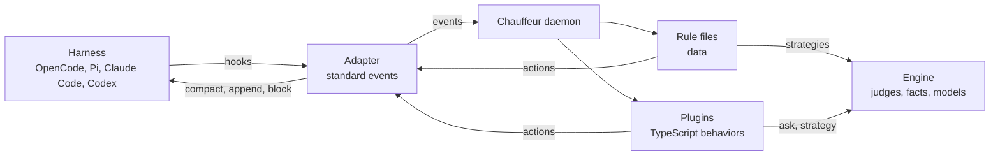
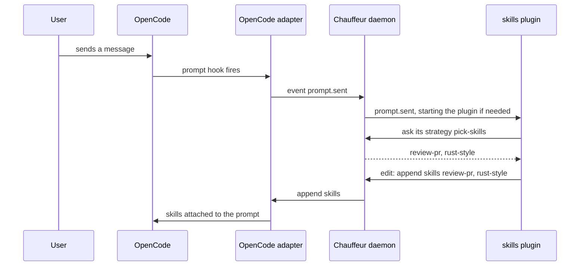

# Chauffeur

Chauffeur judges what your coding agent is doing and steers it. It watches
the harness's events, asks fast and careful judges the right questions, and
acts through the harness: attaching skills, compacting a cold session,
stopping a destructive command or holding back noise.

## How it works



| Part | Job |
|---|---|
| Adapter | Translates one harness: its hooks become standard events, and actions go back to it |
| Daemon | The event bus: loads rules, starts plugins, routes events and actions |
| Rule files | Behavior as data: on this event, ask this, then do that |
| Plugins | Behavior as TypeScript, for anything a rule file can't express |
| Engine | Answers questions: runs strategies over judges, facts and models |
| Callers | Any other program, asking Chauffeur directly through `navigate` |

### One event, end to end

A user sends a message in OpenCode, and the skills plugin attaches the skills
the request needs:



## Features

### Judges

- Four tiers answer the same questions: facts (code), System One (fast
  classifiers), System Two (reasoning models) and a person.
- A named judge picks a tier, optionally a model, and how sure it must be.
- Below its `confidence`, a judge's answer is `unsure`.

```jsonc
"judges": {
  "quick":    { "tier": "system-one", "model": "jev", "confidence": 0.7 },
  "guard":    { "tier": "system-one", "confidence": { "yes": 0.6, "no": 0.95 } },
  "reasoner": { "tier": "system-two", "confidence": 0.6 }
}
```

```text
quick on "Does this commit message break Conventional Commits?"
  "fixed stuff"       yes 0.94 → yes
  "Update parser.rs"  yes 0.58 → unsure
```

### Questions and results

- `noul` (yes or no), `choice` and `score` build questions; `question()`
  builds your own kinds.
- A result is an answer, with its outcome, every outcome's probability and a
  level on the scale, or a failure with its reason. A failure never reads as
  `no`.
- Outcomes are typed from the question that produced them.

```ts
import { ask, choice, judge, score } from "@fdcn/chauffeur/judge"

const quick = judge({ tier: "system-one", confidence: 0.7 })

const next = await ask(choice(["act", "ignore", "ask-user"], "What should the agent do with this message?"), { judge: quick, evidence })
if (next.ok) next.outcome          // "act" | "ignore" | "ask-user" | "unsure"
else next.failed                   // "timeout" | "unavailable" | …

const effort = await ask(score(["low", "medium", "high"], "How hard is this request?"), { judge: quick, evidence })
if (effort.ok && effort.level >= 1) { /* medium or higher */ }
```

### Models

- `models.json` registers models by API format: `systemone` (Jev, SubQ,
  GLiDE), `openai` (including local servers such as Ollama) and `anthropic`.
- Each tier lists its models in fallback order; a missing model falls back
  and the run says so.
- `placeholder` models stand in with recorded or fixed answers, for tests and
  tuning.
- Keys stay inside the engine; rules, plugins and logs never see them.

```jsonc
// ~/.config/chauffeur/models.json
{
  "models": {
    "local-qwen": { "format": "openai", "endpoint": "http://127.0.0.1:11434/v1", "model": "qwen3:4b" },
    "reviewer":   { "format": "anthropic", "model": "claude-sonnet-5-5", "key": { "env": "ANTHROPIC_API_KEY" } }
  },
  "tiers": { "system-one": ["jev", "local-qwen"], "system-two": ["reviewer"] }
}
```

### Facts

- JavaScript modules that answer without a model, run in a QuickJS sandbox
  with memory and time limits.
- Shipped facts: `match`, `select`, `bm25` and `embedding`.
- Your own facts in `~/.config/chauffeur/facts/` can read files, SQLite and
  local services.

```js
// ~/.config/chauffeur/facts/notes.js
import { query } from "chauffeur:sqlite"

export function bm25({ evidence, args }) {
  const rows = query("~/notes/index.db",
    "SELECT id FROM notes WHERE notes MATCH ? ORDER BY bm25(notes) LIMIT ?", [evidence.message, args.top ?? 10])
  return { ranked: rows.map((row) => row.id) }
}
```

```jsonc
{ "id": "related", "judge": "facts", "ask": { "notes.bm25": { "top": 10 } } }
```

### Strategies

- A strategy is a list of steps; each step asks one judge one question.
- `after` makes a step wait for earlier steps and run only when their
  outcomes match.
- `for_each` asks about many candidates in one round, and `select` ranks,
  filters or votes on the answers.
- Every strategy has a known maximum of rounds and model calls, and is proven
  to finish.

Escalate from Jev to GLiDE to a reasoning model, only as far as needed:

```jsonc
"strategy": [
  { "id": "fast",   "judge": "quick",    "ask": "needs-agent" },
  { "id": "slow",   "judge": "careful",  "ask": "needs-agent", "after": [{ "step": "fast", "when": ["unsure", "failed"] }] },
  { "id": "review", "judge": "reasoner", "ask": "needs-agent", "after": [{ "step": "slow", "when": ["unsure", "failed"] }] }
]
```

### Rule files

- JSON that names an event, its judges, its questions, its strategy and what
  to do with the outcome. No code needed.
- Rules come from Chauffeur, integrations, you and your projects.

```jsonc
// .chauffeur/rules/conventional-commits.json
{
  "on": "tool.after",
  "when": { "tools": ["shell"], "input": { "contains": "git commit" } },
  "judges": { "quick": { "tier": "system-one", "confidence": 0.7 } },
  "strategy": [
    { "id": "nonconventional", "judge": "quick",
      "ask": { "outcomes": ["yes", "no"], "evidence": ["tool_call"],
               "instructions": "Does this call create a git commit whose message does not follow Conventional Commits?" } }
  ],
  "then": [{ "if": { "nonconventional": "yes" },
             "message.append": { "parts": [{ "text": "Use Conventional Commits, such as `feat(scope): …`." }], "delivery": "now" } }]
}
```

### Strategy viewer and playground

- `chauffeur strategy show` draws a rule's strategy as a tree, with the models
  it will use and its maximum rounds and calls.
- The playground steps through strategies in the browser.

```text
$ chauffeur strategy show recall
recall                                         on recall
├─ round 1  helps × candidates  system-one → jev
└─ round 2  best               facts select   top 3, min 0.7, from helps
then  attach best
at most 2 rounds · 1 model call · 31 candidates at most
```

### `navigate`

- Any program can send an event with its context and get back intents.
- Available from TypeScript, the `chauffeur navigate` CLI and Rust, all over
  JSON-RPC 2.0.

```ts
import { connect } from "@fdcn/chauffeur/client"

const { intents } = await connect().navigate(
  { on: "recall", evidence: { message }, candidates: { p1: "…", p4: "…" } },
  { signal: AbortSignal.timeout(1_500) },
)
// [{ rule: "recall", attach: ["p4"] }]
```

### Adapters

- One per harness: its hooks become standard events such as `prompt.sent`
  and `tool.before`, and actions are carried out after checking they are
  still current.
- Available for OpenCode, Pi and Claude Code, which run the adapter inside
  the harness, and Codex, which runs `chauffeur hook codex` at each hook.

```json
// Codex: hooks/hooks.json in the Chauffeur plugin
{
  "hooks": {
    "PreToolUse":       [{ "hooks": [{ "type": "command", "command": "chauffeur hook codex" }] }],
    "UserPromptSubmit": [{ "hooks": [{ "type": "command", "command": "chauffeur hook codex" }] }]
  }
}
```

### Plugins

- TypeScript programs that hook events with `ctx.on` (never blocks) or
  `ctx.before` (holds the harness within a budget).
- They act through every control the harness offers, named by resource and
  verb: `session.compact`, `session.update`, `message.append` and more.
- They load when first needed, stop when idle, and restart if they crash.
- Included: skills, context renewal, session warming and a guard against
  irreversible commands.

```ts
import { Plugin } from "@fdcn/chauffeur/plugin"
import { session } from "@fdcn/chauffeur/harness"

export default Plugin.define({
  id: "context-renewal",
  setup(ctx) {
    ctx.on("session.resumed", (e) => {
      if (e.idle_seconds >= e.cache_seconds && e.tokens.used >= e.tokens.window / 2)
        session.compact(e.session, { model: ctx.options.summaryModel })
    })
  },
})
```

### Guards

- A `before` hook can block an action or hand it to you before it happens.
- If the judge is slow or fails, `onTimeout: "ask"` asks you.

```ts
ctx.before("tool.before", async (e) => {
  if (e.tool !== "shell") return
  const harmful = await ask(noul("Could this command cause irreversible harm?"), { judge: guard, evidence: { command: e.input.command } })
  if (!harmful.ok || harmful.outcome !== "no") e.askUser("Chauffeur isn't sure this is safe.")
}, { budget: 2_000, onTimeout: "ask" })
```

### Safety

- The daemon listens only on a Unix socket in a directory only you can open.
  There are no ports and no tokens.
- Evidence is redacted before every model call, and your harness's own
  denials always win.
- A project's code runs only as pure facts, with no access to files or the
  network, and its rules use System Two only where you allow it.

```js
// .chauffeur/facts/touches-migrations.js: a project fact, with no host modules
export default ({ evidence }) =>
  evidence.diff.includes("migrations/") ? { p: { yes: 1, no: 0 } } : { p: { yes: 0, no: 1 } }
```

## Documentation

[`docs/plans/pluggability.md`](docs/plans/pluggability.md) describes the
architecture: judges, facts, strategies, rule files, plugins, adapters and the
`navigate` protocol.

## Develop

The toolchain is pinned in `rust-toolchain.toml`, with Miri and the
WebAssembly target. Local builds use [blaze](https://github.com/indexable-inc/blaze)
and [bacon](https://dystroy.org/bacon/).

```sh
bacon                                           # tests on every save, through blaze; also clippy, doc
cargo blaze test                                # fast local rebuilds; cargo stays the final word
cargo nextest run --workspace
cargo test --doc --workspace
cargo clippy --workspace --all-targets --locked
cargo miri test -p chauffeur-core
cargo kani -p chauffeur-judges                  # harnesses in each crate's src/proofs.rs
cargo mutants -p chauffeur-core                 # the workspace's tests must catch every changed line
cargo shear                                     # no unused dependencies
cargo bench                                     # criterion benchmarks
```

The playground needs Bun and `wasm-pack`:

```sh
cd playground
bun install
bun run dev     # rebuilds Rust on change and reloads the page
bun run check   # release build and type check
```

## License

MIT. See [LICENSE](LICENSE).
