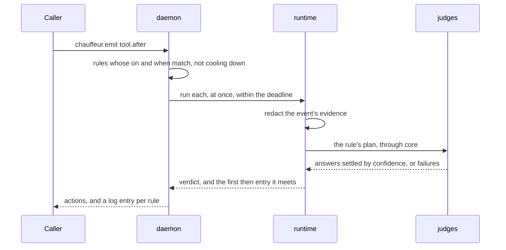

# Crates

The Rust engine. Each crate depends only on the ones below it in this table.

| Crate | Holds |
|---|---|
| `cli` | The `chauffeur` binary: `daemon`, `version`, `emit`, `events`, `status` |
| `daemon` | The private Unix socket, JSON-RPC 2.0 lines, loading and reloading configuration, routing events to rules, cooldowns |
| `runtime` | Running one rule for one event: redaction, a worker thread with a deadline, a bounded log |
| `protocol` | Rule files and their checks, the `when` filter, `then` entries, harness events and their evidence |
| `judges` | Questions, confidence, `models.json`, tiers in fallback order, and the `systemone` and `placeholder` formats |
| `core` | Plans of named steps, judges by name, events and the verdict. No dependencies |

## One event



```sh
echo '{"event":"tool.after","session":"s1","tool":"shell","input":{"command":"git commit -m wip"}}' | chauffeur emit
# → { "actions": [{ "rule": "conventional-commits", "action": "message.append", "payload": { … } }] }
chauffeur events
# → { "runs": [{ "rule": "conventional-commits", "steps": [{ "step": "nonconventional",
#      "answer": { "outcome": "yes", "p": { "yes": 0.93, "no": 0.07 }, "model": "jev", … } }] }] }
```

## Rules for every crate

- No `unwrap`, `expect` or panics outside tests; failures are values.
- A judge's failure is never an answer: it stays `failed`, whatever the confidence.
- Every queue, log, line and connection count has a bound.
- Nothing here embeds shipped content; it loads from `distribution/`.
