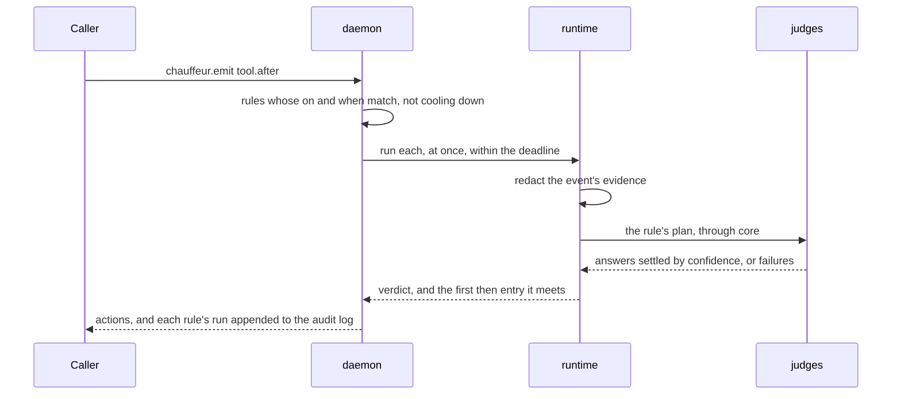
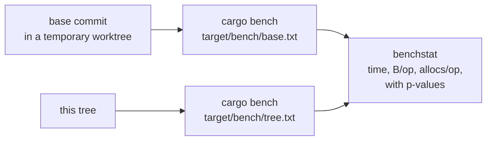

# Crates

The Rust engine. Each crate depends only on the ones below it in this table.

| Crate      | Holds                                                                                                                               |
| ---------- | ----------------------------------------------------------------------------------------------------------------------------------- |
| `cli`      | The `chauffeur` binary: `daemon run`, `daemon status`, `version`, `emit`, `audit`                                                   |
| `daemon`   | The private Unix socket, JSON-RPC 2.0 lines, loading and reloading configuration, routing events to rules, cooldowns, the audit log |
| `runtime`  | Running one rule for one event: redaction, pooled worker threads with a deadline                                                    |
| `protocol` | Rule files and their checks, the `when` filter, `then` entries, harness events and their evidence                                   |
| `judges`   | Questions, confidence, `models.json`, tiers in fallback order, and the `systemone` and `placeholder` formats                        |
| `core`     | Plans of named steps, judges by name, events and the verdict. No dependencies                                                       |

A module with several parts is a folder named after it, one file per
concept, with a `README.md`:

| Folder                                               | Holds                                                                                  |
| ---------------------------------------------------- | -------------------------------------------------------------------------------------- |
| [`core/src/plan/`](core/src/plan/)                   | Plans, steps, outcomes and failures                                                    |
| [`judges/src/question/`](judges/src/question/)       | Questions and their outcomes                                                           |
| [`judges/src/confidence/`](judges/src/confidence/)   | Probabilities and how an answer settles                                                |
| [`judges/src/config/`](judges/src/config/)           | `models.json`                                                                          |
| [`judges/src/placeholder/`](judges/src/placeholder/) | Recorded and fixed answers                                                             |
| [`judges/src/tiers/`](judges/src/tiers/)             | `system_one/`, `system_two/`, `facts/`, `person/`, and fallback across a tier's models |
| [`protocol/src/rule/`](protocol/src/rule/)           | Loading and checking a rule file                                                       |
| [`runtime/src/redact/`](runtime/src/redact/)         | Redacting evidence                                                                     |
| [`runtime/src/run/`](runtime/src/run/)               | Running a rule within a deadline, and the worker pool                                  |
| [`daemon/src/route/`](daemon/src/route/)             | Routing events to rules, cooldowns, the log                                            |

## One event



```sh
echo '{ "event": "tool.after", "session": "s1", "tool": "shell",
        "input": { "command": "git commit -m wip" } }' | chauffeur emit
# → { "actions": [{ "rule": "conventional-commits", "action": "message.append" }] }

chauffeur audit --brief
# → 13:54:43  conventional-commits  s1  nonconventional yes 0.93 jev  312 ms  → …
```

## Benchmarks

Each crate on an event's path has a benchmark binary in `benches/`, built on
[benchfmt.rs](https://github.com/bwplotka/benchfmt.rs). It prints Go's
benchmark format, with the bytes and allocations of each run on the calling
thread, so Go's `benchstat` compares two runs and says which differences are
real. Model calls are left out: a stand-in model answers.

| Crate      | Benchmark                             | Measures                                                          |
| ---------- | ------------------------------------- | ----------------------------------------------------------------- |
| `protocol` | `Parse/output=none`, `64KiB`          | Reading an event, without output and with the adapter's most      |
|            | `Hooks/command=commit`, `ls`          | Whether the commit rule hooks an event                            |
|            | `RuleParse/rule=conventional-commits` | Loading and checking the shipped rule                             |
| `judges`   | `Read/outcomes=2`                     | Reading a reply's probabilities                                   |
|            | `Settle/outcomes=2`, `3`              | Reading and settling them against a bar                           |
| `runtime`  | `Redact/text=command`                 | Redacting a commit command                                        |
|            | `Redact/text=output-64KiB`            | Redacting 64 KiB of build output with paths and hashes            |
|            | `Redact/text=credentials`             | Redacting an environment dump full of tokens                      |
|            | `Run/rule=conventional-commits`       | One rule's run, redaction to verdict, on a pooled worker thread   |
| `daemon`   | `Emit/rule=none`, `nudge`             | `chauffeur.emit` over the socket: no rule, or the nudge and audit |

`Run` and `Emit` work on other threads, so their bytes and allocations are
partly or wholly uncounted; compare their times.

```sh
# Every benchmark, one second each, as Go's testing does by default.
cargo bench --workspace --bench '*'

# Six runs of each, with allocations, compared through benchstat.
node scripts/bench.mjs v2~1
node scripts/bench.mjs v2~1 -- -bench Redact -count 10
```



`node scripts/bench.mjs HEAD -- -bench Redact`, with nothing changed: `~`
marks a difference that is noise, and a real one shows its percentage and
p-value.

```text
                            │    base     │               tree                │
                            │   sec/op    │   sec/op     vs base              │
Redact/text=command-10        433.5n ± 1%   430.5n ± 2%       ~ (p=0.524 n=6)
Redact/text=output-64KiB-10   782.6µ ± 1%   779.4µ ± 1%       ~ (p=0.394 n=6)
Redact/text=credentials-10    93.77µ ± 1%   94.27µ ± 1%       ~ (p=0.394 n=6)
geomean                       31.69µ        31.62µ       -0.19%
```

CI runs each benchmark once, `-benchtime 1x`, so they keep building and
working; shared runners are too noisy to compare times, so comparisons are
made locally.

## Rules for every crate

- No `unwrap`, `expect` or panics outside tests; failures are values.
- A judge's failure is never an answer: it stays `failed`, whatever the confidence.
- Every queue, log, line and connection count has a bound.
- Nothing here embeds shipped content; it loads from `distribution/`.
