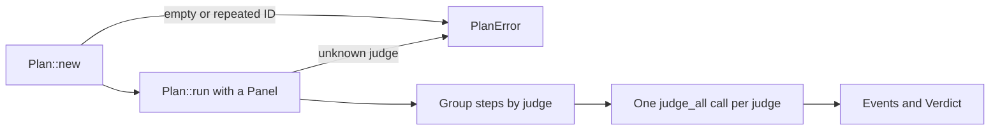

# `plan`

A plan is an ordered list of named steps. Each step asks one question of
one judge. Running a plan asks every judge once and returns the events and
the verdict. Core knows nothing of models: a judge is anything that turns a
request into an `Outcome`.

| File | Holds |
|---|---|
| `mod.rs` | `Plan`: checks steps when it is built, then `run` asks each judge its share in one `judge_all` call |
| `step.rs` | `Step`: an ID, the judge's name, and the request |
| `outcome.rs` | `Outcome`, a value or a `Failure`, and the five failures with their wire names |
| `error.rs` | `PlanError`: an empty plan, a repeated step ID, or a judge the panel lacks |



```rust
use chauffeur_core::{Outcome, Panel, Plan, Step};

let plan = Plan::new([Step::new("commit", "system-one", "Is this message conventional?")])?;
let yes = |_: &&str| Outcome::Value("yes");
let run = plan.run(&Panel::new().with("system-one", &yes))?;
assert_eq!(run.verdict.get("commit"), Some(&Outcome::Value("yes")));
```

- A judge that returns the wrong number of outcomes settles each of its
  steps as `Failed(Invalid)`, never as an answer.
- `Failure::falls_back` says whether a tier's next model should answer in
  its place: unavailable, rate-limited or timed out.
