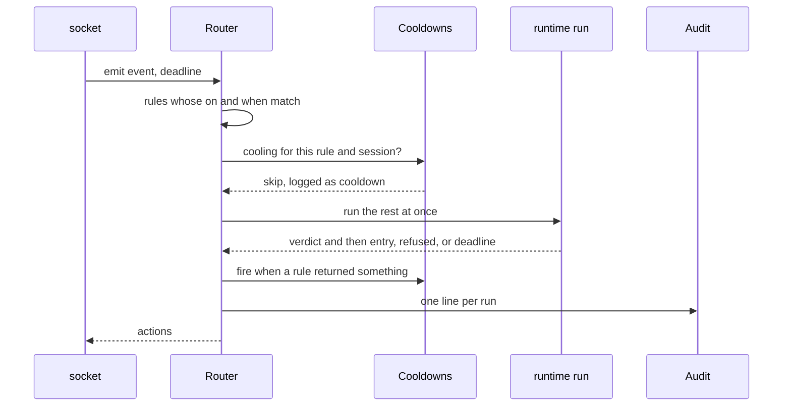

# `route`

Sends an event to every rule that hooks it, runs them at once, and appends
what each did to the audit log.

| File           | Holds                                                                                       |
| -------------- | ------------------------------------------------------------------------------------------- |
| `mod.rs`       | `Router`: the loaded configuration, `emit`, and `replace` on reload                         |
| `cooldown.rs`  | `Cooldowns`: when each rule last returned something in each session, bounded to 4,096 pairs |
| `log_entry.rs` | Each step's answer or failure as JSON, for the audit log                                    |



```rust
use std::time::Duration;

use chauffeur_daemon::audit::{Audit, MAX_BYTES};

let router = Router::new(loaded, Audit::new(&paths.state, MAX_BYTES));
let actions = router.emit(&event, Duration::from_millis(1500));
```

- A run whose line cannot be written still returns its action, and the
  daemon says so on stderr.
- Past 4,096 rule and session pairs, the oldest cooldown is forgotten.
  Cooldowns start afresh with each daemon.
- A reload swaps the configuration whole; a run in progress keeps the one
  it started with.
