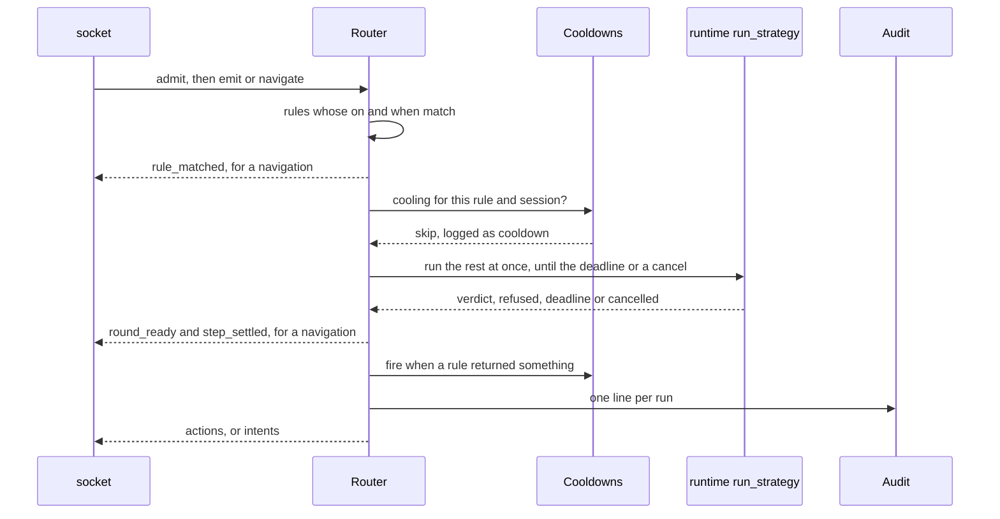

# `route`

Sends an event, or a navigation, to every rule that hooks it, runs them at
once, and appends what each did to the audit log. An inline strategy runs on
its own and returns its verdict.

| File           | Holds                                                                                          |
| -------------- | ---------------------------------------------------------------------------------------------- |
| `mod.rs`       | `Router`: the loaded configuration, admission, `emit`, `replace` on reload, and one rule's run |
| `navigate.rs`  | `Router::navigate`: intents from every hooked rule, or an inline strategy's verdict            |
| `cooldown.rs`  | `Cooldowns`: when each rule last returned something in each session, bounded to 4,096 pairs    |
| `log_entry.rs` | How a run ended, and each step's answer or failure, as JSON for the audit log                  |



```rust
use std::time::Duration;

use chauffeur_daemon::audit::{Audit, MAX_BYTES};

let router = Router::new(loaded, Audit::new(&paths.state, MAX_BYTES));

let permit = router.admit(Source::Harness)?;
let actions = router.emit(&event, Duration::from_millis(1500), &Cancel::new());

let permit = router.admit(Source::Integration)?;
let intents = router.navigate(request, &cancel, &|event| send(event))?;
```

- A run whose line cannot be written still returns its action, and the
  daemon says so on stderr.
- A rule that misses the deadline, or fails, returns nothing; the other
  rules' intents still return.
- A navigation streams at most 4,096 events; its intents always return.
- Past 4,096 rule and session pairs, the oldest cooldown is forgotten.
  Cooldowns start afresh with each daemon.
- A reload swaps the configuration whole; a run in progress keeps the one
  it started with.
