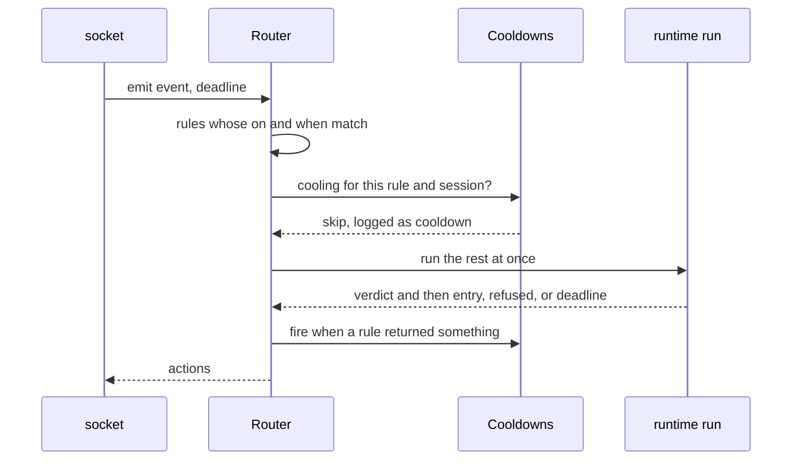

# `route`

Sends an event to every rule that hooks it, runs them at once, and keeps a
bounded log of what each did.

| File | Holds |
|---|---|
| `mod.rs` | `Router`: the loaded configuration, `emit`, `events` and `replace` on reload |
| `cooldown.rs` | `Cooldowns`: when each rule last returned something in each session, bounded to 4,096 pairs |
| `log_entry.rs` | Each step's answer or failure as JSON, for `chauffeur.events` |



```rust
use std::time::Duration;

let router = Router::new(loaded);
let actions = router.emit(&event, Duration::from_millis(1500));
let log = router.events(); // { "runs": [...], "dropped": 0 }
```

- The log keeps the last 256 runs and counts the ones it dropped.
- Past 4,096 rule and session pairs, the oldest cooldown is forgotten.
- A reload swaps the configuration whole; a run in progress keeps the one
  it started with.
