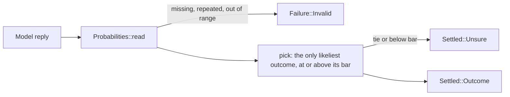

# `confidence`

Turns a judge's probabilities into one outcome or `unsure`. Probabilities
are kept in thousandths, so every comparison is exact. A Kani proof in
`../proofs.rs` checks `pick` for every probability and bar.

| File | Holds |
|---|---|
| `mod.rs` | `Confidence` (likeliest, one bar, or a bar per outcome), its check against a question's outcomes, and `pick` |
| `milli.rs` | `Milli`: a probability from 0 to 1000 thousandths |
| `probabilities.rs` | `Probabilities::read`: exactly one probability per outcome, not all zero, and `level` |
| `answer.rs` | `Answer::settle`, `Settled` (an outcome or `Unsure`) and `AnsweredBy` |
| `error.rs` | `ConfidenceError`: a per-outcome confidence that misses or invents an outcome |



```rust
use chauffeur_judges::{Answer, AnsweredBy, Confidence, Milli, Probabilities, Question, Settled};

let question = Question::noul("Does this commit message break Conventional Commits?", ["commit"])?;
let p = Probabilities::read(question.outcomes(), [("yes", 0.94), ("no", 0.06)])?;
let bar = Confidence::Bar(Milli::new(700).ok_or("bar")?);
let by = AnsweredBy { model: "jev".into(), placeholder: false };
assert_eq!(Answer::settle(&question, p, &bar, by).outcome(), &Settled::Outcome("yes".into()));
```

- A tie between the likeliest outcomes is always `unsure`.
- A failure never reaches this module: only answers are settled.
