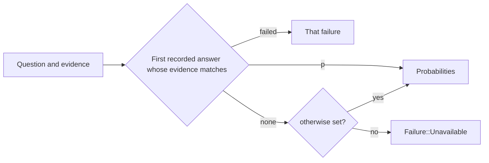

# `placeholder`

A format that stands in for a real model, for tests, the playground and
tiers whose formats do not exist yet. Every answer it gives is marked
`placeholder: true`.

| File | Holds |
|---|---|
| `mod.rs` | `Placeholder`: loads an entry and answers as a `Format` |
| `entry.rs` | `PlaceholderEntry`: an optional answers file and an optional `otherwise` |
| `answers.rs` | Reads the answers file; each recorded answer gives exactly one of `p` and `failed` |



```json
{
  "answers": [
    { "evidence": { "tool_call": "git commit -m 'fixed stuff'" }, "p": { "yes": 0.93, "no": 0.07 } },
    { "evidence": { "tool_call": "git commit -m 'slow'" }, "failed": "timeout" }
  ]
}
```

- A recorded answer matches when the question sees every block it lists,
  with the same content.
- With no match and no `otherwise`, the question fails as unavailable, so a
  gap in the recording shows instead of passing as an answer.
