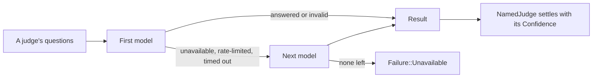

# `tiers`

The four kinds of judge a step can name, and how a tier's models answer as
one core `Judge`. Each tier's folder holds the API formats that tier uses.

| Path | Holds |
|---|---|
| `mod.rs` | `Tier`: `facts`, `system-one`, `system-two`, `person` |
| `fallback.rs` | `Fallback`: a tier's models in order, built from `models.json` and the keys found. The next model answers only what the one before could not |
| `judge.rs` | `NamedJudge`: a `Fallback`, a `Confidence` and the run's evidence, as a core `Judge` |
| `system_one/` | Fast classifiers. The `systemone` format: `mod.rs` holds `SystemOneEntry`, `client.rs` the HTTP client, `wire.rs` the request and reply shapes |
| `system_two/` | Reasoning models. The `openai` and `anthropic` formats arrive with slice 11; for now the folder holds only its README |
| `facts/` | JavaScript facts, with no model. The `facts` format arrives with slice 4; for now the folder holds only its README |
| `person/` | The user, through the harness. The `person` format arrives with slice 5; for now the folder holds only its README |

Until a tier has its own format, only a placeholder listed under that tier
in `models.json` answers its steps. With none, they fail as unavailable.



```rust
use chauffeur_core::Panel;
use chauffeur_judges::{Fallback, NamedJudge, Tier};

let models = Fallback::build(&loaded, Tier::SystemOne, None, |env| std::env::var(env).ok())?;
let judge = NamedJudge::new(&models, &confidence, &evidence);
let run = plan.run(&Panel::new().with("quick", &judge))?;
```

- A model whose key is missing is left out, so a shipped model starts
  answering once its key is set.
- An invalid reply does not fall back: the model answered badly, and asking
  another would hide it.
- Without the `systemone` feature, as in the browser build, `systemone`
  models are left out as if their key were missing.
