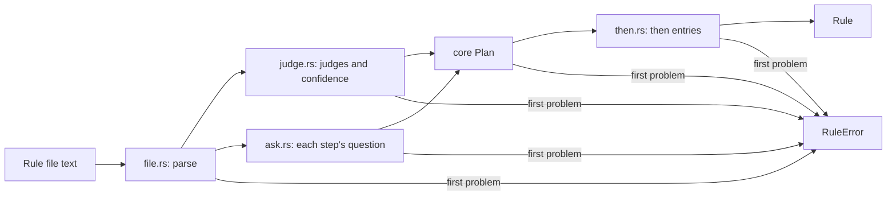

# `rule`

Loads one rule file and checks it, so a bad rule is refused when it loads,
with its ID and the reason, and never fails while running.

| File | Holds |
|---|---|
| `mod.rs` | `Rule::parse`, then `hooks` (its `on` and `when` match an event) and the loaded parts |
| `file.rs` | The rule file as written, before any check |
| `judge.rs` | `JudgeSpec` (tier, model, confidence) from `judges`, or a tier named directly |
| `ask.rs` | A step's question, inline or named in `asks` |
| `then.rs` | A `then` entry: its `if` names real steps and outcomes, with exactly one action or intent |
| `error.rs` | `RuleError`, one variant per check, each naming the rule |



```rust
use chauffeur_protocol::Rule;

let rule = Rule::parse("conventional-commits", &std::fs::read_to_string(path)?)?;
for (name, spec) in rule.judges() {
    println!("{name}: {:?}", spec.tier);
}
```

- A step may name a tier, such as `system-one`, without declaring it in
  `judges`; it then settles on the likeliest outcome.
- A per-outcome confidence must cover exactly the step's outcomes.
