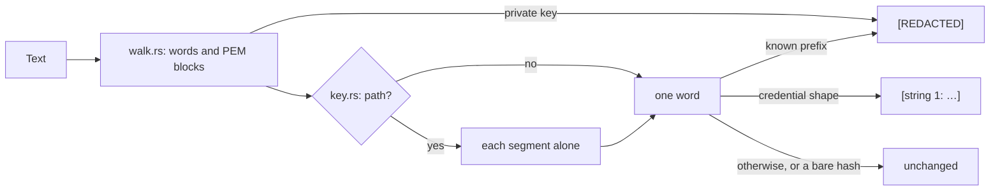

# `redact`

Redacts evidence before any of it reaches a model. Known credential formats
and private-key blocks become `[REDACTED]`. Other credential-like strings
become a numbered description of their shape, never their value. Paths,
links and bare hashes stay readable.

| File | Holds |
|---|---|
| `mod.rs` | `Redactor` (from configuration, then `redact`), `Masking` (numbers each value once per navigation) and `REDACTED` |
| `config.rs` | `RedactionConfig` and `Prefix` from `redaction.json`, and `RedactError` |
| `walk.rs` | Walks text word by word, cutting out PEM private-key blocks |
| `key.rs` | The key a value follows, such as `api_key=` or `Bearer`, and whether a word is a path |
| `shape.rs` | Whether a word looks like a credential, and the description that replaces it |



```rust
use chauffeur_runtime::{Masking, Redactor};

let redactor = Redactor::load(&[shipped, user])?;
let mut masking = Masking::default();
let sent = redactor.redact("export TOKEN=ghp_…", &mut masking);
// "export TOKEN=[REDACTED]"
```

| Input | Sent |
|---|---|
| `ghp_` followed by 20 or more token characters | `[REDACTED]` |
| `api_key=` followed by 32 mixed letters and digits | `api_key=[string 1: 32 characters of mixed letters and digits, after "api_key="]` |
| `a1fb42e9bc3e425dc5f28dd1948966f7f0390169` | unchanged: a bare hash |
| `~/Projects/acme-web/src` | unchanged: a path |

- Later configuration files add prefixes, or replace them with `replace`.
- Longer prefixes are tried first, so `sk-ant-` wins over `sk-`.
