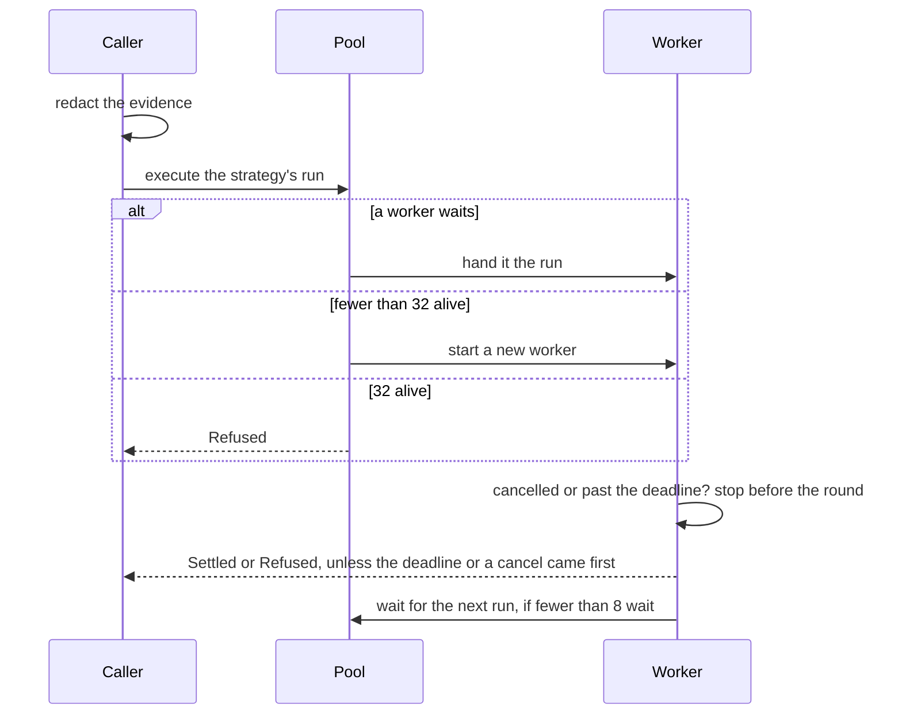

# `run`

Runs one strategy: a rule's for an event, or a navigation's inline one. The
evidence is redacted on the calling thread, then the judges are asked on a
worker thread, and the caller waits for the result until its deadline or its
cancellation.

| File      | Holds                                                                                 |
| --------- | ------------------------------------------------------------------------------------- |
| `mod.rs`  | `run`, `run_strategy`, `Context` (models, redactor, keys) and `Ran` (how a run ended) |
| `wait.rs` | `within`: a job on a worker, waited for until done, its deadline or `Cancel`          |
| `pool.rs` | `Pool`: worker threads kept between runs, at most `max` alive, and `Job`, the work    |
| `log.rs`  | `EventLog`: a navigation's events, at most `MAX_EVENTS`, counting the ones past it    |



Starting a thread for every run took about a tenth of a rule's run, so
workers are kept. A run that outlives its deadline keeps its worker busy
until its models time out; the next run takes another worker, or starts one,
so it is never held up. At most 8 workers wait between runs, enough for
every rule one event hooks to start at once, and at most 32 are alive, twice
the daemon's capacity, so late runs cannot start threads without end.

```rust
use chauffeur_runtime::{Cancel, Ran, run_strategy};

let cancel = Cancel::new();
let ran = run_strategy(&context, &rule, &evidence, deadline, &cancel);

match ran {
    Ran::Settled(run) => { /* the verdict; ran.then(&rule) is what it returns */ }
    Ran::Refused(reason) => { /* the strategy could not run */ }
    Ran::Deadline | Ran::Cancelled => { /* a late result is dropped */ }
}
```

`Pool` and `within` work for any job:

```rust
use chauffeur_runtime::{Cancel, Pool, Waited, within};

let pool = Pool::new(2, 4);

let waited = within(&pool, deadline, &Cancel::new(), |_, _| 42);
assert_eq!(waited, Waited::Done(42));
```
