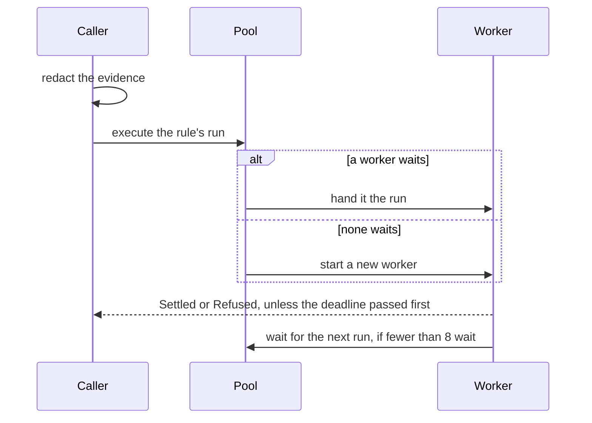

# `run`

Runs one rule for one event. The evidence is redacted on the calling thread,
then the rule's judges are asked on a worker thread, and the caller waits
for the result until its deadline.

| File      | Holds                                                                    |
| --------- | ------------------------------------------------------------------------ |
| `mod.rs`  | `run`, `Context` (models, redactor, keys) and `Ran` (how a run ended)    |
| `pool.rs` | `Pool`: worker threads kept between runs, and `Job`, the work handed one |



Starting a thread for every run took about a tenth of a rule's run, so
workers are kept. A run that outlives its deadline keeps its worker busy
until its models time out; the next run takes another worker, or starts one,
so it is never held up. At most 8 workers wait between runs, enough for
every rule one event hooks to start at once; the rest end.

```rust
use chauffeur_runtime::{Ran, run};

let ran = run(&context, &rule, &event, Duration::from_secs(2));

match ran {
    Ran::Settled { run, then } => { /* the verdict, and what the rule returns */ }
    Ran::Refused(reason) => { /* the rule could not run */ }
    Ran::Deadline => { /* too slow; a late result is dropped */ }
}
```

`Pool` works for any job:

```rust
use chauffeur_runtime::Pool;

let pool = Pool::new(2);

pool.execute(Box::new(|| println!("on a worker")))?;
pool.waiting(); // 1, once the job is done
```
