# State machines audit

## Scope and baseline

Audited commit: `e169208` on `v2`, released as `chauffeur-next` `1.0.0-rc.3`.
The scope is the daemon, runtime, judges, CLI and the OpenCode adapter. This
page lists every state machine in that code, the ones written as types and
the ones held in flags, maps, files and sockets. For each it gives the states,
what must always hold, and how it moves between states. It also gives every
state or move the code could reach that it should not.

A finding counts as confirmed only when it was reproduced twice: through the
real path where it shows, and as a test that failed before its fix. The real
paths are the release daemon, the release CLI, and OpenCode 2.2.5 with the
shipped adapter. Each confirmed finding has an issue and is fixed on `v2`.
What was seen but not reproduced, or not worth a change yet, is listed with
why.

| Check, at `e2b169d`                                                             | Result                                                                  |
| ------------------------------------------------------------------------------- | ----------------------------------------------------------------------- |
| `cargo fmt --all -- --check`                                                    | Pass                                                                    |
| `cargo clippy --workspace --all-targets --all-features --locked -- -D warnings` | Pass                                                                    |
| `cargo nextest run --workspace --locked`                                        | 89 passed                                                               |
| `cargo test --doc --workspace --locked`                                         | Pass                                                                    |
| `bun run check` in `adapters/opencode`                                          | 26 passed; types and build pass                                         |
| `node --test scripts/*.test.mjs`                                                | 8 passed                                                                |
| `node scripts/smoke.mjs` on a packaged tarball                                  | Pass, as `chauffeur` and as `chauffeur-next`                            |
| `cargo mutants` over every file the fixes changed                               | Every viable mutant caught or timed out; one equivalent mutant excluded |

## Findings

In order of impact. Each links the machine it breaks.

| #   | Severity | Machine                                  | What could happen                                                    | Issue                                                  | Fixed in  |
| --- | -------- | ---------------------------------------- | -------------------------------------------------------------------- | ------------------------------------------------------ | --------- |
| S1  | High     | [A request](#a-request-from-the-adapter) | OpenCode waits forever on a tool call when the daemon hangs up       | [#1](https://github.com/StevenJPx2/chauffeur/issues/1) | `4a005a0` |
| S2  | High     | [A rule file](#a-rule-file)              | A rule saved halfway through an edit stops running                   | [#2](https://github.com/StevenJPx2/chauffeur/issues/2) | `102d5ae` |
| S3  | High     | [A rule file](#a-rule-file)              | A folder linked back to `rules/` loads one rule 512 times            | [#2](https://github.com/StevenJPx2/chauffeur/issues/2) | `c5991be` |
| S4  | Medium   | [Cooldowns](#a-cooldown)                 | Events at once in one session each return the action                 | [#3](https://github.com/StevenJPx2/chauffeur/issues/3) | `83e697e` |
| S5  | Low      | [Following the log](#following-the-log)  | `audit --follow` skips runs written while it starts                  | [#4](https://github.com/StevenJPx2/chauffeur/issues/4) | `4c8eebb` |
| S6  | Low      | [The audit log](#the-audit-log)          | Times change width, so they do not sort, and a test fails 1 run in 8 | [#4](https://github.com/StevenJPx2/chauffeur/issues/4) | `527b26d` |

`e2b169d` adds the tests mutation testing asked for after the fixes.

### S1. High: OpenCode waited forever when the daemon hung up

`emit` in `adapters/opencode/src/daemon.ts` settled on a reply, a socket error
or its idle timeout. A daemon that closes the connection cleanly raises none of
them, and closing clears the timeout, so the promise never settled and the
`execute.after` hook never returned. The daemon closes without answering when
it stops or restarts mid-request, and when it already serves 64 connections:
`serve` accepted the 65th and dropped it.

- Against a socket that reads the request and closes, `emit` was still
  pending after 5 seconds, in Bun and in Node.
- Through the adapter's hook, with the release daemon killed 1 second into a
  2-second judge call, the hook was still pending after 10 seconds. The same
  setup without the kill returned in 2,011 ms.
- In OpenCode 2.2.5 with the shipped rc.3 adapter, asked to commit: against a
  stand-in daemon that hangs up, the commit landed and the turn never ended,
  until it was killed at 60 seconds. Against one that answers
  `{ "actions": [] }`, the same run finished in 4 seconds.

Now `emit` rejects as soon as the connection closes unanswered, so the call
goes on and the log says why. The daemon tells a 65th connection it is busy,
with error `-32000`, and the `deadline_ms` option stays within the daemon's 30
seconds.

Tests: `emit fails at once when the daemon hangs up without answering`, `a
daemon that stops mid-request lets the call finish, and the log says so`, `the
deadline option stays within what the daemon allows`, and
`past_the_connection_limit_a_caller_is_told_so_and_served_once_one_closes`.

### S2. High: a rule whose file broke during an edit stopped running

`state::load` built the rules from the files alone. A file that stopped
loading was refused, and its rule was not in the new set; when the user's file
overrode a shipped rule, the shipped one came back in its place. An editor that
saves halfway through an edit is enough, and the daemon's own page promised
that a change that does not load keeps what was loaded.

Now each loaded set keeps the rule each file holds, and a refused file keeps
the one it loaded last; `daemon status` lists it with "the version loaded
before still runs". A removed file still takes its rule with it.

Test: `a_rule_edited_into_one_that_does_not_load_keeps_running_as_it_was`.

### S3. High: a folder linked back to `rules/` loaded a rule hundreds of times

`json_files_below` followed links and remembered no folder. Two links back to
`rules/` loaded one rule 512 times, as `mine`, `a/mine`, `a/b/mine` and so
on, and every copy fired. With no rule file in the folder, the walk ended only
when paths grew too long, which takes exponential time, so the daemon never
finished loading.

Now each real folder is read once, by the first path in name order, and at
most 256 folders are read from each source.

Tests: `a_rule_folder_that_links_back_to_itself_loads_each_rule_once` and
`rules_are_read_from_at_most_256_folders`.

### S4. Medium: events at once in one session each returned the action

`Router::run_one` checked the cooldown, asked the judges, which takes hundreds
of milliseconds, and then recorded the cooldown. Events for one rule and
session that arrived while one was being judged all passed the check, and each
returned the action. OpenCode runs tool calls in parallel, and Code Mode can
run several commits with `Promise.all`. Four commits at once, against a judge
that answers in 300 ms, returned four nudges.

Now every run is still judged, and `try_fire` decides under one lock which run
returns its action: the first to settle. The others are logged as cooling
down.

Test: `events_at_once_in_one_session_return_the_action_once_per_cooldown`.

### S5. Low: `audit --follow` skipped runs written while it started

`chauffeur audit N --follow` read the recent runs, then opened the log again
at its end. A run written between the two was never shown. The release CLI,
against a log a shell loop appended numbered lines to, printed 3130 to 3132 as
the recent lines and then went on from 3145.

Now `follow` takes the count and reads the recent runs and the new ones
through one open file. A line still being written waits until it ends. Three
takes of the same reproduction showed every line.

Tests: `following_starts_with_the_recent_runs_and_misses_none_written_meanwhile`,
`a_line_still_being_written_when_following_starts_comes_once_whole`,
`following_starts_with_the_last_runs_across_both_files` and
`a_log_moved_aside_as_following_starts_is_read_once`.

### S6. Low: audit times changed width

`at` was written with jiff's default, which drops the fraction's trailing
zeros: `…46.0365464Z` one run, `…46.03654Z` the next. Times did not sort as
text, and `a_log_at_exactly_its_bound_stays_and_a_line_over_it_still_starts_one`
failed in 4 of 30 runs on the audited commit. Now `at` is always to the
microsecond; the test passed 60 runs in a row.

### Seen, not fixed

| #   | What                                                                                                                            | Reached                                                                                                           | Why it stays for now                                                                                 |
| --- | ------------------------------------------------------------------------------------------------------------------------------- | ----------------------------------------------------------------------------------------------------------------- | ---------------------------------------------------------------------------------------------------- |
| O1  | A cooldown starts when the daemon returns an action, even when the adapter has stopped waiting or OpenCode refuses the message. | Only when delivery fails; the adapter logs it.                                                                    | The daemon learns nothing about delivery; reporting it back is a protocol change.                    |
| O2  | A run past its deadline keeps its worker until its models' timeouts end, and new runs start new threads with no cap.            | Each late job ends within its tier's timeouts, 3 seconds a model by default; 64 connections limit how many start. | Bounded in practice. Slice 3 ends each step 1 second before the caller's deadline.                   |
| O4  | Accept errors are skipped in a loop, so one that persists, such as running out of file descriptors, would spin a core.          | Not reproduced: 64 connections leave descriptors to spare.                                                        | Nothing to reproduce; tracked in [#10](https://github.com/StevenJPx2/chauffeur/issues/10).           |
| O5  | A poisoned lock turns cooldowns off and makes `emit` return nothing.                                                            | Unreachable: nothing done under these locks can panic.                                                            | Nothing to reproduce.                                                                                |
| O6  | Events with no session share one cooldown, under the session `""`.                                                              | Only through `chauffeur emit` without `session`; the adapter always sends one.                                    | No caller depends on it.                                                                             |
| O7  | An idle connection holds its slot with no time limit.                                                                           | Only a client that connects and stays silent; the adapter and the CLI close theirs.                               | Programs that keep a connection open are planned with `connect()` in slice 2; a limit belongs there. |
| O8  | A deadline is never a step's `failed`, so a `then` entry for `failed` does not run on a deadline.                               | Yes: a late run returns nothing.                                                                                  | Slice 3 ends steps before the deadline, so they fail as `deadline` in time.                          |
| O9  | Two daemons sharing one state folder can interleave moving the log aside.                                                       | Only with two sockets set by `CHAUFFEUR_SOCKET` and one `XDG_STATE_HOME`.                                         | One daemon per installation is the supported setup.                                                  |
| O10 | The reload thread failing to start is reported as a socket error.                                                               | Only when no thread can start.                                                                                    | Wording only; tracked in [#11](https://github.com/StevenJPx2/chauffeur/issues/11).                   |

## The machines

Each machine below has its states, what always holds (its invariants), and a
table of how it moves. A move that S1 to S6 made impossible is noted where it
was.

### The daemon process

Files: `crates/daemon/src/lib.rs`, `socket.rs`, `paths.rs`,
`crates/cli/src/main.rs`

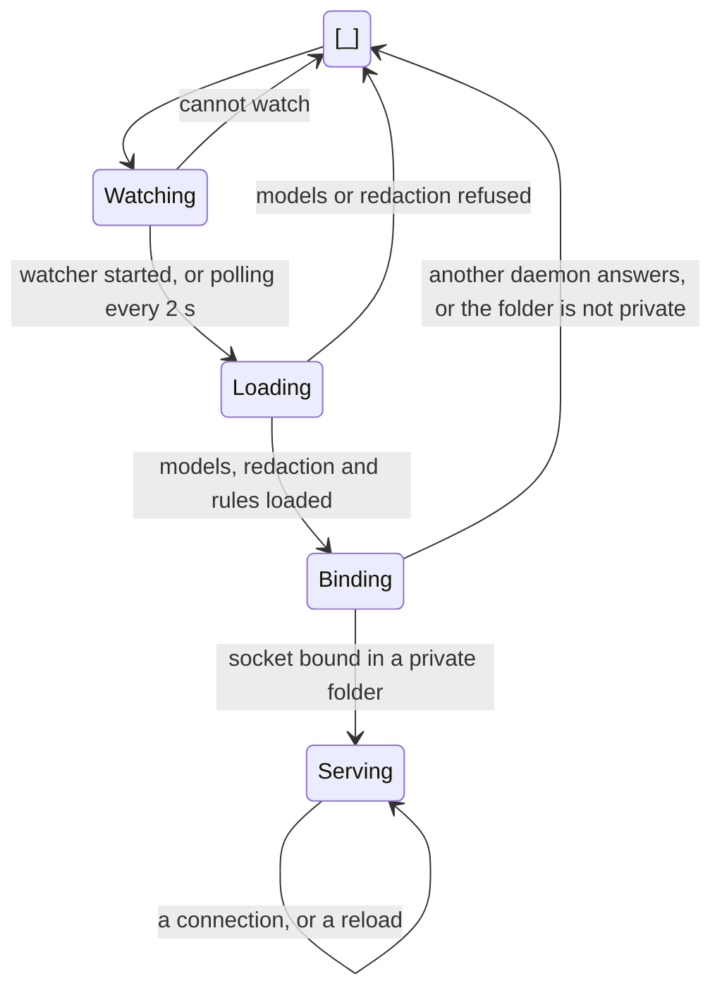

- **Invariants**
  - One daemon per socket: a socket another daemon answers on is left alone,
    and a stale one is replaced.
  - Watching starts before the first load, so a change made while it starts
    still reloads.
  - Serving has no end of its own: the listener's connections never run out
    (O4).

| From     | On                                   | To      | Then                                  |
| -------- | ------------------------------------ | ------- | ------------------------------------- |
| Watching | the platform's watcher starts        | Loading | changes arrive as they happen         |
| Watching | the platform refuses                 | Loading | configuration is checked every 2 s    |
| Loading  | models or redaction do not load      | exit    | the error names the file              |
| Binding  | another daemon answers on the socket | exit 0  | the CLI says one is already running   |
| Binding  | the folder is open to others         | exit    | the error says it must have mode 0700 |
| Binding  | bound                                | Serving | the reload thread starts              |

### The loaded configuration

Files: `crates/daemon/src/lib.rs` (`reload`), `state.rs`, `route/mod.rs`

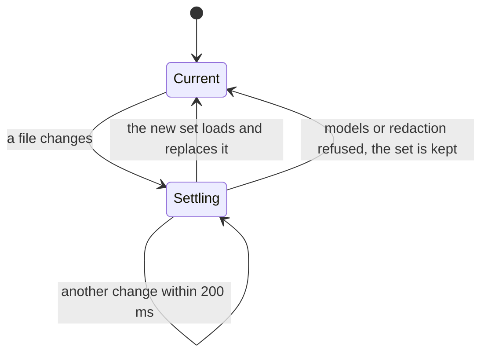

- **Invariants**
  - Each event runs against one set: `emit` takes the current set once.
  - One reload at a time, on its own thread, in the order changes come; a
    change made during a load loads again.
  - A change that does not load keeps what was loaded, for the whole set and
    for each rule file (S2).

| From     | On                                 | To       | Then                                                        |
| -------- | ---------------------------------- | -------- | ----------------------------------------------------------- |
| Current  | a file under either folder changes | Settling |                                                             |
| Settling | 200 ms with no change              | Current  | load, with the current set as the previous one              |
| Settling | models or redaction do not load    | Current  | the current set stays, and the error goes to standard error |

### A rule file

Files: `crates/daemon/src/state.rs`

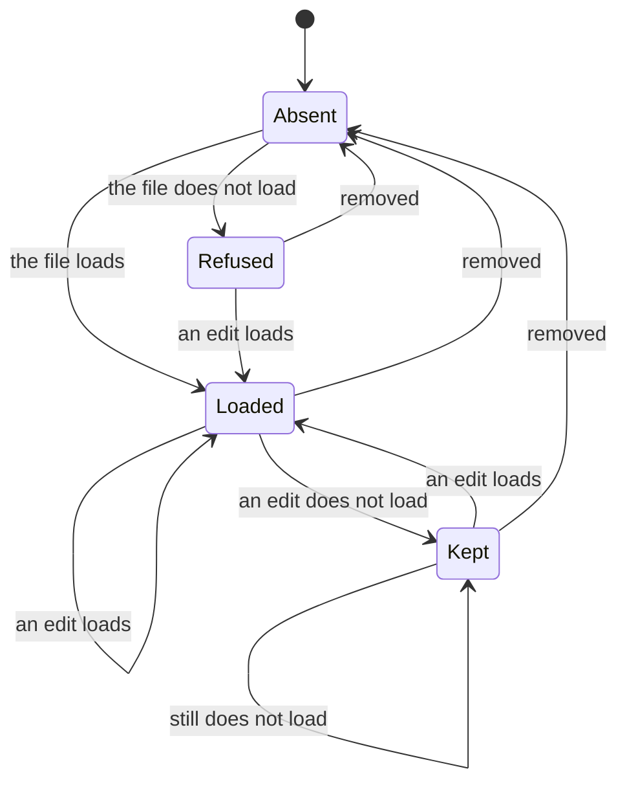

- **States**
  - **Loaded**: its rule runs.
  - **Kept**: the rule it loaded last runs, and `daemon status` lists the file
    as refused, with "the version loaded before still runs".
  - **Refused**: nothing runs from it, and `daemon status` says why.
- **Invariants**
  - One rule per ID. An ID is the file's path under `rules/` without
    `.json`, and the user's rule replaces a shipped one with the same ID.
  - A rule that loaded keeps running until its file loads again or is removed.
    Before S2, Loaded went straight to Refused, and the shipped rule it
    overrode came back.
  - Each real folder is read once, at most 256 folders and 512 files from each
    of the shipped and the user's `rules/`. Before S3, a link back to a folder
    above loaded its rules again under longer IDs.
  - Kept lasts only while the daemon runs: one that starts with a broken file
    has no earlier version, so the file is Refused and a shipped rule with
    its ID runs.

| From    | On                         | To     | Then                                          |
| ------- | -------------------------- | ------ | --------------------------------------------- |
| Absent  | a file that loads appears  | Loaded | replaces any rule with its ID                 |
| Loaded  | an edit that does not load | Kept   | the last version runs; listed as refused      |
| Kept    | an edit that loads         | Loaded | the new version runs; no longer refused       |
| Refused | an edit that loads         | Loaded |                                               |
| any     | the file is removed        | Absent | its rule goes; a shipped one with its ID runs |

### A connection

Files: `crates/daemon/src/socket.rs`, `rpc.rs`

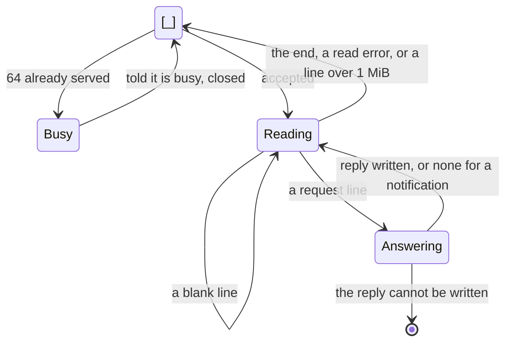

- **Invariants**
  - At most 64 connections are served at once. Before S1 a 65th was closed
    with no word, which a caller could not tell from a daemon that stopped.
  - A request with an `id` gets one reply line, written in one write.
  - A connection frees its slot however it ends, a panic included. An idle
    one holds its slot with no time limit (O7).

| From      | On                                 | To        | Then                                       |
| --------- | ---------------------------------- | --------- | ------------------------------------------ |
| accepted  | 64 already served                  | closed    | error `-32000`: the daemon is busy         |
| Reading   | a line over 1 MiB                  | closed    | error `-32600`                             |
| Reading   | a line                             | Answering | parse error, invalid request or the method |
| Answering | a reply written                    | Reading   |                                            |
| Reading   | the caller closes, or a read fails | closed    |                                            |

### A request from the adapter

Files: `adapters/opencode/src/daemon.ts`, `index.ts`

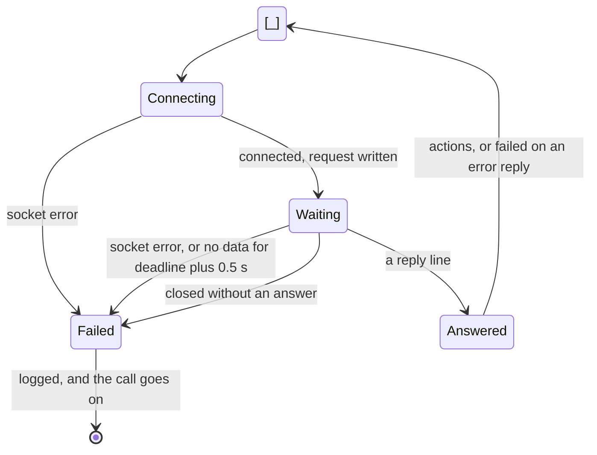

- **Invariants**
  - Every request settles: at once when the connection closes, and otherwise
    within the deadline and half a second after the last data. Before S1 a
    connection closed without an answer left it waiting forever, and OpenCode
    with it.
  - A failure never holds up the tool call or changes its result. Each kind
    of trouble is logged at most once a minute.
  - The deadline is `deadline_ms` when it is a number from 0 to 30,000, at
    most the daemon's limit, and 3,000 otherwise.

| From       | On                                  | To       | Then                                      |
| ---------- | ----------------------------------- | -------- | ----------------------------------------- |
| Connecting | connected                           | Waiting  | the request goes out as one line          |
| Waiting    | a line                              | Answered | the connection is ended                   |
| Waiting    | closed with no line                 | Failed   | "closed the connection without answering" |
| Waiting    | no data for the deadline plus 0.5 s | Failed   | the connection is destroyed               |
| Answered   | an `error` reply, or no `actions`   | Failed   |                                           |

### The adapter's hook

Files: `adapters/opencode/src/index.ts`, `act.ts`, `event.ts`, `log.ts`

A completed tool call becomes a `tool.after` event, then a request, then one
message for each `message.append` returned, sent in order. A failed call sends
nothing. Any other action is skipped and logged.

| `delivery` | OpenCode's `session.synthetic` | When the agent reads it                     |
| ---------- | ------------------------------ | ------------------------------------------- |
| `now`      | `delivery: "steer"`            | at the running turn's next step             |
| `next`     | `delivery: "queue"`            | at the next turn                            |
| `wake`     | `delivery: "queue"`, `resume`  | at the next turn, started now if it is idle |

- **Invariants**
  - The tool's result is never changed.
  - A message OpenCode refuses is logged, and the rest are still sent.
  - Logging holds one state per kind of trouble: quiet, or logged at a time.
    A line within a minute of the last of its kind is dropped.

### A rule's run for one event

Files: `crates/daemon/src/route/mod.rs`, `crates/runtime/src/run/mod.rs`

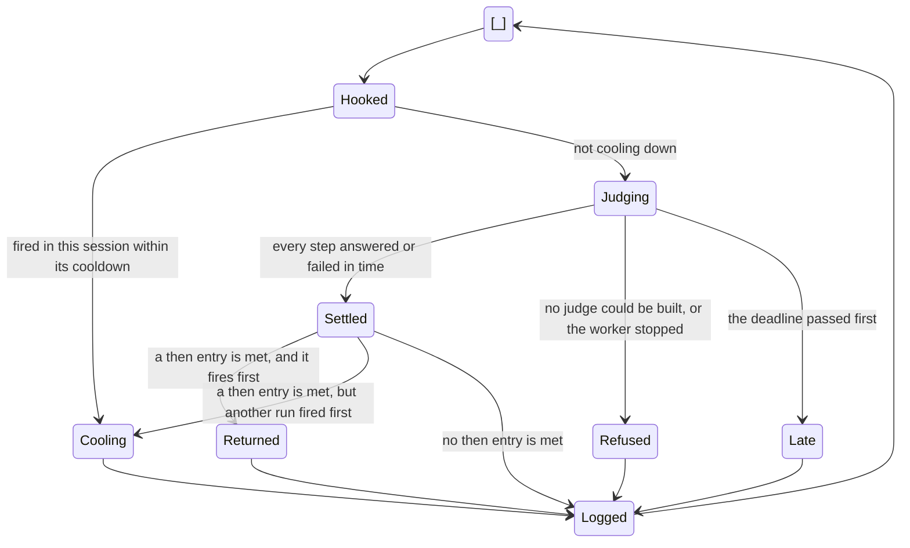

- **Invariants**
  - Every hooked rule runs at once, the last on the calling thread, and every
    run is logged with its rule, event and session.
  - A rule cooling down asks no judge.
  - At most one action per rule and session within its cooldown, however
    events interleave. Before S4, runs that settled at once each returned it.
  - A late result is dropped; its job runs on to its models' timeouts (O2).

| From    | On                                     | To       | Logged as                        |
| ------- | -------------------------------------- | -------- | -------------------------------- |
| Hooked  | the pair fired within the cooldown     | Cooling  | `cooldown: true`, no steps       |
| Judging | the worker answers within the deadline | Settled  | `steps`, `elapsed_ms`            |
| Judging | a fallback cannot be built             | Refused  | `refused` and why                |
| Judging | the worker stops without answering     | Refused  | `refused` and why                |
| Judging | the deadline passes                    | Late     | `deadline: true`                 |
| Settled | an entry is met and `try_fire` wins    | Returned | `returned` and the action's name |
| Settled | an entry is met and `try_fire` loses   | Cooling  | `steps` and `cooldown: true`     |

### A cooldown

Files: `crates/daemon/src/route/cooldown.rs`

One per rule and session, for rules with `cooldown_seconds`.

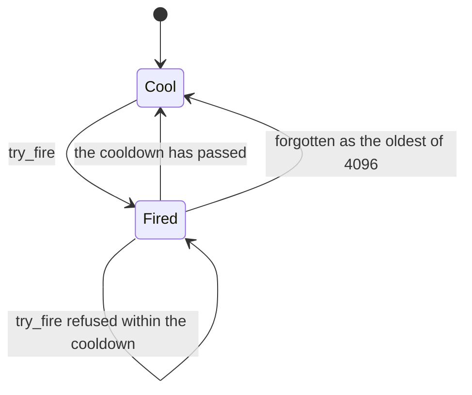

- **Invariants**
  - `try_fire` reads and records under one lock, so two runs cannot both fire
    (S4). `cooling` is only a check before the judges, to spare them.
  - At most 4,096 pairs are kept; past that, the oldest is forgotten.
  - The cooldown starts when the daemon returns the action, delivered or not
    (O1). Events with no session share one (O6).

### The worker pool

Files: `crates/runtime/src/run/pool.rs`, `run/mod.rs`

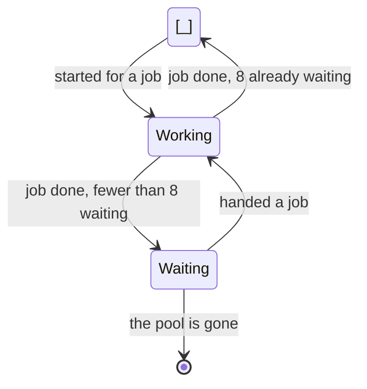

- **Invariants**
  - At most 8 workers wait. Any number may work: a job never waits for a
    worker (O2).
  - A job's result reaches its run through a channel that holds one; after
    the deadline nothing reads it.
  - A worker that stops drops that channel, and its run is refused at once,
    not reported as late.

### Fallback over a tier's models

Files: `crates/judges/src/tiers/fallback.rs`,
`crates/judges/src/tiers/system_one/client.rs`

One per question in a run.

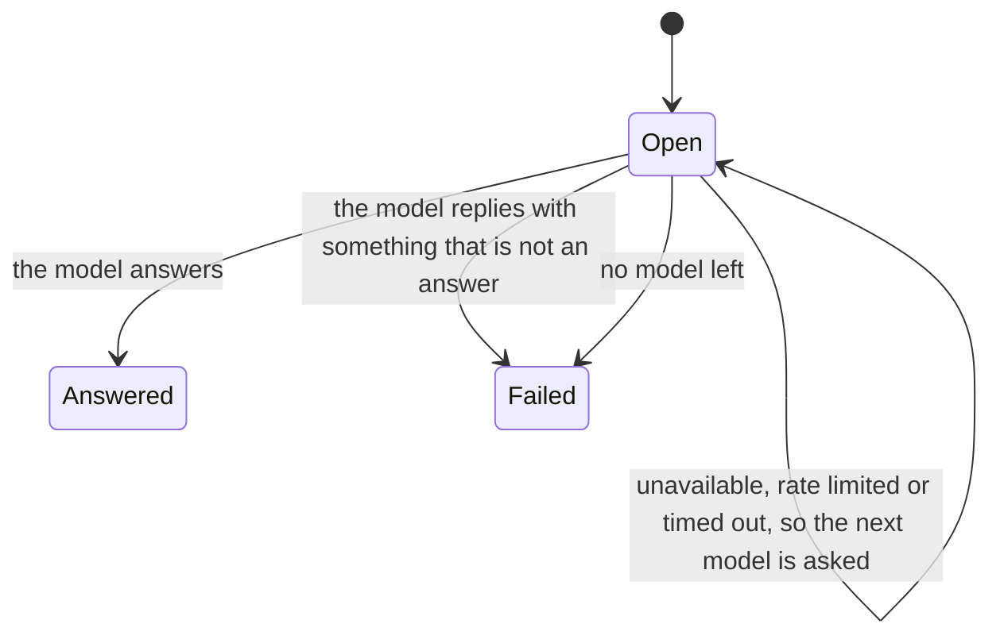

- **Invariants**
  - A failure is never an answer.
  - A model whose key is not set is left out; with no model, the question
    fails as `unavailable`.
  - Each model is asked once, with only the questions still open, within its
    own timeout, 3 seconds by default. With several models, their timeouts
    can add up past the run's deadline (O2).

### The audit log

Files: `crates/daemon/src/audit.rs`

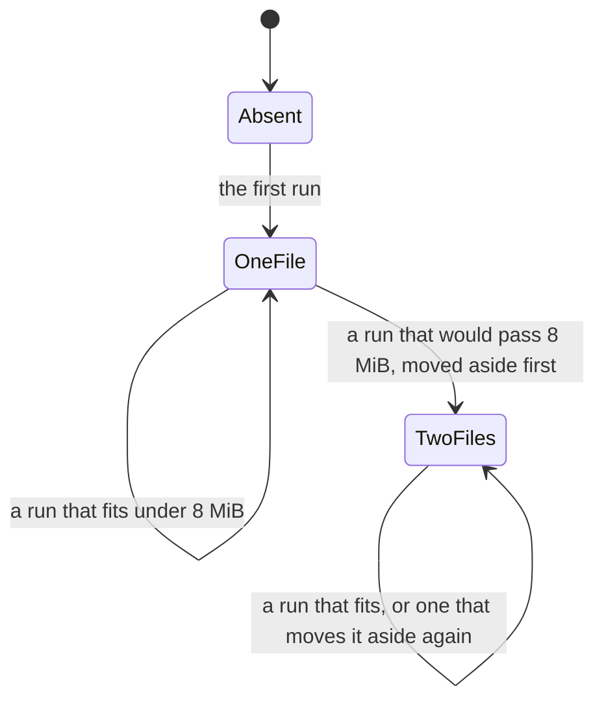

- **Invariants**
  - Within a daemon, runs are written one at a time, each a whole line in
    one write.
  - Moving aside replaces `audit.1.jsonl`, so the two files hold at most
    16 MiB and one line.
  - `at` is UTC to the microsecond, one width, so times sort as text (S6).
  - One daemon writes to a state folder (O9).

### Following the log

Files: `crates/daemon/src/audit.rs` (`follow`), `crates/cli/src/audit.rs`

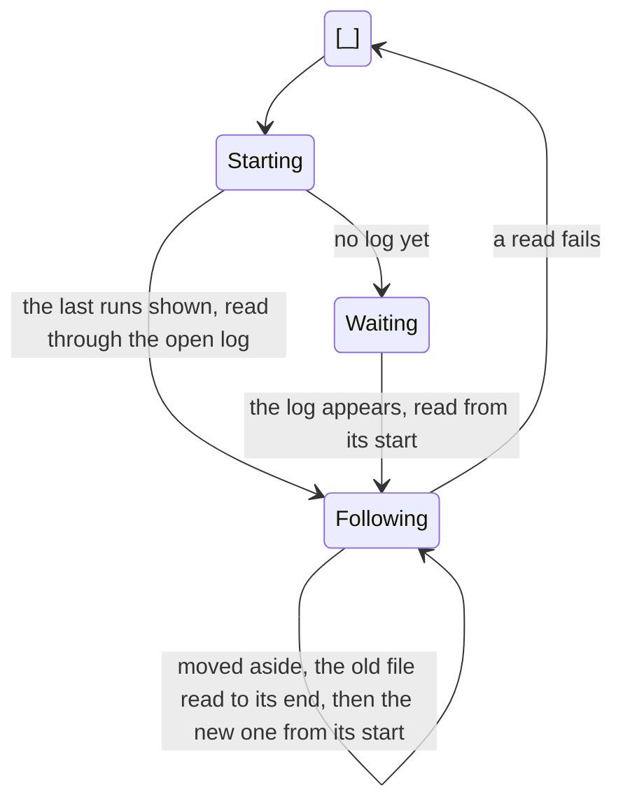

- **Invariants**
  - Each whole line is shown once, in order, from the recent runs on. Before
    S5 the runs between the recent ones and the first followed were skipped.
  - A part of a line waits until it ends.
  - A move aside is looked for before reading, so the old file is read to its
    end before the new one is opened.
