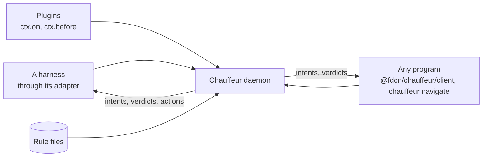

# Programs that ask Chauffeur

Chauffeur answers questions for any program on the machine. A coding-agent
harness is one caller among many: it reaches the daemon through the harness
package's adapter. Any other program calls `chauffeur.navigate` itself, with
its own event name and evidence, and acts on the intents that come back.

The interface is the same for every caller:

- **One call.** `connect().navigate(request)` in TypeScript, `chauffeur navigate`
  on stdin, or the `crates/protocol` types in Rust.
- **The caller names the event.** `recall`, `integration_event`,
  `neo/screen-check`: a rule hooks it by name in `on`, as it hooks
  `tool.after`.
- **The caller defines its intents.** A rule's `then` returns them, such as
  `withhold` or `attach`; no intent means the caller's default.
- **Policy stays in rule files.** The caller holds no thresholds or prompts,
  so the user tunes a decision by editing JSON.
- **Plugins hook callers' events too.** `ctx.on("recall", …)` works the same
  as `ctx.on("tool.after", …)`, with no harness involved.

| Project          | What it asks                                                        | Slice | Page                                    |
| ---------------- | ------------------------------------------------------------------- | ----- | --------------------------------------- |
| sourcefed        | Does this integration event need the agent?                         | 2     | [sourcefed](sourcefed.md)               |
| neo              | Does the iPhone screen show what the next irreversible tap expects? | 3     | [neo](neo.md)                           |
| Proclaimify      | Which key is this song in?                                          | 3     | [Proclaimify](proclaimify.md)           |
| jev-distill      | Serves its students as a System One model                           | 3     | [jev-distill](jev-distill.md)           |
| opencode-history | Which recalled passages help this message?                          | 4     | [opencode-history](opencode-history.md) |
