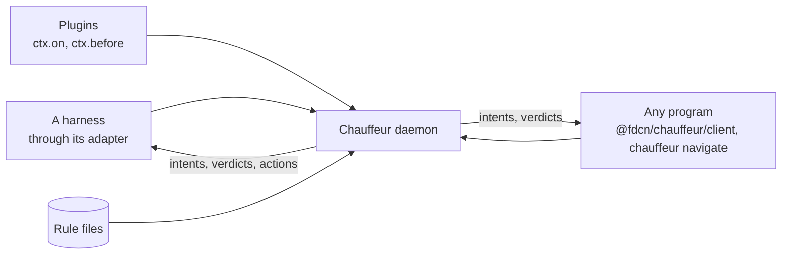

# Integrations

An integration is another project that works with Chauffeur. It brings any of
four things, each kept and installed by that project:

| Brings              | Lives                                                              | Example                                       |
| ------------------- | ------------------------------------------------------------------ | --------------------------------------------- |
| Rule files          | `~/.config/chauffeur/rules/<project>/`, installed with the project | `sourcefed/triage`                            |
| A plugin            | The project's repository, added to `plugins.json` by its installer | sourcefed's `sourcefed` plugin                |
| Calls to `navigate` | The project's own code                                             | neo's screen check, opencode-history's recall |
| A model format      | `models.json` entries pointing at the project's server             | jev-distill's `student`                       |

Chauffeur answers questions for any program on the machine. A coding-agent
harness is one caller among many: it reaches the daemon through Chauffeur's
adapter for that harness. Any other program calls `chauffeur.navigate` itself, with
its own event name and evidence, and acts on the intents that come back.

The interface is the same for every caller:

- **One call.** `navigate(request)` in TypeScript, `chauffeur navigate`
  on stdin, or the `crates/protocol` types in Rust.
- **The caller names the event, keyed by its own name.** `sourcefed.event`,
  `opencode-history.recall`, `neo.screen-check`: a rule hooks it by name in
  `on`, as it hooks `tool.after`, and knows whose event it is.
- **The caller defines its intents.** A rule's `then` returns them, such as
  `withhold` or `attach`; no intent means the caller's default.
- **Policy stays in rule files.** The caller holds no thresholds or prompts,
  so the user tunes a decision by editing JSON.
- **Plugins hook callers' events too.** `ctx.on("opencode-history.recall", …)`
  works as `ctx.on("tool.after", …)` does, with no harness involved.

| Project          | Brings                                                                                                | Slice | Page                                    |
| ---------------- | ----------------------------------------------------------------------------------------------------- | ----- | --------------------------------------- |
| sourcefed        | The `sourcefed/triage` rule, the `sourcefed` plugin, and `navigate` calls before each event it queues | 2, 5  | [sourcefed](sourcefed.md)               |
| neo              | A `navigate` call and its rule, checking the iPhone screen before an irreversible tap                 | 3     | [neo](neo.md)                           |
| jev-distill      | Its students, as System One models through the `student` format                                       | 3     | [jev-distill](jev-distill.md)           |
| opencode-history | A `navigate` call and its rule, ranking recalled passages for each message                            | 4     | [opencode-history](opencode-history.md) |
