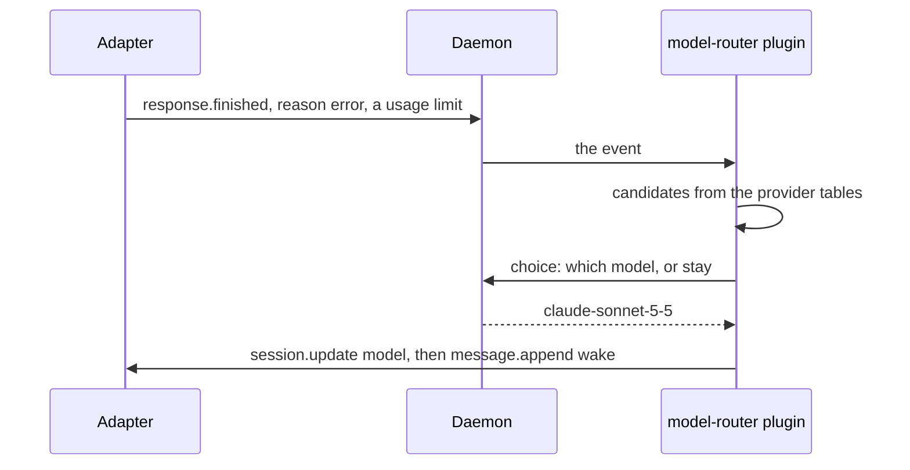

# Model router

v1's model router kept the agent on a model that can serve it: on a usage
limit it switched to the same tier on another provider the user pays for
directly, and switched back once the limit had likely cleared. In v2 this is
the `model-router` plugin, in slice 7, with `session.update` to change the
model.



| v1                                                                                                                                  | v2                                                                                                       |
| ----------------------------------------------------------------------------------------------------------------------------------- | -------------------------------------------------------------------------------------------------------- |
| A limit: HTTP 402, 429, 503, 529, a limit error type, or limit wording                                                              | The same lists in the plugin's options; `response.finished` carries the error's status, type and message |
| A model that cannot serve (401, 403, 404) after a switch                                                                            | Ruled out; the plugin moves to the next candidate                                                        |
| Tier tables per provider, `recommended`, `exclude`                                                                                  | `distribution/providers/<provider>.json`; the user's file replaces its `tiers`                           |
| Candidates: pins, recommended, same tier, providers used directly, then `last_resort`; at most 8; never a provider that hit a limit | The same order and bounds, computed in the plugin                                                        |
| `blacklist`, shipped `["opencode-go/*"]`                                                                                            | The same option                                                                                          |
| No switch when a tool already ran in the failed step                                                                                | The same check, from the event's `step_tools`                                                            |
| One `choice` naming the error; `stay` only once per model and never for a lasting limit                                             | The same `choice` step, with `stay` among its outcomes when allowed                                      |
| A failed or unsure pick (below 0.2) switches to the first candidate                                                                 | `confidence: 0.2`; `unsure` and `failed` take the first candidate                                        |
| Switch back: a user message at least 5 minutes later; "has the limit most likely cleared?" at P ≥ 0.7                               | `ctx.before("prompt.sent")`: the same yes/no, then `session.update` before the prompt runs               |
| A model the user picked forgets the origin                                                                                          | `session.updated` from the user clears it                                                                |

## Options

`skills/config/model-router.json` becomes the plugin's options:

```jsonc
{
  "model-router": {
    "options": {
      "pins": [],
      "blacklist": ["opencode-go/*"],
      "last_resort": ["opencode/*-free"],
      "pick_confidence": 0.2,
      "max_candidates": 8,
      "switch_back": { "after_seconds": 300, "confidence": 0.7 },
      "limit": { "messages": ["credit balance", "…"], "types": ["rate_limit", "…"] },
      "lasting": {
        "messages": ["usage limit", "…"],
        "types": ["quota_exceeded", "…"]
      }
    }
  }
}
```

## What it needs

`response.finished` with `reason: "error"` and the error's details, and
`session.update` for the model with its thinking variant: OpenCode, Pi and
Claude Code's mod support it; Claude Code's hook command and Codex do not, so
there the plugin does nothing.
