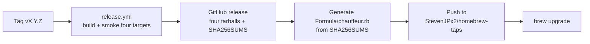
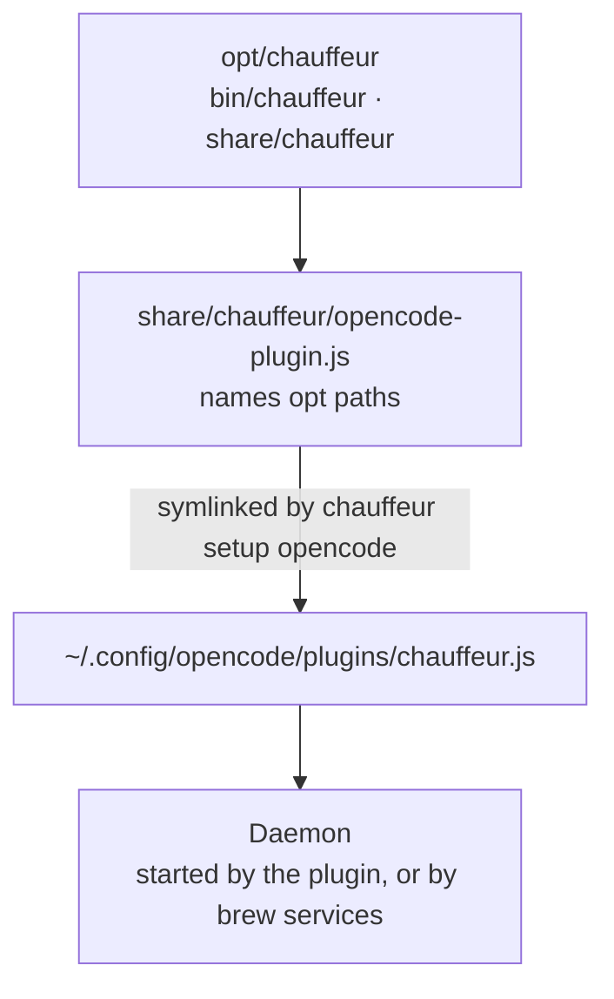

# Homebrew

Status: proposed design; implementation is gated on review.

Chauffeur installs on macOS and Linux with one Homebrew command, from the
`StevenJPx2/homebrew-taps` tap that already carries `sourcefed`:

```sh
brew install stevenjpx2/taps/chauffeur
chauffeur setup opencode          # links the plugin into OpenCode
```

The formula installs the daemon and CLI, the OpenCode plugin bundle, and the
shipped skills, all of one version. Every stable tag rebuilds the formula from
the release's own artifacts; nobody edits it by hand.

## Release flow



### On a user's machine



| Owner | Responsibility |
|---|---|
| `release.yml` | Builds, smoke-tests and attaches the four platform tarballs; generates the formula and pushes it to the tap |
| `scripts/homebrew.mjs` | Renders `Formula/chauffeur.rb` from the version and `SHA256SUMS` |
| Tap `StevenJPx2/homebrew-taps` | Serves the formula; holds no build logic |
| Formula | Installs the keg, writes the plugin shim, defines the service and caveats |
| `chauffeur setup opencode` | Links the shim into `~/.config/opencode/plugins`, or reports what it would change |
| Plugin | Starts the daemon when none runs; defers to a service-managed one |

The tap's local checkout is `~/Documents/Projects/taps`. Chauffeur's formula
lives at `Formula/chauffeur.rb` there, beside `sourcefed.rb` and
`audiobook-studio.rb`. Audiobook Studio's release workflow establishes the
pattern: upload versioned GitHub release tarballs, then update this shared tap
using `HOMEBREW_TAP_TOKEN`. A disposable local tap is used only for packaging
tests; the shared tap receives a formula with real release URLs and checksums.

## Release artifacts

Each target ships one tarball, `chauffeur-X.Y.Z-<target>.tar.gz`, for
`darwin-arm64`, `darwin-x64`, `linux-x64` and `linux-arm64` (musl):

```text
bin/chauffeur
share/chauffeur/dist/index.mjs     the plugin bundle
share/chauffeur/skills/            config, rules, rulebooks, permission, safety, handoff
share/chauffeur/LICENSE
```

`SHA256SUMS` lists all four. These are the same binaries the npm platform
packages carry, so both channels release one build.

## Formula

The generated formula, abridged:

```ruby
class Chauffeur < Formula
  desc "Rides along with your OpenCode agent and steps in when it matters"
  homepage "https://github.com/StevenJPx2/chauffeur"
  version "0.2.0"
  license "MIT"

  on_macos do
    on_arm do
      url "https://github.com/StevenJPx2/chauffeur/releases/download/v0.2.0/chauffeur-0.2.0-darwin-arm64.tar.gz"
      sha256 "…"
    end
    # darwin-x64, then on_linux with linux-arm64 and linux-x64
  end

  def install
    bin.install "bin/chauffeur"
    pkgshare.install Dir["share/chauffeur/*"]
    (pkgshare/"opencode-plugin.js").write <<~JS
      process.env.CHAUFFEUR_BIN ??= "#{opt_bin}/chauffeur"
      process.env.CHAUFFEUR_SKILLS_DIR ??= "#{opt_pkgshare}/skills"
      const plugin = await import("#{opt_pkgshare}/dist/index.mjs")
      export const ChauffeurRpc = plugin.ChauffeurRpc
      export default plugin.default
    JS
  end

  service do
    run [opt_bin/"chauffeur", "daemon"]
    keep_alive true
    environment_variables CHAUFFEUR_SKILLS_DIR: opt_pkgshare/"skills",
                          CHAUFFEUR_MANAGED:    "brew"
    log_path var/"log/chauffeur.log"
    error_log_path var/"log/chauffeur.log"
  end

  test do
    assert_match version.to_s, shell_output("#{bin}/chauffeur --version")
    system bin/"chauffeur", "skill", "validate", pkgshare/"skills/rulebooks/goal.json"
  end
end
```

The caveats name the two follow-up commands: `chauffeur setup opencode`, and
for an always-on daemon, `brew services start chauffeur` with the key in its
env file.

**Paths follow upgrades.** Node resolves a symlinked plugin to its real Cellar
path, which `brew cleanup` deletes after an upgrade. The shim therefore names
`opt` paths, which always point at the installed version, and sets the binary
and skills folder before the bundle loads. The user's own `CHAUFFEUR_BIN` and
`CHAUFFEUR_SKILLS_DIR` still win.

**Formula over cask.** Chauffeur is a command-line daemon with a plugin and
data files, which is a formula's shape. Prebuilt binaries suit a personal tap;
`homebrew/core` would need the project to build from source in its CI and reach
225 stars for a self-submission.

## Running the daemon

| Mode | How | Key comes from |
|---|---|---|
| Plugin-started (default) | The plugin starts `opt/chauffeur/bin/chauffeur daemon` when none answers | The environment OpenCode runs in |
| Service | `brew services start chauffeur` runs it under launchd or systemd, at login | `~/.homebrew/services/chauffeur.env`, which persists across upgrades |

The env file holds `TYPESAFE_API_KEY=…` and settings such as
`CHAUFFEUR_IDLE_STEERING=true`, one per line. `chauffeur setup opencode`
creates it with mode `0600` when asked to set up the service.

### Upgrades in service mode

The user restarts a service after upgrading, then restarts OpenCode:

```sh
brew upgrade stevenjpx2/taps/chauffeur
brew services restart chauffeur
opencode service restart
```

A service daemon reports `"managed": "brew"` in `health` (from
`CHAUFFEUR_MANAGED`). A plugin that finds a managed daemon of another version
logs restart instructions and leaves it running. It never sends `shutdown` or
starts a competing process. An older OpenCode session cannot stop a newer
service, and launchd retains ownership of the daemon's lifecycle.

A plugin-started daemon is replaced as the release plan describes: `shutdown`,
then the plugin starts its own.

## Channels

| Channel | Gets | Updates |
|---|---|---|
| Homebrew | Stable tags `vX.Y.Z` | `brew upgrade` |
| npm `latest` / `next` | Stable tags / release candidates | `opencode plugin update` |

Release candidates stay on npm `next`; the formula moves only on stable tags.
A machine uses one channel: a Homebrew plugin and an npm plugin loaded together
would each register Chauffeur's hooks. `chauffeur setup opencode` refuses to
link while `opencode.jsonc` lists `@fdcn/chauffeur`, and says so.

## Tap automation

`release.yml` gains a final job after the GitHub release, for stable tags only:

1. Download `SHA256SUMS` from the release.
2. Run `node scripts/homebrew.mjs X.Y.Z SHA256SUMS > chauffeur.rb`.
3. Check it with `brew style` and `brew audit --strict --formula`, on the
   macOS runner with the tap checked out.
4. Commit `Formula/chauffeur.rb` as `chauffeur X.Y.Z` and push to the tap.

The push authenticates with `HOMEBREW_TAP_TOKEN`, a fine-grained token with
contents write on `StevenJPx2/homebrew-taps` only, stored in the `release`
environment so it is used only after your approval. Without it, the job skips
and the release still completes.

A generated formula carries all four platform checksums in one commit. The tap
README marks `chauffeur.rb` as generated, as it does for `audiobook-studio`.

## Trust and supply chain

- Homebrew 6 loads non-official taps only when trusted.
  `brew install stevenjpx2/taps/chauffeur` trusts that formula alone.
- Each tarball is verified against the checksum in the formula. The checksums
  come from the same workflow run that built the tarballs.
- The formula installs no code beyond the release tarball: no `npm install`, no
  download at runtime.

## Implementation sequence

1. **Runtime:** `health` reports `managed` when `CHAUFFEUR_MANAGED` is set;
   the plugin's startup defers to a managed daemon on a version mismatch.
   Tests in `crates/daemon` and `adapters/opencode/tests/daemon.test.ts`.
2. **`chauffeur setup opencode`** in `crates/cli`: link the shim, detect an npm
   install, optionally write the service env file; `--dry-run` prints the
   changes. Tests in `crates/cli/tests`.
3. **Artifacts:** `scripts/package.mjs` also writes the four tarballs and
   `SHA256SUMS`; `check.yml`'s packaging dry run unpacks one, runs its binary
   with a dummy key, and validates its skills.
4. **Formula:** `scripts/homebrew.mjs` and a test rendering it from a fixture
   `SHA256SUMS`. Verify by hand: install from a local tap built from an
   `rc` tag's tarballs, run `brew test`, `brew services start`, and one
   OpenCode session.
5. **Automation:** the tap job in `release.yml`, `HOMEBREW_TAP_TOKEN` in the
   `release` environment, and the tap README entry.
6. **Docs:** the README install section offers Homebrew and npm; your machine
   moves to the formula in service mode, replacing `xyz.stjhn.chauffeur`.

Homebrew needs only the GitHub release, so it can ship before npm's
first-publish and trusted-publisher setup.

## Open questions

| Decision | Recommended starting point |
|---|---|
| Which channel ships first | Homebrew: it needs only GitHub releases and the tap token; npm follows once its one-time setup is done |
| Intel Macs and Linux arm64 | Keep all four targets, matching the release plan; the formula costs nothing extra per target |
| A `head` build from source | Leave it out; development runs from the checkout |
