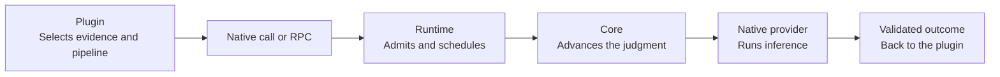
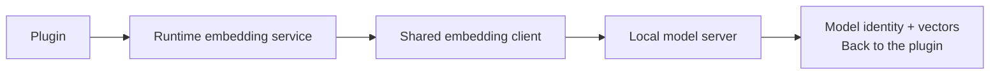

# Judgment runtime and plugin architecture

Status: proposed; implementation needs separate approval. Evidence and the
executed baseline are in the [architecture audit](../audits/architecture.md).

## Decision

Chauffeur executes bounded judgment pipelines. Plugins own domain behavior, and
host adapters observe and act in their environments.

- Inference providers are native Rust crates.
- Independently installed extensions connect over versioned RPC through a thin
  JavaScript SDK.
- Embeddings are a shared runtime service.

## Execution



Core decides what each round asks; the runtime executes the round and feeds its
results back. The plugin interprets the final result and acts under its host's
authority.

**Embeddings, independent of judgment**



## Ownership

| Owner | Responsibility |
|---|---|
| `crates/core` | Questions, reasoning requests, result schemas, rules and pure judgment composition |
| `crates/runtime` | Admission, run state, provider dispatch, egress redaction, plugin lifecycle, service access and traces |
| `crates/protocol` | Versioned RPC envelopes, registration, subscriptions and canonical wire schemas |
| `crates/embeddings` | Local-service transport with bounded vector and model validation |
| `crates/daemon` | Network transport, authentication and the external-plugin bridge around an injected runtime |
| `crates/cli` | Commands and the default bundle's composition |
| `plugins/providers` | Inference, authentication and routing metadata |
| `plugins/behaviors` | Domain policy, evidence selection, persistence, jobs, result interpretation and actions |
| `adapters` | Host observation, action delivery, feature negotiation and enforcement |
| `sdk/javascript` | RPC transport, generated wire types, pipeline and registration helpers |

Core depends on no HTTP, async runtime, host event, permission decision, skill
catalog, agent history or provider. The runtime and daemon depend on no concrete
behavior or provider; the CLI's bundle imports them.

## Source layout

```text
crates/
  core/src/{judge,contracts,pipeline}/
  runtime/src/{execution,egress,plugins,services}/
  protocol/src/
  embeddings/src/
  daemon/src/
  cli/src/{main.rs,bundle.rs}
plugins/
  providers/
    {anthropic,openai,jev,subq}/
    shared/{system-one-http,model-metadata}/
  behaviors/
    {skill-exposure,tool-exposure,permission,model-router,rules,event-gate}/
    shared/agent-api/
    memory/
adapters/
  opencode/
  mcp/
sdk/
  javascript/
config/                  # Runtime defaults
skills/                  # Agent-facing instructions
bench/  docs/  scripts/  .github/
```

A native package holds `Cargo.toml`, `src/`, its own JSON defaults and tests. A
JavaScript plugin holds a manifest, `package.json`, `src/`, JSON policy, tests
and any storage migrations. `memory/` arrives with its integration; Pi, Codex
and Claude host adapters arrive with their first working integrations.

### Where today's code goes

| Existing source | Destination |
|---|---|
| Core `judge/` and the System One/Two contracts | Stay in core; generic `Inference`, `Round` and run identity leave the capability contract |
| Core `engine.rs`, `judge/judged.rs`, `state/situation.rs`, signals and effects | Agent orchestration and state move to `shared/agent-api`; the generic run loop moves to the runtime |
| Core `features/backstop.rs` and irreversible-harm learning | The permission plugin, keeping veto precedence |
| Core redactor and secret-shape learning | Runtime egress stage, applied to every provider call |
| Core config, watch and template helpers | Runtime and plugin support; core keeps no domain defaults |
| Core `protocol.rs` and `client.rs` | Generic contracts to `crates/protocol`; agent and skill-catalog schemas to their owners |
| Daemon scheduler, workers and profile registry | Runtime execution with injected provider factories |
| Daemon Jev, SubQ and Codex selection | The CLI bundle; the transports stay native |
| Daemon `ranking.rs` | Transport to `crates/embeddings`; caches and ranking to skill exposure |
| Daemon `skills.rs` and skill-exposure sources | A worker owned by skill exposure, keeping its source tests and cancellation |
| Daemon `texts.rs` | Adapter-owned defaults served through generic config support |
| Capabilities other than monitors | Behavior plugins, still in Rust |
| Monitors, the SourceFed connector and gate enrichment | The external SourceFed integration, once RPC reaches parity |
| Anthropic and OpenAI | Provider plugins; routing metadata leaves the model-router crate |
| Jev, SubQ and `judges/http` | Provider plugins sharing `system-one-http` |
| `crates/mcp` | The MCP adapter |

`shared/agent-api` holds the agent observation and action schemas that agent
plugins and host adapters share, at today's field bounds. A non-agent embedder
never touches it.

## Contracts

### One pipeline per invocation

Native code keeps `Judge<T>`. External callers submit a bounded declarative
pipeline that compiles to the same primitives:

- classification
- structured reasoning
- a screen-then-review chain
- bounded fan-out
- fixed result assembly

Steps reference declared evidence and earlier results by name. Plugins prepare
evidence and interpret results in their own process; the daemon never receives
or evaluates plugin code.

An invocation carries a request ID, owner identity, evidence, output schema,
profile references and a deadline. The reply carries a validated result or an
explicit failure, attempt metadata and the request ID. No agent session or
history entry is involved. Unsure and failed stay distinct; escalation and
provider fallback are separate, explicit policies.

### Native and external plugins

- The application bundle constructs native providers and behaviors. There is no
  dynamic Rust ABI.
- An external plugin authenticates, then registers versioned, namespaced
  operations, schemas and subscriptions. Host-approved grants decide access.
- Events arrive over the existing HTTP RPC by bounded, cancellable long-poll.
  A waiting plugin holds no inference worker. Plugins connect outward;
  registrations cannot supply callback URLs.
- The SDK owns connection cleanup, bounded reconnect with backoff, and decoding.
  Registrations and outstanding work expire on disconnect after their lease;
  delivery queues are bounded and report overflow.
- The first external integration runs inside its application's process. A
  shared worker for bundled JavaScript plugins arrives only when one needs it.

### Host observations and actions

Agent plugins and adapters share versioned observation and action schemas. The
runtime routes namespaced envelopes by grant without knowing todos, skills,
monitors or permissions, and validates each registered payload schema.

Each observation and action names its host, project or session scope, request
ID and observation revision. The adapter rejects stale results and unsupported
actions.

Permission stays deny-first:

- a host denial stands;
- an unavailable policy leaves the host's conservative decision;
- automatic approval runs only with the safety veto active.

Full conversation capture is a negotiated adapter capability with source IDs and
project ownership, separate from the small evidence window live judgments read.

### Execution, privacy and persistence

| Concern | Decision |
|---|---|
| Admission | One permit covers inbox, waiting and active work; callers also have quotas |
| Priority | Interactive capacity stays reserved; only trusted host grants select it |
| Deadlines | Start at receipt and cover preparation, ranking, inference and delivery |
| Pipeline bounds | Size, schemas, nodes, depth, fan-out, rounds and attempts are checked before dispatch |
| Defaults | Eight active runs, four System One workers with one reserved, two System Two workers, 64 waiting |
| Blocking I/O | Provider and plugin I/O runs off the coordinator; an abandoned call keeps its capacity until it ends |
| Effects | Pipelines return data; actions need a current revision and an explicit commit by the plugin or host |
| Delivery | Correlated and deduplicated where the receiver supports it; never claimed exactly-once |
| Egress | Redaction runs after rendering and before every provider call, and over errors and audit metadata |
| Credentials | Provider logins stay in providers; plugin grants never expose them or administrative methods |
| State | Plugin-owned namespaces with schema versions; agent keys, learned files, rulebook budgets and source IDs migrate explicitly |
| Reload | Owner JSON reloads between work units; each run keeps its configuration snapshot; an invalid change keeps the last valid one |
| Embeddings | One configured local server; bounded input, output and dimensions; caches stay with their features |

Native and external extensions are trusted code. RPC access is authorized, but
an external process is not a sandbox; isolating third-party plugins needs its own
design.

## First integrations

| Integration | Behavior |
|---|---|
| Todos | Reviews a due reminder against the latest request, closing reply and todo list; sends only under its configured verdict and failure policy, at the current revision |
| SourceFed | Detects candidate watches, checks existing monitors, judges them, creates confirmed monitors and supplies each event's origin to the gate |
| Memory | Owns evidence and durable jobs; screens with System One, extracts with System Two on yes or unsure, validates citations and corrections, stores and retrieves with shared embeddings |

SourceFed parity covers monitor operations, delivery gating and agent notices.
After parity, the integration ships from its own repository without a daemon
rebuild, and the generic event gate reads the origin it is given.

Memory brings OptMem's storage, capture, retrieval and validation. An outage
defers a job without recording an empty extraction. Raw-evidence retention is a
separate policy that keeps whatever retained memories cite. Migration is
verified before the installation switches, and the originals stay for rollback.

## Sequence

1. **Characterize.** Turn audit findings A3 and A4 into regression tests, add
   tests for partial-run cancellation and RPC-arrival deadlines, and record
   release-build performance fixtures.
2. **Extract the generic path.** Separate core rounds and composition from agent
   signals, effects and state; run them through an embeddable runtime with
   injected providers. The agent application keeps working on the extracted
   path. A non-agent pipeline runs without a session, HTTP server or embeddings.
3. **First RPC and SDK slice.** Version negotiation, scoped grants, the minimal
   screen-then-review pipeline and generated wire types, exercised by a real
   JavaScript client. Todo-reminder review proves stale-result rejection and
   failure handling. Every call goes through the global limits.
4. **Externalize SourceFed.** Add the registration, subscriptions and action
   brokerage it needs; move monitor policy, connector and gate enrichment
   together. Replay the existing follow and gate fixtures over real RPC,
   including disconnects, duplicates and a slow SourceFed. Remove the compiled
   crates only after parity.
5. **Move native packages and assets.** Relocate providers and behaviors, split
   routing metadata and embedding transport, and move domain defaults beside
   their owners. Crate names stay; Cargo paths, config loading, CLI validation,
   benchmarks, documentation and packaging change in the same commits.
6. **Memory.** Bring OptMem's verified behavior in with a durable worker,
   full-source capture and shared embeddings. Prove citations, scopes,
   corrections, restarts and migration before switching. Measure screen false
   negatives on human-labeled conversations.

A package is created only when its slice separates real dependencies. Folder
moves and behavior changes are separate commits. Pi, Codex and Claude adapters,
new backends, dynamic loading and public plugin discovery are deferred.

## Verification

- Existing Rust, adapter, source, schema and packaging tests keep passing;
  native and RPC paths produce the same outcomes on shared fixtures.
- Dependency checks keep core free of domains and transport, and the runtime
  free of concrete providers. Every shipped operation has a real wire test.
- Tests cover incompatible versions, rejected grants, malformed plans,
  saturation, disconnects, reloads, cancellation and stale actions.
- Current, native and external paths run against one fixed fake provider, on
  release builds, measuring:
  - queue time, p50/p95 latency and throughput
  - idle CPU and total RSS across every process
  - startup time and installed size
  - provider-call counts, with model latency reported separately
- Packaging names runtime defaults, plugin assets, agent skills and adapter
  bundles explicitly, keeps Homebrew's stable `opt` paths and managed-daemon
  ownership, and upgrade tests check assets and state.
- User override paths resolve through one owner per file; an on-disk migration
  is documented and tested before its compatibility read is removed.
- The protocol version is tracked separately from package versions.

## Open questions

| Question | Recommended default |
|---|---|
| How wire types reach TypeScript | Generate from the Rust contracts; the generator is a new dependency and needs approval |
| What a failed todo-reminder review does | Send the reminder, matching the plugin's behavior without Chauffeur |
