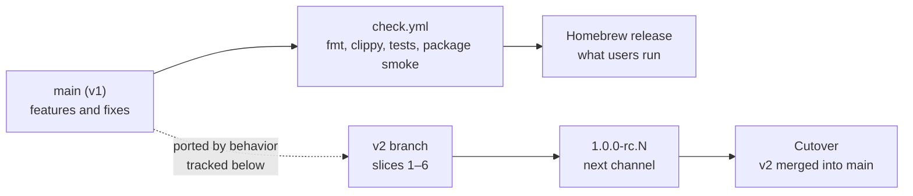
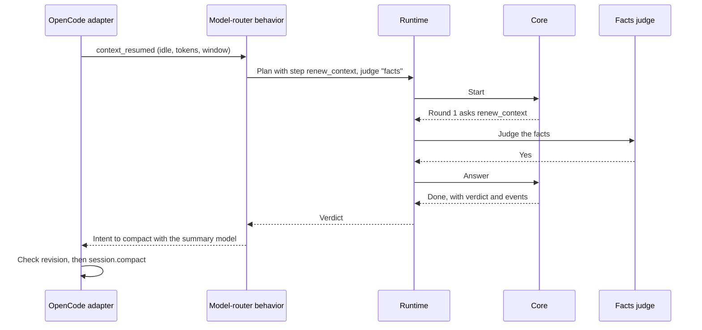
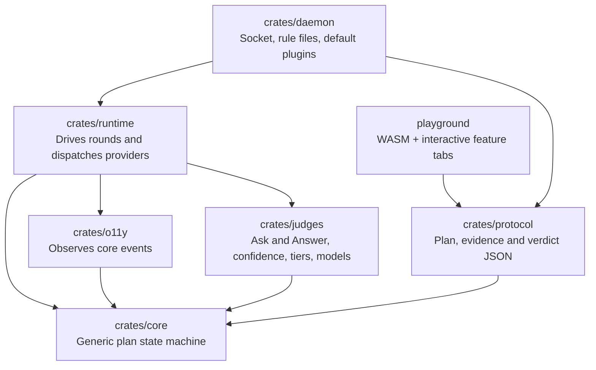
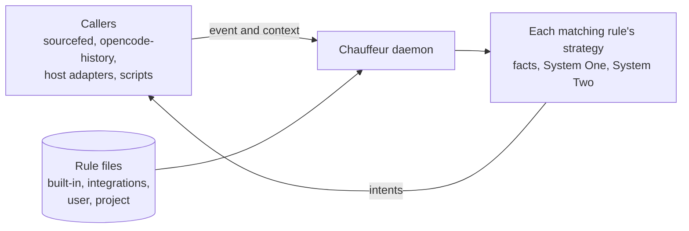
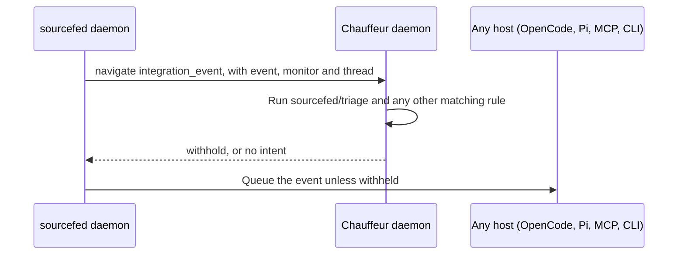
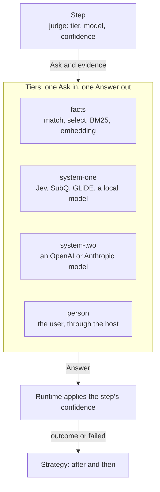
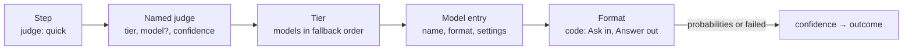
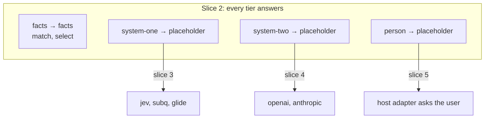
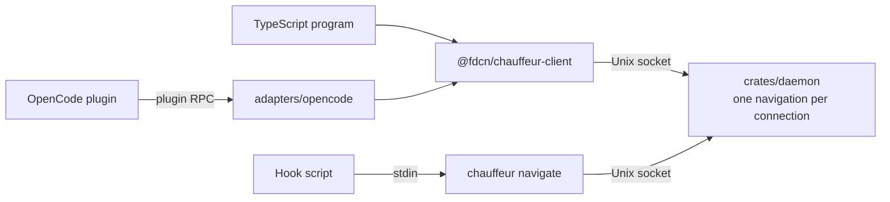

# Chauffeur v2 implementation plan

Status: design for review. The starting workspace is clean apart from its
toolchain, license, plan/audit documents and the Vite/WebAssembly playground.
The [v1 architecture audit](../audits/architecture.md) records the source
findings and checks that inform this plan.

## Goal

Chauffeur's core runs generic, bounded judgment plans. Each step names the
tier of judge that answers it: facts (deterministic code), System One, System
Two or a person. Every judge takes the same question and returns the same
answer. Models are configuration; only each API format is code.

Callers such as sourcefed and opencode-history send a question with its
context through `chauffeur.navigate`. Rule files, which are data, decide how to
answer: when to ask, the plan to run and what to do with the outcome. Chauffeur
never runs code from a repository, and no caller needs a token.

The initial slices are:

1. a generic state machine that is playable in the browser;
2. the plan protocol, the judge contract, rule files, the runtime and the
   daemon, reached through `chauffeur.navigate`;
3. System One models: Jev, SubQ and GLiDE;
4. the first System Two models on the same plan/runtime path;
5. behavior plugins and the OpenCode adapter, reaching parity with `main`;
6. release and cutover: v2 replaces v1 as the shipped Chauffeur.

The work proceeds one crate/slice at a time, with review before advancing.

## Production and parity with main

Users run v1, released from `main`. v2 changes nothing they install until
cutover, and `main` keeps receiving features and fixes meanwhile.



| Concern | Decision |
|---|---|
| Porting | Each `main` feature is re-expressed in v2's architecture, not merged: v2's tree replaces v1's, so merges would conflict on every removed file |
| Tracking | The parity table lists every `main` commit after the branch point; the watermark names the last one reviewed |
| Evidence | A ported feature passes `main`'s cases for it, replayed against v2 |
| Version mixing | The daemon/plugin version handshake keeps v1 and v2 from running together |
| User state | `~/.config/chauffeur` is migrated, or read compatibly, at cutover |
| After cutover | `v1` is a branch for hotfixes only |

### Parity table

Branch point `73bc29e`. Watermark: `e7fbabf`.

| `main` commit | v2 home | Slice | Evidence from `main` |
|---|---|---|---|
| `f2b087b` judge interface, facts judge | Facts is a rule judge on the panel; `judge.json` routes become step judge names | 2 | `judges/facts/src/lib.rs` tests |
| `bb41c9a` context renewal, session warming | Model-router behavior; the adapter performs `compact` and `warm` | 5 | `routing.rs`, `renewal.test.ts`, `warming.test.ts` |
| `22e5391`, `36f6253` skill safety review | Skill-review behavior: a screen-then-review plan | 3–4 | `sources/tests.rs` vetting cases |
| `3a18675` Skilld discovery | Skill-sources behavior; fetches run on runtime workers (audit A4) | 2, 5 | `cli/tests/skills.rs` |
| `c43ecd6` read guard, RPC starvation fix | Permission behavior; runtime admission permits (audit A3) | 2, 5 | `read-guard-probes.json`, `rpc-starvation.test.ts` |
| `9b8e917` rules | Rule content for the rules behavior | 5 | `capabilities/rules/tests/rules.rs` |
| `73bc29e` Homebrew release, CI | Release scripts and `check.yml` in v2 | 6 | `release.test.mjs`, `smoke.mjs` |
| `f54db24`, `d66a385`, `e7fbabf` docs | Documentation only | — | — |
| In progress on `main`: GLiDE provider, confidence escalation | `glide.json` over the `systemone` format; escalation is a rule's strategy: System One with `model: "jev"`, then `model: "glide"`, then System Two | 3 | `judges/glide/tests/wire.rs`, `docs/judges.md` escalation cases |

Context renewal on v2:



Warming asks no question: the behavior returns a `warm` intent without a plan.

## Dependency direction



`crates/core` has no crate dependencies: no async runtime, HTTP, serde, UI,
logging or plugin system. Error types use the standard library. Other crates
consume core's event data.

Adding crates does not by itself increase the shipped binary: linked code and
dependencies determine size. Each package owns a real boundary.

## Pluggability boundaries

Chauffeur and sourcefed both work in any harness, so no policy lives in a
harness adapter or a caller. A caller sends a question with its context;
Chauffeur's rules decide how to answer it. Adapters only translate.

| Kind | What it is | Written by | Examples |
|---|---|---|---|
| Rule file | Data: `on`, `when`, `plan`, `then` | Chauffeur, an integration, the user or a project | `conventional-commits`, `sourcefed/triage`, `opencode-history/recall` |
| Native behavior | Rust inside Chauffeur, for policy that needs Chauffeur's state or arithmetic | Chauffeur | Model router, skill exposure, permission contracts, following the agent's PRs |
| Caller | Any program that sends a question and its context | Anyone | sourcefed's daemon, opencode-history, host adapters, hook scripts |
| Host adapter | Per-harness glue: reports what happens and carries out intents | Chauffeur, one per harness | `adapters/opencode`, `adapters/pi` |

### `chauffeur.navigate`

Callers use one operation, `chauffeur.navigate`: the decision a chauffeur
makes before steering. A request names an event and carries its context;
every rule whose `on` and `when` match answers it, and the caller receives
their intents:

```ts
import { connect } from "@fdcn/chauffeur-client"

const { intents } = await connect().navigate(
  { on: "recall", evidence: { message }, candidates: { p1: "…", p4: "…", p7: "…" } },
  { signal: AbortSignal.timeout(1_500) },
)
// intents → [{ rule: "opencode-history/recall", attach: ["p4", "p1"] }]
```



- **The strategy is the rule's.** A rule can screen with facts, classify with
  System One and review only what System One leaves unsure with System Two.
  Changing the strategy changes a rule file, never a caller.
- **Answers are yes/no, a pick, a level on a scale or a ranking**, built from
  the pieces in [Strategies](#strategies).
- **No intent means the caller's default.** A rule that matches nothing in its
  `then`, or whose judges fail, returns no intent: sourcefed then delivers the
  event, and recall attaches nothing.
- **An inline `strategy` replaces `on`** for scripts, the playground and
  tests, with its own `judges` and `asks`. It runs only that strategy and
  returns its verdict.

Native behaviors answer the same events as rule files. The model router, for
instance, answers `context_resumed` with a `compact` intent.

#### sourcefed: one triage for every host

sourcefed's daemon navigates `integration_event` before it queues an event for
a target, so OpenCode, Pi, MCP and CLI all receive the same filtered stream.
sourcefed installs `sourcefed/triage`, a System One screen that withholds
confident noise; the user tunes or extends it in JSON.



With no Chauffeur, an error, or no answer within 3 seconds, sourcefed
delivers, as v1's gate does. In the other direction, the native behavior that
follows the agent's PRs calls sourcefed's daemon API from a runtime worker,
never from the coordinator (audit A4).

#### opencode-history: recall

opencode-history searches its own index when the user sends a message, then
navigates `recall` with the message and the passages as candidates. Its rule,
`opencode-history/recall`, ranks them, and opencode-history attaches the
passages the `attach` intent names.

| Owner | Responsibility | Boundary |
|---|---|---|
| `crates/core` | Generic plan composition, validation and state transitions | No transport, provider, host or domain policy |
| `crates/judges` | The `Ask` and `Answer` contract, confidence, tiers, facts functions, API formats and model configuration | No behavior policy |
| `crates/runtime` | Admission, run state, deadlines, cancellation, egress redaction and provider dispatch | Injects implementations; owns no behavior policy |
| `crates/protocol` | One JSON form of requests, plans, evidence, events, verdicts and intents for rule files, `navigate` and the playground | Validates and limits before anything runs |
| `crates/daemon` | The socket, rule-file loading and matching, and the default behaviors | Listens only on a socket the user owns |
| Behavior plugins | Questions, evidence selection, domain state, verdict interpretation and action intents | Never call host APIs directly |
| Host adapters | Report what happens with `navigate`, carry out intents, and expose `navigate` to their host's plugins | No policy; host denials remain authoritative |

### One protocol, many bindings

`navigate` is a Chauffeur operation, not any host's. Its request and result
are defined once, in `crates/protocol/schema/navigate.json`, and every binding
forwards them to the daemon socket unchanged:

| Binding | Caller | Mechanism |
|---|---|---|
| `@fdcn/chauffeur-client` | Any TypeScript program: sourcefed's daemon, host plugins, scripts | `connect().navigate(request)` over the socket |
| `chauffeur navigate` | Hook scripts in any host, Git hooks, CI on the same machine | One request on stdin; JSON lines on stdout |
| `crates/protocol` | Rust programs | The same types the daemon uses |
| `adapters/opencode`, `adapters/<host>` | That host's plugins, as a convenience | The host's plugin-to-plugin mechanism, such as OpenCode plugin RPC: `ctx.rpc(Chauffeur).navigate(request)` |

Adding a host or a language adds a binding, never a new request format. The
schema's fixtures run in the protocol crate's tests and in each binding's
tests.

### Stateless invocation

A navigation has a caller, request ID, an event or inline plan, bounded
evidence and candidates, and a deadline. It runs without an agent session,
`Signal`, `Situation`, or prior history; the caller supplies the evidence it
wants considered. Intents and transition events return to that caller. The
only state kept between navigations is a rule's cooldown and a native
behavior's own state. Only a host adapter carries out host actions.

### Judges

Every judge takes one `Ask` and returns one `Answer`. Judges come in four
tiers. A rule names its judges in `judges`, each with a tier, an optional
model and a confidence, and a step's `judge` names one of them or a tier:

| In a rule | Answered by |
|---|---|
| `"quick": { "tier": "system-one", "confidence": 0.7 }` | The tier's models, in the user's fallback order |
| `"careful": { "tier": "system-one", "model": "glide", "confidence": 0.7 }` | GLiDE; the tier's fallback order applies if GLiDE is unavailable or not configured, and the run's events say so |
| A step with `"judge": "facts"` | The tier itself, with no model and no confidence |

Naming the model lets one strategy use two models of the same tier, such as
Jev for a fast screen and GLiDE, more accurate but slower, for what Jev leaves
unsure. A rule shared with someone who lacks GLiDE still runs, on their
System One.



#### The contract

| Type | Shape |
|---|---|
| `Ask` | `question`; `instructions`; `evidence`: names of evidence blocks |
| `Answer` | Each possible answer's probability; `cites`, the evidence names it relied on. Or failed |

| `question` | Answers | Example |
|---|---|---|
| `"yes-no"` | `yes`, `no` | "Does this commit message break Conventional Commits?" |
| `{"choose": ["act", "ignore", "ask-user"]}` | One label | "What should the agent do with this Slack message?" |
| `{"scale": ["low", "medium", "high"]}` | One level, in order | "How hard is the user's request?" |

Every tier answers all three, so moving a step between tiers changes only its
`judge`. Each model's native reply is converted to probabilities: Jev's
`noul` 0.52 is yes 0.52 and no 0.48; GLiDE's weighted probabilities are used
as they are. A `facts` judge answers with probability 1. `crates/judges`
implements core's `Judge` interface for every tier.

#### Confidence

The rule, not the model, decides when an answer is sure enough. A named
judge's `confidence` is how sure it must be of an answer, from 0 to 1:

| `confidence` | Outcome |
|---|---|
| `0.7` | The likeliest answer when its probability is 0.7 or more; otherwise `unsure` |
| `{"yes": 0.6, "no": 0.95}` | Per answer: here `yes` needs 0.6 and `no` needs 0.95 |
| none | A yes/no step settles to yes's probability; a choice or scale to the likeliest answer |

```text
confidence 0.7 on "Does this commit message break Conventional Commits?"
  "fixed stuff"              yes 0.94          → yes
  "feat(cli): add navigate"  yes 0.06, no 0.94 → no
  "Update parser.rs"         yes 0.58, no 0.42 → unsure
  Jev timed out                                → failed
```

A judge that cannot answer settles as `failed` whatever the confidence, so a
failure never reads as `no`. On a scale, a split such as medium 0.45 and high
0.43 is `unsure`; when the question is "medium or higher", ask it as yes/no.
The runtime applies confidence the same way for every tier, in thousandths so
comparisons stay exact, and models never see it. Each judge's confidence is
tuned in its rule file against labelled cases.

#### Tiers

| Tier | Answers with | Built in |
|---|---|---|
| `facts` | Deterministic code: no model, network or credentials | `match` (equals, contains or a pattern over evidence), `select` (combines earlier outcomes; see [Strategies](#strategies)), `bm25` (rank over the step's evidence), `embedding` (similarity from the shared local embedding service) |
| `system-one` | A fast classifier, one batched call per round | `jev` (default), `subq`, `glide` |
| `system-two` | A reasoning model, with a schema-checked answer that cites its evidence | Disabled until reviewed (slice 4) |
| `person` | The user, asked through the host adapter | Each host adapter |

#### How a step reaches a model

A step reaches the code that answers it through four layers. Each layer knows
only the one below it, and all four tiers are built the same way:



| Layer | Defined in | Example |
|---|---|---|
| Named judge | A rule's `judges` | `"quick": { "tier": "system-one", "confidence": 0.7 }` |
| Tier | `models.json` `tiers` | `"system-one": ["jev", "subq"]` |
| Model entry | `models.json` `models` | `"jev": { "format": "systemone", "endpoint": "…", "key": { "env": "JEV_KEY" } }` |
| Format | Rust in `crates/judges` | `systemone`, `openai`, `anthropic`, `facts`, `person`, `placeholder` |

| Tier | Shipped models | Format |
|---|---|---|
| `facts` | `facts` | `facts`: the [facts functions](#tiers); no network |
| `system-one` | `jev`, `subq`, `glide` | `systemone` |
| `system-two` | None; the user adds one | `openai` or `anthropic` |
| `person` | `host` | `person`: the host adapter asks the user |

Every format implements one interface. A model answers every ask it received
in a round with one call:

```rust
pub trait Format {
    fn answer_all(&self, asks: &[Ask], evidence: &Evidence) -> Vec<Result<Answer, Unanswered>>;
}

pub enum Unanswered {
    Unavailable, // the tier's next model answers
    RateLimited, // the tier's next model answers
    OutOfTime,   // the tier's next model answers
    Invalid,     // the step settles as failed
}
```

`crates/judges` turns each tier's models into one core `Judge`, so core sees a
judge per tier and model, such as `system-one:glide`, and nothing below it.

#### Models are configuration

A model is registered the way a user registers a model provider anywhere
else: a name, a built-in API format, and the endpoint, model ID and credential
to use. Code exists only once per API format, in `crates/judges`:

| Format | Speaks |
|---|---|
| `systemone` | The `/v1/systemone` decisions API that Jev, SubQ Snap and Fastino GLiDE share; GLiDE's entry sets its reading of `score` as a level |
| `openai` | OpenAI-compatible chat completions with structured output, which covers local servers such as Ollama |
| `anthropic` | Anthropic Messages with schema-constrained output |
| `facts` | The facts functions, in process |
| `person` | A question to the user through the host adapter |
| `placeholder` | Stands in for any tier until its real model is configured: recorded answers, then a fixed answer |

```jsonc
// ~/.config/chauffeur/models.json
{
  "models": {
    "local-qwen": {
      "format": "openai",
      "endpoint": "http://127.0.0.1:11434/v1",
      "model": "qwen3:4b"
    },
    "reviewer": {
      "format": "anthropic",
      "model": "claude-sonnet-5-5",
      "key": { "env": "ANTHROPIC_API_KEY" },
      "timeout_ms": 20000
    }
  },
  "tiers": {
    "system-one": ["jev", "subq", "local-qwen"],
    "system-two": ["reviewer"]
  }
}
```

- A step's `model` names an entry here. Chauffeur ships `jev`, `subq` and
  `glide` as the same JSON in `crates/judges/models/`. The user's file adds
  models and overrides shipped ones by name. Changes take effect without a
  restart.
- `tiers` lists models in fallback order. The next model answers only when
  one is unavailable, rate-limited or out of time, never because of what it
  answered. Escalating to another model or tier is the plan's job, not
  fallback's.
- Models load only from shipped and user configuration, never from a
  project's `.chauffeur/`. A model entry is a network endpoint, so a cloned
  repository could otherwise send evidence wherever it chose.
- A key is named, as an environment variable or a keychain entry, and is read
  only by `crates/judges`. It never reaches rule files, callers or audit.
- A shipped model is used once its key is present; a System Two model also
  needs the user to turn it on.
- The `embedding` facts function uses a shared, bounded local embedding
  service. Caches and ranking that belong to one behavior stay with it.

#### Placeholders

A `placeholder` model stands in for a tier, or for one facts function, until
the real one is configured. Rules do not change when it is replaced; only
`models.json` does.

```jsonc
// models.json for tests and the playground
{
  "models": {
    "one-stand-in":    { "format": "placeholder", "answers": "fixtures/triage-answers.json", "otherwise": "failed" },
    "two-stand-in":    { "format": "placeholder", "otherwise": { "act": 0.8, "ignore": 0.2 } },
    "person-stand-in": { "format": "placeholder", "otherwise": { "yes": 1 } }
  },
  "tiers": {
    "system-one": ["one-stand-in"],
    "system-two": ["two-stand-in"],
    "person":     ["person-stand-in"]
  }
}
```

```jsonc
// fixtures/triage-answers.json
{ "answers": [
  { "evidence": { "event": "thanks, looks good 👍" },     "answer": { "yes": 0.52, "no": 0.48 } },
  { "evidence": { "event": "@agent bump retries to 5" }, "answer": { "yes": 0.94, "no": 0.06 } },
  { "evidence": { "event": "deploy is on fire" },        "answer": "failed" }
] }
```

- `answers` is matched by evidence: an entry answers an ask whose evidence
  contains every block the entry lists, with the same content. The first
  match wins, so one file serves every rule that asks about the same input.
- `otherwise` answers what no entry matches; without it, the step settles as
  `failed`, so a gap in the recorded answers shows.
- Every placeholder answer is marked as such in events and in
  `strategy show`, so it never passes for a real model's.
- Placeholders load from shipped and user configuration only, like every
  model. Recorded answers can be real ones, such as opencode-history's Jev
  scores, to tune a rule's confidence before it runs live.



### Strategies

A strategy is a rule's `strategy`: a list of steps, built from four pieces.
Chauffeur has no list of built-in strategies: any combination of the pieces is
one.

| Piece | What it does |
|---|---|
| Step | Asks one judge one question; its confidence turns the answer into an outcome |
| `after` | Waits for earlier steps, then runs the step or skips it by their outcomes |
| `for_each` | Copies a step once per candidate, in one round |
| Earlier outcomes | A step may read earlier steps' outcomes as its evidence |

#### `after`

A step waits until every step its `after` names has finished. Then it runs if
every `all` entry is met and, when there are `any` entries, at least one of
them is; otherwise it is skipped. A step without `after` runs in round 1.

```jsonc
"after": ["fast", "slow"]                                     // all: wait for both, whatever they settled to
"after": [{ "step": "fast", "when": ["unsure", "failed"] }]   // all: run only if fast was unsure or failed
"after": { "all": [ … ], "any": [ … ] }                       // every all entry, and at least one any entry
```

- A string entry is met once that step finishes, even when it was skipped.
- An object entry is met only when the step settled to an outcome in `when`.
  A skipped step never matches.
- `failed` and `unsure` are reserved, so no label can use either name.
- `relevant[*]` names every copy `for_each` made of `relevant`. Inside a copy,
  `relevant[item]` names the same candidate's copy.
- `after` names only earlier steps, so a strategy cannot loop. Every strategy
  has a known maximum of rounds and calls before it starts.

Combining answers is a step too. The `facts` function `select` reads earlier
outcomes and settles to one: `first` settled in a list, `top` N, all at or
above `min`, `majority`, or `mean`. A new way to combine is a new facts
function. The protocol lowers `for_each`, wildcards and named judges and asks
to plain core steps, so core runs every strategy alike.

| Strategy | Built from |
|---|---|
| Escalate | A step `after` an earlier one, `when` it is `unsure` or `failed` |
| Rank | A `for_each` step, then `select` with `top` and `min` |
| Collect all that pass | A `for_each` step, then `select` with `min` |
| Check the survivors | Two `for_each` steps, the second `after` `first[item]` `when` `yes` |
| Vote | Parallel steps, `select` with `majority`, and a review `after` the vote `when` `unsure` |

Escalating from Jev to GLiDE, then to System Two:

```jsonc
"judges": {
  "quick":    { "tier": "system-one", "model": "jev",   "confidence": 0.7 },
  "careful":  { "tier": "system-one", "model": "glide", "confidence": 0.7 },
  "reasoner": { "tier": "system-two",                   "confidence": 0.7 }
},
"strategy": [
  { "id": "fast",   "judge": "quick",    "ask": "needs-agent" },
  { "id": "slow",   "judge": "careful",  "ask": "needs-agent", "after": [{ "step": "fast", "when": ["unsure", "failed"] }] },
  { "id": "review", "judge": "reasoner", "ask": "needs-agent", "after": [{ "step": "slow", "when": ["unsure", "failed"] }] },
  { "id": "answer", "judge": "facts", "ask": { "select": { "first": ["review", "slow", "fast"] } },
    "after": ["fast", "slow", "review"] }
]
```

```text
"thanks, looks good 👍"
round 1   fast    jev    yes 0.52               → unsure
round 2   slow    glide  yes 0.18, no 0.82      → no
          review  skipped: slow was not unsure or failed
          answer  fast, slow and review have finished → asked
round 3   answer  select first                  → no
```

The v1 experiment's direct `judge(policy)` and `complete(profile)` calls are
not the primary v2 plugin API: each exposes only one inference request and
cannot express a screen, conditional escalation, fan-out or result assembly.
A future one-step convenience API is acceptable only if it lowers to the same
path and cannot bypass plan limits, redaction or deadlines.

#### Viewing a strategy

`chauffeur strategy show` prints a rule's plan as a tree, with each step's
round, its model as the user's configuration resolves it, its `after` and its
confidence:

```text
$ chauffeur strategy show opencode-history/recall
opencode-history/recall                        on recall
├─ round 1  helps × candidates  system-one → jev
└─ round 2  best               facts select   top 3, min 0.7, from helps
then  attach best
at most 2 rounds · 1 model call · 31 candidates at most
```

`--file` shows an unsaved rule, and an unknown or unconfigured model is marked
where it appears. The playground draws the same tree from rule JSON and steps
through it with recorded answers.

### Access, delivery and failure rules

- The daemon listens only on a Unix socket in a directory only the user can
  open (`chauffeur/` in the user's runtime directory, mode `0700`), so only the
  user's own processes connect. There is no TCP port and no token.
- `.chauffeur/` holds data only. Chauffeur never runs code from a repository.
  A cloned repository's rules are data the user did not write: they run under
  the same limits, and System Two stays off for them unless
  `~/.config/chauffeur` turns it on for that project.
- Callers are trusted code, as their host or the user runs them. They reach
  Chauffeur only through `navigate`; payloads are never authority.
- One connection carries one navigation: the request, then its events in
  order, then its intents or verdict. Each navigation's event buffer is bounded
  and overflow is an explicit event. Closing the connection cancels it.
- One admission permit covers queued, waiting and active work. Capacity per
  source (built-in, integration, user and project rules, and inline strategies), strategy size,
  evidence bytes, node count, depth, fan-out, rounds, attempts and output size
  are checked before dispatch.
- Deadlines include queueing, preparation, every inference round and delivery.
  A disconnected caller cancels future work; a blocking provider call retains
  its worker lease until it ends, and late results cannot commit actions.
- Redaction runs after evidence assembly and before every provider call, and
  also covers errors and audit metadata.
- A pipeline returns data and action intents, not host effects. A host adapter
  checks the current observation revision before acting; host
  denials and the safety veto cannot be overridden by a plugin verdict.

## Extension examples

Three rule files. A rule file needs no code: dropping it into a rules folder
is the whole install.

A rule file has these parts:

| Field | Meaning |
|---|---|
| `on`, `when` | The event that triggers the rule, and a cheap deterministic filter on it |
| `judges` | Named judges: a tier, an optional model and a confidence |
| `asks` | Named questions, so steps that ask the same question share it |
| `strategy` | The steps, in order: each with an `id`, a `judge` (a named judge or a tier), an `ask` (a named question or one written inline), and `after` |
| `then` | Intents by outcome, first match wins; no match returns no intent |

Names in `judges` and `asks` are referred to only by a step's `judge` and
`ask`. Step IDs are referred to only by `after`, `select` and `then`.

Rules load from four sources, and edits apply without a restart:

| Source | Folder | System Two |
|---|---|---|
| Built-in | Each behavior's directory in Chauffeur | Allowed |
| Integration | `~/.config/chauffeur/rules/<integration>/`, installed by sourcefed, opencode-history and others | Allowed |
| User | `~/.config/chauffeur/rules/` | Allowed |
| Project | `.chauffeur/rules/`, from the Git worktree root down to the session's directory | Only where `~/.config/chauffeur` allows it for the project |

A rule's ID is its path under its folder, such as `sourcefed/triage`. The user
tunes an integration's rule by editing its file; reinstalling the integration
keeps a file the user changed.

### Commit messages (rule file)

v1's `conventional-commits` rule, with its question as a one-step strategy:

```jsonc
// .chauffeur/rules/conventional-commits.json
{
  "on": "tool_result",
  "when": { "tools": ["shell"] },
  "judges": { "quick": { "tier": "system-one", "confidence": 0.7 } },
  "strategy": [
    { "id": "nonconventional", "judge": "quick",
      "ask": { "question": "yes-no", "evidence": ["tool_call"],
               "instructions": "Does this call create a git commit whose message does not follow Conventional Commits?" } }
  ],
  "then": [{ "if": { "nonconventional": "yes" }, "steer": "Use Conventional Commits, such as `feat(scope): short description`." }],
  "cooldown_seconds": 120
}
```

### Event triage (integration rule)

sourcefed installs this rule with its System One screen. This user added the
System Two review for Slack messages that System One leaves unsure or fails
on.

```jsonc
// ~/.config/chauffeur/rules/sourcefed/triage.json
{
  "on": "integration_event",
  "judges": {
    "quick":    { "tier": "system-one", "confidence": 0.7 },
    "reasoner": { "tier": "system-two", "confidence": 0.6 }
  },
  "asks": {
    "needs-agent": { "question": "yes-no", "evidence": ["thread", "event"],
                     "instructions": "Does the new event ask the agent to do or change something?" }
  },
  "strategy": [
    { "id": "screen",   "judge": "quick", "ask": "needs-agent" },
    { "id": "is-slack", "judge": "facts", "ask": { "match": { "source": "slack" } } },
    { "id": "review",   "judge": "reasoner",
      "ask": { "question": { "choose": ["act", "ignore"] }, "evidence": ["thread", "event"],
               "instructions": "Should the agent act on the new message? Cite the evidence." },
      "after": [{ "step": "screen", "when": ["unsure", "failed"] }, { "step": "is-slack", "when": ["yes"] }] }
  ],
  "then": [
    { "if": { "screen": "no" }, "withhold": "event" },
    { "if": { "review": "ignore" }, "withhold": "event" }
  ]
}
```

Two rounds at most: `review` is skipped when the screen says `yes` or `no`, or
the event is not from Slack. Every other outcome, including a failed review,
returns no intent, and sourcefed delivers.

### Per-turn recall (integration rule)

opencode-history installs this rule. The rule ranks the passages its search
returned; the code gathers them and attaches the result.

```jsonc
// ~/.config/chauffeur/rules/opencode-history/recall.json
{
  "on": "recall",
  "strategy": [
    { "id": "helps", "judge": "system-one", "for_each": "candidates",
      "ask": { "question": "yes-no", "evidence": ["message", "candidate"],
               "instructions": "Would this passage materially help the agent answer the message, beyond what it already says?" } },
    { "id": "best", "judge": "facts", "after": ["helps[*]"],
      "ask": { "select": { "from": "helps[*]", "top": 3, "min": 0.7 } } }
  ],
  "then": [{ "attach": "best" }]
}
```

`helps` has no named judge, so it uses the user's System One with no
confidence and settles to each passage's probability, which `select` ranks.

Its code is the [`navigate` call](#chauffeurnavigate) with a 1.5 s signal.
All candidates share one round, so Jev answers them in one call. An error or a
missed deadline attaches nothing.

### What a caller gets back

| Result | Meaning | `navigate` |
|---|---|---|
| Intents | Every matching rule ran | `intents`: each with its `rule`, possibly empty |
| Verdict | An inline plan's steps settled, failed or were skipped | `verdict[id]`: `{ settled }`, `{ failed: true }` or `{ skipped: true }` |
| Unknown judge | An inline plan names a tier with no model, or one its source may not use; nothing ran. A rule that does is refused when it loads | `judge_unavailable` error |
| Limit exceeded | The plan or evidence is over a named limit; nothing ran | `limit_exceeded` error |
| Busy | This source's or the daemon's capacity is in use | `busy` error |
| Deadline | The deadline passed; unfinished steps are unanswered | `deadline` error, with the events so far |
| Unavailable | The daemon is not running | `unavailable` error |

## Core plan model

A plan is an ordered list of named steps. Each step carries a request of the
caller's type `Q`; the caller also chooses the outcome type `O`. Core does not
know what either means. Rule files lower to this form: the protocol resolves
named judges and asks, `for_each` copies and wildcards before core sees a plan.

```text
Step<Q, O>   = { id, judge: name, request: Q, after: After<O> }
After<O>     = { all: [Need<O>], any: [Need<O>] }
Need<O>      = { step: an earlier step's ID, when: [Outcome<O>] or none }
Outcome<O>   = Value(O) | Failed
StepState<O> = Pending | Asked | Settled(Outcome<O>) | Skipped
```

`Skipped` is a machine state, not an outcome. A failed model call settles
asked steps as `Failed`; an outcome such as `Unsure` is an ordinary
`Value(O)`.

### `after` in core

One rule decides every step, the one in [Strategies](#after):

- A step stays `Pending` until every step its `after` names is `Settled` or
  `Skipped`.
- It is then `Asked` if every `all` need is met and, when `any` has needs, at
  least one `any` need is met. Otherwise it is `Skipped`.
- A need without `when` is met by any finish. A need with `when` is met only
  by a settled outcome it lists; `Skipped` never matches.
- A step with an empty `after` is asked in round 1. Steps asked together share
  a round, and each judge answers its share of a round in one call.
- `after` names only earlier steps, so every plan finishes within one round
  per step.

The escalation from [Strategies](#strategies), in Rust:

```rust
let unsure_or_failed = [Value(Unsure), Failed];
let plan = Plan::new([
    Step::new("fast", "system-one:jev", ask),
    Step::new("slow", "system-one:glide", ask).after([Need::when("fast", unsure_or_failed.clone())]),
    Step::new("review", "system-two", ask).after([Need::when("slow", unsure_or_failed)]),
    Step::new("answer", "facts", select_first).after(["fast", "slow", "review"]),
]);
```

A step ID alone is a need without `when`, and `after_any` fills the `any`
list. A named judge lowers to a panel name of its tier and model, such as
`system-one:glide`. Rust and rule files build the same steps, so a strategy
reads the same in both.

### The `Judge` interface

A judge answers a step's request. Core defines the interface; it has no
dependencies and is synchronous:

```rust
pub trait Judge<Q, O> {
    fn judge(&self, request: &Q) -> Outcome<O>;
    // Defaults to one `judge` call per request; a batching provider overrides it.
    fn judge_all(&self, requests: &[&Q]) -> Vec<Outcome<O>>;
}
// Any `Fn(&Q) -> Outcome<O>` is a judge.
```

A step names its judge, because plans are data: rule files and inline
strategies can only refer to judges the host already holds, and configuration
can limit which judges a project's rules may use. A `Panel` maps names to
judges. `plan.run(&panel)` validates the plan, rejects a name the panel lacks before asking anything, and then asks
each judge its share of every round in one `judge_all` call. A batch with the
wrong number of answers settles as `Failed`. The round-by-round API remains for
the playground and the runtime; each `Question` reports its step, judge and
request.

Judges are synchronous so rules stay plain functions. The runtime runs slow
judges such as Jev on bounded worker threads, with deadlines and cancellation;
neither core nor the interface changes for that.

## State machine and event model

`plan.run(&panel)` runs a plan to its end. Underneath, core advances one round
at a time, so a caller may also drive rounds itself: the runtime around slow or
remote judges, or the playground with answers picked by hand. The low-level API
returns events as data:

```rust
let transition = plan.start();
observe(transition.events);
let round = transition.next.ask()?;
let reply = answer_round(round.questions()); // each question names its judge
let transition = round.answer(reply)?;
observe(transition.events);
```

Each transition includes:

- the next state: `Ask { round, questions }` or `Done { verdict }`;
- the events produced by the transition.

The event vocabulary is `Started`, `RoundReady`, `StepSettled`,
`StepSkipped` and `Finished`. Events have stable step IDs, round numbers and
settled outcomes; they contain no transport or provider-specific types. A
runtime may offer a local observer callback around transitions; the only
user-supplied code core invokes is a judge, inside `run`.

`crates/o11y` consumes events for logs, traces or audit. `crates/runtime` can
offer a convenience observer callback, but core does not call user code. The
daemon serializes each run's events onto its caller's connection from a bounded
log; a slow caller never blocks a core transition.

The state machine does not decide provider choice, retry/backoff, HTTP,
credentials, or domain actions. Those belong to runtime, provider and plugin
contracts respectively.

## Playground

The Vite application uses petite-vue for reactivity and Web Awesome for UI
components. Each feature under test is a tab; its Rust implementation is
compiled to WASM.

The **State machine** tab contains:

- A plan editor with an example for each row of the
  [strategies table](#strategies): escalate, rank, collect all that pass,
  check the survivors, and vote, plus a step with both `all` and `any`.
- A validation area for duplicate IDs, `after` naming a later or unknown step,
  and empty `when` lists.
- The steps asked in the current round, with controls to pick each one's
  outcome or failure by hand.
- A transition-event timeline and final per-step verdict.
- Reset/replay controls and a sharable plan fragment in the URL.

The playground invokes the same core state transitions as the native runtime;
it does not contain a second implementation of `after`.

The Vite development loop rebuilds Rust changes in `playground/wasm/` and
`crates/`, and reloads the page. Slice 2 adds the Strategy tab.

## Package layout

```text
crates/
  core/                 # Generic plan, outcomes, judges, state machine and events
  o11y/                 # Event consumers
  protocol/             # Plan, evidence and verdict JSON; validation and limits
  judges/               # Ask and Answer, confidence, tiers, facts, API formats
    models/             # Shipped model entries, such as jev.json
  runtime/              # Admission, deadlines, workers, redaction, transition driver
  daemon/               # Socket, rule loading and matching, default behaviors
  cli/                  # `chauffeur` binary: navigate, setup and audit
plugins/
  behaviors/             # Each owns its plans, config and shipped content
    model-router/        # Model switching, context renewal, warming
    skills/              # Skill sources, exposure and safety review
    permission/          # Permission contracts and guards
    rules/               # Built-in rule files
adapters/
  opencode/              # Reports what happens, carries out intents, `navigate` binding
  <host>/                # Each further host: the same three duties
clients/
  typescript/            # @fdcn/chauffeur-client: navigate over the socket
playground/
  wasm/                  # Thin wasm-bindgen bridge to core
  src/features/          # One interactive tab per feature under test
scripts/                 # Packaging, Homebrew formula, smoke tests
.github/workflows/       # check.yml
```

Shipped content lives with the behavior that reads it, so one directory owns
each rule, contract and config (audit A10).

The first core slice does not create provider, protocol, runtime or daemon crates.
They arrive when the core API they consume is reviewed. `o11y` also waits until
the core event schema is stable.

## Sequence and verification

### Slice 0 — playground shell: implemented

- Keep the pinned nightly, strict workspace lint setup, LICENSE and plan/audit
  documents.
- Use Vite, TypeScript and Bun; petite-vue provides reactivity and Web Awesome
  supplies tabs, cards and inputs.
- Compile Rust to browser WASM using wasm-bindgen/wasm-pack.
- Prove in a real browser that editing input updates Rust output, and that an
  edit to Rust rebuilds WASM and reloads the page.

### Slice 1 — core plan and state machine

Status: to be rewritten to the [core plan model](#core-plan-model) above,
replacing the gate-based core on the branch. `crates/core` stays
dependency-free.

| File | Contents |
|---|---|
| `crates/core/src/plan.rs` | `Plan`, `Step` with `after` and `after_any`, `After`, `Need` (`Need::when`, and a step ID as a need without `when`), `Outcome` |
| `crates/core/src/after.rs` | The one rule: a step's decision from its needs' states (`Wait`, `Run`, `Skip`), and one pass over the plan in order |
| `crates/core/src/state.rs` | Validation, `start`, `Round` (`questions`, `answer`, `fail`), `Plan::run` |
| `crates/core/src/judge.rs` | `Judge`, `Panel` |
| `crates/core/src/event.rs` | Events and `Verdict` |
| `crates/core/src/proofs.rs` | Kani harnesses |
| `crates/core/tests/scenarios.rs` | Scenario tests |
| `playground/wasm/src/state_machine.rs`, `playground/src/features/state-machine.ts`, `playground/index.html` | The State machine tab on the new model |

Scenario tests:

- Each row of the [strategies table](#strategies), with a `select`-like rule
  judge standing in for facts: escalate, rank, collect all that pass, check
  the survivors, vote.
- `after` alone: a string need waits for a skipped step and then runs; an
  object need never matches a skipped step; `failed` matches only when listed;
  a step with both `all` and `any` runs only when both hold.
- Validation: an empty plan, a duplicate ID, `after` naming a later or unknown
  step, an empty `when` list, and a judge the panel lacks, each rejected
  before any judge is asked.
- The round API: a reply naming an unknown, unasked or repeated step, or
  missing one, returns the unchanged round; each judge answers its share of a
  round in one call; a batch of the wrong length settles as `Failed`.

Kani harnesses, each one invariant over at most three steps and a small
outcome enum:

| Harness | Property |
|---|---|
| `a_step_waits_until_every_need_has_finished` | No decision while a named step is `Pending` or `Asked` |
| `a_decision_follows_the_rule` | `Run` exactly when every `all` need and, if any, one `any` need is met |
| `a_skipped_step_meets_only_needs_without_when` | Skipped never matches a `when` |
| `one_pass_settles_every_decidable_step` | Skips propagate within one pass |
| `a_pass_only_moves_pending_steps_forward` | Each step is asked at most once |
| `a_pass_with_no_open_round_asks_or_finishes` | A run never stalls, so it finishes within one round per step |

Verification: strict Clippy, the scenario tests and doctests, Kani, Miri, and
the playground in a real browser, with each example stepped through by hand.
Stop for review before slice 2.

### Slice 2 — Navigate: protocol, judges, rules, runtime and daemon

A caller sends an event or an inline plan, with its evidence, candidates and
a deadline, and receives the events and the intents or verdict. It sends data,
never callbacks or code. This slice loads rule files from all four sources and
matches them by `on` and `when`. It builds `navigate` with three bindings so no
host or language shapes the request: the TypeScript client, `chauffeur
navigate`, and the OpenCode binding built on the client.



#### Wire contract

One JSON request in, events and then intents out as JSON lines. The socket
carries exactly what `chauffeur navigate` reads and prints:

```sh
chauffeur navigate <<'EOF'
{"protocol": 1, "deadline_ms": 1500, "on": "recall", "evidence": {"message": "…"}, "candidates": {"p1": "…", "p4": "…"}}
EOF
# → {"event": {"rule_matched": {"rule": "opencode-history/recall"}}}
# → {"event": {"round_ready": {"rule": "opencode-history/recall", "round": 1, "steps": ["helps[p1]", "helps[p4]"]}}}
# → {"event": {"step_settled": {"rule": "opencode-history/recall", "step": "helps[p4]", "outcome": 0.91}}}
# → {"event": {"step_settled": {"rule": "opencode-history/recall", "step": "best", "outcome": ["p4"]}}}
# → {"intents": [{"rule": "opencode-history/recall", "attach": ["p4"]}]}
```

A request with `strategy` in place of `on` ends with `{"verdict": {…}}`.
`$CHAUFFEUR_SOCKET` defaults to `chauffeur/daemon.sock` in the user's runtime
directory: `$XDG_RUNTIME_DIR`, or `$TMPDIR` on macOS. A plugin-RPC binding
takes the same request as an object and returns the intents or verdict.

- **Outcomes** are an answer such as `yes` or `ignore`, `unsure`, a
  probability from 0 to 1 with at most three decimals, or a list of candidate
  names, compared by equality. The runtime turns each `Answer` into an outcome
  with its judge's [confidence](#confidence). `when` matches answers, so a
  step that others wait on `when` it answers a certain way has a confidence.
- **Intents** carry the rule that produced them. A rule's intents are dropped
  if its strategy misses the deadline; other rules' intents still return.
- **Verdicts** give each step `{"settled": <outcome>}`, `"failed"` or
  `"skipped"`. `failed` and `unsure` are reserved, so a judge's failure never
  collides with a label.
- **Evidence** is named once per navigation and referenced by steps, so a
  batched provider call carries each block once.
- **Versioning:** `protocol` is required; the daemon answers
  `unsupported_protocol` with the versions it accepts, and each binding reports
  it as `unavailable`.
- **Limits**, checked before admission: 32 steps per strategy, counting each
  copy `for_each` makes; 16 `after` entries per step; 64 evidence blocks and
  candidates; 256 KiB of evidence; 30 s deadline. Each rejection names its
  limit.

#### Files

| Path | Contents |
|---|---|
| `crates/protocol/src/{lib,request,strategy,rule,intent,limits,error}.rs` | Serde wire types for requests, strategies, rule files and intents; validation and limits; lowering named judges and asks, `for_each` copies, wildcards and `[item]` to `chauffeur_core::Plan<Ask, Outcome>`; typed errors |
| `crates/protocol/schema/navigate.json`, `crates/protocol/fixtures/` | The one `navigate` schema every binding uses, and the valid and invalid requests each binding's tests replay |
| `crates/judges/src/{ask,confidence,tiers,config}.rs` | `Ask` and `Answer` for yes/no, choice and scale; converting each model's reply to probabilities; applying confidence; resolving a step's `judge` and `model` against shipped and user `models.json` in fallback order, refusing any model entry from a project |
| `crates/judges/src/format.rs` | The `Format` interface and `Unanswered`; turning a tier's models into one core `Judge` with fallback |
| `crates/judges/src/{facts,placeholder}.rs` | The `facts` format with `match` and `select`, and the `placeholder` format |
| `crates/runtime/src/admission.rs` | One permit per navigation, held from admission through delivery; per-source and global capacity |
| `crates/runtime/src/run.rs` | Drives rounds on a bounded worker pool; checks the deadline and cancellation before each round; discards late results |
| `crates/runtime/src/redact.rs` | Redacts evidence before every provider judge, porting v1's rules and their cases |
| `crates/runtime/src/events.rs` | Bounded per-run event log; overflow is an explicit event |
| `crates/daemon/src/{main,socket}.rs` | Creates the socket directory `0700` and refuses one it does not own; one navigation per connection, JSON lines out, closing cancels; `--models FILE` replaces the user's models, for tests |
| `crates/daemon/src/rules.rs` | Loads rule files from the four sources, refuses System Two in a project rule the user has not allowed, reloads on change, matches `on` and `when`, and runs matching rules concurrently |
| `crates/cli/src/navigate.rs` | `chauffeur navigate`: one request on stdin, the socket's JSON lines on stdout; exit 0 with intents or a verdict, 1 when rejected, 2 when the daemon is unavailable |
| `crates/cli/src/strategy.rs` | `chauffeur strategy show <rule>` and `--file`: the strategy as a tree, with rounds, resolved models, `after`, confidence and the maximum rounds and model calls |
| `clients/typescript/src/index.ts` | `@fdcn/chauffeur-client`: `connect().navigate(request, { signal })` over the socket, no dependencies; closing on abort cancels the navigation |
| `adapters/opencode/src/rpc.ts` | `Chauffeur`, the OpenCode binding defined from `navigate.json`, exported as `@fdcn/chauffeur/rpc`; forwards each call through the client |
| `playground/wasm`, `playground/src/features/strategy.ts` | Parses plans through `crates/protocol`, so the page, rule files and inline plans share one JSON format; draws a rule's strategy tree and steps through it with recorded answers |

#### Reference caller: opencode-history recall

[Per-turn recall](#per-turn-recall-integration-rule) is the reference caller:
its rule installed in `~/.config/chauffeur/rules/opencode-history/`, and its
code reduced to one `navigate` call. Slice 2 runs it end to end against
recorded scores.

#### Verification

- Protocol: round-trip and rejection cases for every limit and malformed field.
- Runtime under Miri: deadline, cancellation, late result, overflow, and
  exhausted capacity, including audit A3's flood: 81 submissions with capacity
  8 admit 8 and reject 73 with `capacity`.
- Kani: a permit is released exactly once on every terminal path; the event
  log never exceeds its bound; for every probability in thousandths and every
  valid confidence, an answer settles to exactly one outcome, with the edge
  inclusive; `select` with `top`
  and `min` keeps at most `top` candidates, each at or above `min`, best
  first; every lowered plan has at most as many rounds as `strategy show`
  reports.
- Judges: fallback moves to the next model only when one is unavailable,
  rate-limited or out of time; `"model": "glide"` without GLiDE configured
  runs on the tier's fallback order and reports it; a model entry in a
  project's `.chauffeur/` is refused; a key never appears in an event, error or
  verdict; Jev's `noul`, choice and score replies and GLiDE's level replies
  convert to the probabilities `main`'s wire tests expect.
- Strategies: each row of the [strategies table](#strategies) runs as a rule
  with recorded answers; `after` with `[item]` skips exactly the candidates
  whose earlier copy did not match.
- Daemon socket: an unknown judge, an unsupported protocol, an oversized line
  and a closed connection each fail safely; events arrive in order; another
  user's socket directory is refused.
- Rules: each of the four sources loads; a project rule naming System Two is
  refused unless the user allows it; an edited rule applies to the next
  navigation; two matching rules both return their intents; a rule that misses
  the deadline drops only its own intents.
- Placeholders: recorded answers match by evidence, first match wins;
  `otherwise` answers the rest, and without it the step settles as `failed`;
  every placeholder answer is marked in events; a placeholder from a project's
  `.chauffeur/` is refused.
- All three bindings against the daemon with placeholder System One and
  System Two: the
  playground examples return the same verdicts through the client, `chauffeur
  navigate` and a real OpenCode's plugin RPC as through `Plan::run`; every
  fixture is accepted or rejected identically by each; aborting any caller
  cancels the navigation.
- Recall: Jev scores recorded by opencode-history's replay feed a placeholder
  System One; navigating `recall` attaches the replay's top three passages
  scoring 0.7 or above. No agent session or history is sent.

### Slice 3 — System One models: Jev, SubQ and GLiDE

Implement the `systemone` API format in `crates/judges` using the current
`/v1/systemone` contract, including authentication, timeout, bounded response,
explicit 429/529 handling and GLiDE's level-valued `score`. Ship `jev.json`
as the default System One, and `subq.json` and `glide.json` beside it. Core
and the runtime stay unaware of any model.

Verification: loopback HTTP contract cases for each provider's documented
request/response, invalid replies and provider errors, replaying `main`'s
`judges/{jev,subq,glide}/tests/wire.rs`; then run the Jev-to-GLiDE escalation
from [Strategies](#strategies) against both with real keys, and compare its
answers with `main`'s `CHAUFFEUR_JUDGE_ESCALATE=glide` on the same cases.
Report the strategy, answers, rounds, elapsed time and model-call count. Run
opencode-history's recall replay live through `navigate`: one Jev call per
message, judge time within the replay's 278 ms p50 and 318 ms p95 plus local
overhead.

### Slice 4 — System Two models

Implement the `openai` and `anthropic` API formats in `crates/judges`. A System
Two answer is schema-checked, and its `cites` must name evidence the step was
given. Redaction applies before every call. Model entries set the model ID,
effort, timeout and output budget. System Two ships disabled until a model
and its evaluations are reviewed.

Verification: loopback cases for valid, refused, malformed, truncated,
unavailable and timed-out replies; screen→review round ordering; citations of
evidence the step lacks are rejected; the 32 KiB input budget; and proof that a
slow reasoning call cannot consume reserved interactive System One capacity.
Then replay human-labelled cases before enabling a live model.

### Slice 5 — Behaviors and OpenCode adapter parity

Port each parity-table row assigned to slice 5 as a native behavior or a
built-in rule file that answers navigations with intents. Each behavior moves
its rules, contracts and config into its own directory, and v1's rules convert
to rule files. Host adapters navigate what happens in the host (`tool_result`,
`turn_end`, `permission_request`, `context_resumed`) and carry out the intents.

v1's event gate becomes `sourcefed/triage`. In sourcefed, its daemon navigates
`integration_event` before queuing each event, its installer adds the rule,
and its OpenCode adapter's `chauffeur.gate` call goes. Before the slice closes,
review every `main` commit past the watermark and add its row.

Verification: each row's evidence from `main` passes against v2; every v1 rule
converts and validates; an intent for a stale observation revision is refused
at the adapter; sourcefed events reaching OpenCode, Pi and the CLI are
filtered alike, and v1's 12 labelled events give the same deliveries; the
bench `verify` fixtures pass; a day of real use through a locally built plugin
and daemon.

### Slice 6 — Release and cutover

Restore `check.yml`, `scripts/package.mjs`, `scripts/homebrew.mjs` and
`scripts/smoke.mjs` for the v2 layout. Ship `1.0.0-rc.N` to the `next`
channel; the handshake rejects a v1 daemon or plugin. Migrate
`~/.config/chauffeur`, or read v1's layout, without losing personal rules. When
every parity row is done, keep `v1` as a hotfix branch, merge v2 into `main`
and tag `1.0.0`.

Verification: packaging dry run and smoke test on Linux and macOS; Homebrew
`install`, `test`, `audit` and `style`; upgrade from the current v1 release on
a machine with personal rules; rc release-gate runs from the bench.

## Quality gates

- Pinned nightly, deny-level strict Clippy, formatting and stable MSRV check.
- Miri over core and runtime scenarios; Kani proofs are small and each names
  one invariant.
- Real boundary checks for browser WASM, the daemon socket, each `navigate` binding, provider HTTP and
  live Jev. Unit tests supplement these checks; they do not replace them.
- Verify at each slice before proceeding. Keep functions under 70 non-blank,
  non-comment lines, use no production dependency without approval, and keep
  core dependency-free.
- Full workspace tests, clippy, Miri, Kani, docs and deny run before committing
  the completed slice. The v2 branch is pushed after the agreed review.

## Open questions

| Question | Recommended default |
|---|---|
| Event observation API | Core returns transition events; runtime offers an observer callback, and the daemon streams them to the caller from a bounded log. Judges are the only user code core calls |
| Plan outcome types | Native plans choose `O: Clone + Eq`; protocol outcomes are an answer, `unsure`, a probability in thousandths (written as a decimal) or a list of candidate names, with `Failed` a distinct machine result |
| Slice 2 dependencies | `serde` and `serde_json` in protocol. The daemon's socket and the runtime use `std` only; core stays dependency-free |
| `after` semantics | Wait for every named earlier step; then `all` and, if present, one `any` must be met; a skipped step meets only a need without `when`; `failed` matches only when listed |
| Rule-file trust | A project's `.chauffeur/rules/` may use facts and System One; System Two needs the user's `~/.config/chauffeur` to allow it for that project. Integration rules sit in the user's folder and are trusted as the user's |
| Rule reload | The daemon polls rule folders' modification times with `std`; a file watcher needs a dependency |
| o11y backend | Begin with a small event-consumer crate; choose a tracing/logging dependency only when implementing it |
