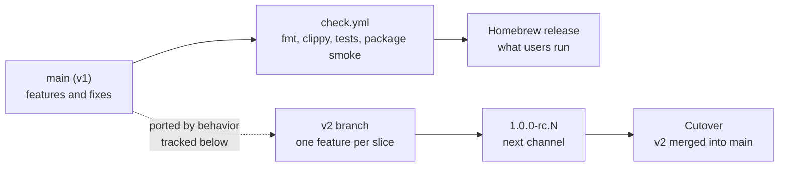
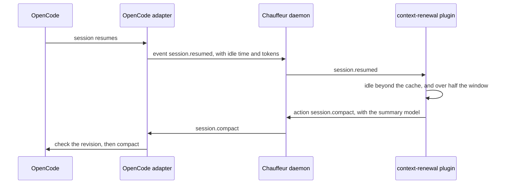
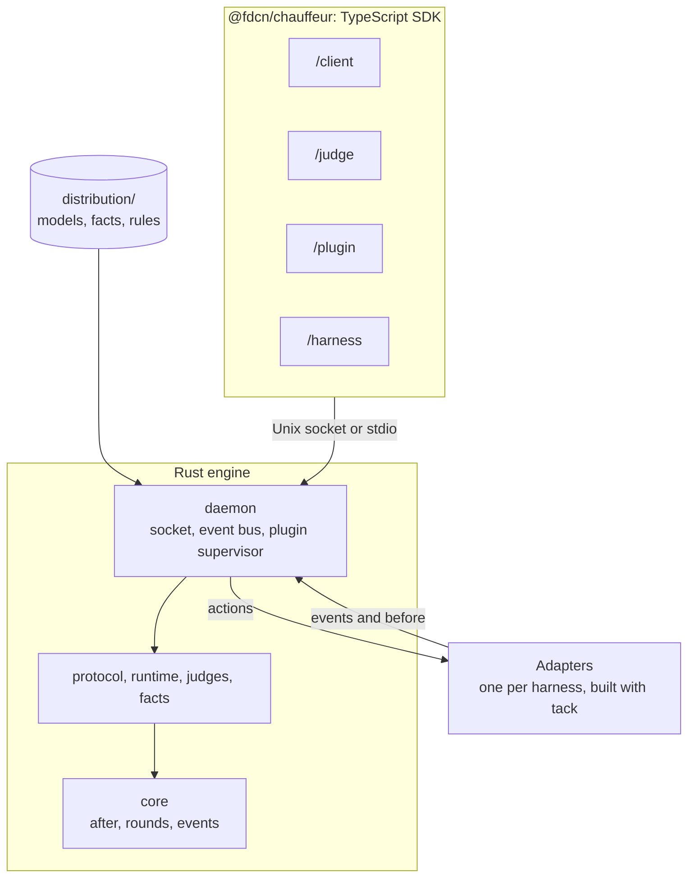
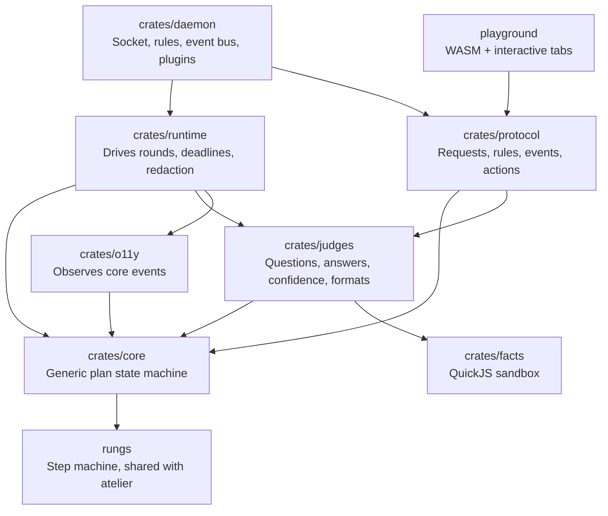
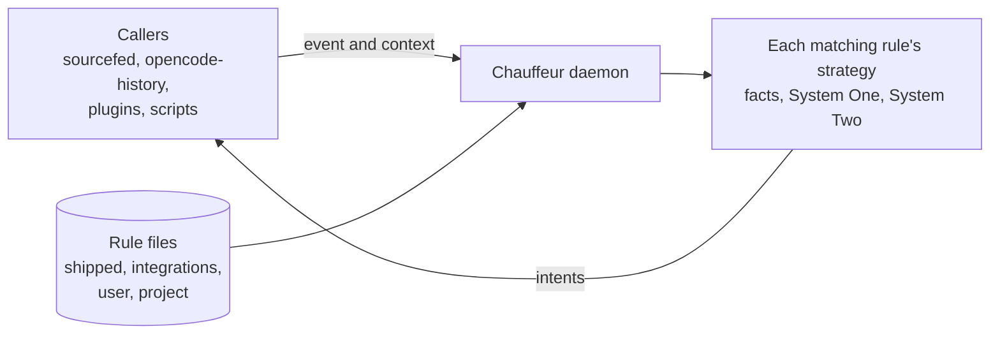
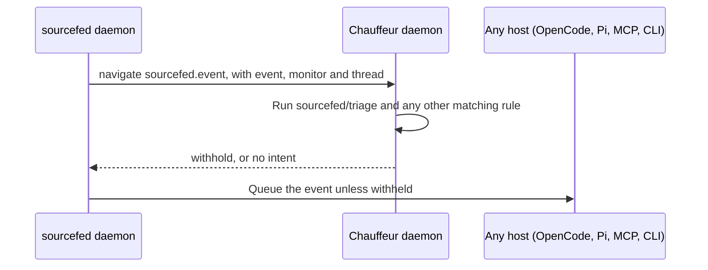
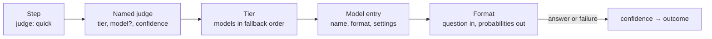
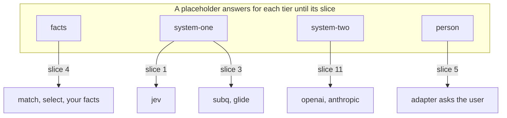
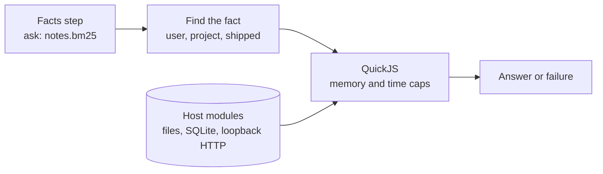

# Chauffeur v2 implementation plan

Status: design for review. The starting workspace is clean apart from its
toolchain, license, plan/audit documents and the Vite/WebAssembly playground.
The [v1 architecture audit](../audits/architecture.md) records the source
findings and checks that inform this plan.

## Goal

Chauffeur is a judgment engine with plugins around it.

- **The engine**, in Rust, runs bounded strategies. Each step asks a judge one
  question: facts (code), System One, System Two or a person. Every judge takes
  the same question and returns the same answer. Models are configuration;
  only each API format is code.
- **Plugins**, in TypeScript, are the behaviors: they hook into harness events,
  ask the engine questions, and act on the harness through generic actions.
- **Adapters**, one per harness, translate that harness's hooks into standard
  events and carry out actions. Chauffeur ships them, built with
  `@workhorse/tack`, which turns one plugin into each harness's native form.
  The OpenCode adapter is written against OpenCode's plugin API directly and
  moves onto tack in slice 8.
- **Callers**, any program, send a question with its context through
  `chauffeur.navigate`, with or without a harness. Rule files, which are
  data, decide how to answer. [Integrations](../integrations/README.md)
  has one page per program.

Shipped content (models, facts, rules) lives apart from the engine, in
`distribution/`, and loads through the same path as the user's own.

Each slice delivers one feature a person uses, working through the real path
and installable, and builds only the pieces that feature needs. The next
slice's feature brings the next pieces. See
[Slices](slices/README.md).

| #   | Feature                                                          | New pieces                                                                                |
| --- | ---------------------------------------------------------------- | ----------------------------------------------------------------------------------------- |
| 0   | [Setup](slices/slice-0.md)                                       | Toolchain, lints, the playground shell                                                    |
| 1   | [Conventional Commits nudge in OpenCode](slices/slice-1.md)      | Core, rule files, the Jev format, the OpenCode adapter, rc release                        |
| 2   | [sourcefed triage](slices/slice-2.md)                            | `navigate` for programs, intents, the TypeScript client                                   |
| 3   | [Escalation from Jev to GLiDE](slices/slice-3.md)                | Multi-step strategies with `after`, SubQ and GLiDE, `choice` and `score`, `strategy show` |
| 4   | [opencode-history recall](slices/slice-4.md)                     | Facts, `for_each`, `select`                                                               |
| 5   | [Harm guard, permissions and v1's rules](slices/slice-5.md)      | Plugins, `ctx.before`, asking the user, the rule-file fields v1's rules need              |
| 6   | [Skills and tools](slices/slice-6.md)                            | The skills, tools and `ask-chauffeur` plugins, prompt edits                               |
| 7   | [Context renewal, warming and model failover](slices/slice-7.md) | Session actions                                                                           |
| 8   | [Pi](slices/slice-8.md)                                          | Every feature so far, through its Pi adapter, built with tack                             |
| 9   | [Claude Code](slices/slice-9.md)                                 | The same, through its Claude Code adapter                                                 |
| 10  | [Codex](slices/slice-10.md)                                      | The same, through its Codex hook command                                                  |
| 11  | [Review by a reasoning model](slices/slice-11.md)                | The System Two formats                                                                    |
| 12  | [Rulebooks](slices/slice-12.md)                                  | Held until discussed                                                                      |
| 13  | [Cutover](slices/slice-13.md)                                    | v2 replaces v1                                                                            |

The work proceeds one slice at a time, with review before advancing.

```mermaid
flowchart LR
    S0["0 Setup"] --> S1["1 Commit nudge<br/>OpenCode, Jev"]
    S1 --> S2["2 sourcefed triage<br/>navigate"]
    S2 --> S3["3 Escalation<br/>after, GLiDE"]
    S3 --> S4["4 Recall<br/>facts, select"]
    S4 --> S5["5 Guard<br/>plugins"]
    S5 --> S6["6 Skills, tools"]
    S6 --> S7["7 Renewal, warming,<br/>failover"]
    S7 --> S8["8–10 Pi, Claude Code, Codex"]
    S8 --> S11["11 System Two"]
    S11 -.-> S12["12 Rulebooks<br/>held"]
    S12 --> S13["13 Cutover"]
```



## Production and parity with main

Users run v1, released from `main`. v2 changes nothing they install until
cutover, and `main` keeps receiving features and fixes meanwhile.



| Concern        | Decision                                                                                                                                                                                  |
| -------------- | ----------------------------------------------------------------------------------------------------------------------------------------------------------------------------------------- |
| Porting        | Each `main` feature is re-expressed in v2's architecture, not merged: v2's tree replaces v1's, so merges would conflict on every removed file                                             |
| Tracking       | The parity table lists every `main` commit after the branch point; the watermark names the last one reviewed                                                                              |
| Evidence       | A ported feature passes `main`'s cases for it, replayed against v2                                                                                                                        |
| Version mixing | The version handshake between the daemon, its SDK, plugins and adapters keeps v1 and v2 from running together                                                                             |
| User state     | v2 reads no v1 file. At cutover an agent rewrites the user's configuration into v2's files, from the prompt in the [migration guide](../migration/README.md#rewriting-your-configuration) |
| After cutover  | `v1` is a branch for hotfixes only                                                                                                                                                        |

### Parity table

The [migration guide](../migration/README.md) shows every v1 feature's file
beside the v2 rule file or plugin that replaces it.

Branch point `73bc29e`. Watermark: `269dfd7`.

| `main` commit                                                                      | v2 home                                                                                                                                                                                                                                                                                                                                                                                                                                                                         | Slice    | Evidence from `main`                                                                             |
| ---------------------------------------------------------------------------------- | ------------------------------------------------------------------------------------------------------------------------------------------------------------------------------------------------------------------------------------------------------------------------------------------------------------------------------------------------------------------------------------------------------------------------------------------------------------------------------- | -------- | ------------------------------------------------------------------------------------------------ |
| `f2b087b` judge interface, facts judge                                             | The `match` fact in `distribution/facts/`; `judge.json` routes become step judge names                                                                                                                                                                                                                                                                                                                                                                                          | 4        | `judges/facts/src/lib.rs` tests                                                                  |
| `bb41c9a` context renewal, session warming                                         | The `context-renewal` and `warming` plugins; the adapter carries out `session.compact` and `session.warm`                                                                                                                                                                                                                                                                                                                                                                       | 7        | `routing.rs`, `renewal.test.ts`, `warming.test.ts`                                               |
| `22e5391`, `36f6253` skill safety review                                           | The skills plugin's screen-then-review strategy                                                                                                                                                                                                                                                                                                                                                                                                                                 | 6        | `sources/tests.rs` vetting cases                                                                 |
| `3a18675` Skilld discovery                                                         | The harness's own skill sources: the skills plugin reads the harness's catalog, such as OpenCode's `skills` paths and HTTP catalogs, and fetches nothing                                                                                                                                                                                                                                                                                                                        | 6        | `cli/tests/skills.rs` discovery cases, against an HTTP catalog in OpenCode's config              |
| `c43ecd6` read guard, RPC starvation fix                                           | The guard plugin's `before` hooks; runtime admission permits (audit A3)                                                                                                                                                                                                                                                                                                                                                                                                         | 2, 5     | `read-guard-probes.json`, `rpc-starvation.test.ts`                                               |
| `9b8e917` rules                                                                    | Rule files in `distribution/rules/`; each v1 rule lands in the first slice that has the pieces it needs                                                                                                                                                                                                                                                                                                                                                                         | 1–11     | `capabilities/rules/tests/rules.rs`                                                              |
| Rulebooks (`/goal`, `/ticket`)                                                     | Rulebook files run by the `rulebooks` plugin; see [Rulebooks](#rulebooks)                                                                                                                                                                                                                                                                                                                                                                                                       | 12       | `skills/rulebooks/*.json`, `rulebooks.test.ts`                                                   |
| `73bc29e` Homebrew release, CI                                                     | Release scripts, `check.yml` and `release.yml` in v2: rc releases as `chauffeur-next` from slice 1, `1.0.0` at cutover                                                                                                                                                                                                                                                                                                                                                          | 1, 13    | `release.test.mjs`, `smoke.mjs`                                                                  |
| `f54db24`, `d66a385`, `e7fbabf` docs                                               | Documentation only                                                                                                                                                                                                                                                                                                                                                                                                                                                              | —        | —                                                                                                |
| `5330c3b` GLiDE, `fab9ae1` no escalation for permission requests, who answered     | `glide.json` over the `systemone` format; escalation is a strategy: System One with `model: "jev"`, then `model: "glide"`, then System Two. The guard's strategy asks one judge and never escalates, since the agent's call waits on it; each round's event names the model that answered and keeps the answers a later step replaced                                                                                                                                           | 3, 5, 11 | `judges/glide/tests/wire.rs`, `docs/judges.md` escalation cases                                  |
| `0adc459` a failed permission check keeps the host's decision                      | Rules on `permission.asked`: a failed or late answer keeps what the harness decided, since Chauffeur only vetoes what the host allows; a 5 s `before` budget; the adapter retries an unreachable daemon twice, 500 ms apart                                                                                                                                                                                                                                                     | 5        | `permission.test.ts`                                                                             |
| `16c1433`, `1949263`, `413eb65` tools that stay exposed                            | The `tools` plugin's `base` list: `history_search`; the agent conversation tools stay through the `agents` Code Mode namespace in `code_mode.always`                                                                                                                                                                                                                                                                                                                            | 6        | `tool-exposure/tests/exposure.rs`, `skills/config/tool-exposure.json`                            |
| `94e3b4e` 32 remote skill sources                                                  | The harness's config sets the sources; Chauffeur keeps no list or limit of its own                                                                                                                                                                                                                                                                                                                                                                                              | 6        | —                                                                                                |
| `02aee18`, `60d4c26` renewal fixes                                                 | The context-renewal plugin writes a summary in a temporary child session on the summary model, passes over a provider that failed for an hour, and leaves a session already on a cheap model to the harness's own compaction                                                                                                                                                                                                                                                    | 7        | `renewal.test.ts`, `model-router/tests/routing.rs`                                               |
| `c3b4e1b` reworded questions                                                       | The wording ships in each rule's `instructions`: the shell file guards (5), `cat-to-read` and `hand-rolled-patch` (the first slice with their pieces) and the Code Mode namespace question (6), each replayed against `main`'s recorded requests                                                                                                                                                                                                                                | 1–6      | `skills/permission/shell-file-*-guard.json`, `skills/rules/{cat-to-read,hand-rolled-patch}.json` |
| `0454f8a` escalation near the bar, `ask_chauffeur`, skill ranking, Code Mode notes | `after`'s `near` need: GLiDE answers when Jev's P lies within 0.15 of the bar the rule acts on, or Jev fails, and a strategy's steps end 1 s before the caller's deadline; `ask_chauffeur` asks Jev alone, grants at most two groups or namespaces and one skill, skips skills already in context, and suggests the closest; the `bm25` fact by default; one Code Mode note per namespace per session, none once it is called; rule wording that covers calls through Code Mode | 3, 5, 6  | `judgment/tests.rs`, `escalation.rs` tests, `ask-tool.test.ts`, `bench/ask`                      |
| `c86f15b` shell file searches steered to the grep tool                             | `grep-recursive`'s instructions and text, word for word                                                                                                                                                                                                                                                                                                                                                                                                                         | 5        | `skills/rules/grep-recursive.json`                                                               |
| `397a067` cache expiry from the user's `cache.ttl`                                 | The adapter sends the model's `cache_seconds` on `session.resumed` and `session.idle`, ahead of each plugin's per-provider option; a compaction after 2 minutes is the harness's own                                                                                                                                                                                                                                                                                            | 7        | `model-router/tests/routing.rs`, `renewal.test.ts`                                               |
| `8ad159e` agent tools out of `base`                                                | The `tools` plugin's `base` holds no agent tools; they reach the agent through Code Mode, with `agents` in `code_mode.always`                                                                                                                                                                                                                                                                                                                                                   | 6        | `tool-exposure/tests/exposure.rs`                                                                |
| `41b1931` `ask_chauffeur` bench                                                    | Benchmark only: `bench/ask` is the evidence for `0454f8a`                                                                                                                                                                                                                                                                                                                                                                                                                       | —        | —                                                                                                |
| `269dfd7` `/slice` rulebook                                                        | A rulebook file run by the `rulebooks` plugin, as `/goal` and `/ticket` are; its turn-end rules become rules in the v2 format                                                                                                                                                                                                                                                                                                                                                   | 12       | `skills/rulebooks/slice.json`, `rulebooks.rs` tests                                              |
| Uncommitted on `main`                                                              | Reviewed once committed                                                                                                                                                                                                                                                                                                                                                                                                                                                         | —        | —                                                                                                |

Context renewal on v2:



## Quality gates

A slice's rc ships only when every gate passes on its final tree. `check.yml`
runs format, lints, the MSRV check, tests, benchmarks once and the package smoke
test on each push to `v2`; the rest run locally before the tag.

| Gate       | Run                                                                                                                                                     | Passes when                                                                                                                            |
| ---------- | ------------------------------------------------------------------------------------------------------------------------------------------------------- | -------------------------------------------------------------------------------------------------------------------------------------- |
| Format     | `cargo fmt --all -- --check`; `bun run format:check` in `site/`                                                                                         | Nothing would change                                                                                                                   |
| Lints      | `cargo clippy --workspace --all-targets --locked -- -D warnings`, also for `chauffeur-judges` without default features and the playground's wasm target | No warning                                                                                                                             |
| MSRV       | `cargo +1.100.0 check --workspace --all-targets --locked`, also for `chauffeur-judges` without default features and the playground's wasm target        | Stable Rust 1.100, the `rust-version`, builds every crate                                                                              |
| Tests      | `cargo nextest run --workspace --locked`, `cargo test --doc --workspace --locked`, `bun run check` in `adapters/opencode`                               | Every test passes, every run; a test that fails sometimes is a bug                                                                     |
| Package    | `node --test scripts/*.test.mjs`, a release build, then `package.mjs` and `smoke.mjs` on the tarball                                                    | The tarball installs and runs its rule as `chauffeur` and as `chauffeur-next`                                                          |
| Mutation   | `cargo mutants` over the files the slice changed                                                                                                        | Every viable mutant is caught; an equivalent one is excluded in `.cargo/mutants.toml`, with why                                        |
| Proofs     | `cargo kani -p chauffeur-judges`, `cargo miri test -p chauffeur-core`                                                                                   | Every harness verifies; until Kani's compiler reaches Rust 1.100, `chauffeur-core` and `chauffeur-judges` use only APIs stable by 1.99 |
| Benchmarks | `node scripts/bench.mjs <base> -- -bench <Name> -count 10` when a hot path changes                                                                      | No regression against the base commit                                                                                                  |
| Docs       | `bun run build` in `site/`, then the changed pages in the preview                                                                                       | No dead link, and every diagram renders                                                                                                |
| Playground | The slice's tab in a real browser                                                                                                                       | It shows the feature working                                                                                                           |
| Real path  | The feature in its real harness or caller, with the real models; then the installed rc, recorded                                                        | The recording on the slice's page shows it                                                                                             |

## Architecture



| Kind      | What it is                                                      | Written by                                       | Examples                                                                  |
| --------- | --------------------------------------------------------------- | ------------------------------------------------ | ------------------------------------------------------------------------- |
| Rule file | Data: `on`, `when`, `judges`, `asks`, `strategy`, `then`        | Chauffeur, an integration, the user or a project | `conventional-commits`, `sourcefed/triage`, `opencode-history/recall`     |
| Fact      | A JavaScript module that answers a question without a model     | Chauffeur, the user, or a project (pure only)    | `match`, `select`, `bm25`, a user's `notes`                               |
| Plugin    | A TypeScript program that hooks events, asks questions and acts | Chauffeur, the user, anyone                      | `skills`, `context-renewal`, `warming`, `guard`                           |
| Caller    | Any program that sends a question and its context               | Anyone                                           | sourcefed's daemon, opencode-history, hook scripts                        |
| Adapter   | Per-harness glue: standard events out, actions in               | Chauffeur, one per harness, with tack            | Its OpenCode plugin, Pi extension, Claude Code mod and Codex hook command |

Policy lives in rule files, facts and plugins. Adapters and callers hold no
judging logic: an adapter translates, and a caller sends its question and acts
on the intents it gets back.

### Dependency direction



`crates/core` has one crate dependency, [rungs](https://github.com/StevenJPx2/rungs/issues/1),
the step machine it drives from slice 3, which is `no_std` with no
dependencies of its own. Core has no async runtime, HTTP, serde, UI, logging
or plugin system. Error types use the standard library. Other crates
consume core's event data. Adding crates does not by itself increase the
shipped binary: linked code and dependencies determine size.

### Why the engine is Rust

Measured on the development machine:

|                                                 | Result                     |
| ----------------------------------------------- | -------------------------- |
| One message over the Unix socket, 20 KB of JSON | 0.023 ms p50, 0.232 ms p99 |
| One Jev call (opencode-history's recall replay) | 278 ms p50                 |
| v1's Rust daemon at rest                        | 66 MB                      |
| Idle Bun, idle Node                             | 10 MB, 37 MB               |

| Concern      | Rust's part                                                                                                                                                                                                                                                              |
| ------------ | ------------------------------------------------------------------------------------------------------------------------------------------------------------------------------------------------------------------------------------------------------------------------ |
| Safety       | The deciding reason. The daemon parses untrusted input (the socket, project rules, project facts), holds model keys and redacts evidence. Rust gives memory safety there, `serde` rejects malformed input, and Kani and Miri prove strategies finish within their limits |
| Speed        | Not decisive: a hop costs 0.03 ms against a 278 ms model call                                                                                                                                                                                                            |
| Resource use | Decided by design more than language: lazy plugins, idle shutdown and bounded caches                                                                                                                                                                                     |

Plugins, adapters and the SDK are TypeScript. gdp-ts types the places where
a check must come before an action (see [Proofs](#proofs)).

## `chauffeur.navigate`

Callers use one operation, `chauffeur.navigate`: the decision a chauffeur
makes before steering. A request names an event and carries its context;
every rule whose `on` and `when` match answers it, and the caller receives
their intents:

```ts
import { navigate } from "@fdcn/chauffeur/client"

const { intents } = await navigate(
  {
    on: "opencode-history.recall",
    evidence: { message },
    candidates: { p1: "…", p4: "…", p7: "…" }
  },
  { signal: AbortSignal.timeout(1_500) }
)
// intents → [{ rule: "opencode-history/recall", attach: ["p4", "p1"] }]
```



- **The strategy is the rule's.** A rule can screen with facts, classify with
  System One and review only what System One leaves unsure with System Two.
  Changing the strategy changes a rule file, never a caller.
- **No intent means the caller's default.** A rule that matches nothing in its
  `then`, or whose judges fail, returns no intent: sourcefed then delivers the
  event, and recall attaches nothing.
- **An inline `strategy` replaces `on`** for scripts, plugins, the playground
  and tests, with its own `judges` and `asks`. It runs only that strategy and
  returns its verdict. The SDK's `ask` and `strategy` send inline strategies.
- **One call, one connection.** `navigate` connects to `$CHAUFFEUR_SOCKET`,
  sends the request, and closes the connection when the result arrives or
  the signal aborts, so a script exits as soon as it is done. A program that
  makes many calls keeps one connection with `connect()`, which reconnects
  after a daemon restart, and closes it itself:

  ```ts
  const chauffeur = connect() // connect({ socket }) for another daemon
  const triage = await chauffeur.navigate(request, { signal })
  chauffeur.close()
  ```

  Inside a plugin, both go over the plugin's stdio, which the daemon owns, and
  `close` does nothing.

### sourcefed: one triage for every host

sourcefed's daemon navigates `sourcefed.event` before it queues an event for
a target, so OpenCode, Pi, MCP and CLI all receive the same filtered stream.
sourcefed installs `sourcefed/triage`, a System One screen that withholds
confident noise; the user tunes or extends it in JSON.



With no Chauffeur, an error, or no answer within 3 seconds, sourcefed
delivers, as v1's gate does.

### opencode-history: recall

opencode-history searches its own index when the user sends a message, then
navigates `opencode-history.recall` with the message and the passages as
candidates. Its rule, `opencode-history/recall`, ranks them, and opencode-history attaches the
passages the `attach` intent names.

### Programs without a harness

A program needs no harness to ask Chauffeur. neo navigates
`neo.screen-check` with an iPhone screenshot before each irreversible tap,
and jev-distill's students answer as System One models. Each has
a page in [Integrations](../integrations/README.md).

### One protocol, many bindings

`navigate` is a Chauffeur operation, not any host's. Its request and result
are defined once, in `crates/protocol/schema/navigate.json`, and every binding
forwards them to the daemon socket unchanged:

| Binding                  | Caller                                          | Mechanism                                             |
| ------------------------ | ----------------------------------------------- | ----------------------------------------------------- |
| `@fdcn/chauffeur/client` | Any TypeScript program                          | `navigate(request)` over the socket                   |
| `chauffeur navigate`     | Hook scripts, Git hooks, CI on the same machine | One request on stdin; the JSON-RPC messages on stdout |
| `crates/protocol`        | Rust programs                                   | The same types the daemon uses                        |

Adding a host or a language adds a binding, never a new request format. The
schema's fixtures run in the protocol crate's tests and in each binding's
tests.

### JSON-RPC 2.0

Every message to and from the engine is JSON-RPC 2.0, one message per line,
over two transports:

| Transport       | Used by                    | Why                                                                                        |
| --------------- | -------------------------- | ------------------------------------------------------------------------------------------ |
| The Unix socket | Clients, the CLI, adapters | Independent programs reach the daemon; the socket's `0700` directory is the access control |
| stdio           | Plugins the daemon starts  | A plugin's lifetime is tied to the daemon's, with no socket permissions to manage          |

The same messages travel on both. A request with an `id` gets a result or an
error; a message without one is a notification, used for streamed events.
`$/cancelRequest` with a request's `id` cancels it, and closing a connection
cancels everything it carried. JSON-RPC is the standard LSP and MCP use: it
needs nothing beyond `serde_json`, and its messages stay readable when
debugging.

| Method            | Direction        | Carries                                                                   |
| ----------------- | ---------------- | ------------------------------------------------------------------------- |
| `navigate`        | Caller → daemon  | A request; `event` notifications stream back, then the intents or verdict |
| `emit`, `before`  | Adapter → daemon | A harness event; `before` returns the edits plugins made                  |
| `act`             | Daemon → adapter | An action, with the revision it applies to                                |
| `start`           | Daemon → plugin  | Discovery or run mode, options and the actions available                  |
| `hooks`           | Plugin → daemon  | The events the plugin hooks with `on` and `before`                        |
| `event`, `before` | Daemon → plugin  | A hooked event; `before` returns edits                                    |
| `act`, `navigate` | Plugin → daemon  | An action, or a question for the engine                                   |

### Stateless invocation

A navigation has a caller, request ID, an event or inline strategy, bounded
evidence and candidates, and a deadline. It runs without an agent session or
prior history; the caller supplies the evidence it wants considered. Intents
and transition events return to that caller. The only state kept between
navigations is a rule's cooldown. Plugins keep their own state.

## Judges

Every judge takes one question and returns one result. Judges come in four
tiers. A rule names its judges in `judges`, each with a tier, an optional
model and a confidence, and a step's `judge` names one of them or a tier:

| In a rule                                                                  | Answered by                                                                                                     |
| -------------------------------------------------------------------------- | --------------------------------------------------------------------------------------------------------------- |
| `"quick": { "tier": "system-one", "confidence": 0.7 }`                     | The tier's models, in the user's fallback order                                                                 |
| `"careful": { "tier": "system-one", "model": "glide", "confidence": 0.7 }` | GLiDE; the tier's fallback order applies if GLiDE is unavailable or not configured, and the run's events say so |
| A step with `"judge": "facts"`                                             | The facts tier, with no model and no confidence                                                                 |

Naming the model lets one strategy use two models of the same tier, such as
Jev for a fast screen and GLiDE, more accurate but slower, for what Jev leaves
unsure. A rule shared with someone who lacks GLiDE still runs, on their
System One.

### Questions

A question is instructions and a list of possible outcomes. Nothing else
reaches a judge:

```jsonc
{
  "instructions": "What should the agent do with this message?",
  "outcomes": [
    "act",
    "ignore",
    { "value": "ask-user", "description": "Unclear; the user decides" }
  ],
  "evidence": ["thread", "event"]
}
```

- 2 to 64 outcomes, each unique. An outcome is a string, or a `value` with a
  `description` that the model sees.
- The list's order is meaningful: it is the order of a scale, when the
  outcomes are one.
- `unsure` and `failed` are reserved and cannot be outcomes.
- `evidence` names the request's evidence blocks the judge sees. A block is
  text, or an image (bytes and a media type, at most 4 MiB). Only formats that
  accept images receive one, such as Jev with its opt-in; an image is never
  redacted, so only a step that names it sends it.

The SDK's question functions build this shape, using Jev's names:

| Function                               | Builds                                                               | Example                                                                            |
| -------------------------------------- | -------------------------------------------------------------------- | ---------------------------------------------------------------------------------- |
| `noul(instructions)`                   | `outcomes: ["yes", "no"]`                                            | "Does this commit message break Conventional Commits?"                             |
| `choice(outcomes, instructions)`       | `outcomes` as given                                                  | "What should the agent do with this message?"                                      |
| `score(levels, instructions)`          | `outcomes` as given, lowest first                                    | "How hard is the user's request?"                                                  |
| `question({ instructions, outcomes })` | The primitive the others use; anyone can write new functions over it | `question({ instructions, outcomes: ["none", "minor", "major", "irreversible"] })` |

### Results

A judge either answers or fails. Failure is not an outcome:

| Side    | Carries                                                                                                                                                                            |
| ------- | ---------------------------------------------------------------------------------------------------------------------------------------------------------------------------------- |
| Answer  | `outcome`: one of the question's outcomes, or `unsure`. `p`: a probability for every outcome. `level`: the probability-weighted position in the list, from 0 (first) to n−1 (last) |
| Failure | Why: `unavailable`, `rate_limited`, `timeout`, `invalid` or `deadline`                                                                                                             |

```json
{
  "answer": {
    "outcome": "medium",
    "p": { "low": 0.12, "medium": 0.45, "high": 0.43 },
    "level": 1.31
  }
}
{ "failed": "timeout" }
```

`level` is meaningful when the outcomes are a scale: `level ≥ 1` reads as
"medium or higher" even when no single level is likely enough. Every tier
answers every question, so moving a step between tiers changes only its
`judge`.

### Confidence

The rule, not the model, decides when an answer is sure enough. A named
judge's `confidence` is how likely its top outcome must be, from 0 to 1:

| `confidence`                 | Outcome                                                                                                                                                      |
| ---------------------------- | ------------------------------------------------------------------------------------------------------------------------------------------------------------ |
| `0.7`                        | The likeliest outcome when its probability is 0.7 or more; otherwise `unsure`                                                                                |
| `{ "yes": 0.9, "no": 0.95 }` | Per outcome: here `yes` needs 0.9 and `no` needs 0.95. The map must cover every outcome of every question the judge is used for, checked when the rule loads |
| none                         | The likeliest outcome; a tie is `unsure`                                                                                                                     |

```text
confidence 0.7 on noul "Does this commit message break Conventional Commits?"
  "fixed stuff"              yes 0.94, no 0.06 → yes
  "feat(cli): add navigate"  yes 0.06, no 0.94 → no
  "Update parser.rs"         yes 0.58, no 0.42 → unsure
  Jev timed out                                → failed: timeout
```

```text
"Could this command cause irreversible harm?" with confidence { yes: 0.9, no: 0.95 }
  "rm -rf ~/Projects"  yes 0.96, no 0.04 → yes
  "ls -la"             yes 0.02, no 0.98 → no
  "git clean -fd"      yes 0.12, no 0.88 → unsure, so the user is asked
```

A failure stays a failure whatever the confidence, so it never reads as `no`.
The runtime applies confidence the same way for every tier, in thousandths so
comparisons stay exact, and models never see it. Each judge's confidence is
tuned against labelled cases.

### Tiers

| Tier         | Answers with                                                            | Shipped                                |
| ------------ | ----------------------------------------------------------------------- | -------------------------------------- |
| `facts`      | JavaScript functions in a sandbox: no model and no credentials          | `match`, `select`, `bm25`, `embedding` |
| `system-one` | A fast classifier, one batched call per round                           | `jev` (default), `subq`, `glide`       |
| `system-two` | A reasoning model, with a schema-checked answer that cites its evidence | Disabled until reviewed (slice 11)     |
| `person`     | The user, asked through the adapter                                     | Each adapter                           |

### How a step reaches a model

A step reaches the code that answers it through four layers. Each layer knows
only the one below it, and all four tiers are built the same way:



| Layer       | Defined in                                 | Example                                                                          |
| ----------- | ------------------------------------------ | -------------------------------------------------------------------------------- |
| Named judge | A rule's `judges`, or `judge()` in the SDK | `"quick": { "tier": "system-one", "confidence": 0.7 }`                           |
| Tier        | `models.json` `tiers`                      | `"system-one": ["jev", "subq"]`                                                  |
| Model entry | `models.json` `models`                     | `"jev": { "format": "systemone", "endpoint": "…", "key": { "env": "JEV_KEY" } }` |
| Format      | Rust in `crates/judges`                    | `systemone`, `openai`, `anthropic`, `facts`, `person`, `placeholder`             |

Every format implements `answer_all`. A model answers every question it
received in a round with one call, and the format decides how to ask its
model from the question's outcomes:

```rust
let replies = jev.answer_all(&round_questions, &evidence);
// → [Ok({ yes: 0.94, no: 0.06 }), Err(Failure::Timeout), …]
```

| `Failure`                               | Then                          |
| --------------------------------------- | ----------------------------- |
| `Unavailable`, `RateLimited`, `Timeout` | The tier's next model answers |
| `Invalid`                               | The step fails                |

| Format        | Speaks                                                                                                                                                                                                                                |
| ------------- | ------------------------------------------------------------------------------------------------------------------------------------------------------------------------------------------------------------------------------------- |
| `systemone`   | The `/v1/systemone` API that Jev, SubQ Snap and Fastino GLiDE share: its `noul` type for `["yes", "no"]`, and `choice`, which returns every outcome's probability, for the rest. GLiDE's entry sets its reading of `score` as a level |
| `openai`      | OpenAI-compatible chat completions, with a JSON schema whose `enum` is the outcomes; covers local servers such as Ollama                                                                                                              |
| `anthropic`   | Anthropic Messages with the same schema                                                                                                                                                                                               |
| `facts`       | Runs a fact in `crates/facts`                                                                                                                                                                                                         |
| `person`      | A question to the user through the adapter                                                                                                                                                                                            |
| `student`     | A jev-distill student over its loopback server: the task's labels are the outcomes, and evidence blocks fill its `state`                                                                                                              |
| `placeholder` | Recorded or fixed answers, standing in until the real model is configured                                                                                                                                                             |

An outcome outside the question's list fails the step as `invalid`.
`crates/judges` turns each tier's models into one core `Judge`, so core sees a
judge per tier and model, such as `system-one:glide`, and nothing below it.

### Models are configuration

A model is registered the way a user registers a model provider anywhere
else: a name, a built-in API format, and the endpoint, model ID and credential
to use.

```jsonc
// ~/.config/chauffeur/models.json
{
  "models": {
    "local-qwen": {
      "format": "openai",
      "endpoint": "http://127.0.0.1:11434/v1",
      "model": "qwen3:4b"
    },
    "reviewer": {
      "format": "anthropic",
      "model": "claude-sonnet-5-5",
      "key": { "env": "ANTHROPIC_API_KEY" },
      "timeout_ms": 20000
    }
  },
  "tiers": {
    "system-one": ["jev", "subq", "local-qwen"],
    "system-two": ["reviewer"]
  }
}
```

- A step's `model` names an entry. `distribution/models/` ships `jev`, `subq`
  and `glide` as the same JSON. The user's file adds models and overrides
  shipped ones by name. Changes take effect without a restart.
- `tiers` lists models in fallback order. The next model answers only when
  one is unavailable, rate-limited or timed out, never because of what it
  answered. Escalating to another model or tier is the strategy's job.
- Models load only from shipped and user configuration, never from a
  project's `.chauffeur/`. A model entry is a network endpoint, so a cloned
  repository could otherwise send evidence wherever it chose.
- A key is named, as an environment variable or a keychain entry, and is read
  only by `crates/judges`. It never reaches rule files, callers, plugins or
  audit.
- A shipped model is used once its key is present; a System Two model also
  needs the user to turn it on.

### Placeholders

A `placeholder` model stands in for a tier, or for one fact, until the real
one is configured. Rules do not change when it is replaced; only `models.json`
does.

```jsonc
// models.json for tests and the playground
{
  "models": {
    "one-stand-in": {
      "format": "placeholder",
      "answers": "fixtures/triage-answers.json"
    },
    "two-stand-in": {
      "format": "placeholder",
      "otherwise": { "act": 0.8, "ignore": 0.2 }
    },
    "person-stand-in": {
      "format": "placeholder",
      "otherwise": { "yes": 1, "no": 0 }
    }
  },
  "tiers": {
    "system-one": ["one-stand-in"],
    "system-two": ["two-stand-in"],
    "person": ["person-stand-in"]
  }
}
```

```jsonc
// fixtures/triage-answers.json
{
  "answers": [
    {
      "evidence": { "event": "thanks, looks good 👍" },
      "p": { "yes": 0.52, "no": 0.48 }
    },
    {
      "evidence": { "event": "@agent bump retries to 5" },
      "p": { "yes": 0.94, "no": 0.06 }
    },
    { "evidence": { "event": "deploy is on fire" }, "failed": "timeout" }
  ]
}
```

- `answers` is matched by evidence: an entry answers a question whose evidence
  contains every block the entry lists, with the same content. The first
  match wins, so one file serves every rule that asks about the same input.
- `otherwise` answers what no entry matches; without it, the step fails as
  `unavailable`, so a gap in the recorded answers shows.
- Every placeholder answer is marked in events and in `strategy show`, so it
  never passes for a real model's.
- Recorded answers can be real ones, such as opencode-history's Jev scores, to
  tune a rule's confidence before it runs live.



## Facts

A fact is a JavaScript module that answers a question without a model. It
runs in `crates/facts`, an embedded QuickJS sandbox. Shipped facts and the
user's own have the same shape; a user's fact replaces a shipped one of the
same name.



A fact module exports a default function, named functions, or both:

```js
// ~/.config/chauffeur/facts/notes.js
import { query } from "chauffeur:sqlite"

// "notes.bm25": BM25 over the user's own notes database
export function bm25({ evidence, args }) {
  const rows = query(
    "~/notes/index.db",
    "SELECT id FROM notes WHERE notes MATCH ? ORDER BY bm25(notes) LIMIT ?",
    [evidence.message, args.top ?? 10]
  )

  return { ranked: rows.map((row) => row.id) }
}

// "notes": is the message about something already in the notes?
export default function ({ evidence }) {
  const [hit] = query(
    "~/notes/index.db",
    "SELECT 1 FROM notes WHERE notes MATCH ? LIMIT 1",
    [evidence.message]
  )

  return { p: { yes: hit ? 1 : 0, no: hit ? 0 : 1 } }
}
```

A facts step names the fact and its arguments as its `ask`:

```jsonc
{ "id": "related", "judge": "facts", "ask": { "notes.bm25": { "top": 10 } } }
{ "id": "is-slack", "judge": "facts",
  "ask": { "match": { "field": "event.source", "equals": "slack" } } }
```

| A fact receives                                         | A fact returns                                   |
| ------------------------------------------------------- | ------------------------------------------------ |
| `evidence`, the request's named blocks                  | `{ p }` over the outcomes, usually 1 and 0       |
| `candidates`                                            | `{ ranked: [...] }`: candidate names, best first |
| `outcomes` of earlier steps, with their `p` and `level` | Throws: the step fails as `invalid`              |
| `args`, from the step                                   |                                                  |

| Source  | Folder                       | Host modules                                                                            |
| ------- | ---------------------------- | --------------------------------------------------------------------------------------- |
| Shipped | `distribution/facts/`        | `chauffeur:fs` (read), `chauffeur:sqlite` (read-only), `chauffeur:http` (loopback only) |
| User    | `~/.config/chauffeur/facts/` | The same                                                                                |
| Project | `.chauffeur/facts/`          | None: pure functions of their inputs                                                    |

### Shipped facts

| Fact        | Does                                                                                                                                                                                                       |
| ----------- | ---------------------------------------------------------------------------------------------------------------------------------------------------------------------------------------------------------- |
| `match`     | Conditions on evidence fields: `equals`, `one_of`, `contains`, `pattern` (glob), `at_least`, `at_most` (a number, or another field times `times`); combined with `all` and `any`; `cases` answers a choice |
| `select`    | Combines earlier outcomes: `first` settled in a list, `top` N, all at or above `min`, `majority` or `mean`; `by` names the outcome whose probability ranks, such as `yes`                                  |
| `bm25`      | Ranks candidates against a query                                                                                                                                                                           |
| `embedding` | Ranks candidates by similarity from the local embedding service                                                                                                                                            |

v1's context-renewal rule, as a `match`:

```jsonc
{
  "id": "renew",
  "judge": "facts",
  "ask": {
    "match": {
      "all": [
        { "field": "idle_seconds", "at_least": { "field": "cache_seconds" } },
        {
          "field": "context_tokens",
          "at_least": { "field": "context_window", "times": 0.5 }
        }
      ]
    }
  }
}
```

A field the evidence lacks fails the step as `invalid`, never `no`.

### Limits

| Concern      | Decision                                                                                                                  |
| ------------ | ------------------------------------------------------------------------------------------------------------------------- |
| Runaway code | Each call has a memory cap (16 MiB by default) and an interrupt at the step's deadline; overrunning either fails the step |

## Rulebooks

A rulebook is a set of rules that a slash command switches on for one session.
`/goal ship the parser fix` keeps the agent working until the evidence shows
the goal is met, and `/ticket` does the same for a ticket. A project adds its
own books in `.chauffeur/rulebooks/`.

The [`rulebooks` plugin](../plugins/rulebooks.md) runs them:

- At start, it registers each book's command with `command.add`.
- The command starts, pauses, resumes or clears the book in that session.
- While a book runs, its rules go through `navigate` like any other rule, and
  each delivery counts against the book's budget.

A book keeps v1's fields (`args`, `budget`, `on_start`, `on_budget`). Its
rules use the v2 [rule format](../migration/rule-format.md), and a rule ends
the book with an `end` intent. The rest of the design is held until it is
discussed; [slice 12](slices/slice-12.md) is written then, and cutover waits
for it, since v1 users rely on `/goal`.
