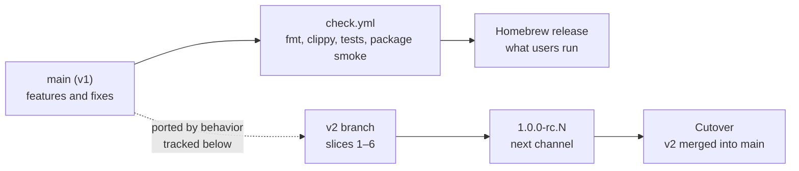
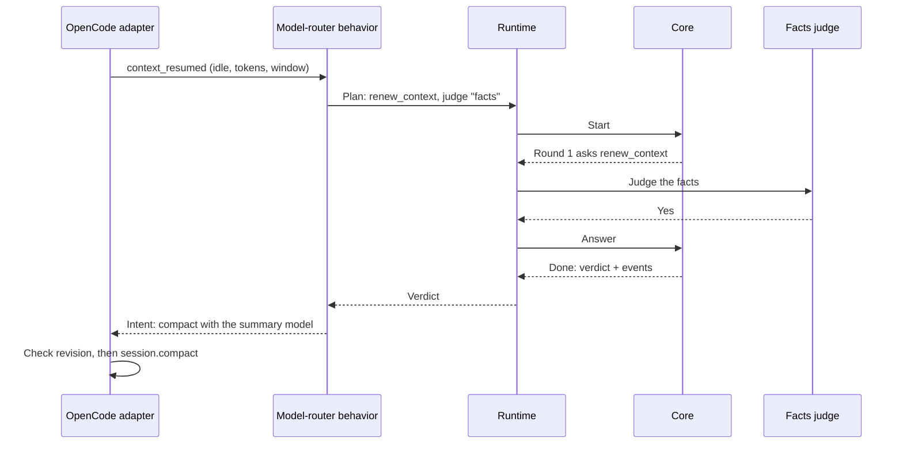
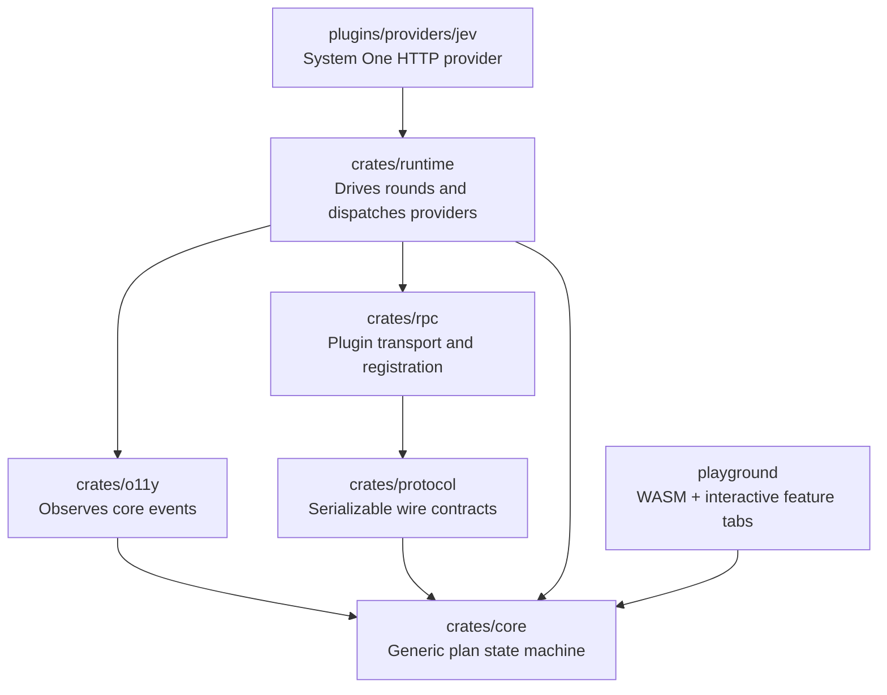
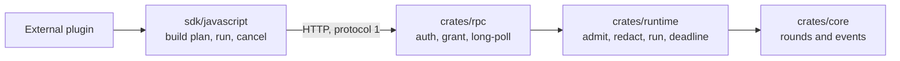

# Chauffeur v2 implementation plan

Status: design for review. The starting workspace is clean apart from its
toolchain, license, plan/audit documents and the Vite/WebAssembly playground.
The [v1 architecture audit](../audits/architecture.md) records the source
findings and checks that inform this plan.

## Goal

Chauffeur's core runs generic, bounded judgment plans. Applications and
behavior plugins build plans and supply domain evidence. Each step names the
judge that answers it. A judge is anything implementing core's generic `Judge`
interface: a deterministic rule, a System One classifier, a System Two
reasoner or a person. Provider plugins supply the model-backed judges.
Observability and RPC consume core's public contracts; core depends on neither.

The initial slices are:

1. a generic state machine that is playable in the browser;
2. the provider-neutral inference contract and plugin/RPC path;
3. Jev implementing that contract.
4. System Two structured reasoning on the same plan/runtime path.
5. Behavior plugins and the OpenCode adapter, reaching parity with `main`.
6. Release and cutover: v2 replaces v1 as the shipped Chauffeur.

The work proceeds one crate/slice at a time, with review before advancing.

## Production and parity with main

Users run v1, released from `main`. v2 changes nothing they install until
cutover, and `main` keeps receiving features and fixes meanwhile.



| Concern | Decision |
|---|---|
| Porting | Each `main` feature is re-expressed in v2's architecture, not merged: v2's tree replaces v1's, so merges would conflict on every removed file |
| Tracking | The parity table lists every `main` commit after the branch point; the watermark names the last one reviewed |
| Evidence | A ported feature passes `main`'s cases for it, replayed against v2 |
| Version mixing | The daemon/plugin version handshake keeps v1 and v2 from running together |
| User state | `~/.config/chauffeur` is migrated, or read compatibly, at cutover |
| After cutover | `v1` is a branch for hotfixes only |

### Parity table

Branch point `73bc29e`. Watermark: `e7fbabf`.

| `main` commit | v2 home | Slice | Evidence from `main` |
|---|---|---|---|
| `f2b087b` judge interface, facts judge | Facts is a rule judge on the panel; `judge.json` routes become step judge names and grants | 2 | `judges/facts/src/lib.rs` tests |
| `bb41c9a` context renewal, session warming | Model-router behavior; the adapter performs `compact` and `warm` | 5 | `routing.rs`, `renewal.test.ts`, `warming.test.ts` |
| `22e5391`, `36f6253` skill safety review | Skill-review behavior: a screen-then-review plan | 3–4 | `sources/tests.rs` vetting cases |
| `3a18675` Skilld discovery | Skill-sources behavior; fetches run on runtime workers (audit A4) | 2, 5 | `cli/tests/skills.rs` |
| `c43ecd6` read guard, RPC starvation fix | Permission behavior; runtime admission permits (audit A3) | 2, 5 | `read-guard-probes.json`, `rpc-starvation.test.ts` |
| `9b8e917` rules | Rule content for the rules behavior | 5 | `capabilities/rules/tests/rules.rs` |
| `73bc29e` Homebrew release, CI | Release scripts and `check.yml` in v2 | 6 | `release.test.mjs`, `smoke.mjs` |
| `f54db24`, `d66a385`, `e7fbabf` docs | Documentation only | — | — |

Context renewal on v2:



Warming asks no question: the behavior returns a `warm` intent without a plan.

## Dependency direction



`crates/core` has no crate dependencies: no async runtime, HTTP, serde, UI,
logging or plugin system. Error types use the standard library. Other crates
consume core's event data.

Adding crates does not by itself increase the shipped binary: linked code and
dependencies determine size. Each package owns a real boundary.

## Pluggability boundaries

```mermaid
sequenceDiagram
    participant B as Behavior plugin
    participant P as Versioned protocol / RPC
    participant R as Runtime
    participant C as Core plan
    participant I as Inference provider
    B->>P: Register operation; submit bounded plan + evidence
    P->>R: Invoke with plugin grant and deadline
    R->>C: Advance ready steps
    C-->>R: Typed System One / System Two requests
    R->>I: Execute on bounded provider workers
    I-->>R: Validated answer or explicit failure
    R-->>C: Settle step; continue or finish
    R-->>P: Correlated verdict + bounded events
    P-->>B: Result
```

The default bundle may link native Rust behavior and provider plugins. An
independently installed behavior plugin runs out of process and connects over
versioned RPC through the JavaScript SDK. Both paths submit the same declarative
plan and use the same admission, validation, deadline, redaction and failure
rules; the runtime never loads or executes external plugin code.

| Owner | Responsibility | Boundary |
|---|---|---|
| `crates/core` | Generic plan composition, validation and state transitions | No transport, provider, host or domain policy |
| `crates/runtime` | Admission, run state, deadlines, cancellation, egress redaction and provider dispatch | Injects implementations; owns no behavior-plugin policy |
| `crates/protocol` / `crates/rpc` | Versioned plan and result schemas, registration, grants and bounded event delivery | A plugin ID names a principal; it grants no authority by itself |
| Behavior plugins | Questions, evidence selection, domain state, verdict interpretation and action intents | Never call host APIs directly |
| Provider plugins | System One classification and System Two reasoning, transport and credentials | Expose provider-neutral results to the runtime |
| Host adapters | Report host observations and enforce approved actions at host seams | Host denials remain authoritative |
| JavaScript SDK | Registration, plan construction, correlated requests and reconnect handling | Cannot mint grants or bypass runtime validation |

### Stateless invocation and inference tiers

An invocation has a caller, request ID, bounded evidence, declared plan and
deadline. It can run without an agent session, `Signal`, `Situation`, or prior
history; the caller supplies the evidence it wants considered. Results and
transition events return to that caller. Agent observations and host actions
are separate operations, admitted only under their own scope grants.

System One and System Two are judges, not separate domain-policy engines or
special request kinds. They implement the same `Judge` interface as a
deterministic rule, and a plan mixes them freely: a rule can screen, System One
can classify what the rule leaves unsure, and System Two can review what System
One leaves unsure. Each provider maps its native answer onto the plan's
outcome type:

| Judge | Input | Result |
|---|---|---|
| Rule | The step's request | A deterministic outcome; no model, network or credentials |
| System One | Redacted evidence and typed questions | Probability, choice or score, mapped to an outcome |
| System Two | Named execution profile, instructions, bounded evidence and output schema | Schema-validated verdict or explicit failure |

The v1 experiment's direct `judge(policy)` and `complete(profile)` calls are
not the primary v2 plugin API: each exposes only one inference request and
cannot express a screen, conditional escalation, fan-out or result assembly.
An external caller submits a bounded declarative plan; inference requests are
its steps. A future one-step convenience API is acceptable only if it lowers to
that same path and cannot bypass plan limits, grants, redaction or deadlines.

### Access, delivery and failure rules

- A host administrator grants each plugin named operations and observation or
  action scopes. Plugin-supplied IDs and payloads are never authority.
- External plugins are trusted processes, not sandboxes. They cannot register
  callback URLs or run inside the daemon.
- Long-poll delivery uses bounded, cancellable queues. The SDK handles
  correlation, reconnect and disconnect leases; registrations and pending
  work expire with their lease, and overflow is explicit.
- One admission permit covers queued, waiting and active work. Per-plugin
  quotas, interactive capacity, plan size, evidence bytes, node count, depth,
  fan-out, rounds, attempts and output size are checked before dispatch.
- Deadlines include queueing, preparation, every inference round and delivery.
  A disconnected caller cancels future work; a blocking provider call retains
  its worker lease until it ends, and late results cannot commit actions.
- Redaction runs after evidence assembly and before every provider call, and
  also covers errors and audit metadata. Provider credentials remain in the
  provider implementation and never enter plugin grants.
- A pipeline returns data and action intents, not host effects. A host adapter
  checks the current observation revision and its grant before acting; host
  denials and the safety veto cannot be overridden by a plugin verdict.

Native providers are linked only into bundles that select them. Adding a
provider crate does not make it public or enabled. Embeddings are a shared,
bounded local service; domain-specific vector caches and ranking stay with the
behavior that owns them.

## Core plan model

A plan is an ordered directed acyclic graph. It contains named steps, each
carrying a generic request payload `Q`; a caller chooses the outcome type `O`.
Core does not know what either means. A step may have several gates; every gate
must pass.

```text
Step<Q> = { id, judge: name, request: Q, gates: [Gate<O>] }
Gate<O> = { mode: any | all, sources: [preceding step IDs], on: [Outcome<O>] }
Outcome<O> = Value(O) | Failed
StepState<O> = Pending | Asked | Settled(Outcome<O>) | Skipped
```

`Skipped` is a machine state, not a classifier outcome. A failed provider call
settles asked steps as `Failed`; a user-defined outcome such as `Unsure` is a
normal `Value(O)`. A step runs at most once. Gates only reference preceding
steps, so a finite plan terminates after at most one round per step.

### Gate behavior

- **Any:** run as soon as one source settles to a value listed in `on`. Skip
  once all sources are terminal and none matched.
- **All:** skip as soon as a source is terminal without a listed value. Run
  once every source matches.
- A skipped source is terminal and is not a match. `Failed` can match when
  explicitly listed in `on`.

These are proposed semantics for review. Gates on one step combine with AND;
within a gate, `Any` and `All` short-circuit once their result is known.
Independent ready steps share a round.

### Judges

A judge answers a step's request. Core defines the interface; it has no
dependencies and is synchronous:

```rust
pub trait Judge<Q, O> {
    fn judge(&self, request: &Q) -> Outcome<O>;
    // Defaults to one `judge` call per request; a batching provider overrides it.
    fn judge_all(&self, requests: &[&Q]) -> Vec<Outcome<O>>;
}
// Any `Fn(&Q) -> Outcome<O>` is a judge.
```

A step names its judge, because plans are data: JSON and RPC plans can only
refer to judges the host already holds, and grants can then limit which judges
a plugin may use. A `Panel` maps names to judges. `plan.run(&panel)` validates
the plan, rejects a name the panel lacks before asking anything, and then asks
each judge its share of every round in one `judge_all` call. A batch with the
wrong number of answers settles as `Failed`. The round-by-round API remains for
the playground and RPC; each `Question` reports its step, judge and request.

Judges are synchronous so rules stay plain functions. The runtime runs slow
judges such as Jev on bounded worker threads, with deadlines and cancellation;
neither core nor the interface changes for that.

### Composable plans

The public helpers are conveniences that lower to this same plan model:

```rust
let screen_then_review = ask("screen", "system-one", screen_question)
    .then_on(
        When::any([Outcome::Value(Unsure), Outcome::Failed]),
        ask("review", "system-two", review_question),
    );

let candidates_then_review = all([
    ask("skill-slack", "system-one", slack_question),
    ask("skill-jira", "system-one", jira_question),
    ask("skill-memory", "system-one", memory_question),
])
.then_if_any(Outcome::Value(Yes), ask("review", "system-two", review_question));
```

`ask`, `all`, `then_on` and `then_if_any` are ordinary functions/builders, not
a privileged list of built-in strategies. A plugin can define `fan_out`,
`screen_then_review`, or its own strategy by composing them. The playground
edits the same plan structure, so Rust builders and RPC plans have one meaning.

Composition lowers to the DAG: `all` combines independent plans;
`then_on`/`then_if_any` add a gate to each root of the following plan, referring
to the terminal steps of the preceding plan. If a step already has gates, the
composition gate joins that list. Names are unique across the composed plan.

## State machine and event model

`plan.run(&panel)` runs a plan to its end. Underneath, core advances one round
at a time, so a caller may also drive rounds itself: the runtime around slow or
remote judges, or the playground with answers picked by hand. The low-level API
returns events as data:

```rust
let transition = plan.start();
observe(transition.events);
let round = transition.next.ask()?;
let reply = answer_round(round.questions()); // each question names its judge
let transition = round.answer(reply)?;
observe(transition.events);
```

Each transition includes:

- the next state: `Ask { round, questions }` or `Done { verdict }`;
- the events produced by the transition.

The proposed event vocabulary is `Started`, `RoundReady`, `StepSettled`,
`StepSkipped` and `Finished`. Events have stable step IDs, round numbers and
settled outcomes; they contain no transport or provider-specific types. A
runtime may offer a local observer callback around transitions; the only
user-supplied code core invokes is a judge, inside `run`.

`crates/o11y` consumes events for logs, traces or audit. `crates/runtime` can
offer a convenience observer callback, but core does not call user code. For
RPC, runtime/protocol serializes events and sends them through a bounded queue;
remote observers never block a core transition.

The state machine does not decide provider choice, retry/backoff, HTTP,
credentials, or domain actions. Those belong to runtime, provider and plugin
contracts respectively.

## Playground

The Vite application uses petite-vue for reactivity and Web Awesome for UI
components. Each feature under test is a tab; its Rust implementation is
compiled to WASM.

The **State machine** tab will contain:

- A JSON plan editor with examples for single, chain, fan-out, screen/review,
  fallback and fan-out/review.
- A validation area for invalid IDs, gates or plan structure.
- The current ready steps, with controls to manually select a value or failure
  reply for each step.
- A transition-event timeline and final per-step verdict.
- Reset/replay controls and a sharable plan fragment in the URL.

The playground invokes the same core state transitions as the native runtime;
it does not contain a second implementation of gate semantics.

The Vite development loop rebuilds Rust changes in `playground/wasm/` and
`crates/`, and reloads the page. The State machine tab is the only tab.

## Package layout

```text
crates/
  core/                 # Generic plan, outcomes, judges, state machine and events
  o11y/                 # Event consumers
  protocol/             # Versioned serde wire models and validation
  rpc/                  # Plugin registration/transport built on protocol
  runtime/              # Admission, deadlines, workers, redaction, transition driver
  daemon/               # Composition root: selects the default plugins
  cli/                  # `chauffeur` binary, setup and audit
plugins/
  judges/
    facts/               # Deterministic rule judge over named facts
  providers/
    jev/                 # System One
    openai/              # System Two backend
  behaviors/             # Each owns its plans, config and shipped content
    model-router/        # Model switching, context renewal, warming
    skills/              # Skill sources, exposure and safety review
    permission/          # Permission contracts and guards
    rules/               # Rules and rulebooks
adapters/
  opencode/              # Host observation and action enforcement
playground/
  wasm/                  # Thin wasm-bindgen bridge to core
  src/features/          # One interactive tab per feature under test
sdk/javascript/          # External plugin client and builder helpers
scripts/                 # Packaging, Homebrew formula, smoke tests
.github/workflows/       # check.yml
```

Shipped content lives with the behavior that reads it, so one directory owns
each rule, contract and config (audit A10).

The first core slice does not create provider, protocol, RPC or runtime crates.
They arrive when the core API they consume is reviewed. `o11y` also waits until
the core event schema is stable.

## Sequence and verification

### Slice 0 — playground shell: implemented

- Keep the pinned nightly, strict workspace lint setup, LICENSE and plan/audit
  documents.
- Use Vite, TypeScript and Bun; petite-vue provides reactivity and Web Awesome
  supplies tabs, cards and inputs.
- Compile Rust to browser WASM using wasm-bindgen/wasm-pack.
- Prove in a real browser that editing input updates Rust output, and that an
  edit to Rust rebuilds WASM and reloads the page.

### Slice 1 — core plan and state machine

Status: implemented and reviewed. Steps name a judge; core defines the
`Judge` interface, `Panel` and `Plan::run` (`crates/core/src/judge.rs`). The
playground seats a deterministic `keywords` rule judge beside `person`.

Files: `crates/core/Cargo.toml`, `crates/core/src/{lib,plan,gate,state,event}.rs`,
Kani harnesses in `crates/core/src/proofs.rs`, scenarios in
`crates/core/tests/scenarios.rs`. Playground:
`playground/wasm/src/state_machine.rs`,
`playground/src/features/state-machine.ts` and its template in
`playground/index.html`.

- Implement the generic plan graph, builder composition, `start`/`answer`
  transitions and transition events.
- Add small Kani harnesses separately for Any/All gate resolution, skip
  propagation, each step asked at most once and bounded termination. Do not
  combine plan shape, reply parsing and result interpretation into one proof.
- Add scenario tests for the playground strategies and invalid transition
  order. Keep each proof to one invariant, a small fixed graph and a small
  outcome enum.
- Run strict clippy, scenario tests, Kani, Miri, and the browser playground.
- Stop for user review before adding observability or RPC.

Kani results, each run alone (`cargo kani -p chauffeur-core --harness <name>`):

| Harness | Property | Time |
|---|---|---|
| `any_gate_runs_on_a_match_and_skips_when_none_remains_possible` | `Any` gate decision | 83 s |
| `all_gate_runs_when_every_source_matches_and_skips_on_a_terminal_mismatch` | `All` gate decision | 150 s |
| `a_gate_decision_is_final` | Short-circuiting is sound | 44 s |
| `a_step_runs_only_when_every_gate_runs` | Gates on one step combine with AND | 188 s |
| `one_pass_settles_every_decidable_step` | Skips propagate within one pass | 488 s |
| `a_pass_only_moves_pending_steps_forward` | Each step is asked at most once | 240 s |
| `a_pass_with_no_open_round_asks_or_finishes` | A run never stalls | 156 s |

The last two give termination within one round per step; `proofs.rs` states the
argument. Gate proofs cover three sources and every outcome subset; whole-plan
proofs cover every three-step plan whose gates name one source and one outcome.

### Slice 2 — Provider-neutral inference contract and plugin/RPC path

An external plugin submits a bounded declarative plan with its evidence and a
deadline, and receives a verdict and the run's events. It sends data, never
callbacks or code. The runtime seats judges on a panel by name; a plugin's
grant names the judges it may use. Native Rust callers use the same runtime
contracts without RPC. Plugin-registered operations and host-action grants
arrive with the behaviors that need them in slice 5.



#### Wire contract

```sh
curl -s localhost:18790/v2/invoke -H "authorization: Bearer $TOKEN" -d '{
  "protocol": 1, "deadline_ms": 1500,
  "evidence": [{"id": "message", "text": "…"}, {"id": "p1", "text": "…"}],
  "plan": {"steps": [{"id": "p1", "judge": "system-one",
    "ask": {"kind": "noul", "instructions": "Would p1 help?", "evidence": ["message", "p1"]}}]}
}'
# → {"run": "run_7"}
curl -s localhost:18790/v2/wait -H "authorization: Bearer $TOKEN" -d '{"run": "run_7", "after": 0}'
# → {"done": true, "verdict": {"p1": {"settled": 812}}, "events": [ … ], "next": 4}
```

- **Outcomes** are a string or an integer, compared by equality. A `noul` step
  settles to its score, 0 to 1000. A step that gates others adds
  `"label": {"yes": 700, "no": 300}` and settles to `yes`, `no` or `unsure`;
  gates match labels. Recall reads scores; screen-then-review gates on labels.
- **Evidence** is named once per run and referenced by steps, so a batched
  provider call carries each block once.
- **Versioning:** `protocol` is required; the server answers
  `unsupported_protocol` with the versions it accepts. `GET /v2/hello` reports
  them with the daemon version.
- **Limits**, checked before admission: 32 steps, 16 gates per step, 64 evidence
  blocks, 256 KiB of evidence, 30 s deadline. Each rejection names its limit.

#### Files

| Path | Contents |
|---|---|
| `crates/protocol/src/{lib,plan,evidence,limits,error}.rs` | Serde wire types; validation and limits; lowering to `chauffeur_core::Plan<Ask, Outcome>`; typed errors |
| `crates/runtime/src/admission.rs` | One permit per run, held from admission through delivery; per-grant and global capacity |
| `crates/runtime/src/run.rs` | Drives rounds on a bounded worker pool; checks the deadline and cancellation before each round; discards late results |
| `crates/runtime/src/judges.rs` | `Send + Sync` panel by name; the `noul` label mapping; the fake System One that replays recorded scores |
| `crates/runtime/src/redact.rs` | Redacts evidence before every provider judge, porting v1's rules and their cases |
| `crates/runtime/src/events.rs` | Bounded per-run event log with cursor reads; overflow is an explicit event |
| `crates/rpc/src/{lib,auth,routes}.rs` | Loopback HTTP server: `hello`, `invoke`, `wait`, `cancel`; bearer token to grant; a missed `wait` lease cancels the run |
| `crates/rpc/examples/loopback.rs` | Test server with the fake System One, for SDK and recall tests |
| `sdk/javascript/src/{index,plan,client}.ts` | `ask`, `all`, `thenOn` builders matching core's; `client.run(plan, { evidence, deadlineMs, signal })` |
| `playground/wasm` | Parses plans through `crates/protocol`, so the page and RPC share one JSON format |

Grants live in `~/.config/chauffeur/plugins.json`: plugin ID, token hash,
allowed judges and capacity. The token, not the ID, identifies the plugin.

#### Reference plugin: opencode-history recall

For each user message, opencode-history submits one round of up to eight
`noul` steps, one per candidate passage, sharing the message and the end of the
previous reply as evidence. It keeps at most three scores of 700 or more and
attaches them itself. Its grant names only `system-one`. Its deadline is its
context-hook wait; a missed deadline attaches nothing.

#### Verification

- Protocol: round-trip and rejection cases for every limit and malformed field.
- Runtime under Miri: deadline, cancellation, late result, overflow, and
  exhausted capacity, including audit A3's flood: 81 submissions with capacity
  8 admit 8 and reject 73 with `capacity`.
- Kani: a permit is released exactly once on every terminal path; the event
  log never exceeds its bound.
- RPC over loopback: denied judge, wrong token, unsupported protocol, dropped
  `wait` lease; events arrive in order.
- SDK against `loopback.rs`: the playground examples run with the same verdicts
  as `Plan::run`.
- Recall: Jev scores recorded by opencode-history's replay feed the fake System
  One; the SDK path attaches the same passages as the replay. No agent session
  or history is sent.

### Slice 3 — Jev integration

Implement Jev as a System One judge using the current TypeSafe API contract,
including authentication, timeout, bounded response and explicit 429/529
handling. The runtime registers it; core stays unaware of Jev.

Verification: loopback HTTP contract cases for documented request/response,
invalid replies and provider errors; then run a screen/review plan through the
playground/runtime against Jev with a real key. Report the plan, answers,
rounds, elapsed time and provider-call count. Run opencode-history's recall
replay live through the SDK: one Jev call per message, judge time within the
replay's 278 ms p50 and 318 ms p95 plus local overhead.

### Slice 4 — System Two provider backend

Implement the structured reasoning backend contract and execution profiles in
the runtime, then connect a native provider backend. System Two is a request
kind in the same plan, so a behavior can screen with System One and escalate
only unsure or failed outcomes. Keep provider fallback and behavior escalation
as separate policies. Profiles choose provider, model, effort, timeout and
output budget; local redaction and schema/evidence validation apply before and
after every call. System Two ships disabled until its provider and evaluations
are reviewed.

Verification: fake-backend cases for valid, refused, malformed, truncated,
unavailable and timed-out replies; screen→review round ordering; evidence
citations and the 32 KiB input budget; and proof that a slow reasoning call
cannot consume reserved interactive System One capacity. Then replay human-
labeled cases before enabling a live profile.

### Slice 5 — Behaviors and OpenCode adapter parity

Port each parity-table row assigned to slice 5 as a behavior plugin that builds
plans and returns intents, with the adapter observing the host and enforcing
those intents. Each behavior moves its rules, contracts and config into its own
directory. Before the slice closes, review every `main` commit past the
watermark and add its row.

Verification: each row's evidence from `main` passes against v2; an intent for
a stale observation revision is refused at the adapter; the bench `verify`
fixtures pass; a day of real use through a locally built plugin and
daemon.

### Slice 6 — Release and cutover

Restore `check.yml`, `scripts/package.mjs`, `scripts/homebrew.mjs` and
`scripts/smoke.mjs` for the v2 layout. Ship `1.0.0-rc.N` to the `next`
channel; the handshake rejects a v1 daemon or plugin. Migrate
`~/.config/chauffeur`, or read v1's layout, without losing personal rules. When
every parity row is done, keep `v1` as a hotfix branch, merge v2 into `main`
and tag `1.0.0`.

Verification: packaging dry run and smoke test on Linux and macOS; Homebrew
`install`, `test`, `audit` and `style`; upgrade from the current v1 release on
a machine with personal rules; rc release-gate runs from the bench.

## Quality gates

- Pinned nightly, deny-level strict Clippy, formatting and stable MSRV check.
- Miri over core and runtime scenarios; Kani proofs are small and each names
  one invariant.
- Real boundary checks for browser WASM, RPC serialization, provider HTTP and
  live Jev. Unit tests supplement these checks; they do not replace them.
- Verify at each slice before proceeding. Keep functions under 70 non-blank,
  non-comment lines, use no production dependency without approval, and keep
  core dependency-free.
- Full workspace tests, clippy, Miri, Kani, docs and deny run before committing
  the completed slice. The v2 branch is pushed after the agreed review.

## Open questions

| Question | Recommended default |
|---|---|
| Event observation API | Core returns transition events; runtime offers an observer callback, and RPC forwards through a bounded queue. Judges are the only user code core calls |
| Plan outcome types | Native plans choose `O: Clone + Eq`; protocol outcomes are a string or an integer, with `Failed` a distinct machine result |
| Slice 2 dependencies | `serde` and `serde_json` in protocol; `tokio` and `axum` in rpc only, as v1 ships; runtime uses `std` threads. Core stays dependency-free |
| Gate source semantics | Any/All over preceding step IDs; skipped is terminal non-match; failures match only when named |
| External plugin scope | A plugin may submit bounded plans and receive results and events; registered operations and host-action grants arrive in slice 5 |
| o11y backend | Begin with a small event-consumer crate; choose a tracing/logging dependency only when implementing it |
