# Chauffeur v2 implementation plan

Status: design for review. The starting workspace is clean apart from its
toolchain, license, plan/audit documents and the Vite/WebAssembly playground.
The [v1 architecture audit](../audits/architecture.md) records the source
findings and checks that inform this plan.

## Goal

Chauffeur is a judgment engine with plugins around it.

- **The engine**, in Rust, runs bounded strategies. Each step asks a judge one
  question: facts (code), System One, System Two or a person. Every judge takes
  the same question and returns the same answer. Models are configuration;
  only each API format is code.
- **Plugins**, in TypeScript, are the behaviors: they hook into harness events,
  ask the engine questions, and act on the harness through generic actions.
- **Adapters**, one per harness, translate that harness's hooks into standard
  events and carry out actions. They come from the shared harness package,
  which any program can use; Chauffeur is one of the deciders it asks.
- **Callers**, any program, send a question with its context through
  `chauffeur.navigate`. Rule files, which are data, decide how to answer.

Shipped content (models, facts, rules) lives apart from the engine, in
`distribution/`, and loads through the same path as the user's own.

Each slice delivers one feature a person uses, working through the real path
and installable, and builds only the pieces that feature needs. The next
slice's feature brings the next pieces. See
[Sequence and verification](#sequence-and-verification).

| # | Feature | New pieces |
|---|---|---|
| 0 | Setup | Toolchain, lints, the playground shell |
| 1 | Conventional Commits nudge in OpenCode | Core, rule files, the Jev format, the daemon as a decider, rc release |
| 2 | sourcefed triage | `navigate` for programs, intents, the TypeScript client |
| 3 | Escalation from Jev to GLiDE | Multi-step strategies with `after`, SubQ and GLiDE, `choice` and `score`, `strategy show` |
| 4 | opencode-history recall | Facts, `for_each`, `select` |
| 5 | Harm guard | Plugins, `ctx.before`, asking the user |
| 6 | Skills | The skills plugin, prompt edits |
| 7 | Context renewal and warming | Session actions |
| 8 | Pi | Every feature so far, through the harness package's Pi adapter |
| 9 | Claude Code | The same, through its Claude Code adapter |
| 10 | Codex | The same, through its Codex hook command |
| 11 | Review by a reasoning model | The System Two formats |
| 12 | Rulebooks | Held until discussed |
| 13 | Cutover | v2 replaces v1 |

The work proceeds one slice at a time, with review before advancing.


## Production and parity with main

Users run v1, released from `main`. v2 changes nothing they install until
cutover, and `main` keeps receiving features and fixes meanwhile.

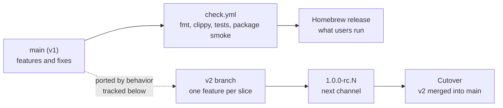

| Concern | Decision |
|---|---|
| Porting | Each `main` feature is re-expressed in v2's architecture, not merged: v2's tree replaces v1's, so merges would conflict on every removed file |
| Tracking | The parity table lists every `main` commit after the branch point; the watermark names the last one reviewed |
| Evidence | A ported feature passes `main`'s cases for it, replayed against v2 |
| Version mixing | The version handshake between the daemon, its SDK, plugins and the harness package keeps v1 and v2 from running together |
| User state | `~/.config/chauffeur` is migrated, or read compatibly, at cutover |
| After cutover | `v1` is a branch for hotfixes only |

### Parity table

Branch point `73bc29e`. Watermark: `e7fbabf`.

| `main` commit | v2 home | Slice | Evidence from `main` |
|---|---|---|---|
| `f2b087b` judge interface, facts judge | The `match` fact in `distribution/facts/`; `judge.json` routes become step judge names | 4 | `judges/facts/src/lib.rs` tests |
| `bb41c9a` context renewal, session warming | The `context-renewal` and `warming` plugins; the adapter carries out `session.compact` and `session.warm` | 7 | `routing.rs`, `renewal.test.ts`, `warming.test.ts` |
| `22e5391`, `36f6253` skill safety review | The skills plugin's screen-then-review strategy | 6 | `sources/tests.rs` vetting cases |
| `3a18675` Skilld discovery | The skills plugin's remote sources; fetches run in the plugin, never on the daemon's coordinator (audit A4) | 6 | `cli/tests/skills.rs` |
| `c43ecd6` read guard, RPC starvation fix | The guard plugin's `before` hooks; runtime admission permits (audit A3) | 2, 5 | `read-guard-probes.json`, `rpc-starvation.test.ts` |
| `9b8e917` rules | Rule files in `distribution/rules/`; each v1 rule lands in the first slice that has the pieces it needs | 1–11 | `capabilities/rules/tests/rules.rs` |
| Rulebooks (`/goal`, `/ticket`) | Rulebook files run by the `rulebooks` plugin; see [Rulebooks](#rulebooks) | 12 | `skills/rulebooks/*.json`, `rulebooks.test.ts` |
| `73bc29e` Homebrew release, CI | Release scripts and `check.yml` in v2: rc releases from slice 1, `1.0.0` at cutover | 1, 13 | `release.test.mjs`, `smoke.mjs` |
| `f54db24`, `d66a385`, `e7fbabf` docs | Documentation only | — | — |
| In progress on `main`: GLiDE provider, confidence escalation | `glide.json` over the `systemone` format; escalation is a strategy: System One with `model: "jev"`, then `model: "glide"`, then System Two | 3, 11 | `judges/glide/tests/wire.rs`, `docs/judges.md` escalation cases |

Context renewal on v2:

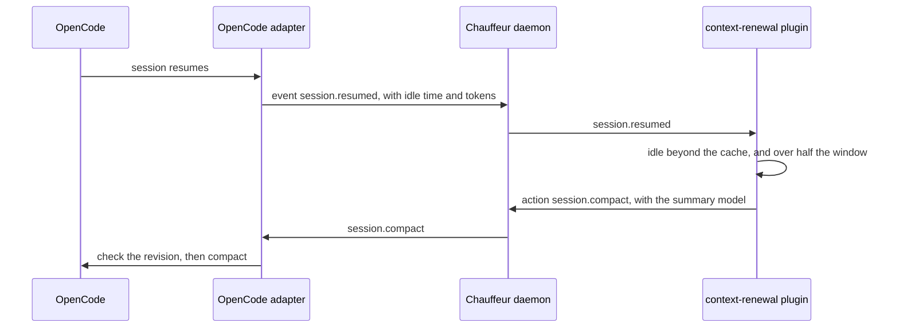

## Architecture

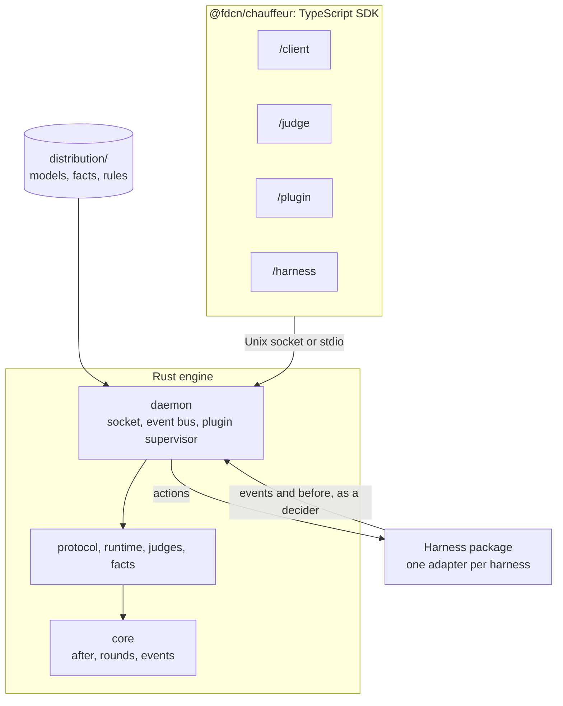

| Kind | What it is | Written by | Examples |
|---|---|---|---|
| Rule file | Data: `on`, `when`, `judges`, `asks`, `strategy`, `then` | Chauffeur, an integration, the user or a project | `conventional-commits`, `sourcefed/triage`, `opencode-history/recall` |
| Fact | A JavaScript module that answers a question without a model | Chauffeur, the user, or a project (pure only) | `match`, `select`, `bm25`, a user's `notes` |
| Plugin | A TypeScript program that hooks events, asks questions and acts | Chauffeur, the user, anyone | `skills`, `context-renewal`, `warming`, `guard` |
| Caller | Any program that sends a question and its context | Anyone | sourcefed's daemon, opencode-history, hook scripts |
| Adapter | Per-harness glue: standard events out, actions in | The shared harness package, one per harness | Its OpenCode plugin, Pi extension, Claude Code mod and Codex hook command |

Policy lives in rule files, facts and plugins. Adapters and callers hold no
judging logic: an adapter translates, and a caller sends its question and acts
on the intents it gets back.

### Dependency direction

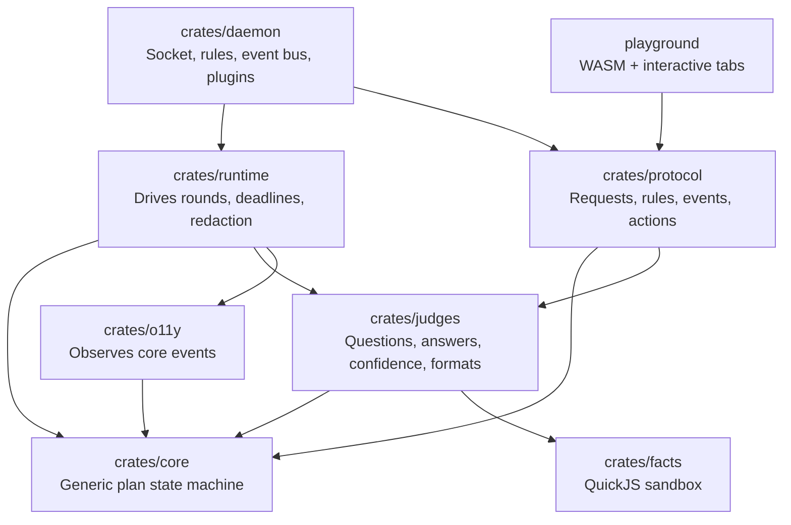

`crates/core` has no crate dependencies: no async runtime, HTTP, serde, UI,
logging or plugin system. Error types use the standard library. Other crates
consume core's event data. Adding crates does not by itself increase the
shipped binary: linked code and dependencies determine size.

### Why the engine is Rust

Measured on the development machine:

| | Result |
|---|---|
| One message over the Unix socket, 20 KB of JSON | 0.023 ms p50, 0.232 ms p99 |
| One Jev call (opencode-history's recall replay) | 278 ms p50 |
| v1's Rust daemon at rest | 66 MB |
| Idle Bun, idle Node | 10 MB, 37 MB |

| Concern | Rust's part |
|---|---|
| Safety | The deciding reason. The daemon parses untrusted input (the socket, project rules, project facts), holds model keys and redacts evidence. Rust gives memory safety there, `serde` rejects malformed input, and Kani and Miri prove strategies finish within their limits |
| Speed | Not decisive: a hop costs 0.03 ms against a 278 ms model call |
| Resource use | Decided by design more than language: lazy plugins, idle shutdown and bounded caches |

Plugins, adapters and the SDK are TypeScript. gdp-ts types the places where
a check must come before an action (see [Proofs](#proofs)).

## `chauffeur.navigate`

Callers use one operation, `chauffeur.navigate`: the decision a chauffeur
makes before steering. A request names an event and carries its context;
every rule whose `on` and `when` match answers it, and the caller receives
their intents:

```ts
import { connect } from "@fdcn/chauffeur/client"

const { intents } = await connect().navigate(
  { on: "recall", evidence: { message }, candidates: { p1: "…", p4: "…", p7: "…" } },
  { signal: AbortSignal.timeout(1_500) },
)
// intents → [{ rule: "opencode-history/recall", attach: ["p4", "p1"] }]
```


- **The strategy is the rule's.** A rule can screen with facts, classify with
  System One and review only what System One leaves unsure with System Two.
  Changing the strategy changes a rule file, never a caller.
- **No intent means the caller's default.** A rule that matches nothing in its
  `then`, or whose judges fail, returns no intent: sourcefed then delivers the
  event, and recall attaches nothing.
- **An inline `strategy` replaces `on`** for scripts, plugins, the playground
  and tests, with its own `judges` and `asks`. It runs only that strategy and
  returns its verdict. The SDK's `ask` and `strategy` send inline strategies.

### sourcefed: one triage for every host

sourcefed's daemon navigates `integration_event` before it queues an event for
a target, so OpenCode, Pi, MCP and CLI all receive the same filtered stream.
sourcefed installs `sourcefed/triage`, a System One screen that withholds
confident noise; the user tunes or extends it in JSON.

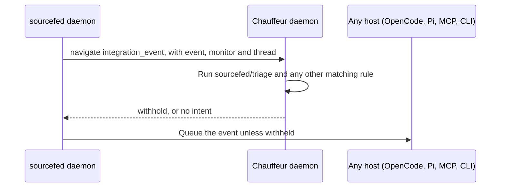

With no Chauffeur, an error, or no answer within 3 seconds, sourcefed
delivers, as v1's gate does.

### opencode-history: recall

opencode-history searches its own index when the user sends a message, then
navigates `recall` with the message and the passages as candidates. Its rule,
`opencode-history/recall`, ranks them, and opencode-history attaches the
passages the `attach` intent names.

### One protocol, many bindings

`navigate` is a Chauffeur operation, not any host's. Its request and result
are defined once, in `crates/protocol/schema/navigate.json`, and every binding
forwards them to the daemon socket unchanged:

| Binding | Caller | Mechanism |
|---|---|---|
| `@fdcn/chauffeur/client` | Any TypeScript program | `connect().navigate(request)` over the socket |
| `chauffeur navigate` | Hook scripts, Git hooks, CI on the same machine | One request on stdin; the JSON-RPC messages on stdout |
| `crates/protocol` | Rust programs | The same types the daemon uses |

Adding a host or a language adds a binding, never a new request format. The
schema's fixtures run in the protocol crate's tests and in each binding's
tests.

### JSON-RPC 2.0

Every message to and from the engine is JSON-RPC 2.0, one message per line,
over two transports:

| Transport | Used by | Why |
|---|---|---|
| The Unix socket | Clients, the CLI, adapters | Independent programs reach the daemon; the socket's `0700` directory is the access control |
| stdio | Plugins the daemon starts | A plugin's lifetime is tied to the daemon's, with no socket permissions to manage |

The same messages travel on both. A request with an `id` gets a result or an
error; a message without one is a notification, used for streamed events.
`$/cancelRequest` with a request's `id` cancels it, and closing a connection
cancels everything it carried. JSON-RPC is the standard LSP and MCP use: it
needs nothing beyond `serde_json`, and its messages stay readable when
debugging.

| Method | Direction | Carries |
|---|---|---|
| `navigate` | Caller → daemon | A request; `event` notifications stream back, then the intents or verdict |
| `emit`, `before` | Adapter → daemon | A harness event; `before` returns the edits plugins made |
| `act` | Daemon → adapter | An action, with the revision it applies to |
| `start` | Daemon → plugin | Discovery or run mode, options and the actions available |
| `hooks` | Plugin → daemon | The events the plugin hooks with `on` and `before` |
| `event`, `before` | Daemon → plugin | A hooked event; `before` returns edits |
| `act`, `navigate` | Plugin → daemon | An action, or a question for the engine |

### Stateless invocation

A navigation has a caller, request ID, an event or inline strategy, bounded
evidence and candidates, and a deadline. It runs without an agent session or
prior history; the caller supplies the evidence it wants considered. Intents
and transition events return to that caller. The only state kept between
navigations is a rule's cooldown. Plugins keep their own state.

## Judges

Every judge takes one question and returns one result. Judges come in four
tiers. A rule names its judges in `judges`, each with a tier, an optional
model and a confidence, and a step's `judge` names one of them or a tier:

| In a rule | Answered by |
|---|---|
| `"quick": { "tier": "system-one", "confidence": 0.7 }` | The tier's models, in the user's fallback order |
| `"careful": { "tier": "system-one", "model": "glide", "confidence": 0.7 }` | GLiDE; the tier's fallback order applies if GLiDE is unavailable or not configured, and the run's events say so |
| A step with `"judge": "facts"` | The facts tier, with no model and no confidence |

Naming the model lets one strategy use two models of the same tier, such as
Jev for a fast screen and GLiDE, more accurate but slower, for what Jev leaves
unsure. A rule shared with someone who lacks GLiDE still runs, on their
System One.

### Questions

A question is instructions and a list of possible outcomes. Nothing else
reaches a judge:

```jsonc
{ "instructions": "What should the agent do with this message?",
  "outcomes": ["act", "ignore", { "value": "ask-user", "description": "Unclear; the user decides" }],
  "evidence": ["thread", "event"] }
```

- 2 to 64 outcomes, each unique. An outcome is a string, or a `value` with a
  `description` that the model sees.
- The list's order is meaningful: it is the order of a scale, when the
  outcomes are one.
- `unsure` and `failed` are reserved and cannot be outcomes.
- `evidence` names the request's evidence blocks the judge sees.

The SDK's question functions build this shape, using Jev's names:

| Function | Builds | Example |
|---|---|---|
| `noul(instructions)` | `outcomes: ["yes", "no"]` | "Does this commit message break Conventional Commits?" |
| `choice(outcomes, instructions)` | `outcomes` as given | "What should the agent do with this message?" |
| `score(levels, instructions)` | `outcomes` as given, lowest first | "How hard is the user's request?" |
| `question({ instructions, outcomes })` | The primitive the others use; anyone can write new functions over it | `question({ instructions, outcomes: ["none", "minor", "major", "irreversible"] })` |

### Results

A judge either answers or fails. Failure is not an outcome:

| Side | Carries |
|---|---|
| Answer | `outcome`: one of the question's outcomes, or `unsure`. `p`: a probability for every outcome. `level`: the probability-weighted position in the list, from 0 (first) to n−1 (last) |
| Failure | Why: `unavailable`, `rate_limited`, `timeout`, `invalid` or `deadline` |

```json
{ "answer": { "outcome": "medium", "p": { "low": 0.12, "medium": 0.45, "high": 0.43 }, "level": 1.31 } }
{ "failed": "timeout" }
```

`level` is meaningful when the outcomes are a scale: `level ≥ 1` reads as
"medium or higher" even when no single level is likely enough. Every tier
answers every question, so moving a step between tiers changes only its
`judge`.

### Confidence

The rule, not the model, decides when an answer is sure enough. A named
judge's `confidence` is how likely its top outcome must be, from 0 to 1:

| `confidence` | Outcome |
|---|---|
| `0.7` | The likeliest outcome when its probability is 0.7 or more; otherwise `unsure` |
| `{ "yes": 0.6, "no": 0.95 }` | Per outcome: here `yes` needs 0.6 and `no` needs 0.95. The map must cover every outcome of every question the judge is used for, checked when the rule loads |
| none | The likeliest outcome; a tie is `unsure` |

```text
confidence 0.7 on noul "Does this commit message break Conventional Commits?"
  "fixed stuff"              yes 0.94, no 0.06 → yes
  "feat(cli): add navigate"  yes 0.06, no 0.94 → no
  "Update parser.rs"         yes 0.58, no 0.42 → unsure
  Jev timed out                                → failed: timeout
```

```text
confidence { yes: 0.6, no: 0.95 } on noul "Could this command cause irreversible harm?"
  "rm -rf build/"   yes 0.71, no 0.29 → yes
  "ls -la"          yes 0.02, no 0.98 → no
  "git clean -fd"   yes 0.12, no 0.88 → unsure, so the user is asked
```

A failure stays a failure whatever the confidence, so it never reads as `no`.
The runtime applies confidence the same way for every tier, in thousandths so
comparisons stay exact, and models never see it. Each judge's confidence is
tuned against labelled cases.

### Tiers

| Tier | Answers with | Shipped |
|---|---|---|
| `facts` | JavaScript functions in a sandbox: no model and no credentials | `match`, `select`, `bm25`, `embedding` |
| `system-one` | A fast classifier, one batched call per round | `jev` (default), `subq`, `glide` |
| `system-two` | A reasoning model, with a schema-checked answer that cites its evidence | Disabled until reviewed (slice 11) |
| `person` | The user, asked through the adapter | Each adapter |

### How a step reaches a model

A step reaches the code that answers it through four layers. Each layer knows
only the one below it, and all four tiers are built the same way:

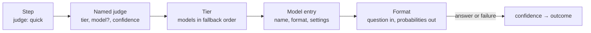

| Layer | Defined in | Example |
|---|---|---|
| Named judge | A rule's `judges`, or `judge()` in the SDK | `"quick": { "tier": "system-one", "confidence": 0.7 }` |
| Tier | `models.json` `tiers` | `"system-one": ["jev", "subq"]` |
| Model entry | `models.json` `models` | `"jev": { "format": "systemone", "endpoint": "…", "key": { "env": "JEV_KEY" } }` |
| Format | Rust in `crates/judges` | `systemone`, `openai`, `anthropic`, `facts`, `person`, `placeholder` |

Every format implements `answer_all`. A model answers every question it
received in a round with one call, and the format decides how to ask its
model from the question's outcomes:

```rust
let replies = jev.answer_all(&round_questions, &evidence);
// → [Ok({ yes: 0.94, no: 0.06 }), Err(Failure::Timeout), …]
```

| `Failure` | Then |
|---|---|
| `Unavailable`, `RateLimited`, `Timeout` | The tier's next model answers |
| `Invalid` | The step fails |

| Format | Speaks |
|---|---|
| `systemone` | The `/v1/systemone` API that Jev, SubQ Snap and Fastino GLiDE share: its `noul` type for `["yes", "no"]`, and `choice`, which returns every outcome's probability, for the rest. GLiDE's entry sets its reading of `score` as a level |
| `openai` | OpenAI-compatible chat completions, with a JSON schema whose `enum` is the outcomes; covers local servers such as Ollama |
| `anthropic` | Anthropic Messages with the same schema |
| `facts` | Runs a fact in `crates/facts` |
| `person` | A question to the user through the adapter |
| `placeholder` | Recorded or fixed answers, standing in until the real model is configured |

An outcome outside the question's list fails the step as `invalid`.
`crates/judges` turns each tier's models into one core `Judge`, so core sees a
judge per tier and model, such as `system-one:glide`, and nothing below it.

### Models are configuration

A model is registered the way a user registers a model provider anywhere
else: a name, a built-in API format, and the endpoint, model ID and credential
to use.

```jsonc
// ~/.config/chauffeur/models.json
{
  "models": {
    "local-qwen": { "format": "openai", "endpoint": "http://127.0.0.1:11434/v1", "model": "qwen3:4b" },
    "reviewer":   { "format": "anthropic", "model": "claude-sonnet-5-5",
                    "key": { "env": "ANTHROPIC_API_KEY" }, "timeout_ms": 20000 }
  },
  "tiers": {
    "system-one": ["jev", "subq", "local-qwen"],
    "system-two": ["reviewer"]
  }
}
```

- A step's `model` names an entry. `distribution/models/` ships `jev`, `subq`
  and `glide` as the same JSON. The user's file adds models and overrides
  shipped ones by name. Changes take effect without a restart.
- `tiers` lists models in fallback order. The next model answers only when
  one is unavailable, rate-limited or timed out, never because of what it
  answered. Escalating to another model or tier is the strategy's job.
- Models load only from shipped and user configuration, never from a
  project's `.chauffeur/`. A model entry is a network endpoint, so a cloned
  repository could otherwise send evidence wherever it chose.
- A key is named, as an environment variable or a keychain entry, and is read
  only by `crates/judges`. It never reaches rule files, callers, plugins or
  audit.
- A shipped model is used once its key is present; a System Two model also
  needs the user to turn it on.

### Placeholders

A `placeholder` model stands in for a tier, or for one fact, until the real
one is configured. Rules do not change when it is replaced; only `models.json`
does.

```jsonc
// models.json for tests and the playground
{
  "models": {
    "one-stand-in":    { "format": "placeholder", "answers": "fixtures/triage-answers.json" },
    "two-stand-in":    { "format": "placeholder", "otherwise": { "act": 0.8, "ignore": 0.2 } },
    "person-stand-in": { "format": "placeholder", "otherwise": { "yes": 1, "no": 0 } }
  },
  "tiers": {
    "system-one": ["one-stand-in"],
    "system-two": ["two-stand-in"],
    "person":     ["person-stand-in"]
  }
}
```

```jsonc
// fixtures/triage-answers.json
{ "answers": [
  { "evidence": { "event": "thanks, looks good 👍" },     "p": { "yes": 0.52, "no": 0.48 } },
  { "evidence": { "event": "@agent bump retries to 5" }, "p": { "yes": 0.94, "no": 0.06 } },
  { "evidence": { "event": "deploy is on fire" },        "failed": "timeout" }
] }
```

- `answers` is matched by evidence: an entry answers a question whose evidence
  contains every block the entry lists, with the same content. The first
  match wins, so one file serves every rule that asks about the same input.
- `otherwise` answers what no entry matches; without it, the step fails as
  `unavailable`, so a gap in the recorded answers shows.
- Every placeholder answer is marked in events and in `strategy show`, so it
  never passes for a real model's.
- Recorded answers can be real ones, such as opencode-history's Jev scores, to
  tune a rule's confidence before it runs live.

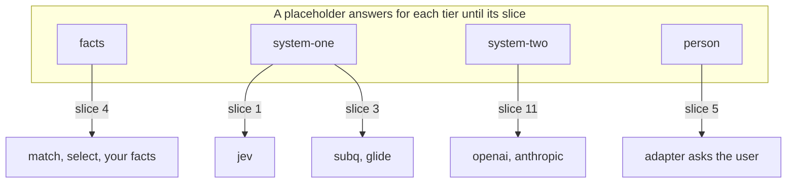

## Facts

A fact is a JavaScript module that answers a question without a model. It
runs in `crates/facts`, an embedded QuickJS sandbox. Shipped facts and the
user's own have the same shape; a user's fact replaces a shipped one of the
same name.

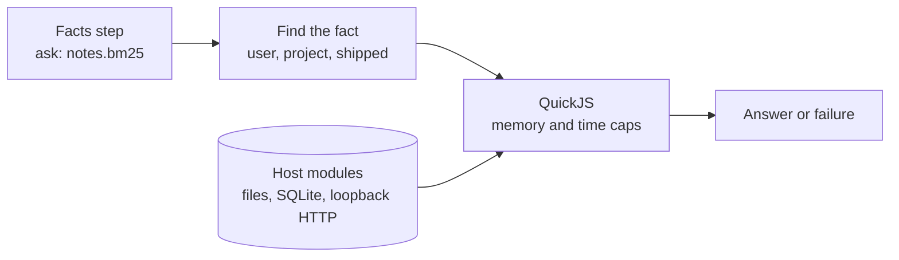

A fact module exports a default function, named functions, or both:

```js
// ~/.config/chauffeur/facts/notes.js
import { query } from "chauffeur:sqlite"

// "notes.bm25": BM25 over the user's own notes database
export function bm25({ evidence, args }) {
  const rows = query("~/notes/index.db",
    "SELECT id FROM notes WHERE notes MATCH ? ORDER BY bm25(notes) LIMIT ?", [evidence.message, args.top ?? 10])
  return { ranked: rows.map((row) => row.id) }
}

// "notes": is the message about something already in the notes?
export default function ({ evidence }) {
  const [hit] = query("~/notes/index.db", "SELECT 1 FROM notes WHERE notes MATCH ? LIMIT 1", [evidence.message])
  return { p: { yes: hit ? 1 : 0, no: hit ? 0 : 1 } }
}
```

A facts step names the fact and its arguments as its `ask`:

```jsonc
{ "id": "related", "judge": "facts", "ask": { "notes.bm25": { "top": 10 } } }
{ "id": "is-slack", "judge": "facts", "ask": { "match": { "field": "event.source", "equals": "slack" } } }
```

| A fact receives | A fact returns |
|---|---|
| `evidence`, the request's named blocks | `{ p }` over the outcomes, usually 1 and 0 |
| `candidates` | `{ ranked: [...] }`: candidate names, best first |
| `outcomes` of earlier steps, with their `p` and `level` | Throws: the step fails as `invalid` |
| `args`, from the step | |

| Source | Folder | Host modules |
|---|---|---|
| Shipped | `distribution/facts/` | `chauffeur:fs` (read), `chauffeur:sqlite` (read-only), `chauffeur:http` (loopback only) |
| User | `~/.config/chauffeur/facts/` | The same |
| Project | `.chauffeur/facts/` | None: pure functions of their inputs |

### Shipped facts

| Fact | Does |
|---|---|
| `match` | Conditions on evidence fields: `equals`, `one_of`, `contains`, `pattern` (glob), `at_least`, `at_most` (a number, or another field times `times`); combined with `all` and `any`; `cases` answers a choice |
| `select` | Combines earlier outcomes: `first` settled in a list, `top` N, all at or above `min`, `majority` or `mean`; `by` names the outcome whose probability ranks, such as `yes` |
| `bm25` | Ranks candidates against a query |
| `embedding` | Ranks candidates by similarity from the local embedding service |

v1's context-renewal rule, as a `match`:

```jsonc
{ "id": "renew", "judge": "facts", "ask": { "match": { "all": [
  { "field": "idle_seconds",   "at_least": { "field": "cache_seconds" } },
  { "field": "context_tokens", "at_least": { "field": "context_window", "times": 0.5 } }
] } } }
```

A field the evidence lacks fails the step as `invalid`, never `no`.

### Limits

| Concern | Decision |
|---|---|
| Runaway code | Each call has a memory cap (16 MiB by default) and an interrupt at the step's deadline; overrunning either fails the step |
| A missing fact | `unavailable`, so the facts tier's next model answers: a placeholder can stand in |
| Names | A fact cannot be named `instructions`, `outcomes` or `evidence` |
| Project facts | Run with no host modules. QuickJS is not a hardened sandbox, so a memory-safety bug in it could let a repository's code escape; the caps and the absence of host modules keep that risk small, and it is accepted |
| Engine | `rquickjs` in `crates/facts`; core stays dependency-free |

## Strategies

A strategy is a list of steps, built from four pieces. Chauffeur has no list
of built-in strategies: any combination of the pieces is one.

| Piece | What it does |
|---|---|
| Step | Asks one judge one question; its confidence turns the answer into an outcome |
| `after` | Waits for earlier steps, then runs the step or skips it by their outcomes |
| `for_each` | Copies a step once per candidate, in one round |
| Earlier outcomes | A step may read earlier steps' outcomes, `p` and `level` as its evidence |

### `after`

A step waits until every step its `after` names has finished. Then it runs if
every `all` entry is met and, when there are `any` entries, at least one of
them is; otherwise it is skipped. A step without `after` runs in round 1.

```jsonc
"after": ["fast", "slow"]                                     // all: wait for both, however they finished
"after": [{ "step": "fast", "when": ["unsure", "failed"] }]   // all: run only if fast was unsure or failed
"after": { "all": [ … ], "any": [ … ] }                       // every all entry, and at least one any entry
```

- A string entry is met once that step finishes, even when it was skipped.
- An object entry is met only when the step's outcome is in `when`. `failed`
  in `when` matches a step whose judge failed, for any reason. A skipped step
  never matches.
- `relevant[*]` names every copy `for_each` made of `relevant`. Inside a copy,
  `relevant[item]` names the same candidate's copy.
- `after` names only earlier steps, so a strategy cannot loop. Every strategy
  has a known maximum of rounds and calls before it starts.

Combining answers is a step too: the `select` fact reads earlier outcomes and
settles to one. A new way to combine is a new fact. The protocol lowers
`for_each`, wildcards, named judges and named asks to plain core steps, so
core runs every strategy alike.

| Strategy | Built from |
|---|---|
| Escalate | A step `after` an earlier one, `when` it is `unsure` or `failed` |
| Rank | A `for_each` step, then `select` with `top` and `min` |
| Collect all that pass | A `for_each` step, then `select` with `min` |
| Check the survivors | Two `for_each` steps, the second `after` `first[item]` `when` `yes` |
| Vote | Parallel steps, `select` with `majority`, and a review `after` the vote `when` `unsure` |

Escalating from Jev to GLiDE, then to System Two:

```jsonc
"judges": {
  "quick":    { "tier": "system-one", "model": "jev",   "confidence": 0.7 },
  "careful":  { "tier": "system-one", "model": "glide", "confidence": 0.7 },
  "reasoner": { "tier": "system-two",                   "confidence": 0.7 }
},
"strategy": [
  { "id": "fast",   "judge": "quick",    "ask": "needs-agent" },
  { "id": "slow",   "judge": "careful",  "ask": "needs-agent", "after": [{ "step": "fast", "when": ["unsure", "failed"] }] },
  { "id": "review", "judge": "reasoner", "ask": "needs-agent", "after": [{ "step": "slow", "when": ["unsure", "failed"] }] },
  { "id": "answer", "judge": "facts", "ask": { "select": { "first": ["review", "slow", "fast"] } },
    "after": ["fast", "slow", "review"] }
]
```

```text
"thanks, looks good 👍"
round 1   fast    jev    yes 0.52, no 0.48      → unsure
round 2   slow    glide  yes 0.18, no 0.82      → no
          review  skipped: slow was not unsure or failed
          answer  fast, slow and review have finished → asked
round 3   answer  select first                  → no
```

### Viewing a strategy

`chauffeur strategy show` prints a rule's strategy as a tree, with each
step's round, its model as the user's configuration resolves it, its `after`
and its confidence:

```text
$ chauffeur strategy show opencode-history/recall
opencode-history/recall                        on recall
├─ round 1  helps × candidates  system-one → jev
└─ round 2  best               facts select   top 3, min 0.7, from helps
then  attach best
at most 2 rounds · 1 model call · 31 candidates at most
```

`--file` shows an unsaved rule, and an unknown or unconfigured model is marked
where it appears. The playground draws the same tree and steps through it with
recorded answers.

## Rule files

A rule file needs no code: dropping it into a rules folder is the whole
install.

| Field | Meaning |
|---|---|
| `on`, `when` | The event that triggers the rule, and a cheap filter on it, such as tool names and text the input contains; no judge is asked unless it matches |
| `judges` | Named judges: a tier, an optional model and a confidence |
| `asks` | Named questions, so steps that ask the same question share it |
| `strategy` | The steps, in order: each with an `id`, a `judge` (a named judge or a tier), an `ask` (a named question, one written inline, or a fact), and `after` |
| `then` | Intents by outcome, first match wins; no match returns no intent |

Names in `judges` and `asks` are referred to only by a step's `judge` and
`ask`. Step IDs are referred to only by `after`, `select` and `then`.

Rules load from four sources, and edits apply without a restart:

| Source | Folder | System Two |
|---|---|---|
| Shipped | `distribution/rules/` | Allowed |
| Integration | `~/.config/chauffeur/rules/<integration>/`, installed by the integration | Allowed |
| User | `~/.config/chauffeur/rules/` | Allowed |
| Project | `.chauffeur/rules/`, from the Git worktree root down to the session's directory | Only where `~/.config/chauffeur` allows it for the project |

A rule's ID is its path under its folder, such as `sourcefed/triage`. The user
tunes an integration's rule by editing its file; reinstalling the integration
keeps a file the user changed.

### Commit messages

```jsonc
// distribution/rules/conventional-commits.json
{
  "on": "tool.after",
  "when": { "tools": ["shell"], "input": { "contains": "git commit" } },
  "judges": { "quick": { "tier": "system-one", "confidence": 0.7 } },
  "strategy": [
    { "id": "nonconventional", "judge": "quick",
      "ask": { "outcomes": ["yes", "no"], "evidence": ["tool_call"],
               "instructions": "Does this call create a git commit whose message does not follow Conventional Commits?" } }
  ],
  "then": [{ "if": { "nonconventional": "yes" },
             "message.append": { "parts": [{ "text": "Use Conventional Commits, such as `feat(scope): short description`." }], "delivery": "now" } }],
  "cooldown_seconds": 120
}
```

A rule on a harness event names [actions](#actions) in its `then`, and the
daemon passes them to the adapter. A rule on a caller's event, such as
`integration_event` or `recall`, returns intents the caller defines, such as
`withhold` and `attach`.

### Event triage

sourcefed installs this rule with its System One screen. This user added the
System Two review for Slack messages that System One leaves unsure or fails
on.

```jsonc
// ~/.config/chauffeur/rules/sourcefed/triage.json
{
  "on": "integration_event",
  "judges": {
    "quick":    { "tier": "system-one", "confidence": 0.7 },
    "reasoner": { "tier": "system-two", "confidence": 0.6 }
  },
  "asks": {
    "needs-agent": { "outcomes": ["yes", "no"], "evidence": ["thread", "event"],
                     "instructions": "Does the new event ask the agent to do or change something?" }
  },
  "strategy": [
    { "id": "screen",   "judge": "quick", "ask": "needs-agent" },
    { "id": "is-slack", "judge": "facts", "ask": { "match": { "field": "event.source", "equals": "slack" } } },
    { "id": "review",   "judge": "reasoner",
      "ask": { "outcomes": ["act", "ignore"], "evidence": ["thread", "event"],
               "instructions": "Should the agent act on the new message? Cite the evidence." },
      "after": [{ "step": "screen", "when": ["unsure", "failed"] }, { "step": "is-slack", "when": ["yes"] }] }
  ],
  "then": [
    { "if": { "screen": "no" }, "withhold": "event" },
    { "if": { "review": "ignore" }, "withhold": "event" }
  ]
}
```

Two rounds at most: `review` is skipped when the screen says `yes` or `no`, or
the event is not from Slack. Every other outcome, including a failed review,
returns no intent, and sourcefed delivers.

### Per-turn recall

opencode-history installs this rule. The rule ranks the passages its search
returned; the code gathers them and attaches the result.

```jsonc
// ~/.config/chauffeur/rules/opencode-history/recall.json
{
  "on": "recall",
  "strategy": [
    { "id": "helps", "judge": "system-one", "for_each": "candidates",
      "ask": { "outcomes": ["yes", "no"], "evidence": ["message", "candidate"],
               "instructions": "Would this passage materially help the agent answer the message, beyond what it already says?" } },
    { "id": "best", "judge": "facts", "after": ["helps[*]"],
      "ask": { "select": { "from": "helps[*]", "top": 3, "min": 0.7, "by": "yes" } } }
  ],
  "then": [{ "attach": "best" }]
}
```

`select` ranks the copies by their probability of `yes`. All candidates share
one round, so Jev answers them in one call. An error or a missed deadline
attaches nothing.

### What a caller gets back

| Result | Meaning | `navigate` |
|---|---|---|
| Intents | Every matching rule ran | `intents`: each with its `rule`, possibly empty |
| Verdict | An inline strategy's steps finished | `verdict[id]`: `{ "answer": … }`, `{ "failed": "<reason>" }` or `"skipped"` |
| Unknown judge | An inline strategy names a tier with no model, or one its source may not use; nothing ran. A rule that does is refused when it loads | `judge_unavailable` error |
| Limit exceeded | The strategy or evidence is over a named limit; nothing ran | `limit_exceeded` error |
| Busy | This source's or the daemon's capacity is in use | `busy` error |
| Deadline | The deadline passed; unfinished steps are unanswered | `deadline` error, with the events so far |
| Unavailable | The daemon is not running | `unavailable` error |

## Plugins

A plugin is a long-running TypeScript program that hooks into events, asks
questions and acts on the harness. The daemon starts it, passes it the events
it hooks, and carries its actions to the adapter. Plugins are harness-agnostic:
the same plugin works in every harness whose adapter supports the actions it
uses.

### How a message reaches a plugin

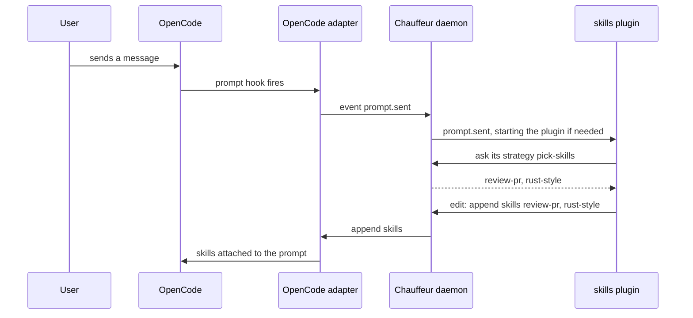

### Events

Harness events and actions are the [harness package's](#adapters) contract:
its schemas define them, and its fidelity table says which each harness
supports. Chauffeur reads those schemas; plugins and rules hook events by
name, such as `tool.after`, `tool.before` and `prompt.sent`. A plugin or
caller may define its own events, namespaced to it, such as
`sourcefed.event`.

### Actions

Actions are named by resource and verb, such as `message.append` with a
delivery of `now`, `next` or `wake`, or `session.compact`. A plugin can check
the fidelity table before relying on one; an action a harness cannot carry
out returns `unsupported`.

### `on` and `before`

| Hook | Holds the harness | Can |
|---|---|---|
| `ctx.on(event, handler)` | Never: the event goes ahead at once | Call any action, any time |
| `ctx.before(event, handler, { budget, onTimeout })` | Until the handler returns or `budget` ms pass | Edit what is about to happen |

`before` exists for the points where acting late is acting too late:

| Event | A `before` handler can | `onTimeout` |
|---|---|---|
| `prompt.sent` | Append parts, edit the text, block it | `allow` |
| `tool.before` | Block it, ask the user, rewrite its input | `ask`, `block` or `allow` |
| `permission.asked` | Reply, or ask the user | `ask` |

`ask` hands the decision to the user. A guard against irreversible harm uses
`ask`, so a slow or failed judge never lets the action through silently. Host
denials always win over a plugin.

### Retries

| Kind of action | Examples | If it fails or arrives stale |
|---|---|---|
| Sets state | `session.update`, registry `add`, `update` and `remove` | Retried with backoff; the last write wins |
| One-shot | `session.compact`, `session.interrupt` | Retried once if the adapter was unreachable; dropped if stale |
| Append | `message.append` | Delivered `next` when the plugin set `late: "next"`; otherwise dropped once its turn has passed |
| Guard decision | Block, ask the user | Never retried; on timeout, `onTimeout` applies |

Each action carries the session `revision` it applies to, and the adapter
checks it against the harness before carrying it out, so a stale action never
lands on a newer state.

### Lifecycle

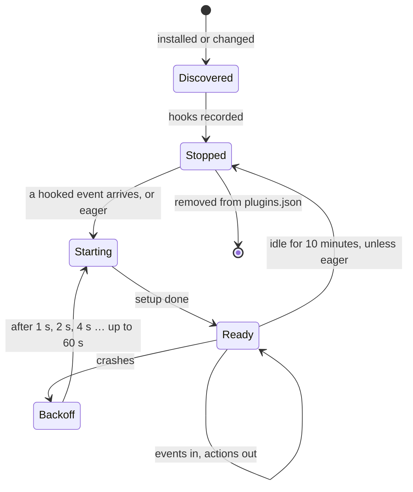

- **Registration.** The user lists plugins in `~/.config/chauffeur/plugins.json`.
  A project can never add a plugin.
- **Discovery.** When a plugin is installed or its files change, the daemon
  runs its `setup` once in discovery mode: `ctx.on` and `ctx.before` only
  record the hooks, and the plugin stops. The hooks are cached against the
  plugin's file hash. `setup` must register hooks before doing work with side
  effects.
- **Lazy by default.** The first event the plugin hooks starts it, and events
  queue until it is ready. An idle plugin stops after 10 minutes.
- **Eager.** `"chauffeur": { "eager": true }` in the plugin's `package.json`
  starts it with the daemon and keeps it running, for plugins with timers or
  their own connections.
- **Transport.** The daemon starts each plugin as a child process and speaks
  [JSON-RPC 2.0](#json-rpc-20) over its stdin and stdout, so a plugin never
  outlives the daemon.
- **Hot reload.** When a plugin's files change, the daemon reruns discovery
  and restarts the plugin; its next event reaches the new code. Plugins run
  from source on Bun, so nothing is compiled first.
- **Isolation.** A crash affects only that plugin. A slow plugin's `on` events
  queue to a bound; overflow drops the oldest and says so in an event.

### The SDK

One package, `@fdcn/chauffeur`, with subpath exports so bundlers keep only
what is imported:

| Import | Holds |
|---|---|
| `@fdcn/chauffeur/plugin` | `Plugin.define({ id, setup(ctx) })`; `ctx` holds only `on`, `before` and `options` |
| `@fdcn/chauffeur/judge` | `ask`, `judge`, `strategy`, and the question functions `question`, `noul`, `choice`, `score` |
| `@fdcn/chauffeur/harness` | Actions: `session`, `message`, `permission`, and the registries |
| `@fdcn/chauffeur/client` | `connect().navigate(request)` |

`ctx` holds what is tied to the plugin's lifetime. Everything else is a
function to import, and `/judge` works the same from any program through the
client.

`ask` returns a result typed from its question:

```ts
type Result<O extends string> =
  | { ok: true; outcome: O | "unsure"; p: Record<O, number>; level: number }
  | { ok: false; failed: "unavailable" | "rate_limited" | "timeout" | "invalid" | "deadline" }
```

```ts
import { ask, choice, judge, noul, score } from "@fdcn/chauffeur/judge"

const quick = judge({ tier: "system-one", model: "jev", confidence: 0.7 })

const commit = await ask(noul("Does this commit message break Conventional Commits?"), { judge: quick, evidence })
if (commit.ok && commit.outcome === "yes") { /* "yes" | "no" | "unsure" */ }

const next = await ask(choice(["act", "ignore", "ask-user"], "What should the agent do with this message?"), { judge: quick, evidence })
const effort = await ask(score(["low", "medium", "high"], "How hard is the user's request?"), { judge: quick, evidence })
if (effort.ok && effort.level >= 1) { /* medium or higher */ }
```

A question function returns `{ wire, read }`: the generic question, and a
reader that types the reply. `question` is the primitive the others use, so a
plugin defines a new kind of question without any change to the engine. An
outcome outside the list fails as `invalid` at run time, and a comparison with
an impossible outcome fails to compile. A strategy's `when` accepts only the
outcomes its step can produce.

### Plugins from v1's features

Context renewal:

```ts
import { Plugin } from "@fdcn/chauffeur/plugin"
import { session } from "@fdcn/chauffeur/harness"

export default Plugin.define({
  id: "context-renewal",
  setup(ctx) {
    ctx.on("session.resumed", (e) => {
      if (e.idle_seconds >= e.cache_seconds && e.tokens.used >= e.tokens.window / 2)
        session.compact(e.session, { model: ctx.options.summaryModel })
    })
  },
})
```

Guard against irreversible harm:

```ts
import { Plugin } from "@fdcn/chauffeur/plugin"
import { ask, judge, noul } from "@fdcn/chauffeur/judge"

const guard = judge({ tier: "system-one", model: "jev", confidence: { yes: 0.6, no: 0.95 } })

export default Plugin.define({
  id: "guard",
  setup(ctx) {
    ctx.before("tool.before", async (e) => {
      if (e.tool !== "shell") return
      const harmful = await ask(noul("Could this command cause irreversible harm?"), { judge: guard, evidence: { command: e.input.command } })
      if (harmful.ok && harmful.outcome === "yes") e.block("This command may cause irreversible harm.")
      else if (!harmful.ok || harmful.outcome === "unsure") e.askUser("Chauffeur isn't sure this is safe.")
    }, { budget: 2_000, onTimeout: "ask" })
  },
})
```

Skill exposure, with its own strategy:

```ts
import { Plugin } from "@fdcn/chauffeur/plugin"
import { judge, noul, strategy } from "@fdcn/chauffeur/judge"

const quick = judge({ tier: "system-one", confidence: 0.7 })
const pick = strategy([
  { id: "needs", judge: quick, forEach: "candidates", ask: noul("Does this request need this skill?") },
  { id: "best", judge: "facts", after: ["needs[*]"], ask: { select: { from: "needs[*]", top: 4, min: 0.7, by: "yes" } } },
])

export default Plugin.define({
  id: "skills",
  setup(ctx) {
    ctx.before("prompt.sent", async (e) => {
      const best = await pick.run({ evidence: { message: e.text }, candidates: e.skills })
      if (best.ok) e.append(best.outcome.map((skill) => ({ skill })))
    }, { budget: 400, onTimeout: "allow" })
  },
})
```

Session warming:

```ts
import { Plugin } from "@fdcn/chauffeur/plugin"
import { session } from "@fdcn/chauffeur/harness"

export default Plugin.define({
  id: "warming",
  setup(ctx) {
    ctx.on("session.idle", (e) => setTimeout(() => session.warm(e.session), 270_000))
  },
})
```

`strategy(...).run` returns the last step's result. `ask` and `strategy` send
inline strategies through `navigate`, so limits,
confidence, model fallback, redaction and keys stay in the engine. Plugins
never hold model keys.

## Adapters

Adapters come from the shared harness package, a separate project that any
program can use to hook a harness and act on it. It holds the contract as
data (event and action schemas, the fidelity table, the rules for combining
several deciders' answers), one adapter per harness, and a hook command for
harnesses that only run commands. It holds no policy.

Chauffeur is one decider among others, such as sourcefed and Workhorse:

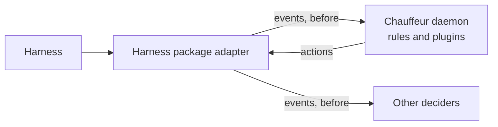

| Chauffeur needs | From the package |
|---|---|
| Events and `before` hooks | Delivered to the daemon's socket; the daemon routes them to its rules and plugins and answers within each hook's budget |
| Actions | The daemon sends its rules' and plugins' actions through the package, which carries them out or returns `unsupported` |
| The contract | The package's schemas and fidelity table, which `crates/protocol` reads |

Chauffeur keeps no per-harness code. A harness slice adopts the package's
adapter for that harness and proves every feature so far through it.

## Rulebooks

Status: a sketch, held for discussion before its slice starts.

A rulebook is a set of rules that stays off until the user starts it in a
session, such as `/goal ship the parser fix`. A book is data in the rule-file
shape, and the first-party `rulebooks` plugin runs it:

```jsonc
// distribution/rulebooks/goal.json
{
  "id": "goal",
  "args": { "required": true },
  "budget": 20,
  "on_start": "Goal: {args}. Work toward it until evidence shows it is done.",
  "rules": [{
    "on": "response.finished",
    "judges": { "quick": { "tier": "system-one", "confidence": 0.7 } },
    "strategy": [{ "id": "done", "judge": "quick",
                   "ask": { "outcomes": ["yes", "no"], "evidence": ["summary", "todos"], "instructions": "Is {args} done and checked?" } }],
    "then": [{ "if": { "done": "yes" }, "end": "complete" },
             { "if": { "done": "no" }, "message.append": { "parts": [{ "text": "Not done yet: {args}" }], "delivery": "wake" } }]
  }]
}
```

- The plugin registers `/goal` with `command.add`, and keeps each session's
  running books, their arguments and remaining budget.
- When a running book's event fires, the plugin runs its rules through
  `navigate` and carries out their `then`, counting each delivery against the
  budget.
- Books load from `distribution/rulebooks/`, `~/.config/chauffeur/rulebooks/`
  and `.chauffeur/rulebooks/`, like rules.

## Proofs

| What | How |
|---|---|
| `after` and rounds in core | Kani: a step waits for its needs, decisions follow the rule, a run never stalls and finishes within one round per step |
| The runtime | Miri: deadlines, cancellation, late results, overflow and capacity |
| Shipped facts | Exhaustive tests over small inputs, run in the QuickJS sandbox: for example, `select` with `top` and `min` keeps at most `top` candidates, each at or above `min`, best first, for every input up to 4 candidates |
| Confidence | Kani: for every probability in thousandths and every valid confidence, an answer settles to exactly one outcome, edges inclusive |
| TypeScript checks before actions | gdp-ts: an adapter carries out an action only with a `RevisionIsCurrent<Session, Revision>` proof, and an action the host gates only with a `HostAllowed<Action>` proof. Its lint preset rejects forged proofs |

## Access, delivery and failure rules

- The daemon listens only on a Unix socket in a directory only the user can
  open (`chauffeur/` in the user's runtime directory, mode `0700`), so only the
  user's own processes connect. There is no TCP port and no token.
- The daemon runs as a Homebrew service when the user starts one. A second
  start that finds the socket taken exits.
- Code from a repository runs only as a project fact: a pure function in the
  QuickJS sandbox, with no host modules and with memory and time caps.
  Plugins and models come only from the user's configuration.
- A cloned repository's rules are data the user did not write: they run under
  the same limits, and System Two stays off for them unless
  `~/.config/chauffeur` turns it on for that project.
- Callers and plugins are trusted code, as the user runs them. They reach
  Chauffeur only through `navigate` and the plugin protocol; payloads are
  never authority.
- A connection may carry several calls, each with its own `id`. A
  navigation's events arrive in order before its result. Each navigation's
  event buffer is bounded and overflow is an explicit event.
  `$/cancelRequest` cancels one call; closing the connection cancels all of
  them.
- One admission permit covers queued, waiting and active work. Capacity per
  source (shipped, integration, user and project rules, and inline
  strategies), strategy size, evidence bytes, fan-out, rounds, attempts and
  output size are checked before dispatch.
- Deadlines include queueing, preparation, every inference round and delivery.
  A disconnected caller cancels future work; a blocking provider call keeps
  its worker until it ends, and late results cannot commit actions.
- Redaction runs after evidence assembly and before every provider call, and
  also covers errors and audit metadata.
- Strategies return data and intents, never host effects. Only adapters act
  on a harness, after checking the revision; host denials cannot be
  overridden by a plugin.

## Core plan model

A plan is an ordered list of named steps. Each step carries a request of the
caller's type `Q`; the caller also chooses the outcome type `O`. Core does not
know what either means. Rule files and SDK strategies lower to this form: the
protocol resolves named judges and asks, `for_each` copies and wildcards
before core sees a plan.

```text
Step<Q, O>   = { id, judge: name, request: Q, after: After<O> }
After<O>     = { all: [Need<O>], any: [Need<O>] }
Need<O>      = { step: an earlier step's ID, when: [Outcome<O>] or none }
Outcome<O>   = Value(O) | Failed
StepState<O> = Pending | Asked | Settled(Outcome<O>) | Skipped
```

`Outcome` is core's result: `Value` is an answer's outcome, and `Failed` is
the failure side. In the engine, `O` is an outcome label, `unsure`, or a list
of candidate names from `select`; the runtime keeps each answer's `p` and
`level` beside it for `select`, evidence and events. `Skipped` is a machine
state, not an outcome.

### `after` in core

One rule decides every step, the one in [Strategies](#after):

- A step stays `Pending` until every step its `after` names is `Settled` or
  `Skipped`.
- It is then `Asked` if every `all` need is met and, when `any` has needs, at
  least one `any` need is met. Otherwise it is `Skipped`.
- A need without `when` is met by any finish. A need with `when` is met only
  by a settled outcome it lists; `Skipped` never matches.
- A step with an empty `after` is asked in round 1. Steps asked together share
  a round, and each judge answers its share of a round in one call.
- `after` names only earlier steps, so every plan finishes within one round
  per step.

The escalation from [Strategies](#strategies), in Rust:

```rust
let unsure_or_failed = [Value(Unsure), Failed];
let plan = Plan::new([
    Step::new("fast", "system-one:jev", ask),
    Step::new("slow", "system-one:glide", ask).after([Need::when("fast", unsure_or_failed.clone())]),
    Step::new("review", "system-two", ask).after([Need::when("slow", unsure_or_failed)]),
    Step::new("answer", "facts", select_first).after(["fast", "slow", "review"]),
]);
```

A step ID alone is a need without `when`, and `after_any` fills the `any`
list. A named judge lowers to a panel name of its tier and model, such as
`system-one:glide`. Rust, rule files and the SDK build the same steps.

### The `Judge` interface

A judge answers a step's request. Core defines the interface: synchronous
`judge`, and `judge_all` for a batch, which a batching provider overrides. Any
closure is a judge:

```rust
let panel = Panel::new().with("facts", |ask: &Ask| Value(Yes)).with("system-one:jev", &jev);
let verdict = plan.run(&panel)?;
```

A step names its judge, because plans are data: rule files and inline
strategies can only refer to judges the engine already holds, and
configuration can limit which judges a project's rules may use. A `Panel`
maps names to judges. `plan.run(&panel)` validates the plan, rejects a name
the panel lacks before asking anything, and then asks each judge its share of
every round in one `judge_all` call. A batch with the wrong number of answers
settles as `Failed`. The round-by-round API remains for the playground and the
runtime; each `Question` reports its step, judge and request.

Judges are synchronous so rules stay plain functions. The runtime runs slow
judges such as Jev on bounded worker threads, with deadlines and cancellation;
neither core nor the interface changes for that.

## State machine and event model

`plan.run(&panel)` runs a plan to its end. Underneath, core advances one round
at a time, so a caller may also drive rounds itself: the runtime around slow or
remote judges, or the playground with answers picked by hand. The low-level API
returns events as data:

```rust
let transition = plan.start();
observe(transition.events);
let round = transition.next.ask()?;
let reply = answer_round(round.questions()); // each question names its judge
let transition = round.answer(reply)?;
observe(transition.events);
```

Each transition includes the next state, `Ask { round, questions }` or
`Done { verdict }`, and the events it produced: `Started`, `RoundReady`,
`StepSettled`, `StepSkipped` and `Finished`. Events have stable step IDs,
round numbers and settled outcomes; they contain no transport or
provider-specific types. The only user-supplied code core invokes is a judge,
inside `run`.

`crates/o11y` consumes events for logs, traces or audit. The daemon serializes
each run's events onto its caller's connection from a bounded log; a slow
caller never blocks a core transition. The state machine does not decide
provider choice, retries, HTTP, credentials or actions.

## Playground

The Vite application uses petite-vue for reactivity and Web Awesome for UI
components. Each feature under test is a tab; its Rust implementation is
compiled to WASM.

Each slice adds the tab for its feature:

| Tab | Slice | Contents |
|---|---|---|
| Question | 1 | A question's outcomes, probabilities and confidence; the settled outcome, `unsure` or `failed` |
| Strategy | 3 | A strategy editor with an example for each row of the [strategies table](#strategies); validation errors; each round's steps, with their outcome or failure picked by hand; the event timeline and verdict; the strategy in the URL |
| Facts | 4 | A fact's input and its answer, with its memory and time used |

The page calls the same Rust code as the daemon, compiled to WASM. The Vite
development loop rebuilds Rust changes in `playground/wasm/` and `crates/`,
and reloads the page.

## Package layout

The product holds building blocks only. Shipped content lives in
`distribution/` and loads from a path, through the same loader as the user's
own; nothing in `crates/` embeds it.

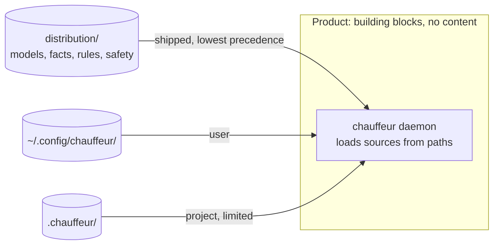

```text
crates/
  core/          # Steps, after, rounds, events, verdict. No dependencies
  protocol/      # navigate, rule files, events and actions; validation and limits; lowering
  judges/        # Questions, results, confidence, tiers and fallback; formats:
                 #   systemone, openai, anthropic, person, placeholder, facts
  facts/         # QuickJS sandbox: runs a fact with caps and host modules. Ships no facts
  runtime/       # Admission, deadlines, workers, redaction
  daemon/        # Socket; loads models, facts and rules; event bus; plugin supervisor
  cli/           # chauffeur binary: navigate, strategy show, setup and audit
  o11y/          # Event consumers, on tracing
packages/
  chauffeur/     # @fdcn/chauffeur: /client, /judge, /plugin, /harness
plugins/
  skills/            # Skill exposure, remote sources and safety review
  context-renewal/   # Compacts long, cold sessions
  warming/           # Keeps the prompt cache warm while idle
  guard/             # Blocks or asks before irreversible actions
distribution/
  models/        # jev.json, subq.json, glide.json
  facts/         # match.js, select.js, bm25.js, embedding.js, and their tests
  rules/         # Shipped rule files
  safety/        # Redaction and backstop patterns
playground/
  wasm/          # Thin wasm-bindgen bridge to core and protocol
  src/features/  # One interactive tab per feature under test
scripts/         # Packaging, Homebrew formula, smoke tests
.github/workflows/
```

| Rule | Consequence |
|---|---|
| `crates/` never embeds content | A build without `distribution/` still runs, with nothing in it |
| One loader for every source | The shipped `select.js` takes exactly the path a user's `notes.js` takes |
| Precedence | Shipped, then user; project content is limited (pure facts, no models, System Two only if allowed) |
| Install | Packaging copies `distribution/` to `~/.local/share/chauffeur/`, so the product and its content release separately |
| Plugins | `plugins/` holds the first-party plugins. Each is its own package on the SDK, registered in `plugins.json` like anyone else's; nothing in `crates/` depends on them |

Each crate arrives with the first slice that needs it. `o11y` waits until the
core event schema is stable.

## Sequence and verification

A slice delivers one feature a person uses, through the real path from the
harness or caller to the judge and back. It builds only what that feature
needs, with the tests and proofs for that code. Every slice ends the same way:
the [quality gates](#quality-gates) pass, its playground tab works in a real
browser, the feature works in its real harness or caller, the parity table
covers every `main` commit to date, an rc ships, and work stops for review.

### Slice 0: setup (implemented)

- The pinned nightly, strict workspace lints, LICENSE, and the plan and audit
  documents.
- The playground shell: Vite, TypeScript and Bun, with petite-vue and Web
  Awesome. Rust compiles to WASM with wasm-pack; the heading shows the version
  Rust returns, and an edit to Rust rebuilds the module and reloads the page.
- `bacon.toml`, whose jobs build and test through blaze.

### Slice 1: Conventional Commits nudge in OpenCode

**You can:** install the rc beside v1 and the harness package's OpenCode
adapter, with Chauffeur registered as a decider. When the agent commits with a message such as `fixed stuff`, its
next tool result carries "Use Conventional Commits, such as
`feat(scope): …`". An `unsure` or `failed` answer sends nothing.

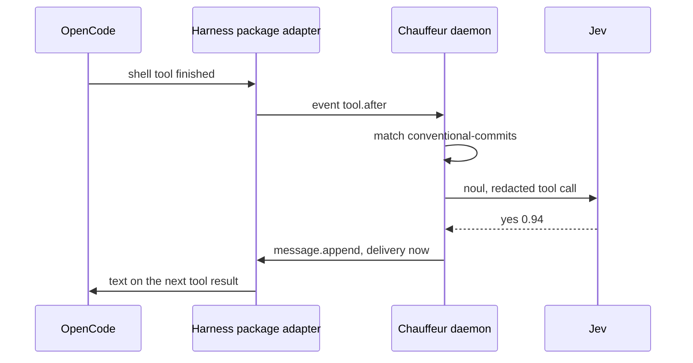

| File | Contents |
|---|---|
| `crates/core/src/{plan/,judge.rs,event.rs}` | Steps asked in one round, `Outcome`, `Judge`, `Panel`, `Plan::run`, events and `Verdict`; no dependencies |
| `crates/protocol/src/{rule/,when.rs,then.rs,event.rs}` | Rule files (`on`, `when`, `judges`, `asks`, `strategy`, `then`, `cooldown_seconds`), checked when they load; the `when` filter; `then` entries by outcome, `unsure` or `failed`; harness events and the evidence blocks they give, such as `tool_call` |
| `crates/judges/src/{question/,confidence/,config/,format.rs,placeholder/}` | Questions and results; confidence and `level`; `models.json` from shipped and user configuration; the `Format` interface; the `placeholder` format |
| `crates/judges/src/tiers/` | The four tiers; each tier's models in fallback order as one core `Judge`, with the model that answered. `system_one/` holds the `systemone` format with `noul`, behind the default `systemone` feature so the playground builds without HTTP: authentication, timeout, bounded response, 429 and 529. `system_two/`, `facts/` and `person/` gain their formats in slices 11, 4 and 5 |
| `crates/runtime/src/{run.rs,redact/,log.rs}` | Runs a rule on a worker thread within its deadline; redacts evidence before every model call, with v1's rules and cases and `distribution/safety/redaction.json`; a bounded log |
| `crates/daemon/src/{paths,state,rpc,socket}.rs`, `crates/daemon/src/route/` | Socket folder `0700`, JSON-RPC 2.0 lines up to 1 MiB, 64 connections; loads shipped and user models, redaction and rules and reloads them on change; routes an event to the rules that hook it, concurrently, with each rule's cooldown per session. Methods `chauffeur.emit`, `chauffeur.events` and `chauffeur.status`; the decider methods follow the harness package's contract |
| `crates/cli/src/main.rs` | `chauffeur daemon`, `version`, `emit`, `events` and `status`; the installation's name is the executable's, so `chauffeur-next` keeps its own socket and configuration; a second daemon that finds the socket taken exits |
| `distribution/models/jev.json`, `distribution/rules/conventional-commits.json`, `distribution/safety/redaction.json` | Jev as the default System One; the nudge; the known credential prefixes |
| `scripts/{package,homebrew,smoke}.mjs`, `.github/workflows/check.yml` | rc packaging and the `chauffeur@next` formula, with its Homebrew service |
| `playground/src/features/question.ts` | The Question tab |

Verification:

- Kani: for every probability in thousandths and every valid confidence, an
  answer settles to exactly one outcome, edges inclusive. Core's one-round run
  is covered by scenario tests, Miri and `cargo-mutants`; its Kani harnesses
  arrive with `after` in slice 3.
- Live, through `chauffeur emit` and the daemon: the nudge goes out for a
  nonconventional commit and not for a conventional one, with Jev's answer,
  model and time in `chauffeur events`.
- Judges: `main`'s `judges/jev/tests/wire.rs` replayed over loopback HTTP;
  fallback moves on only for unavailable, rate-limited or timed out; an
  outcome outside the question's list fails as `invalid`; a key never appears
  in an event, error or verdict.
- Placeholders: recorded answers match by evidence, first match wins;
  `otherwise` answers the rest, and without it the step fails as
  `unavailable`; every placeholder answer is marked in events.
- Daemon: another user's socket directory is refused; an oversized line and a
  closed connection fail safely; an edited rule applies to the next event; a
  rule naming an unknown judge is refused at load, with its path.
- OpenCode, for real: `fixed stuff` gets the nudge, `feat(parser): handle
  empty input` gets nothing, and with Jev unreachable nothing is sent and the
  event log shows `failed: unavailable`; `ls` and `cargo test` make no Jev
  call; two OpenCode windows share one daemon.
- Release: packaging dry run and smoke test on Linux and macOS; the rc's
  Homebrew `install`, `test`, `audit` and `style` on a machine running v1,
  which keeps working.

### Slice 2: sourcefed triage

**You can:** let sourcefed ask Chauffeur before it queues each event, so
OpenCode, Pi, MCP and the CLI receive the same filtered stream, as in
[sourcefed: one triage for every host](#sourcefed-one-triage-for-every-host).
sourcefed's daemon navigates `integration_event`, its installer adds
`sourcefed/triage` with the System One screen, and its OpenCode adapter's
`chauffeur.gate` call goes.

A caller sends an event or an inline strategy, with its evidence and a
deadline, and receives the events and the intents or verdict. It sends data,
never callbacks or code. This slice adds caller events, intents, the
integration and project rule sources, admission and cancellation, and the
bindings: the TypeScript client and `/judge`, and `chauffeur navigate`.

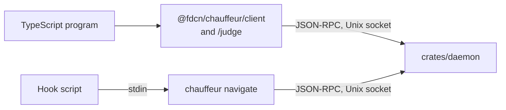

#### Wire contract

A `navigate` request, `event` notifications, then the result, as
[JSON-RPC 2.0](#json-rpc-20) lines. `chauffeur navigate` reads the request's
`params` on stdin and prints the messages it receives:

```sh
chauffeur navigate <<'EOF'
{"protocol": 1, "deadline_ms": 3000, "on": "integration_event", "evidence": {"event": "…", "thread": "…"}}
EOF
# → {"jsonrpc": "2.0", "method": "event", "params": {"id": 1, "rule_matched": {"rule": "sourcefed/triage"}}}
# → {"jsonrpc": "2.0", "method": "event", "params": {"id": 1, "round_ready": {"rule": "sourcefed/triage", "round": 1, "steps": ["screen"]}}}
# → {"jsonrpc": "2.0", "method": "event", "params": {"id": 1, "step_settled": {"step": "screen", "answer": {"outcome": "no", "p": {"yes": 0.04, "no": 0.96}, "level": 0.96}}}}
# → {"jsonrpc": "2.0", "id": 1, "result": {"intents": [{"rule": "sourcefed/triage", "withhold": "event"}]}}
```

A rejection is a JSON-RPC error whose `data.reason` names it:
`limit_exceeded`, `judge_unavailable`, `busy`, `deadline` or
`unsupported_protocol`.

A request with `strategy` in place of `on` ends with `{"verdict": {…}}`.
`$CHAUFFEUR_SOCKET` defaults to `chauffeur/daemon.sock` in the user's runtime
directory: `$XDG_RUNTIME_DIR`, or `$TMPDIR` on macOS.

- **Answers and failures** are distinct: a step settles to
  `{"answer": {"outcome", "p", "level"}}` or `{"failed": "<reason>"}`.
  Probabilities have at most three decimals.
- **Intents** carry the rule that produced them. A rule's intents are dropped
  if its strategy misses the deadline; other rules' intents still return.
- **Evidence** is named once per navigation and referenced by steps, so a
  batched provider call carries each block once.
- **Versioning:** `protocol` is required; the daemon answers
  `unsupported_protocol` with the versions it accepts, and each binding reports
  it as `unavailable`.
- **Limits**, checked before admission: 32 steps per strategy, counting each
  copy `for_each` makes; 16 `after` entries per step; 64 outcomes per
  question; 64 evidence blocks and candidates; 256 KiB of evidence; 30 s
  deadline. Each rejection names its limit.

#### Files

| Path | Contents |
|---|---|
| `crates/protocol/src/{request,intent,limits}.rs`, `schema/navigate.json`, `fixtures/` | Requests, intents and limits; the one `navigate` schema, and the valid and invalid requests every binding's tests replay |
| `crates/runtime/src/admission.rs` | One permit per navigation, held from admission through delivery; per-source and global capacity |
| `crates/runtime/src/run.rs` | A bounded worker pool; the deadline and cancellation checked before each round; late results discarded |
| `crates/daemon/src/{socket,rules}.rs` | Several calls per connection, `$/cancelRequest`, cancel on close, `--models FILE` for tests; the integration and project rule sources, refusing System Two in a project rule the user has not allowed and any model or placeholder entry from a project; matching rules run concurrently |
| `crates/cli/src/navigate.rs` | `chauffeur navigate`: one request on stdin, the JSON-RPC messages on stdout; exit 0 with intents or a verdict, 1 when rejected, 2 when the daemon is unavailable |
| `packages/chauffeur/src/{client,judge}/` | `@fdcn/chauffeur/client` and `/judge`: `navigate` over the socket, closing on abort; `ask`, `judge`, `noul`, and results typed from their questions |
| sourcefed: its daemon, installer and `adapters/opencode/bridge.ts` | `navigate` before queuing; installing `sourcefed/triage`; removing `chauffeur.gate` |

#### Verification

- Protocol: round-trip and rejection cases for every limit and malformed
  field, including duplicate outcomes, reserved outcome names and a
  per-outcome confidence that misses an outcome.
- Runtime under Miri: deadline, cancellation, late result, overflow, and
  exhausted capacity, including audit A3's flood: 81 submissions with capacity
  8 admit 8 and reject 73 with `capacity`.
- Kani: a permit is released exactly once on every terminal path; the event
  log never exceeds its bound.
- Rules: each of the four sources loads; a project rule naming System Two, and
  a model or placeholder entry in a project's `.chauffeur/`, are refused; two
  matching rules both return their intents; a rule that misses the deadline
  drops only its own intents.
- Bindings: the client, `/judge` and `chauffeur navigate` accept and reject
  every fixture identically and return the same verdicts; aborting any caller
  cancels the navigation; an unsupported protocol reports as `unavailable`;
  `ask`'s result types reject impossible outcomes at compile time.
- sourcefed, for real: v1's 12 labelled events give the same deliveries;
  events reaching OpenCode, Pi and the CLI are filtered alike; with Chauffeur
  stopped, sourcefed delivers.

### Slice 3: escalation from Jev to GLiDE

**You can:** have the commit nudge and `sourcefed/triage` ask GLiDE only when
Jev is unsure or fails, see each strategy as a tree with
`chauffeur strategy show`, and step through it in the playground's Strategy
tab.

This slice adds strategies with more than one step: a step's `after` names
the earlier steps it waits for and the outcomes it needs, as in the
[core plan model](#core-plan-model).

| File | Contents |
|---|---|
| `crates/core/src/{after,state}.rs` | The `after` rule, validation, and the round API (`questions`, `answer`, `fail`) |
| `crates/core/src/proofs.rs`, `crates/core/tests/scenarios.rs` | Kani harnesses and scenario tests |
| `crates/protocol/src/lower.rs` | Lowering named judges, asks and `after` to `chauffeur_core::Plan` |
| `crates/judges/src/tiers/system_one/` | `choice` with every outcome's probability, and GLiDE's level-valued `score` |
| `distribution/models/{subq,glide}.json` | SubQ and GLiDE beside Jev |
| `crates/cli/src/strategy.rs` | `chauffeur strategy show <rule>` and `--file`: the tree, rounds, resolved models, `after`, confidence, and the maximum rounds and model calls |
| `playground/src/features/strategy.ts` | The Strategy tab |

Scenario tests:

- Escalation, with recorded answers at every tier.
- `after` alone: a string need waits for a skipped step and then runs; an
  object need never matches a skipped step; `Failed` matches only when listed;
  a step with both `all` and `any` runs only when both hold.
- Validation: an empty plan, a duplicate ID, `after` naming a later or unknown
  step, an empty `when` list, and a judge the panel lacks, each rejected
  before any judge is asked.
- The round API: a reply naming an unknown, unasked or repeated step, or
  missing one, returns the unchanged round; each judge answers its share of a
  round in one call; a batch of the wrong length settles as `Failed`.

Kani harnesses, each one invariant over at most three steps and a small
outcome enum. The `after` rule and round state are written over step indices
and outcome enums, with no strings or maps, so CBMC explores them in seconds;
the names and events around them stay in the code that calls them:

| Harness | Property |
|---|---|
| `a_step_waits_until_every_need_has_finished` | No decision while a named step is `Pending` or `Asked` |
| `a_decision_follows_the_rule` | `Run` exactly when every `all` need and, if any, one `any` need is met |
| `a_skipped_step_meets_only_needs_without_when` | Skipped never matches a `when` |
| `one_pass_settles_every_decidable_step` | Skips propagate within one pass |
| `a_pass_only_moves_pending_steps_forward` | Each step is asked at most once |
| `a_pass_with_no_open_round_asks_or_finishes` | A run never stalls, so it finishes within one round per step |
| `strategy_show_bounds_every_lowered_plan` | A lowered plan has at most the rounds `strategy show` reports |

Verification: `main`'s `judges/{subq,glide}/tests/wire.rs` replayed over
loopback; `"model": "glide"` without GLiDE configured runs on the tier's
fallback order and reports it; the escalation runs live against Jev and GLiDE
and agrees with `main`'s `CHAUFFEUR_JUDGE_ESCALATE=glide` on the same cases,
reporting answers, rounds, elapsed time and model calls; labelled scale
questions through `choice` and `score` report which agrees with the labels
more often.

### Slice 4: opencode-history recall

**You can:** have opencode-history attach the right past passages when you
send a message, as in [Per-turn recall](#per-turn-recall): its rule installed
in `~/.config/chauffeur/rules/opencode-history/`, its code reduced to one
`navigate` call. You can also write your own facts.

This slice adds facts, `for_each` over candidates, and `select`.

| File | Contents |
|---|---|
| `crates/facts/src/{lib,sandbox,host,limits}.rs` | Fact modules from the three sources; QuickJS with memory caps and deadline interrupts; the read-only host modules for shipped and user facts |
| `crates/judges/src/tiers/facts/` | The `facts` format |
| `distribution/facts/{match,select}.js` and their tests | The two shipped facts |
| `crates/protocol/src/lower.rs` | Candidates, `for_each` copies, wildcards and `[item]` |
| `playground/src/features/facts.ts` | The Facts tab |

Verification:

- Facts: `match` passes v1's facts-judge cases; `select` passes exhaustive
  tests over every input up to 4 candidates; a fact over its memory cap or
  deadline fails the step; a project fact cannot import a host module; a
  missing fact falls back to a placeholder.
- Strategies: each row of the [strategies table](#strategies) runs as a rule
  with recorded answers; `after` with `[item]` skips exactly the candidates
  whose earlier copy did not match.
- Recall: Jev scores recorded by opencode-history's replay feed a placeholder
  System One, and navigating `recall` attaches the replay's top three passages
  scoring 0.7 or above. Live, it makes one Jev call per message, with judge
  time within the replay's 278 ms p50 and 318 ms p95 plus local overhead. No
  agent session or history is sent.

### Slice 5: harm guard

**You can:** have the guard ask System One, before a shell command runs,
whether it could cause irreversible harm. `yes` blocks the call; `unsure`,
`failed` or a slow answer hands it to you.

This slice adds [plugins](#plugins) and the person tier.

| File | Contents |
|---|---|
| `crates/daemon/src/plugins.rs` | `plugins.json`; the stdio plugin protocol; discovery cache, lazy and eager start, idle stop, restart with backoff, reload on file change |
| `crates/daemon/src/bus.rs` | `ctx.on` and `ctx.before` routing, `before` budgets and `onTimeout`, retries by kind, the stale-action check |
| `crates/judges/src/tiers/person/` | The `person` format: a question shown to the user through the harness |
| `packages/chauffeur/src/{plugin,harness}/` | `@fdcn/chauffeur/plugin` and `/harness` |
| `plugins/guard/` | The guard, with the read guard's `before` hooks |

A spike decides whether first-party plugins ship compiled with scriptc. It
compiles `guard`, and reports which SDK and Node APIs scriptc rejects, start
time and memory against Bun, and build time. User plugins, and first-party
plugins in development, run from source on Bun.

Verification: a plugin crash, a missed `before` budget and a stale action each
behave as specified; `onTimeout: "ask"` hands a tool call to the user;
discovery records the same hooks a full start registers; `main`'s
`read-guard-probes.json` and `rpc-starvation.test.ts` pass; in a real
OpenCode, a destructive command is blocked or asked about and `ls` runs
within the budget.

### Slice 6: skills

**You can:** have the skills plugin attach the skills each prompt needs, find
skills from remote sources, and screen new skills before they are offered.

| File | Contents |
|---|---|
| `plugins/skills/` | Exposure, remote sources with fetches inside the plugin (audit A4), and the screen-then-review strategy, using `prompt.sent` edits and the `skill` registry |

The review step runs on System Two from slice 11. Until then, a skill the
screen leaves `unsure` is withheld.

Verification: `main`'s `sources/tests.rs` vetting cases and
`cli/tests/skills.rs` pass; in a real OpenCode, a request to review a pull
request attaches the review skill.

### Slice 7: context renewal and warming

**You can:** have a long, cold session compacted with a cheap model before
your next prompt runs, and an idle session's prompt cache kept warm.

| File | Contents |
|---|---|
| `plugins/{context-renewal,warming}/` | The two plugins, using the session events and the `session.compact`, `session.warm` and `session.update` actions the fidelity table marks as supported |

Verification: `main`'s `routing.rs`, `renewal.test.ts` and `warming.test.ts`
pass; in a real OpenCode, a session resumed after the cache expires is
compacted before the prompt runs.

### Slice 8: Pi

**You can:** use every feature so far in Pi, through the harness package's Pi
adapter.

Verification: every feature so far works in a real Pi, or reports
`unsupported` where the fidelity table says so; sourcefed events reaching Pi
are filtered as in OpenCode.

### Slice 9: Claude Code

**You can:** use every feature so far in Claude Code, through the harness
package's Claude Code adapter, with mods on or off.

Verification: every feature so far works in a real Claude Code with mods on
and off, or reports `unsupported` where the fidelity table says so; a failed
guard refuses the call.

### Slice 10: Codex

**You can:** use every feature so far in Codex, through the harness package's
hook command.

Verification: every feature so far works in a real Codex, or reports
`unsupported` where the fidelity table says so; the daemon answers within the
hook command's budget; a `wake` goes out at the next `Stop`.

### Slice 11: review by a reasoning model

**You can:** escalate to a reasoning model, such as the Slack review in
[Event triage](#event-triage) and the skills plugin's review step.

This slice adds the `openai` and `anthropic` formats, in
`crates/judges/src/tiers/system_two/`. A System Two answer is
schema-checked against the question's outcomes, and its `cites` must name
evidence the step was given. Model entries set the model ID, effort, timeout
and output budget. System Two ships disabled until a model and its
evaluations are reviewed.

Verification: loopback cases for valid, refused, malformed, truncated,
unavailable and timed-out replies; citations of evidence the step lacks are
rejected; the 32 KiB input budget; a slow reasoning call cannot consume
reserved interactive System One capacity; human-labelled cases replay before
a live model is enabled.

### Slice 12: rulebooks

Held until the [rulebooks](#rulebooks) design is discussed and approved. The
slice's files, tests and verification are written then. Cutover waits for
it, since v1 users rely on `/goal`.

### Slice 13: cutover

v2 replaces v1. `~/.config/chauffeur` is migrated, or v1's layout is read,
without losing personal rules, and every v1 rule converts and validates. When
every parity row is done, `v1` becomes a hotfix branch, v2 merges into `main`,
and `1.0.0` is tagged and published to Homebrew.

Verification: upgrade from the current v1 release on a machine with personal
rules; the bench `verify` fixtures and release-gate runs pass; a day of real
use.

## Quality gates

- Pinned nightly, deny-level strict Clippy, formatting and stable MSRV check.
- Miri over core and runtime scenarios; Kani proofs are small and each names
  one invariant. `crates/facts` is outside Miri because QuickJS is C; its
  tests run natively.
- TypeScript: strict `tsc`, the gdp-ts lint preset, and type tests that
  impossible outcomes fail to compile.
- Real boundary checks for browser WASM, the daemon socket, each `navigate`
  binding, the plugin protocol, provider HTTP and live Jev. Unit tests
  supplement these checks; they do not replace them.
- Verify at each slice before proceeding. Keep functions under 70 non-blank,
  non-comment lines, use no production dependency without approval, and keep
  core dependency-free.
- Tests run under `cargo nextest`, with doctests through `cargo test --doc`.
  `cargo-mutants` runs over core, confidence and lowering, and every
  surviving mutant is either killed by a new test or explained. `cargo-shear`
  finds no unused dependency. `criterion` benchmarks back every latency the
  plan states.
- Full workspace tests, Clippy, Miri, Kani, docs and deny run before committing
  the completed slice. The v2 branch is pushed after the agreed review.

## Decisions

| Concern | Decision |
|---|---|
| Wire protocol | JSON-RPC 2.0 over the Unix socket and stdio |
| First-party plugins | `plugins/` in this repository, each its own package on the SDK |
| Adapters | Adopted from the shared harness package, designed separately; Chauffeur registers as a decider and reads the package's event, action and fidelity data. Slice 1's OpenCode part and its rc wait for the package |
| Chauffeur for other services | sourcefed and Workhorse ask Chauffeur as a judgment layer through `navigate`, and pass through when it is unavailable |
| Slices | Each slice is one feature a person uses, built end to end and released as an rc; the pieces arrive with the first feature that needs them. Cutover waits for rulebooks |
| rc beside v1 | The `chauffeur@next` Homebrew formula installs `chauffeur-next`, with its own socket and `~/.config/chauffeur-next/`, so v1 keeps running untouched until cutover |
| `bm25` and `embedding` facts | Ship with the first feature that uses them |
| Jev's `score` type | `choice` for every question that is not yes/no; slice 3 measures `score` on labelled scale cases, and a question gains a hint only if `score` is clearly better |
| Production dependencies | Core stays dependency-free. Approved: `serde` and `serde_json` (protocol and every config file), `thiserror` (typed errors outside core), `rquickjs` and bundled `rusqlite` (facts and the `chauffeur:sqlite` host module), `notify` (reloading rules, facts and models), `ureq` with rustls (model formats, from slice 1), `tracing` and `jiff` (o11y events and audit timestamps), `clap` and `color-eyre` (the CLI binary only) |
| Development tools | `cargo-nextest` runs tests (doctests stay on `cargo test --doc`); `cargo-mutants` checks that tests catch changed logic in core, confidence and lowering; `cargo-shear` catches unused dependencies; `criterion` benchmarks the socket hop, confidence, a fact call and lowering; `bacon.toml` holds shared watch jobs |
| blaze | Builds and tests in the local loop, through `bacon`. Clippy, CI, Kani, Miri and `cargo-mutants` run on cargo with the pinned toolchain, which stays the final word: blaze builds with its own nightly and its borrow checker is incomplete |
| scriptc | A slice 5 spike for first-party plugins; the engine stays Rust |

## Open questions

| Question | Recommended default |
|---|---|
| The rulebooks design | Discuss before slice 12; the [sketch](#rulebooks) is the starting point |
| How the daemon starts when no service runs and only the harness package connects | Settle with the harness package's decider registration |
