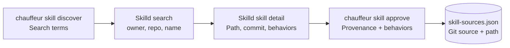

# Skill discovery through Skilld

Status: first cut built. Search and approval run from the CLI; dependency
suggestions and host surfaces are deferred.

## Decision

[Skilld](https://github.com/skilld-dev/skilld) helps find upstream skills;
Chauffeur owns review, approval, source configuration, caching, ranking, and
attachment. Discovery is an explicit user action and stays outside the
prompt-time path. An unapproved result never becomes an available skill.

## Discovery and approval

Approval reads the skill's detail record, validates it, and prints its author,
license, repository, path, source commit, and the behaviors Skilld flagged.
Behaviors Skilld marks `ask` (remote code, privilege, credentials, destructive,
hidden text) block approval until each is named with `--allow`. `--dry-run`
shows the change without writing.

One-skill approval records the skill's exact directory. Repository approval
records the deepest folder that holds all of its listed skills, and so follows
future skills published there.

## Skilld interface

The public API at `https://skilld.dev/api/v1` needs no account. Chauffeur uses:

| Endpoint | Returns | Use |
|---|---|---|
| `GET /skills?q=&limit=` | Name, description, stars, GitHub owner/repository | Candidate list |
| `GET /skills/{owner}/{repository}/{name}` | `repositoryUrl`, `skillPath`, `sourceCommit`, `sourceGone`, license, behaviors | Approval record |
| `GET /repositories/{owner}/{repository}` | Skill names; paths are absent | Repository approval, one detail read per skill |

`SKILLD_API_URL` overrides the origin, as it does for the Skilld CLI: HTTPS, or
HTTP on loopback.

## Writing the source

| Situation | Change |
|---|---|
| No source for the repository | Add a Git source for `repositoryUrl.git` with the path; the ID derives from the repository name |
| A source already follows the repository | Add the path to it; drop paths the new one now covers |
| The path is already covered | Report it and write nothing |
| 16 sources or 16 paths would be exceeded | Refuse, naming the limit |

The file is rewritten whole and atomically; its content, including
`descriptions`, is preserved, but hand formatting is not.

## Decisions

| Concern | Decision |
|---|---|
| Trigger | User-run command; no background or per-prompt searches |
| Privacy | Send only the typed search terms or the named selector |
| Trust | Approval is required to add a source; nothing from Skilld executes |
| Updates | Approved sources follow the default branch, like hand-written ones; the reviewed commit is printed |
| Verification | Chauffeur fetches from Git directly, so Skilld's artifact attestation does not apply |
| Compatibility | Skilld carries no version-compatibility data; tags and last push are shown instead |
| Failure | A Skilld failure changes nothing; approved sources keep working |

## Implementation

1. `capabilities/skill-exposure/src/sources/skilld.rs`: Skilld client with
   bounded responses and timeouts, and candidate validation.
2. `capabilities/skill-exposure/src/sources/approve.rs`: the pure merge into
   `SourcesConfig`, behavior gating, and atomic reading and writing.
3. `crates/cli/src/discover.rs`: `chauffeur skill discover` and
   `chauffeur skill approve`, writing `$CHAUFFEUR_CONFIG_DIR/skill-sources.json`.
   The daemon reloads it.
4. Tests in `sources/discovery_tests.rs`: malformed provenance, merge cases
   and limits, behavior gating, file handling, and the client against a local
   fake API.
5. Docs: `docs/remote-skills.md` and the `chauffeur` skill.

Deferred: suggestions from project dependencies (Skilld has no such
interface, so Chauffeur would build search terms itself), and host-adapter
surfaces.
