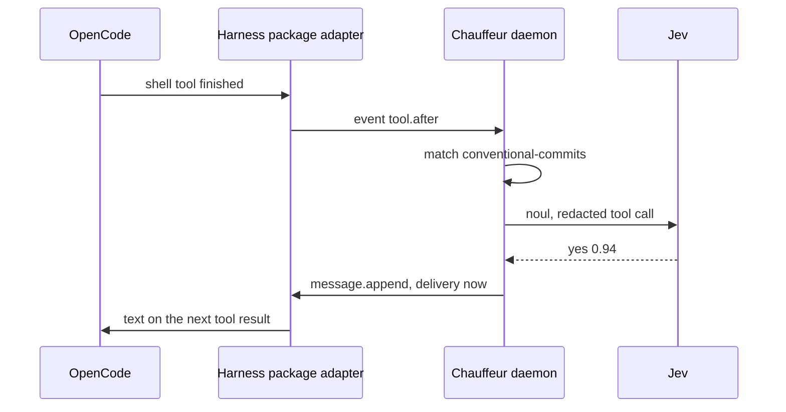

# Slice 1: Conventional Commits nudge in OpenCode

**Status:** In progress: the engine, the release pipeline and the audit log are built; the OpenCode adapter waits for the harness package.

**You can:** install the rc beside v1 and the harness package's OpenCode
adapter, with Chauffeur registered as a decider. When the agent commits with a message such as `fixed stuff`, its
next tool result carries "Use Conventional Commits, such as
`feat(scope): …`". An `unsure` or `failed` answer sends nothing.

## What it builds

### Core: one round of steps

A plan of named steps, each asking one judge one question, all asked in one
round; `Outcome`, `Judge`, `Panel` and `Plan::run`, the events a run emits,
and the `Verdict`. Core has no dependencies.

Files: `crates/core/src/plan/`, `judge.rs`, `event.rs`

Verified by:

- Scenario tests, Miri and `cargo-mutants` over the one-round run. Core's
  Kani harnesses arrive with `after` in slice 3.

### Rule files

Loading and checking a rule file: `on`, `when`, `judges`, `asks`,
`strategy`, `then` and `cooldown_seconds`; the `when` filter; `then` entries
by outcome, `unsure` or `failed`; harness events and the evidence blocks they
give, such as `tool_call`.

Files: `crates/protocol/src/rule/`, `when.rs`, `then.rs`, `event.rs`

Verified by:

- A rule naming an unknown judge is refused when it loads, with its path.

### Questions, confidence and models

Questions and results; confidence and `level`; `models.json` from shipped and
user configuration; the `Format` interface; the `placeholder` format.

Files: `crates/judges/src/question/`, `confidence/`, `config/`, `format.rs`,
`placeholder/`

Verified by:

- Kani: for every probability in thousandths and every valid confidence, an
  answer settles to exactly one outcome, edges inclusive.
- An outcome outside the question's list fails as `invalid`.
- Placeholders: recorded answers match by evidence, first match wins;
  `otherwise` answers the rest, and without it the step fails as
  `unavailable`; every placeholder answer is marked in events.

### Tiers and the Jev format

Each tier's models in fallback order, as one core `Judge` that reports the
model that answered. `system_one/` holds the `systemone` format with `noul`:
authentication, timeout, a bounded response, 429 and 529. It sits behind the
default `systemone` feature, so the playground builds without HTTP.
`system_two/`, `facts/` and `person/` gain their formats in slices 11, 4
and 5.

Files: `crates/judges/src/tiers/`

Verified by:

- `main`'s `judges/jev/tests/wire.rs` replayed over loopback HTTP.
- Fallback moves on only for unavailable, rate-limited or timed out.
- A key never appears in an event, error or verdict.

### Running a rule

Runs a rule on a worker thread within its deadline, and redacts evidence
before every model call, with v1's rules and `distribution/safety/redaction.json`.

Files: `crates/runtime/src/run.rs`, `redact/`

Verified by:

- v1's redaction cases.
- A judge sees only redacted evidence; a missed deadline settles nothing.

### The daemon

A private socket (its folder `0700`), JSON-RPC 2.0 lines up to 1 MiB, 64
connections. It loads shipped and user models, redaction and rules, and
reloads them when they change. It routes an event to the rules that hook it,
concurrently, with each rule's cooldown per session, and appends every run
to `audit.jsonl` in `~/.local/state/<name>/`, moved aside once past 8 MiB.
Its methods are `chauffeur.emit` and `chauffeur.status`; the decider methods
follow the harness package's contract.

Files: `crates/daemon/src/paths.rs`, `state.rs`, `rpc.rs`, `socket.rs`,
`audit.rs`, `route/`

Verified by:

- Another user's socket folder is refused.
- An oversized line and a closed connection fail safely.
- An edited rule applies to the next event.
- The audit log moves aside at its bound and reads across both files.

### The CLI

`chauffeur daemon run`, `daemon status`, `version`, `emit` and `audit`.
`audit` reads the log's files, so it works with no daemon, with `--follow`
and `--brief`. The installation's name is the executable's, so
`chauffeur-next` keeps its own socket, configuration and log. A second daemon
that finds the socket taken exits.

Files: `crates/cli/src/main.rs`, `audit.rs`

Verified by:

- The binary against a real daemon: the nudge through `emit`, `daemon status`,
  a second daemon, no daemon, refusals, and `audit` after the daemon stops.

### Shipped content

Jev as the default System One, the nudge, and the known credential prefixes.

Files: `distribution/models/jev.json`, `distribution/rules/conventional-commits.json`,
`distribution/safety/redaction.json`

Verified by the end-to-end checks below.

### Release

rc packaging and the `chauffeur-next` formula with its Homebrew service.
`release.yml` publishes a prerelease and the formula on each rc tag.

Files: `scripts/package.mjs`, `homebrew.mjs`, `smoke.mjs`,
`.github/workflows/check.yml`, `release.yml`

Verified by:

- A packaging dry run and the smoke test on Linux and macOS.
- The rc's Homebrew `install`, `test`, `audit` and `style` on a machine
  running v1, which keeps working.

### The playground

The Question tab: a question's probabilities settled under a confidence, as
the daemon does.

Files: `playground/src/features/question.ts`

Verified by:

- The tab settles the plan's confidence examples in a real browser.

## End to end

- Through `chauffeur emit` and the daemon, live: the nudge goes out for a
  nonconventional commit and not for a conventional one, with Jev's answer,
  model and time in `chauffeur audit`, which still shows them after the
  daemon restarts.
- OpenCode, for real: `fixed stuff` gets the nudge, `feat(parser): handle
empty input` gets nothing, and with Jev unreachable nothing is sent and the
  audit log shows `failed: unavailable`; `ls` and `cargo test` make no Jev
  call; two OpenCode windows share one daemon.
