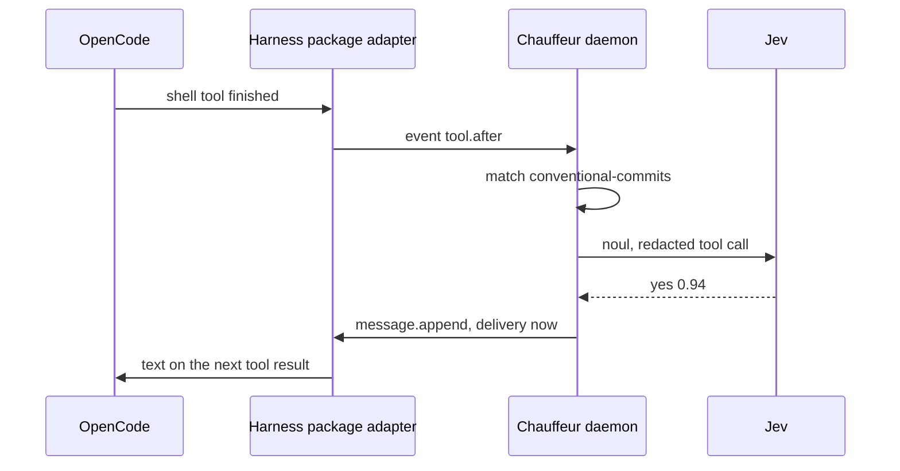

# Slice 1: Conventional Commits nudge in OpenCode

**Status:** In progress: the engine, the release pipeline and the audit log are built; the OpenCode adapter waits for the harness package.

**You can:** install the rc beside v1 and the harness package's OpenCode
adapter, with Chauffeur registered as a decider. When the agent commits with
a message such as `fixed stuff`, its next tool result carries "Use Conventional Commits, such as
`feat(scope): …`". An `unsure` or `failed` answer sends nothing.



## What it builds

### Core: one round of steps

A plan of named steps, each asking one judge one question, all asked in one
round; `Outcome`, `Judge`, `Panel` and `Plan::run`, the events a run emits,
and the `Verdict`. Core has no dependencies.

Files: `crates/core/src/plan/`, `judge.rs`, `event.rs`

```rust
let step = Step::new("commit", "system-one", "Is this message conventional?");
let plan = Plan::new([step])?;

let yes = |_: &&str| Outcome::Value("yes");
let run = plan.run(&Panel::new().with("system-one", &yes))?;

assert_eq!(run.verdict.get("commit"), Some(&Outcome::Value("yes")));
```

Structure:

- **`Plan<Q>`**, the steps in order, each ID once. Field: `steps`.
  - `new(steps)` refuses no steps (`Empty`) and a repeated ID
    (`DuplicateStep`).
  - `steps()` returns them.
  - `run(&panel)` refuses a step whose judge the panel lacks
    (`UnknownJudge`) before asking any judge. Otherwise it asks each judge
    once, with all its steps through `judge_all`, in the order the judges
    first appear, and returns a `Run`. A judge that returns the wrong number
    of answers has each of its steps settle as `Invalid`.
- **`Step<Q>`**, one question for one judge. Fields: `id`, `judge` (the
  judge's name) and `request`; `new(id, judge, request)` and a getter for
  each.
- **`Judge<Q, O>`**, the trait a judge implements: `judge(&request)` answers
  one request, and `judge_all(&requests)` answers several, calling `judge`
  for each unless the judge batches. Every `Fn(&Q) -> Outcome<O>` is a judge.
- **`Panel<'a, Q, O>`**, the judges a plan may name. Field: `judges`, name
  and judge pairs, looked up in order. `new()`, `with(name, &judge)`, which
  replaces a judge of the same name, and `get(name)`; implements `Default`.
- **`Outcome<O>`**, a step's result: `Value(O)`, the judge's answer, or
  `Failed(Failure)`.
- **`Failure`**: `Unavailable`, `RateLimited`, `Timeout`, `Invalid` or
  `Deadline`.
  - `name()` and `from_name(name)` convert to and from wire names such as
    `rate_limited`.
  - `falls_back()` is true for the first three, the failures that let a
    tier's next model answer instead.
  - Implements `Display` and `Error`.
- **`Event<O>`**, what a run emits in order: `Started { steps }`,
  `RoundReady { round, steps }`, `StepSettled { step, outcome }` and
  `Finished`.
- **`Verdict<O>`**, each step's outcome in plan order. Field: `settled`;
  `get(step)` and `iter()`.
- **`Run<O>`**, a finished run. Public fields: `events` and `verdict`.
- **`PlanError`**: `Empty`, `DuplicateStep(id)` or
  `UnknownJudge { step, judge }`; implements `Display` and `Error`.

Every type but `Panel` derives `Clone`, `Debug`, `PartialEq` and `Eq`;
`Failure` is also `Copy` and `Hash`.

Verified by:

- Scenario tests, Miri and `cargo-mutants` over the one-round run. Core's
  Kani harnesses arrive with `after` in slice 3.

### Rule files

Loading and checking a rule file: `on`, `when`, `judges`, `asks`,
`strategy`, `then` and `cooldown_seconds`; the `when` filter; `then` entries
by outcome, `unsure` or `failed`; harness events and the evidence blocks they
give, such as `tool_call`.

Files: `crates/protocol/src/rule/`, `when.rs`, `then.rs`, `event.rs`

```rust
// A RuleError names the rule and the reason.
let rule = Rule::parse("conventional-commits", &text)?;

let event = Event::parse(
    r#"{ "event": "tool.after", "tool": "shell",
         "input": { "command": "git commit -m wip" } }"#,
)?;

// on and when match, before any judge is asked.
assert!(rule.hooks(&event));
```

Structure:

- **`Rule`**, a checked rule. Fields: `id`, `on`, `when`, `judges` (name
  to `JudgeSpec`), `plan` (a core `Plan<Question>`), `then` and
  `cooldown`.
  - `parse(id, text)` reads the file as written, refusing unknown fields,
    then checks it: each judge's confidence; each step's judge, from
    `judges` or a tier named directly, which settles on the likeliest
    outcome; each step's question, inline or named in `asks`; the plan; and
    each `then` entry.
  - `hooks(&event)` is true when `on` names the event and `when` matches.
  - `id()`, `judges()`, `plan()`, `then()` and `cooldown()` return the
    fields.
- **`RuleFile`** and its parts, `JudgeFile`, `AskFile`, `StepFile`,
  `ThenFile` and the rest: the file as written, private to `rule/`, which
  `parse` turns into the checked types.
- **`JudgeSpec`**, a named judge. Public fields: `tier`, `model` (asked
  before the tier's order) and `confidence`.
- **`When`**, the filter checked before any judge is asked. Fields: `tools`
  and `input` (`contains`). `matches(&event)` is true when the event's
  tool is listed, if any are, and some string in its `input` contains the
  text. An empty filter matches every event.
- **`Then`**, one `then` entry. Fields: `needs` (step and `Expect`
  pairs), `name` (such as `message.append`) and `payload`. A getter for
  each, and `first_met(entries, &verdict)`, the first entry whose needs all
  hold.
- **`Expect`**, what an entry needs from a step: `Outcome(value)`, `Unsure`
  or `Failed`.
- **`Event`**, a harness event. Fields: `name` and `fields`.
  - `parse(text)` takes a JSON object with a string `event`.
  - `name()`, `field(name)` and `session()` read it.
  - `evidence()` gives the blocks a rule can name: `tool_call` (the tool
    and its input) and `tool_output` for tool events, and every other string
    field under its own name.
- **`RuleError`**: `Parse`, `UnknownJudge`, `UnknownAsk`, `Question`,
  `Confidence`, `Plan` or `Then`, each naming the rule, and the step or
  entry where there is one. **`EventError`**: `Json` or `Unnamed`.

Verified by:

- A rule naming an unknown judge is refused when it loads, with its path.

### Questions, confidence and models

Questions and results; confidence and `level`; `models.json` from shipped and
user configuration; the `Format` interface; the `placeholder` format.

Files: `crates/judges/src/question/`, `confidence/`, `config/`, `format.rs`,
`placeholder/`

```rust
let instructions = "Does this commit message break Conventional Commits?";
let question = Question::noul(instructions, ["commit"])?;

let p = Probabilities::read(question.outcomes(), [("yes", 0.94), ("no", 0.06)])?;
let bar = Confidence::Bar(Milli::new(700).ok_or("bar")?);
let by = AnsweredBy { model: "jev".into(), placeholder: false };

let answer = Answer::settle(&question, p, &bar, by);
assert_eq!(answer.outcome(), &Settled::Outcome("yes".into()));

let models = Models::load(&[shipped, user])?; // the user's entries win
```

Structure:

Questions:

- **`Question`**, all a judge sees. Fields: `instructions`, `outcomes` and
  `evidence` (the block names). `new(instructions, outcomes, evidence)`,
  `noul(instructions, evidence)` for yes and no, and a getter for each.
- **`Outcomes`**, 2 to 64 labels in order, unique, none blank, and neither
  `unsure` nor `failed`; for a scale, the order is the scale's. `new`,
  `len`, `iter`, `position(value)` and `get(index)`.
- **`Label`**, one outcome. Fields: `value` and an optional `description`
  the model sees. `new`, `described` and getters; implements
  `From<&str>`.
- **`QuestionError`**: `NoInstructions`, `OutcomeCount`, `BlankOutcome`,
  `Duplicate` or `Reserved`.

Confidence:

- **`Milli`**, a probability in thousandths, 0 to 1000, so comparisons are
  exact. `ONE`, `new`, `from_f64` (rounded), `get` and `to_f64`;
  ordered, `Copy` and `Hash`.
- **`Probabilities`**, one `Milli` per outcome, in the outcomes' order.
  `read(outcomes, pairs)` takes exactly one probability from 0 to 1 for each
  outcome, not all zero, and fails as `Invalid` otherwise. `level()` is the
  probability-weighted position, from 0 to n − 1.
- **`Confidence`**: `Likeliest`, where a tie is `unsure`; `Bar(Milli)`;
  or `PerOutcome`, a bar for each outcome. `check(&outcomes)` refuses a
  per-outcome confidence that misses or adds an outcome. `pick(p, bar)`
  settles the likeliest outcome when no other is as likely and it meets its
  bar, edges included.
- **`Answer`**. Fields: `outcome` (a `Settled`), `p` (each outcome's
  probability), `level` and `by`. `settle(&question, p, &confidence, by)`
  builds it; a getter for each field.
- **`Settled`**: `Outcome(value)` or `Unsure`; `Display` prints the value
  or `unsure`.
- **`AnsweredBy`**. Public fields: `model` and `placeholder`.
- **`ConfidenceError`**: `Missing(outcome)` or `Unknown(outcome)`.

Models:

- **`Models`**, every registered model and each tier's order. Fields:
  `models` and `tiers`.
  - `load(files)` reads shipped files first and the user's last; a later
    model or tier list of the same name replaces the earlier one, and a
    placeholder's `answers` path becomes relative to its file. It refuses a
    tier that names an unregistered model.
  - `model(name)` and `tier(tier)` read it.
- **`ModelEntry`**, one model by its `format`: `Systemone(SystemOneEntry)`
  or `Placeholder(PlaceholderEntry)`. **`KeySource`**: `env`, the variable
  that holds the key.
- **`Format`**, the trait each API format implements:
  `answer_all(&questions, &evidence)` asks a round's questions in one call
  and gives probabilities or a failure for each. `is_placeholder()` is false
  unless the format overrides it.
- **`Evidence`**, the redacted blocks by name. `new(blocks)`, `get(name)`
  and `named_by(&questions)`, the blocks the questions name, each once.
- **`Placeholder`**, the `placeholder` format. Fields: `answers` (recorded
  answers, each with its evidence and probabilities or failure) and
  `otherwise`. `load(&entry)` reads the answers file. As a `Format`, it
  gives the first recorded answer whose evidence the question sees with the
  same content, then `otherwise`, and fails as `Unavailable` without
  either; `is_placeholder()` is true.
- **`ConfigError`**: `Read`, `Parse`, `Placeholder { path, index, reason }`
  or `UnknownModel { tier, model }`.

Verified by:

- Kani: for every probability in thousandths and every valid confidence, an
  answer settles to exactly one outcome, edges inclusive.
- An outcome outside the question's list fails as `invalid`.
- Placeholders: recorded answers match by evidence, first match wins;
  `otherwise` answers the rest, and without it the step fails as
  `unavailable`; every placeholder answer is marked in events.

### Tiers and the Jev format

Each tier's models in fallback order, as one core `Judge` that reports the
model that answered. `system_one/` holds the `systemone` format with `noul`:
authentication, timeout, a bounded response, 429 and 529. It sits behind the
default `systemone` feature, so the playground builds without HTTP.
`system_two/`, `facts/` and `person/` gain their formats in slices 11, 4
and 5.

Files: `crates/judges/src/tiers/`

```rust
let keys = |env: &str| std::env::var(env).ok();
let jev_first = Fallback::build(&models, Tier::SystemOne, None, keys)?;

let judge = NamedJudge::new(&jev_first, &confidence, &evidence);
let run = plan.run(&Panel::new().with("quick", &judge))?;
// each answer names its model: AnsweredBy { model: "jev", placeholder: false }
```

Structure:

- **`Tier`**: `Facts`, `SystemOne`, `SystemTwo` or `Person`. `name()` and
  `from_name(name)` convert to and from names such as `system-one`.
- **`Model`**, one model ready to ask. Fields: `name` and `format`.
- **`Fallback`**, a tier's models in order. Field: `models`.
  - `build(&models, tier, preferred, key)` puts `preferred` first, then the
    tier's order, each once. It leaves out a model whose key is missing, and
    loads placeholders.
  - `answer_all(&questions, &evidence)` asks each model only the questions
    still open, moving on for a failure that `falls_back()`. Each answer
    names its model; a question no model answered fails as `Unavailable`.
- **`NamedJudge<'a>`**, a rule's named judge for one run. It borrows a
  `Fallback`, a `Confidence` and the run's `Evidence`. As a core `Judge`,
  `judge_all` asks the fallback once per round and settles each reply with
  `Answer::settle`; `judge` asks for one.
- **`SystemOneEntry`**. Public fields: `endpoint`, `model`, `key` and
  `timeout_ms`. `system_one::format(entry, key)` returns its client, or
  none when built without the `systemone` feature.
- **`SystemOne`**, the client. Fields: an HTTP `agent` with the timeout
  (3 seconds by default), the `url` (`{endpoint}/v1/systemone`), the
  `model` and the `key`.
  - `new(entry, key)` builds it.
  - `call(body)` posts with the bearer key and reads at most 256 KiB. A 429
    or 529 fails as `RateLimited`, a 408 or a transport timeout as
    `Timeout`, and any other error as `Unavailable`, its text dropped.
  - As a `Format`, it sends a round's yes and no questions as `noul` in one
    request, with the evidence they name as `state`, and reads each `noul`
    as the chance of `yes`. Any other question fails as `Invalid`.

Verified by:

- `main`'s `judges/jev/tests/wire.rs` replayed over loopback HTTP.
- Fallback moves on only for unavailable, rate-limited or timed out.
- A key never appears in an event, error or verdict.

### Running a rule

Runs a rule on a worker thread within its deadline, and redacts evidence
before every model call, with v1's rules and `distribution/safety/redaction.json`.

Files: `crates/runtime/src/run.rs`, `redact/`

```rust
// "export TOKEN=[REDACTED]"
let sent = redactor.redact("export TOKEN=ghp_…", &mut Masking::default());

match run(&context, &rule, &event, Duration::from_secs(2)) {
    Ran::Settled { run, then } => { /* run.verdict, and the first then entry met */ }
    Ran::Refused(reason) => { /* a placeholder whose answers would not load */ }
    Ran::Deadline => { /* nothing settled in time */ }
}
```

Structure:

- **`Context`**, what any rule needs to run. Public fields: `models`,
  `redactor` and `keys`, a function from a variable's name to its key.
- **`run(&context, &rule, &event, deadline)`** redacts the event's evidence,
  starts a worker thread and waits at most `deadline`. The worker builds a
  `Fallback` and a `NamedJudge` for each of the rule's judges, runs the
  plan, and finds the first `then` entry met.
- **`Ran`**: `Settled { run, then }`, `Refused(reason)` when a fallback or
  the plan cannot be built, or `Deadline`, after which a late result is
  dropped.
- **`Redactor`**, the credential prefixes from the redaction files. Field:
  `prefixes`.
  - `new(configs)` and `load(paths)` take shipped files first; a file with
    `replace` drops the earlier prefixes. More than 256 prefixes, or an empty
    one, is refused.
  - `redact(text, &mut masking)` replaces private-key blocks and words with
    a known prefix with `[REDACTED]`, and other credential-like words with a
    description of their shape, such as
    `[string 1: 40 characters of hex, after "api_key="]`. Paths, links and
    hashes stay readable.
- **`Masking`**, the numbers given to described values, so a value gets the
  same number in every block of one run.
- **`RedactionConfig`** (`replace` and `prefixes`), **`Prefix`** (`prefix`
  and `min_body`), and **`RedactError`**: `Read`, `Parse` or `Prefixes`.

Verified by:

- v1's redaction cases.
- A judge sees only redacted evidence; a missed deadline settles nothing.

### The daemon

A private socket (its folder `0700`), JSON-RPC 2.0 lines up to 1 MiB, 64
connections. It loads shipped and user models, redaction and rules, and
reloads them when they change. It routes an event to the rules that hook it,
concurrently, with each rule's cooldown per session, and appends every run
to `audit.jsonl` in `~/.local/state/<name>/`, moved aside once past 8 MiB.
Its methods are `chauffeur.emit` and `chauffeur.status`; the decider methods
follow the harness package's contract.

Files: `crates/daemon/src/paths.rs`, `state.rs`, `rpc.rs`, `socket.rs`,
`audit.rs`, `route/`

```rust
// The socket, configuration, distribution and state folders.
let paths = Paths::from_env("chauffeur", None);
chauffeur_daemon::run(&paths)?; // serves until the listener fails

let router = Router::new(loaded, Audit::new(&paths.state, MAX_BYTES));
let actions = router.emit(&event, Duration::from_millis(1500));

let last = audit::recent(&paths.state, 20)?; // one JSON line per run, oldest first
```

Structure:

- **`Paths`**, one installation's places. Public fields: `name`, `socket`,
  `config`, `distribution` and `state`.
  - `from_env(name, distribution)` reads them from the environment: the
    socket from `$CHAUFFEUR_SOCKET` or the runtime folder, configuration in
    `~/.config/<name>/`, state in `~/.local/state/<name>/`, and the
    distribution from `share/<name>/` beside the executable.
  - `private_folder(socket)` creates the socket's folder with mode `0700`,
    or refuses one that is open to others or owned by someone else.
- **`run(&paths)`** loads everything, starts the watcher (polling every
  2 seconds when the platform refuses), binds the socket and serves. A change
  reloads after 200 ms; one that does not load keeps the earlier state.
- **`Loaded`**, the result of `state::load(&paths)`. Public fields:
  `rules`, where a user rule replaces a shipped one of the same ID;
  `refused`, each rule file that did not load and why; and `context`.
- **`Router`**. Fields: `loaded`, `cooldowns` and `audit`.
  - `new(loaded, audit)` builds it; `replace(loaded)` swaps in a reload, and
    `loaded()` reads the current one.
  - `emit(&event, deadline)` runs every rule that hooks the event at once,
    each on its own thread, writes each run to the audit log and returns
    what the rules returned. A run is still returned when the log cannot be
    written.
  - Each run is skipped while its rule's cooldown holds in that session, and
    logs its session, steps, time, and refusal or deadline.
- **`Cooldowns`**, when each rule last returned something in each session,
  for at most 4,096 pairs, forgetting the oldest. `cooling(key, cooldown)`
  and `fire(key)`.
- **`Audit`**. Fields: `folder`, `max_bytes` and a write lock.
  `append(entry)` adds the time as `at` and writes one line, moving the log
  to `audit.1.jsonl` past 8 MiB. `audit::recent(folder, count)` reads the
  last lines across both files, and `audit::follow(folder, each)` calls
  `each` with every new line.
- **`socket::bind(socket)`** leaves a socket that another daemon answers on
  and replaces a stale one. **`socket::serve`** gives each connection its
  own thread, at most 64.
- **`rpc::handle(&router, line)`** answers one JSON-RPC line, and nothing for
  a notification. Deadlines default to 3 seconds and stop at 30.
- **`DaemonError`**: `Running`, `SocketFolder`, `Socket`, `Config` or
  `Watch`.

Verified by:

- Another user's socket folder is refused.
- An oversized line and a closed connection fail safely.
- An edited rule applies to the next event.
- The audit log moves aside at its bound and reads across both files.

### The CLI

`chauffeur daemon run`, `daemon status`, `version`, `emit` and `audit`.
`audit` reads the log's files, so it works with no daemon, with `--follow`
and `--brief`. The installation's name is the executable's, so
`chauffeur-next` keeps its own socket, configuration and log. A second daemon
that finds the socket taken exits.

Files: `crates/cli/src/main.rs`, `audit.rs`

```sh
chauffeur daemon run &

echo '{ "event": "tool.after", "session": "s1", "tool": "shell",
        "input": { "command": "git commit -m wip" } }' | chauffeur emit

chauffeur audit --brief
# 13:54:43  conventional-commits  s1  nonconventional yes 0.93 jev  312 ms  → …

chauffeur daemon status   # version, loaded rules, refused rule files
```

Structure:

- **`Cli`** and **`Command`**, the commands as `clap` reads them:
  `Daemon` (`Run { distribution }` or `Status`), `Version`,
  `Emit { deadline_ms }` and `Audit { count, follow, brief }`.
- **`main`** takes the installation's name from the executable's file name,
  then runs the daemon, or sends one call to it over the socket and prints
  the result.
- **`audit::print(state, count, follow, brief)`** prints the runs from the
  log's files. `--brief` prints one line per run: the local time, the rule,
  the session, each step's result and model, the time it took and what it
  returned.

Verified by:

- The binary against a real daemon: the nudge through `emit`, `daemon status`,
  a second daemon, no daemon, refusals, and `audit` after the daemon stops.

### Shipped content

Jev as the default System One, the nudge, and the known credential prefixes.

Files: `distribution/models/jev.json`, `distribution/rules/conventional-commits.json`,
`distribution/safety/redaction.json`

```json
{
  "models": {
    "jev": {
      "format": "systemone",
      "endpoint": "https://api.typesafe.ai",
      "model": "jev-latest",
      "key": { "env": "TYPESAFE_API_KEY" },
      "timeout_ms": 3000
    }
  },
  "tiers": { "system-one": ["jev"] }
}
```

The rule is in the plan's [Commit messages](../pluggability.md#commit-messages).

Verified by the end-to-end checks below.

### Release

rc packaging and the `chauffeur-next` formula with its Homebrew service.
`release.yml` publishes a prerelease and the formula on each rc tag.

Files: `scripts/package.mjs`, `homebrew.mjs`, `smoke.mjs`,
`.github/workflows/check.yml`, `release.yml`

```sh
node scripts/package.mjs tarball --target darwin-arm64 \
  --binary target/release/chauffeur --out dist
node scripts/package.mjs sums dist

# Installs it as chauffeur and as chauffeur-next, then runs each.
node scripts/smoke.mjs dist/chauffeur-*.tar.gz

node scripts/homebrew.mjs 1.0.0-rc.1 dist/SHA256SUMS  # Formula/chauffeur-next.rb
```

Structure:

- **`package.mjs`**: `version()` reads the workspace's version;
  `tarball({ target, binary, out })` packs `bin/chauffeur` and
  `share/chauffeur/`; `sums(folder)` writes `SHA256SUMS`.
- **`homebrew.mjs`**: `parseSums(text)` reads `SHA256SUMS`, and
  `formula(release, sums, downloads)` renders `chauffeur-next.rb` with each
  platform's URL and checksum.
- **`smoke.mjs`** installs a tarball under both names and runs each:
  `version`, the daemon, the shipped rule with a stand-in model, a nudge
  through `emit`, and the run in `audit`.

Verified by:

- A packaging dry run and the smoke test on Linux and macOS.
- The rc's Homebrew `install`, `test`, `audit` and `style` on a machine
  running v1, which keeps working.

### The playground

The Question tab: a question's probabilities settled under a confidence, as
the daemon does.

Files: `playground/src/features/question.ts`

```ts
const result = JSON.parse(
  settle(
    JSON.stringify({
      outcomes: ["yes", "no"],
      p: { yes: 0.58, no: 0.42 },
      confidence: 0.7
    })
  )
)
// { answer: { outcome: "unsure", level: 0.42,
//              p: [{ outcome: "yes", p: 0.58 }, { outcome: "no", p: 0.42 }] } }
```

Structure:

- **`settle(input)`**, in `playground/wasm/`, takes
  `{ outcomes, p, confidence }` as JSON and returns `{ answer }`,
  `{ failed }` for a reply that is not an answer, or `{ error }` for a
  question or confidence a rule would refuse. It calls the same
  `Answer::settle` as the daemon.
- **`Feature`**, one playground tab: `id`, `title` and `view`.
  **`question`** is the Question tab, with the plan's confidence examples.

Verified by:

- The tab settles the plan's confidence examples in a real browser.

## End to end

- Through `chauffeur emit` and the daemon, live: the nudge goes out for a
  nonconventional commit and not for a conventional one, with Jev's answer,
  model and time in `chauffeur audit`, which still shows them after the
  daemon restarts.
- OpenCode, for real: `fixed stuff` gets the nudge, `feat(parser): handle
empty input` gets nothing, and with Jev unreachable nothing is sent and the
  audit log shows `failed: unavailable`; `ls` and `cargo test` make no Jev
  call; two OpenCode windows share one daemon.
