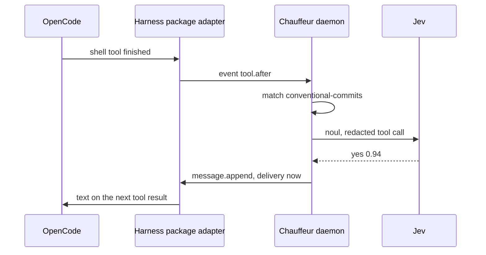

# Slice 1: Conventional Commits nudge in OpenCode

**Status:** In progress: the engine, the release pipeline and the audit log are built; the OpenCode adapter waits for the harness package.

**You can:** install the rc beside v1 and the harness package's OpenCode
adapter, with Chauffeur registered as a decider. When the agent commits with a message such as `fixed stuff`, its
next tool result carries "Use Conventional Commits, such as
`feat(scope): …`". An `unsure` or `failed` answer sends nothing.

| File                                                                                                                 | Contents                                                                                                                                                                                                                                                                                                                                                                                                                                                                                          |
| -------------------------------------------------------------------------------------------------------------------- | ------------------------------------------------------------------------------------------------------------------------------------------------------------------------------------------------------------------------------------------------------------------------------------------------------------------------------------------------------------------------------------------------------------------------------------------------------------------------------------------------- |
| `crates/core/src/{plan/,judge.rs,event.rs}`                                                                          | Steps asked in one round, `Outcome`, `Judge`, `Panel`, `Plan::run`, events and `Verdict`; no dependencies                                                                                                                                                                                                                                                                                                                                                                                         |
| `crates/protocol/src/{rule/,when.rs,then.rs,event.rs}`                                                               | Rule files (`on`, `when`, `judges`, `asks`, `strategy`, `then`, `cooldown_seconds`), checked when they load; the `when` filter; `then` entries by outcome, `unsure` or `failed`; harness events and the evidence blocks they give, such as `tool_call`                                                                                                                                                                                                                                            |
| `crates/judges/src/{question/,confidence/,config/,format.rs,placeholder/}`                                           | Questions and results; confidence and `level`; `models.json` from shipped and user configuration; the `Format` interface; the `placeholder` format                                                                                                                                                                                                                                                                                                                                                |
| `crates/judges/src/tiers/`                                                                                           | The four tiers; each tier's models in fallback order as one core `Judge`, with the model that answered. `system_one/` holds the `systemone` format with `noul`, behind the default `systemone` feature so the playground builds without HTTP: authentication, timeout, bounded response, 429 and 529. `system_two/`, `facts/` and `person/` gain their formats in slices 11, 4 and 5                                                                                                              |
| `crates/runtime/src/{run.rs,redact/}`                                                                                | Runs a rule on a worker thread within its deadline; redacts evidence before every model call, with v1's rules and cases and `distribution/safety/redaction.json`                                                                                                                                                                                                                                                                                                                                  |
| `crates/daemon/src/{paths,state,rpc,socket,audit}.rs`, `crates/daemon/src/route/`                                    | Socket folder `0700`, JSON-RPC 2.0 lines up to 1 MiB, 64 connections; loads shipped and user models, redaction and rules and reloads them on change; routes an event to the rules that hook it, concurrently, with each rule's cooldown per session. Methods `chauffeur.emit` and `chauffeur.status`; the decider methods follow the harness package's contract. Every run is appended to `audit.jsonl` in `~/.local/state/<name>/`, a folder only the user can open, moved aside once past 8 MiB |
| `crates/cli/src/{main,audit}.rs`                                                                                     | `chauffeur daemon run`, `daemon status`, `version`, `emit` and `audit`; `audit` reads the log's files, so it works with no daemon, with `--follow` and `--brief`; the installation's name is the executable's, so `chauffeur-next` keeps its own socket, configuration and log; a second daemon that finds the socket taken exits                                                                                                                                                                 |
| `distribution/models/jev.json`, `distribution/rules/conventional-commits.json`, `distribution/safety/redaction.json` | Jev as the default System One; the nudge; the known credential prefixes                                                                                                                                                                                                                                                                                                                                                                                                                           |
| `scripts/{package,homebrew,smoke}.mjs`, `.github/workflows/{check,release}.yml`                                      | rc packaging and the `chauffeur-next` formula, with its Homebrew service; `release.yml` publishes a prerelease and the formula on each rc tag                                                                                                                                                                                                                                                                                                                                                     |
| `playground/src/features/question.ts`                                                                                | The Question tab                                                                                                                                                                                                                                                                                                                                                                                                                                                                                  |

Verification:

- Kani: for every probability in thousandths and every valid confidence, an
  answer settles to exactly one outcome, edges inclusive. Core's one-round run
  is covered by scenario tests, Miri and `cargo-mutants`; its Kani harnesses
  arrive with `after` in slice 3.
- Live, through `chauffeur emit` and the daemon: the nudge goes out for a
  nonconventional commit and not for a conventional one, with Jev's answer,
  model and time in `chauffeur audit`, which still shows them after the
  daemon restarts.
- Judges: `main`'s `judges/jev/tests/wire.rs` replayed over loopback HTTP;
  fallback moves on only for unavailable, rate-limited or timed out; an
  outcome outside the question's list fails as `invalid`; a key never appears
  in an event, error or verdict.
- Placeholders: recorded answers match by evidence, first match wins;
  `otherwise` answers the rest, and without it the step fails as
  `unavailable`; every placeholder answer is marked in events.
- Daemon: another user's socket directory is refused; an oversized line and a
  closed connection fail safely; an edited rule applies to the next event; a
  rule naming an unknown judge is refused at load, with its path.
- OpenCode, for real: `fixed stuff` gets the nudge, `feat(parser): handle
empty input` gets nothing, and with Jev unreachable nothing is sent and the
  event log shows `failed: unavailable`; `ls` and `cargo test` make no Jev
  call; two OpenCode windows share one daemon.
- Release: packaging dry run and smoke test on Linux and macOS; the rc's
  Homebrew `install`, `test`, `audit` and `style` on a machine running v1,
  which keeps working.
