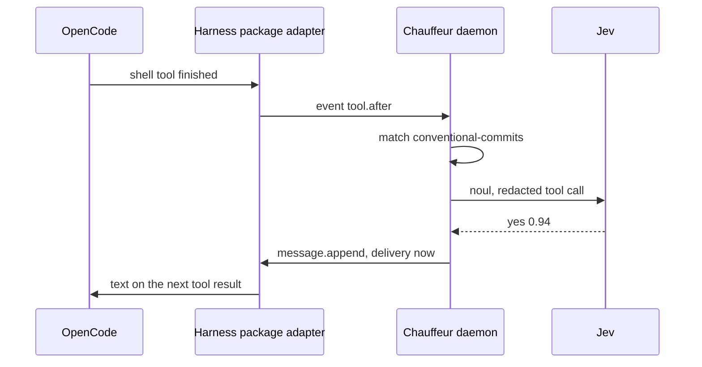

# Slice 1: Conventional Commits nudge in OpenCode

**Status:** In progress: the engine, the release pipeline and the audit log are
built; the OpenCode adapter waits for the harness package.

**You can:** install the rc beside v1 and the harness package's OpenCode
adapter, with Chauffeur registered as a decider. When the agent commits with
a message such as `fixed stuff`, its next tool result carries "Use
Conventional Commits, such as `feat(scope): …`". An `unsure` or `failed` answer sends nothing.



## What it builds

### Core: one round of steps

A plan of named steps, each asking one judge one question, all asked in one
round; `Outcome`, `Judge`, `Panel` and `Plan::run`, the events a run emits,
and the `Verdict`. Core has no dependencies.

Files: `crates/core/src/plan/`, `judge.rs`, `event.rs`

```rust
let step = Step::new("commit", "system-one", "Is this message conventional?");
let plan = Plan::new([step])?;

let yes = |_: &&str| Outcome::Value("yes");
let run = plan.run(&Panel::new().with("system-one", &yes))?;

assert_eq!(run.verdict.get("commit"), Some(&Outcome::Value("yes")));
```

Structure:

```rust
pub struct Plan<Q> {
    steps: Vec<Step<Q>>,
}

impl<Q> Plan<Q> {
    // Empty with no steps, DuplicateStep for a repeated ID.
    pub fn new(steps: impl IntoIterator<Item = Step<Q>>) -> Result<Self, PlanError>;

    pub fn steps(&self) -> &[Step<Q>];

    // UnknownJudge before any judge is asked. Each judge answers all its steps
    // in one judge_all, in the order the judges first appear; a batch of the
    // wrong length settles its steps as Invalid.
    pub fn run<O: Clone>(
        &self,
        panel: &Panel<'_, Q, O>,
    ) -> Result<Run<O>, PlanError>;
}

pub struct Step<Q> {
    id: String,
    judge: String, // the judge's name in the panel
    request: Q,
}

impl<Q> Step<Q> {
    pub fn new(id: impl Into<String>, judge: impl Into<String>, request: Q) -> Self;
    pub fn id(&self) -> &str;
    pub const fn request(&self) -> &Q;
}

pub trait Judge<Q, O> {
    fn judge(&self, request: &Q) -> Outcome<O>;

    // Calls judge for each request, unless the judge batches.
    fn judge_all(&self, requests: &[&Q]) -> Vec<Outcome<O>>;
}

impl<Q, O, F: Fn(&Q) -> Outcome<O>> Judge<Q, O> for F {}

pub struct Panel<'a, Q, O> {
    judges: Vec<(String, &'a dyn Judge<Q, O>)>, // looked up in order
}

impl<'a, Q, O> Panel<'a, Q, O> {
    pub const fn new() -> Self; // and Default

    // Replaces a judge of the same name.
    pub fn with<J: Judge<Q, O>>(self, name: impl Into<String>, judge: &'a J) -> Self;

    pub fn get(&self, name: &str) -> Option<&'a dyn Judge<Q, O>>;
}
```

```rust
pub enum Outcome<O> {
    Value(O),
    Failed(Failure),
}

pub enum Failure {
    Unavailable,
    RateLimited,
    Timeout,
    Invalid,
    Deadline,
}

impl Failure {
    pub const fn name(self) -> &'static str; // "rate_limited"
    pub fn from_name(name: &str) -> Option<Self>;

    // True for the first three: the tier's next model answers instead.
    pub const fn falls_back(self) -> bool;
}

impl Display for Failure {} // its name
impl Error for Failure {}

pub enum Event<O> {
    Started { steps: Vec<String> },
    RoundReady { round: u32, steps: Vec<String> },
    StepSettled { step: String, outcome: Outcome<O> },
    Finished,
}

pub struct Verdict<O> {
    settled: Vec<(String, Outcome<O>)>, // in plan order
}

impl<O> Verdict<O> {
    pub fn get(&self, step: &str) -> Option<&Outcome<O>>;
    pub fn iter(&self) -> impl Iterator<Item = (&str, &Outcome<O>)>;
}

pub struct Run<O> {
    pub events: Vec<Event<O>>,
    pub verdict: Verdict<O>,
}

pub enum PlanError {
    Empty,
    DuplicateStep(String),
    UnknownJudge { step: String, judge: String },
}

impl Display for PlanError {}
impl Error for PlanError {}
```

Verified by:

- Scenario tests, Miri and `cargo-mutants` over the one-round run. Core's
  Kani harnesses arrive with `after` in slice 3.

### Rule files

Loading and checking a rule file: `on`, `when`, `judges`, `asks`,
`strategy`, `then` and `cooldown_seconds`; the `when` filter; `then` entries
by outcome, `unsure` or `failed`; harness events and the evidence blocks they
give, such as `tool_call`.

Files: `crates/protocol/src/rule/`, `when.rs`, `then.rs`, `event.rs`

```rust
// A RuleError names the rule and the reason.
let rule = Rule::parse("conventional-commits", &text)?;

let event = Event::parse(
    r#"{ "event": "tool.after", "tool": "shell",
         "input": { "command": "git commit -m wip" } }"#,
)?;

// on and when match, before any judge is asked.
assert!(rule.hooks(&event));
```

Structure:

```rust
pub struct Rule {
    id: String,
    on: String,
    when: When,
    judges: BTreeMap<String, JudgeSpec>, // with tiers named directly
    plan: Plan<Question>,
    then: Vec<Then>,
    cooldown: Option<Duration>,
}

impl Rule {
    // Refuses unknown fields, then checks each judge's confidence, each step's
    // judge and question (inline or from asks), the plan and each then entry.
    // A tier named directly as a judge settles on the likeliest outcome.
    pub fn parse(id: &str, text: &str) -> Result<Self, RuleError>;

    // on names the event and when matches.
    pub fn hooks(&self, event: &Event) -> bool;

    pub fn id(&self) -> &str;
    pub const fn judges(&self) -> &BTreeMap<String, JudgeSpec>;
    pub const fn plan(&self) -> &Plan<Question>;
    pub fn then(&self) -> &[Then];
    pub const fn cooldown(&self) -> Option<Duration>;
}

pub struct JudgeSpec {
    pub tier: Tier,
    pub model: Option<String>, // asked before the tier's order
    pub confidence: Confidence,
}

pub struct When {
    tools: Vec<String>,
    input: Option<InputFilter>, // { contains: String }
}

impl When {
    // The event's tool is listed, if any are, and some string in its input
    // contains the text. An empty filter matches every event.
    pub fn matches(&self, event: &Event) -> bool;
}

pub struct Then {
    needs: Vec<(String, Expect)>, // step ID and what it must be
    name: String,                 // "message.append"
    payload: Value,
}

impl Then {
    pub fn needs(&self) -> &[(String, Expect)];
    pub fn name(&self) -> &str;
    pub const fn payload(&self) -> &Value;

    // The first entry whose needs all hold.
    pub fn first_met<'a>(
        entries: &'a [Self],
        verdict: &Verdict<Answer>,
    ) -> Option<&'a Self>;
}

pub enum Expect {
    Outcome(String),
    Unsure,
    Failed,
}
```

```rust
pub struct Event {
    name: String,
    fields: Map<String, Value>,
}

impl Event {
    // A JSON object with a string "event".
    pub fn parse(text: &str) -> Result<Self, EventError>;

    pub fn name(&self) -> &str;
    pub fn field(&self, field: &str) -> Option<&Value>;
    pub fn session(&self) -> Option<&str>;

    // tool_call (the tool and its input) and tool_output for tool events, and
    // every other string field under its own name.
    pub fn evidence(&self) -> Vec<(String, String)>;
}

// Each names the rule, and the step or entry where there is one.
pub enum RuleError {
    Parse { rule, source: serde_json::Error },
    UnknownJudge { rule, step, judge },
    UnknownAsk { rule, step, ask },
    Question { rule, step, source: QuestionError },
    Confidence { rule, step, reason },
    Plan { rule, source: PlanError },
    Then { rule, index, reason },
}

pub enum EventError {
    Json(serde_json::Error),
    Unnamed,
}
```

`RuleFile` and its parts, private to `rule/`, are the file as written;
`parse` turns them into these types.

Verified by:

- A rule naming an unknown judge is refused when it loads, with its path.

### Questions, confidence and models

Questions and results; confidence and `level`; `models.json` from shipped and
user configuration; the `Format` interface; the `placeholder` format.

Files: `crates/judges/src/question/`, `confidence/`, `config/`, `format.rs`,
`placeholder/`

```rust
let instructions = "Does this commit message break Conventional Commits?";
let question = Question::noul(instructions, ["commit"])?;

let p = Probabilities::read(question.outcomes(), [("yes", 0.94), ("no", 0.06)])?;
let bar = Confidence::Bar(Milli::new(700).ok_or("bar")?);
let by = AnsweredBy { model: "jev".into(), placeholder: false };

let answer = Answer::settle(&question, p, &bar, by);
assert_eq!(answer.outcome(), &Settled::Outcome("yes".into()));

let models = Models::load(&[shipped, user])?; // the user's entries win
```

Structure:

Questions:

```rust
pub struct Question {
    instructions: String,
    outcomes: Outcomes,
    evidence: Vec<String>, // the block names the judge sees
}

impl Question {
    pub fn new(
        instructions: impl Into<String>,
        outcomes: Outcomes,
        evidence: impl IntoIterator<Item = impl Into<String>>,
    ) -> Result<Self, QuestionError>;

    // Outcomes yes and no.
    pub fn noul(
        instructions: impl Into<String>,
        evidence: impl IntoIterator<Item = impl Into<String>>,
    ) -> Result<Self, QuestionError>;

    pub fn instructions(&self) -> &str;
    pub const fn outcomes(&self) -> &Outcomes;
    pub fn evidence(&self) -> &[String];
}

// 2 to 64, unique, none blank, neither "unsure" nor "failed". For a scale,
// the order is the scale's.
pub struct Outcomes(Vec<Label>);

impl Outcomes {
    pub fn new(
        labels: impl IntoIterator<Item = impl Into<Label>>,
    ) -> Result<Self, QuestionError>;

    pub const fn len(&self) -> usize;
    pub fn iter(&self) -> impl Iterator<Item = &Label>;
    pub fn position(&self, value: &str) -> Option<usize>;
    pub fn get(&self, index: usize) -> Option<&Label>;
}

pub struct Label {
    value: String,
    description: Option<String>, // shown to the model
}

impl Label {
    pub fn new(value: impl Into<String>) -> Self; // and From<&str>
    pub fn described(
        value: impl Into<String>,
        description: impl Into<String>,
    ) -> Self;

    pub fn value(&self) -> &str;
    pub fn description(&self) -> Option<&str>;
}

pub enum QuestionError {
    NoInstructions,
    OutcomeCount(usize),
    BlankOutcome,
    Duplicate(String),
    Reserved(String),
}
```

Confidence:

```rust
pub struct Milli(u16); // 0 to 1000, so comparisons are exact; ordered

impl Milli {
    pub const ONE: Self = Self(1000);
    pub const fn new(thousandths: u16) -> Option<Self>;
    pub fn from_f64(p: f64) -> Option<Self>; // rounded
    pub const fn get(self) -> u16;
    pub fn to_f64(self) -> f64;
}

pub struct Probabilities(Vec<Milli>); // one per outcome, in their order

impl Probabilities {
    // Exactly one probability from 0 to 1 per outcome, not all zero;
    // Failure::Invalid otherwise.
    pub fn read<'a>(
        outcomes: &Outcomes,
        reply: impl IntoIterator<Item = (&'a str, f64)>,
    ) -> Result<Self, Failure>;

    pub fn as_slice(&self) -> &[Milli];
    pub fn level(&self) -> f64; // probability-weighted position, 0 to n − 1
}

pub enum Confidence {
    Likeliest, // a tie is unsure
    Bar(Milli),
    PerOutcome(BTreeMap<String, Milli>),
}

impl Confidence {
    // A per-outcome confidence must name exactly the outcomes.
    pub fn check(&self, outcomes: &Outcomes) -> Result<(), ConfidenceError>;
}

// The likeliest outcome, when no other is as likely and it meets its bar,
// edges included; None is unsure.
pub fn pick(p: &[Milli], bar: impl Fn(usize) -> Option<Milli>) -> Option<usize>;

pub struct Answer {
    outcome: Settled,
    p: Vec<(String, Milli)>,
    level: f64,
    by: AnsweredBy,
}

impl Answer {
    pub fn settle(
        question: &Question,
        p: Probabilities,
        confidence: &Confidence,
        by: AnsweredBy,
    ) -> Self;

    pub const fn outcome(&self) -> &Settled;
    pub fn p(&self) -> impl Iterator<Item = (&str, Milli)>;
    pub const fn level(&self) -> f64;
    pub const fn by(&self) -> &AnsweredBy;
}

pub enum Settled {
    Outcome(String),
    Unsure,
}

impl Display for Settled {} // the value, or "unsure"

pub struct AnsweredBy {
    pub model: String,
    pub placeholder: bool,
}

pub enum ConfidenceError {
    Missing(String),
    Unknown(String),
}
```

Models:

```rust
pub struct Models {
    models: BTreeMap<String, ModelEntry>,
    tiers: BTreeMap<Tier, Vec<String>>,
}

impl Models {
    // Shipped files first, the user's last; a later model or tier list of the
    // same name wins. A placeholder's answers path is relative to its file.
    // Refuses a tier naming an unregistered model.
    pub fn load(files: &[PathBuf]) -> Result<Self, ConfigError>;

    pub fn model(&self, name: &str) -> Option<&ModelEntry>;
    pub fn tier(&self, tier: Tier) -> &[String];
}

pub enum ModelEntry {
    Systemone(SystemOneEntry), // "format": "systemone"
    Placeholder(PlaceholderEntry),
}

pub struct KeySource {
    pub env: String,
}

pub trait Format: Send + Sync {
    // A round's questions in one call, one result each.
    fn answer_all(
        &self,
        questions: &[&Question],
        evidence: &Evidence,
    ) -> Vec<Result<Probabilities, Failure>>;

    fn is_placeholder(&self) -> bool; // false unless overridden
}

pub struct Evidence(BTreeMap<String, String>); // redacted blocks by name

impl Evidence {
    pub fn new(
        blocks: impl IntoIterator<Item = (impl Into<String>, impl Into<String>)>,
    ) -> Self;

    pub fn get(&self, name: &str) -> Option<&str>;

    // The blocks the questions name, each once.
    pub fn named_by<'a>(
        &'a self,
        questions: &[&Question],
    ) -> impl Iterator<Item = (&'a str, &'a str)>;
}

pub struct PlaceholderEntry {
    pub answers: Option<PathBuf>,
    pub otherwise: Option<BTreeMap<String, f64>>,
}

pub struct Placeholder {
    answers: Vec<Recorded>, // evidence, and probabilities or a failure
    otherwise: Option<BTreeMap<String, f64>>,
}

impl Placeholder {
    pub fn load(entry: &PlaceholderEntry) -> Result<Self, ConfigError>;
}

// The first recorded answer whose evidence the question sees with the same
// content, then otherwise, else Unavailable. is_placeholder() is true.
impl Format for Placeholder {}

pub enum ConfigError {
    Read { path, source: io::Error },
    Parse { path, source: serde_json::Error },
    Placeholder { path, index, reason },
    UnknownModel { tier, model },
}
```

Verified by:

- Kani: for every probability in thousandths and every valid confidence, an
  answer settles to exactly one outcome, edges inclusive.
- An outcome outside the question's list fails as `invalid`.
- Placeholders: recorded answers match by evidence, first match wins;
  `otherwise` answers the rest, and without it the step fails as
  `unavailable`; every placeholder answer is marked in events.

### Tiers and the Jev format

Each tier's models in fallback order, as one core `Judge` that reports the
model that answered. `system_one/` holds the `systemone` format with `noul`:
authentication, timeout, a bounded response, 429 and 529. It sits behind the
default `systemone` feature, so the playground builds without HTTP.
`system_two/`, `facts/` and `person/` gain their formats in slices 11, 4
and 5.

Files: `crates/judges/src/tiers/`

```rust
let keys = |env: &str| std::env::var(env).ok();
let jev_first = Fallback::build(&models, Tier::SystemOne, None, keys)?;

let judge = NamedJudge::new(&jev_first, &confidence, &evidence);
let run = plan.run(&Panel::new().with("quick", &judge))?;
// each answer names its model: AnsweredBy { model: "jev", placeholder: false }
```

Structure:

```rust
pub enum Tier {
    Facts,
    SystemOne,
    SystemTwo,
    Person,
}

impl Tier {
    pub const fn name(self) -> &'static str; // "system-one"
    pub fn from_name(name: &str) -> Option<Self>;
}

pub struct Model {
    name: String,
    format: Box<dyn Format>,
}

pub struct Fallback {
    models: Vec<Model>,
}

impl Fallback {
    // preferred first, then the tier's order, each once. Leaves out a model
    // whose key is missing; loads placeholders.
    pub fn build(
        models: &Models,
        tier: Tier,
        preferred: Option<&str>,
        key: impl Fn(&str) -> Option<String>,
    ) -> Result<Self, ConfigError>;

    // Each model answers only the questions still open after a failure that
    // falls_back(); with no model left, a question is Unavailable.
    pub fn answer_all(
        &self,
        questions: &[&Question],
        evidence: &Evidence,
    ) -> Vec<Result<(Probabilities, AnsweredBy), Failure>>;
}

pub struct NamedJudge<'a> {
    models: &'a Fallback,
    confidence: &'a Confidence,
    evidence: &'a Evidence,
}

// judge_all asks the fallback once per round and settles each reply with
// Answer::settle.
impl Judge<Question, Answer> for NamedJudge<'_> {}
```

```rust
pub struct SystemOneEntry {
    pub endpoint: String,
    pub model: String,
    pub key: KeySource,
    pub timeout_ms: Option<u64>, // 3,000 by default
}

// system_one::format: None when built without the systemone feature.
pub fn format(entry: &SystemOneEntry, key: String) -> Option<Box<dyn Format>>;

pub struct SystemOne {
    agent: ureq::Agent, // with the timeout
    url: String,        // {endpoint}/v1/systemone
    model: String,
    key: String, // sent as a bearer token
}

impl SystemOne {
    pub fn new(entry: &SystemOneEntry, key: String) -> Self;

    // Reads at most 256 KiB. 429 and 529 are RateLimited, 408 and a transport
    // timeout Timeout, anything else Unavailable, its text dropped.
    fn call(&self, body: &Value) -> Result<Response, Failure>;
}

// A round's yes and no questions as noul in one request, with the evidence
// they name as state; noul is the chance of yes. Other questions are Invalid.
impl Format for SystemOne {}
```

Verified by:

- `main`'s `judges/jev/tests/wire.rs` replayed over loopback HTTP.
- Fallback moves on only for unavailable, rate-limited or timed out.
- A key never appears in an event, error or verdict.

### Running a rule

Runs a rule on a worker thread within its deadline, and redacts evidence
before every model call, with v1's rules and `distribution/safety/redaction.json`.

Files: `crates/runtime/src/run.rs`, `redact/`

```rust
// "export TOKEN=[REDACTED]"
let sent = redactor.redact("export TOKEN=ghp_…", &mut Masking::default());

match run(&context, &rule, &event, Duration::from_secs(2)) {
    Ran::Settled { run, then } => { /* run.verdict, and the first then entry met */ }
    Ran::Refused(reason) => { /* a placeholder whose answers would not load */ }
    Ran::Deadline => { /* nothing settled in time */ }
}
```

Structure:

```rust
pub struct Context {
    pub models: Models,
    pub redactor: Redactor,
    pub keys: Box<Keys>, // Fn(&str) -> Option<String>: a variable's key
}

// Redacts the event's evidence, then on a worker thread builds a Fallback and
// a NamedJudge per judge, runs the plan, and finds the first then entry met.
pub fn run(
    context: &Arc<Context>,
    rule: &Arc<Rule>,
    event: &Event,
    deadline: Duration,
) -> Ran;

pub enum Ran {
    Settled { run: Run<Answer>, then: Option<Then> },
    Refused(String), // a fallback or the plan could not be built
    Deadline,        // a late result is dropped
}
```

```rust
pub struct Redactor {
    prefixes: Vec<Prefix>,
}

impl Redactor {
    // Shipped first; replace drops the earlier prefixes. At most 256, none
    // empty.
    pub fn new(
        configs: impl IntoIterator<Item = RedactionConfig>,
    ) -> Result<Self, RedactError>;

    pub fn load(paths: &[PathBuf]) -> Result<Self, RedactError>;

    // Private keys and known prefixes become [REDACTED]; other credential-like
    // words a description of their shape, such as
    // [string 1: 40 characters of hex, after "api_key="].
    // Paths, links and hashes stay readable.
    pub fn redact(&self, text: &str, masking: &mut Masking) -> String;
}

// Numbers each described value, the same in every block of one run.
pub struct Masking {
    numbers: BTreeMap<String, usize>,
}

pub struct RedactionConfig {
    pub replace: bool,
    pub prefixes: Vec<Prefix>,
}

pub struct Prefix {
    pub prefix: String, // "ghp_"
    pub min_body: usize,
}

pub enum RedactError {
    Read { path, source: io::Error },
    Parse { path, source: serde_json::Error },
    Prefixes,
}
```

Verified by:

- v1's redaction cases.
- A judge sees only redacted evidence; a missed deadline settles nothing.

### The daemon

A private socket (its folder `0700`), JSON-RPC 2.0 lines up to 1 MiB, 64
connections. It loads shipped and user models, redaction and rules, and
reloads them when they change. It routes an event to the rules that hook it,
concurrently, with each rule's cooldown per session, and appends every run
to `audit.jsonl` in `~/.local/state/<name>/`, moved aside once past 8 MiB.
Its methods are `chauffeur.emit` and `chauffeur.status`; the decider methods
follow the harness package's contract.

Files: `crates/daemon/src/paths.rs`, `state.rs`, `rpc.rs`, `socket.rs`,
`audit.rs`, `route/`

```rust
// The socket, configuration, distribution and state folders.
let paths = Paths::from_env("chauffeur", None);
chauffeur_daemon::run(&paths)?; // serves until the listener fails

let router = Router::new(loaded, Audit::new(&paths.state, MAX_BYTES));
let actions = router.emit(&event, Duration::from_millis(1500));

let last = audit::recent(&paths.state, 20)?; // one JSON line per run, oldest first
```

Structure:

```rust
pub struct Paths {
    pub name: String,          // the executable's: chauffeur, chauffeur-next
    pub socket: PathBuf,       // $CHAUFFEUR_SOCKET, or the runtime folder
    pub config: PathBuf,       // ~/.config/<name>/
    pub distribution: PathBuf, // share/<name>/ beside the executable
    pub state: PathBuf,        // ~/.local/state/<name>/
}

impl Paths {
    pub fn from_env(name: &str, distribution: Option<PathBuf>) -> Self;
}

// Creates the socket's folder with mode 0700, or refuses one that is open to
// others or owned by someone else.
pub fn private_folder(socket: &Path) -> Result<(), DaemonError>;

// Loads, watches (polling every 2 s when the platform refuses), binds and
// serves. A change reloads after 200 ms; one that fails keeps the old state.
pub fn run(paths: &Paths) -> Result<(), DaemonError>;

// state::load(&paths)
pub struct Loaded {
    pub rules: Vec<Arc<Rule>>, // a user rule replaces a shipped one
    pub refused: Vec<String>,  // each rule file that did not load, and why
    pub context: Arc<Context>,
}

pub enum DaemonError {
    Running(PathBuf),
    SocketFolder { path, reason },
    Socket { path, source: io::Error },
    Config(String),
    Watch(notify::Error),
}
```

```rust
pub struct Router {
    loaded: RwLock<Arc<Loaded>>,
    cooldowns: Cooldowns,
    audit: Audit,
}

impl Router {
    pub fn new(loaded: Loaded, audit: Audit) -> Self;
    pub fn replace(&self, loaded: Loaded);
    pub fn loaded(&self) -> Option<Arc<Loaded>>;

    // Runs every rule that hooks the event at once, each on its own thread,
    // skipping one cooling down in that session. Logs each run and returns
    // what the rules returned, even when the log cannot be written.
    pub fn emit(&self, event: &Event, deadline: Duration) -> Vec<Value>;
}

type Key = (String, String); // rule ID, session

// 4,096 pairs at most, forgetting the oldest.
struct Cooldowns {
    fired: Mutex<BTreeMap<Key, Instant>>,
}

impl Cooldowns {
    fn cooling(&self, key: &Key, cooldown: Option<Duration>) -> bool;
    fn fire(&self, key: Key);
}
```

```rust
pub struct Audit {
    folder: PathBuf,
    max_bytes: u64, // MAX_BYTES, 8 MiB
    writing: Mutex<()>,
}

impl Audit {
    pub fn new(folder: &Path, max_bytes: u64) -> Self;

    // Adds the time as at; past max_bytes the log moves to audit.1.jsonl.
    pub fn append(&self, entry: Value) -> io::Result<()>;
}

// The last lines across both files, oldest first.
pub fn recent(folder: &Path, count: usize) -> io::Result<Vec<String>>;

pub fn follow(folder: &Path, each: impl FnMut(&str)) -> io::Result<()>;

// socket.rs: leaves a socket another daemon answers on; replaces a stale one.
pub fn bind(socket: &Path) -> Result<UnixListener, DaemonError>;

// A thread per connection, 64 at most, lines up to MAX_LINE (1 MiB).
pub fn serve(listener: &UnixListener, router: &Arc<Router>);

// rpc.rs: one JSON-RPC line, and nothing for a notification. Deadlines
// default to 3 s and stop at 30.
pub fn handle(router: &Router, line: &str) -> Option<Value>;
```

Verified by:

- Another user's socket folder is refused.
- An oversized line and a closed connection fail safely.
- An edited rule applies to the next event.
- The audit log moves aside at its bound and reads across both files.

### The CLI

`chauffeur daemon run`, `daemon status`, `version`, `emit` and `audit`.
`audit` reads the log's files, so it works with no daemon, with `--follow`
and `--brief`. The installation's name is the executable's, so
`chauffeur-next` keeps its own socket, configuration and log. A second daemon
that finds the socket taken exits.

Files: `crates/cli/src/main.rs`, `audit.rs`

```sh
chauffeur daemon run &

echo '{ "event": "tool.after", "session": "s1", "tool": "shell",
        "input": { "command": "git commit -m wip" } }' | chauffeur emit

chauffeur audit --brief
# 13:54:43  conventional-commits  s1  nonconventional yes 0.93 jev  312 ms  → …

chauffeur daemon status   # version, loaded rules, refused rule files
```

Structure:

```rust
enum Command {
    Daemon { command: Daemon },
    Version,
    Emit { deadline_ms: u64 }, // 3,000 by default
    Audit { count: usize, follow: bool, brief: bool }, // count 20 by default
}

enum Daemon {
    Run { distribution: Option<PathBuf> }, // exits if one already runs
    Status,
}

// The installation's name is the executable's file name. Runs the daemon, or
// sends one call over the socket and prints the result.
fn main() -> Result<ExitCode>;

// audit.rs. --brief prints one line per run: local time, rule, session, each
// step's result and model, the time taken and what it returned.
pub fn print(state: &Path, count: usize, follow: bool, brief: bool) -> Result<()>;
```

Verified by:

- The binary against a real daemon: the nudge through `emit`, `daemon status`,
  a second daemon, no daemon, refusals, and `audit` after the daemon stops.

### Shipped content

Jev as the default System One, the nudge, and the known credential prefixes.

Files: `distribution/models/jev.json`,
`distribution/rules/conventional-commits.json`,
`distribution/safety/redaction.json`

```json
{
  "models": {
    "jev": {
      "format": "systemone",
      "endpoint": "https://api.typesafe.ai",
      "model": "jev-latest",
      "key": { "env": "TYPESAFE_API_KEY" },
      "timeout_ms": 3000
    }
  },
  "tiers": { "system-one": ["jev"] }
}
```

The rule is in the plan's [Commit messages](../pluggability.md#commit-messages).

Verified by the end-to-end checks below.

### Release

rc packaging and the `chauffeur-next` formula with its Homebrew service.
`release.yml` publishes a prerelease and the formula on each rc tag.

Files: `scripts/package.mjs`, `homebrew.mjs`, `smoke.mjs`,
`.github/workflows/check.yml`, `release.yml`

```sh
node scripts/package.mjs tarball --target darwin-arm64 \
  --binary target/release/chauffeur --out dist
node scripts/package.mjs sums dist

# Installs it as chauffeur and as chauffeur-next, then runs each.
node scripts/smoke.mjs dist/chauffeur-*.tar.gz

node scripts/homebrew.mjs 1.0.0-rc.1 dist/SHA256SUMS  # Formula/chauffeur-next.rb
```

Structure:

```js
// package.mjs
export const TARGETS = ["darwin-arm64", "darwin-x64", "linux-arm64", "linux-x64"]
export function version(root) {} // the workspace's version
export function tarballName(release, target) {}
export function tarball({ target, binary, out, root }) {} // bin/, share/chauffeur/
export function sums(folder) {} // writes SHA256SUMS

// homebrew.mjs
export function parseSums(text) {}
// chauffeur-next.rb, with each platform's URL and checksum
export function formula(release, sums, downloads) {}
```

`smoke.mjs` installs a tarball under both names and runs each: `version`,
the daemon, the shipped rule with a stand-in model, a nudge through `emit`,
and the run in `audit`.

Verified by:

- A packaging dry run and the smoke test on Linux and macOS.
- The rc's Homebrew `install`, `test`, `audit` and `style` on a machine
  running v1, which keeps working.

### The playground

The Question tab: a question's probabilities settled under a confidence, as
the daemon does.

Files: `playground/src/features/question.ts`

```ts
const result = JSON.parse(
  settle(
    JSON.stringify({
      outcomes: ["yes", "no"],
      p: { yes: 0.58, no: 0.42 },
      confidence: 0.7
    })
  )
)
// { answer: { outcome: "unsure", level: 0.42,
//              p: [{ outcome: "yes", p: 0.58 }, { outcome: "no", p: 0.42 }] } }
```

Structure:

```rust
// playground/wasm. Takes { outcomes, p, confidence } as JSON; returns
// { answer }, { failed } for a reply that is not an answer, or { error } for a
// question or confidence a rule would refuse. Calls the daemon's Answer::settle.
#[wasm_bindgen]
pub fn settle(input: &str) -> String;
```

```ts
type Feature = {
  readonly id: string // #id in the URL
  readonly title: string
  readonly view: () => { readonly $template: string }
}

// The Question tab, with the plan's confidence examples.
export const question: Feature
```

Verified by:

- The tab settles the plan's confidence examples in a real browser.

## End to end

- Through `chauffeur emit` and the daemon, live: the nudge goes out for a
  nonconventional commit and not for a conventional one, with Jev's answer,
  model and time in `chauffeur audit`, which still shows them after the
  daemon restarts.
- OpenCode, for real: `fixed stuff` gets the nudge, `feat(parser): handle
empty input` gets nothing, and with Jev unreachable nothing is sent and the
  audit log shows `failed: unavailable`; `ls` and `cargo test` make no Jev
  call; two OpenCode windows share one daemon.
