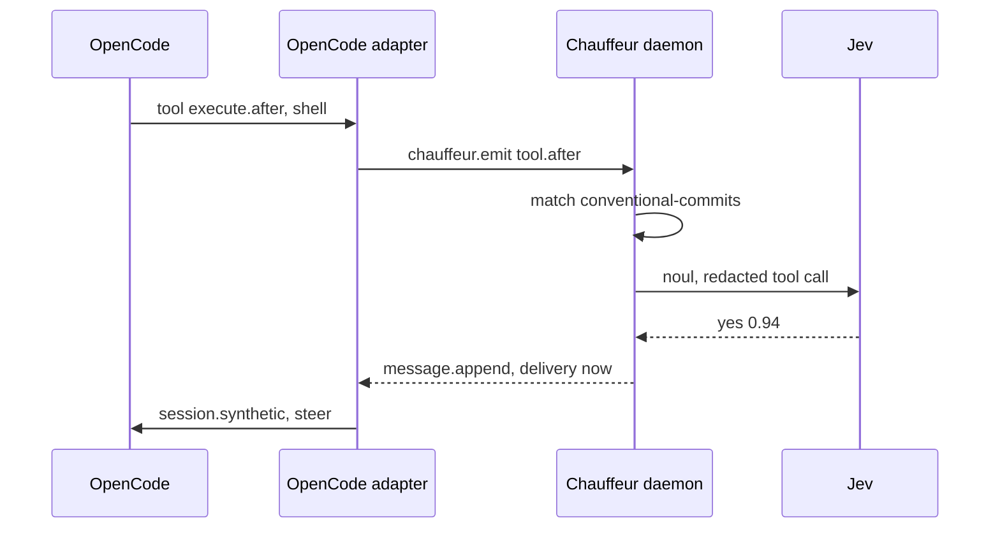

# Slice 1: Conventional Commits nudge in OpenCode

**Status:** Implemented, released as `chauffeur-next` `1.0.0-rc.3`.

**You can:** install the rc beside v1 and add its OpenCode adapter to
`plugins` in `opencode.jsonc`. When the agent commits with a message such as
`fixed stuff`, Chauffeur's message follows in the conversation, and the agent
amends the commit unless you chose the message. OpenCode shows it as one row:

```text
◈ Chauffeur · conventional-commits: commit message isn't conventional; asking the agent to amend it
```

An `unsure` or `failed` answer sends nothing.



## Recording

OpenCode with `chauffeur-next` `1.0.0-rc.3` and Jev, above
`chauffeur-next audit --follow --brief`. Asked to add a line and commit it, the
agent commits as `Add …`. Jev answers yes at 0.89 in 367 ms, Chauffeur's
message arrives in the conversation, and the agent amends the commit to
`docs(readme): add hello line`.

<video src="../../media/slice-1.mp4" controls muted playsinline width="100%"></video>

## What it builds

### Core: one round of steps

A plan of named steps, each asking one judge one question, all asked in one
round; `Outcome`, `Judge`, `Panel` and `Plan::run`, the events a run emits,
and the `Verdict`. Core has no dependencies.

Files: `crates/core/src/plan/`, `judge.rs`, `event.rs`

```rust
let step = Step::new("commit", "system-one", "Is this message conventional?");
let plan = Plan::new([step])?;

let yes = |_: &&str| Outcome::Value("yes");
let run = plan.run(&Panel::new().with("system-one", &yes))?;

assert_eq!(run.verdict.get("commit"), Some(&Outcome::Value("yes")));
```

Structure:

A plan is its steps in order. `new` refuses an empty plan and a repeated step
ID. `run` refuses a step whose judge the panel lacks before asking any judge;
then it asks each judge once, with all its steps, in the order the judges first
appear. A judge that returns the wrong number of answers has each of its steps
settle as `Invalid`.

```rust
pub struct Plan<Q> {
    steps: Vec<Step<Q>>,
}

impl<Q> Plan<Q> {
    pub fn new(steps: impl IntoIterator<Item = Step<Q>>) -> Result<Self, PlanError>;
    pub fn steps(&self) -> &[Step<Q>];

    pub fn run<O: Clone>(
        &self,
        panel: &Panel<'_, Q, O>,
    ) -> Result<Run<O>, PlanError>;
}
```

A step asks one judge, by its name in the panel, one request.

```rust
pub struct Step<Q> {
    id: String,
    judge: String,
    request: Q,
}

impl<Q> Step<Q> {
    pub fn new(id: impl Into<String>, judge: impl Into<String>, request: Q) -> Self;
    pub fn id(&self) -> &str;
    pub const fn request(&self) -> &Q;
}
```

A judge answers one request, and several at once when it batches; by default
`judge_all` calls `judge` for each. Any closure from a request to an outcome is
a judge. A panel holds the judges a plan may name, looked up in order; `with`
replaces a judge of the same name.

```rust
pub trait Judge<Q, O> {
    fn judge(&self, request: &Q) -> Outcome<O>;
    fn judge_all(&self, requests: &[&Q]) -> Vec<Outcome<O>>;
}

impl<Q, O, F: Fn(&Q) -> Outcome<O>> Judge<Q, O> for F {}

pub struct Panel<'a, Q, O> {
    judges: Vec<(String, &'a dyn Judge<Q, O>)>,
}

impl<'a, Q, O> Panel<'a, Q, O> {
    pub const fn new() -> Self;
    pub fn with<J: Judge<Q, O>>(self, name: impl Into<String>, judge: &'a J) -> Self;
    pub fn get(&self, name: &str) -> Option<&'a dyn Judge<Q, O>>;
}

impl<Q, O> Default for Panel<'_, Q, O> {}
```

Each step settles as the judge's value or a failure. The first three failures
fall back: the tier's next model answers instead. A failure's name is its wire
name, such as `rate_limited`, which `Display` prints.

```rust
pub enum Outcome<O> {
    Value(O),
    Failed(Failure),
}

pub enum Failure {
    Unavailable,
    RateLimited,
    Timeout,
    Invalid,
    Deadline,
}

impl Failure {
    pub const fn name(self) -> &'static str;
    pub fn from_name(name: &str) -> Option<Self>;
    pub const fn falls_back(self) -> bool;
}

impl Display for Failure {}
impl Error for Failure {}
```

A run returns the events it emitted, in order, and the verdict: each step's
outcome, in plan order.

```rust
pub enum Event<O> {
    Started { steps: Vec<String> },
    RoundReady { round: u32, steps: Vec<String> },
    StepSettled { step: String, outcome: Outcome<O> },
    Finished,
}

pub struct Verdict<O> {
    settled: Vec<(String, Outcome<O>)>,
}

impl<O> Verdict<O> {
    pub fn get(&self, step: &str) -> Option<&Outcome<O>>;
    pub fn iter(&self) -> impl Iterator<Item = (&str, &Outcome<O>)>;
}

pub struct Run<O> {
    pub events: Vec<Event<O>>,
    pub verdict: Verdict<O>,
}

pub enum PlanError {
    Empty,
    DuplicateStep(String),
    UnknownJudge { step: String, judge: String },
}

impl Display for PlanError {}
impl Error for PlanError {}
```

Verified by:

- Scenario tests, Miri and `cargo-mutants` over the one-round run. Core's
  Kani harnesses arrive with `after` in slice 3.

### Rule files

Loading and checking a rule file: `on`, `when`, `judges`, `asks`,
`strategy`, `then` and `cooldown_seconds`; the `when` filter; `then` entries
by outcome, `unsure` or `failed`; harness events and the evidence blocks they
give, such as `tool_call`.

Files: `crates/protocol/src/rule/`, `when.rs`, `then.rs`, `event.rs`

```rust
// A RuleError names the rule and the reason.
let rule = Rule::parse("conventional-commits", &text)?;

let event = Event::parse(
    r#"{ "event": "tool.after", "tool": "shell",
         "input": { "command": "git commit -m wip" } }"#,
)?;

// on and when match, before any judge is asked.
assert!(rule.hooks(&event));
```

Structure:

A rule is its file, checked. `parse` refuses unknown fields, then checks each
judge's confidence, each step's judge and question (inline or named in `asks`),
the plan, and each `then` entry. A step may name a tier directly, as a judge
that settles on the likeliest outcome. `hooks` is true when `on` names the event
and `when` matches.

```rust
pub struct Rule {
    id: String,
    on: String,
    when: When,
    judges: BTreeMap<String, JudgeSpec>,
    plan: Plan<Question>,
    then: Vec<Then>,
    cooldown: Option<Duration>,
}

impl Rule {
    pub fn parse(id: &str, text: &str) -> Result<Self, RuleError>;
    pub fn hooks(&self, event: &Event) -> bool;

    pub fn id(&self) -> &str;
    pub const fn judges(&self) -> &BTreeMap<String, JudgeSpec>;
    pub const fn plan(&self) -> &Plan<Question>;
    pub fn then(&self) -> &[Then];
    pub const fn cooldown(&self) -> Option<Duration>;
}
```

A named judge is a tier, a model asked before the tier's order, and the
confidence its answers need.

```rust
pub struct JudgeSpec {
    pub tier: Tier,
    pub model: Option<String>,
    pub confidence: Confidence,
}
```

`when` is checked before any judge is asked: the event's tool is one of `tools`,
if any are listed, and some string in its input contains the text. An empty
filter matches every event.

```rust
pub struct When {
    tools: Vec<String>,
    input: Option<InputFilter>,
}

struct InputFilter {
    contains: String,
}

impl When {
    pub fn matches(&self, event: &Event) -> bool;
}
```

A `then` entry needs a result from some steps, an outcome, `unsure` or `failed`,
and returns an action such as `message.append` with its payload. `first_met`
picks the first entry whose needs all hold. A `message.append` payload is
checked when the rule loads: text `parts`, a `delivery` of `now`, `next` or
`wake`, and an optional `label` of one line, at most 100 characters.

```rust
pub struct Then {
    needs: Vec<(String, Expect)>,
    name: String,
    payload: Value,
}

impl Then {
    pub fn needs(&self) -> &[(String, Expect)];
    pub fn name(&self) -> &str;
    pub const fn payload(&self) -> &Value;

    pub fn first_met<'a>(
        entries: &'a [Self],
        verdict: &Verdict<Answer>,
    ) -> Option<&'a Self>;
}

pub enum Expect {
    Outcome(String),
    Unsure,
    Failed,
}
```

An event is a JSON object named by its `event` field. Its evidence is
`tool_call` (the tool and its input) and `tool_output` for tool events, and
every other string field under its own name.

```rust
pub struct Event {
    name: String,
    fields: Map<String, Value>,
}

impl Event {
    pub fn parse(text: &str) -> Result<Self, EventError>;

    pub fn name(&self) -> &str;
    pub fn field(&self, field: &str) -> Option<&Value>;
    pub fn session(&self) -> Option<&str>;
    pub fn evidence(&self) -> Vec<(String, String)>;
}

pub enum EventError {
    Json(serde_json::Error),
    Unnamed,
}
```

Each error names the rule, and the step or entry where there is one. The file as
written, `RuleFile` and its parts, stays private to `rule/`.

```rust
pub enum RuleError {
    Parse { rule, source: serde_json::Error },
    UnknownJudge { rule, step, judge },
    UnknownAsk { rule, step, ask },
    Question { rule, step, source: QuestionError },
    Confidence { rule, step, reason },
    Plan { rule, source: PlanError },
    Then { rule, index, reason },
}
```

Verified by:

- A rule naming an unknown judge is refused when it loads, with its path.

### Questions, confidence and models

Questions and results; confidence and `level`; `models.json` from shipped and
user configuration; the `Format` interface; the `placeholder` format.

Files: `crates/judges/src/question/`, `confidence/`, `config/`, `format.rs`,
`placeholder/`

```rust
let instructions = "Does this commit message break Conventional Commits?";
let question = Question::noul(instructions, ["commit"])?;

let p = Probabilities::read(question.outcomes(), [("yes", 0.94), ("no", 0.06)])?;
let bar = Confidence::Bar(Milli::new(700).ok_or("bar")?);
let by = AnsweredBy { model: "jev".into(), placeholder: false };

let answer = Answer::settle(&question, p, &bar, by);
assert_eq!(answer.outcome(), &Settled::Outcome("yes".into()));

let models = Models::load(&[shipped, user])?; // the user's entries win
```

Structure:

A question is all a judge sees: its instructions, the outcomes to choose from,
and the names of the evidence blocks. `noul` asks yes or no.

```rust
pub struct Question {
    instructions: String,
    outcomes: Outcomes,
    evidence: Vec<String>,
}

impl Question {
    pub fn new(
        instructions: impl Into<String>,
        outcomes: Outcomes,
        evidence: impl IntoIterator<Item = impl Into<String>>,
    ) -> Result<Self, QuestionError>;

    pub fn noul(
        instructions: impl Into<String>,
        evidence: impl IntoIterator<Item = impl Into<String>>,
    ) -> Result<Self, QuestionError>;

    pub fn instructions(&self) -> &str;
    pub const fn outcomes(&self) -> &Outcomes;
    pub fn evidence(&self) -> &[String];
}
```

Outcomes are 2 to 64 labels, unique, none blank, and neither `unsure` nor
`failed`; for a scale, their order is the scale's. A label may carry a
description the model sees.

```rust
pub struct Outcomes(Vec<Label>);

impl Outcomes {
    pub fn new(
        labels: impl IntoIterator<Item = impl Into<Label>>,
    ) -> Result<Self, QuestionError>;

    pub const fn len(&self) -> usize;
    pub fn iter(&self) -> impl Iterator<Item = &Label>;
    pub fn position(&self, value: &str) -> Option<usize>;
    pub fn get(&self, index: usize) -> Option<&Label>;
}

pub struct Label {
    value: String,
    description: Option<String>,
}

impl Label {
    pub fn new(value: impl Into<String>) -> Self;
    pub fn described(
        value: impl Into<String>,
        description: impl Into<String>,
    ) -> Self;

    pub fn value(&self) -> &str;
    pub fn description(&self) -> Option<&str>;
}

impl From<&str> for Label {}

pub enum QuestionError {
    NoInstructions,
    OutcomeCount(usize),
    BlankOutcome,
    Duplicate(String),
    Reserved(String),
}
```

Probabilities are kept in thousandths, from 0 to 1000, so comparisons are exact.
`read` takes exactly one probability from 0 to 1 for each outcome, not all zero,
and fails as `Invalid` otherwise. `level` is the probability-weighted position
in the outcomes, from 0 to n − 1.

```rust
pub struct Milli(u16);

impl Milli {
    pub const ONE: Self = Self(1000);
    pub const fn new(thousandths: u16) -> Option<Self>;
    pub fn from_f64(p: f64) -> Option<Self>;
    pub const fn get(self) -> u16;
    pub fn to_f64(self) -> f64;
}

pub struct Probabilities(Vec<Milli>);

impl Probabilities {
    pub fn read<'a>(
        outcomes: &Outcomes,
        reply: impl IntoIterator<Item = (&'a str, f64)>,
    ) -> Result<Self, Failure>;

    pub fn as_slice(&self) -> &[Milli];
    pub fn level(&self) -> f64;
}
```

A confidence says when the likeliest outcome settles: whenever no other is as
likely, at one bar, or at a bar per outcome, which `check` makes cover exactly
the question's outcomes. `pick` is the rule the proof below checks: the
likeliest outcome settles when no other is as likely and it meets its bar, edges
included; otherwise the answer is `unsure`.

```rust
pub enum Confidence {
    Likeliest,
    Bar(Milli),
    PerOutcome(BTreeMap<String, Milli>),
}

impl Confidence {
    pub fn check(&self, outcomes: &Outcomes) -> Result<(), ConfidenceError>;
}

pub fn pick(p: &[Milli], bar: impl Fn(usize) -> Option<Milli>) -> Option<usize>;

pub enum ConfidenceError {
    Missing(String),
    Unknown(String),
}
```

`settle` turns a judge's probabilities into an answer under a confidence, and
keeps the model that gave them. `Settled` prints as its value or as `unsure`.

```rust
pub struct Answer {
    outcome: Settled,
    p: Vec<(String, Milli)>,
    level: f64,
    by: AnsweredBy,
}

impl Answer {
    pub fn settle(
        question: &Question,
        p: Probabilities,
        confidence: &Confidence,
        by: AnsweredBy,
    ) -> Self;

    pub const fn outcome(&self) -> &Settled;
    pub fn p(&self) -> impl Iterator<Item = (&str, Milli)>;
    pub const fn level(&self) -> f64;
    pub const fn by(&self) -> &AnsweredBy;
}

pub enum Settled {
    Outcome(String),
    Unsure,
}

impl Display for Settled {}

pub struct AnsweredBy {
    pub model: String,
    pub placeholder: bool,
}
```

`load` reads the shipped `models.json` files first and the user's last; a later
model or tier list of the same name wins, and a placeholder's `answers` path is
relative to its file. It refuses a tier that names an unregistered model. Each
model is one of the API formats, by its `format`.

```rust
pub struct Models {
    models: BTreeMap<String, ModelEntry>,
    tiers: BTreeMap<Tier, Vec<String>>,
}

impl Models {
    pub fn load(files: &[PathBuf]) -> Result<Self, ConfigError>;
    pub fn model(&self, name: &str) -> Option<&ModelEntry>;
    pub fn tier(&self, tier: Tier) -> &[String];
}

pub enum ModelEntry {
    Systemone(SystemOneEntry),
    Placeholder(PlaceholderEntry),
}

pub struct KeySource {
    pub env: String,
}

pub enum ConfigError {
    Read { path, source: io::Error },
    Parse { path, source: serde_json::Error },
    Placeholder { path, index, reason },
    UnknownModel { tier, model },
}
```

A format speaks one model API: it asks a round's questions in one call, with the
redacted evidence blocks they name, and gives probabilities or a failure for
each.

```rust
pub trait Format: Send + Sync {
    fn answer_all(
        &self,
        questions: &[&Question],
        evidence: &Evidence,
    ) -> Vec<Result<Probabilities, Failure>>;

    fn is_placeholder(&self) -> bool;
}

pub struct Evidence(BTreeMap<String, String>);

impl Evidence {
    pub fn new(
        blocks: impl IntoIterator<Item = (impl Into<String>, impl Into<String>)>,
    ) -> Self;

    pub fn get(&self, name: &str) -> Option<&str>;

    pub fn named_by<'a>(
        &'a self,
        questions: &[&Question],
    ) -> impl Iterator<Item = (&'a str, &'a str)>;
}
```

A placeholder stands in for a model. It gives the first recorded answer whose
evidence the question sees with the same content, then `otherwise`, and fails as
`Unavailable` with neither, so a gap in the recording shows.

```rust
pub struct PlaceholderEntry {
    pub answers: Option<PathBuf>,
    pub otherwise: Option<BTreeMap<String, f64>>,
}

pub struct Placeholder {
    answers: Vec<Recorded>,
    otherwise: Option<BTreeMap<String, f64>>,
}

impl Placeholder {
    pub fn load(entry: &PlaceholderEntry) -> Result<Self, ConfigError>;
}

impl Format for Placeholder {}
```

Verified by:

- Kani proves `pick` for every two or three outcomes, every probability in
  thousandths and every bar, including none: an outcome settles exactly when
  it is the only likeliest one and meets its bar, edges included, so an
  answer is one outcome or `unsure`.

  ```text
  for all p   = 2 or 3 probabilities, each 0 to 1000 thousandths
  for all bar = for each outcome, a bar from 0 to 1000, or none

  picked = pick(p, bar)

  for each outcome i:
      only_likeliest = every other p[j] < p[i]
      meets          = bar[i] is some b and p[i] >= b

      assert (picked == i) == (only_likeliest and meets)
  ```

- An outcome outside the question's list fails as `invalid`.
- Placeholders: recorded answers match by evidence, first match wins;
  `otherwise` answers the rest, and without it the step fails as
  `unavailable`; every placeholder answer is marked in events.

### Tiers and the Jev format

Each tier's models in fallback order, as one core `Judge` that reports the
model that answered. `system_one/` holds the `systemone` format with `noul`:
authentication, timeout, a bounded response, 429 and 529. It sits behind the
default `systemone` feature, so the playground builds without HTTP.
`system_two/`, `facts/` and `person/` gain their formats in slices 11, 4
and 5.

Files: `crates/judges/src/tiers/`

```rust
let keys = |env: &str| std::env::var(env).ok();
let jev_first = Fallback::build(&models, Tier::SystemOne, None, keys)?;

let judge = NamedJudge::new(&jev_first, &confidence, &evidence);
let run = plan.run(&Panel::new().with("quick", &judge))?;
// each answer names its model: AnsweredBy { model: "jev", placeholder: false }
```

Structure:

A step's judge names one of four tiers, written as `system-one` in rule files
and `models.json`.

```rust
pub enum Tier {
    Facts,
    SystemOne,
    SystemTwo,
    Person,
}

impl Tier {
    pub const fn name(self) -> &'static str;
    pub fn from_name(name: &str) -> Option<Self>;
}
```

A fallback is a tier's models in order: `preferred` first, then the tier's
order, each once, leaving out a model whose key is missing. Each model answers
only the questions still open after a failure that falls back, and a question no
model answered fails as `Unavailable`.

```rust
pub struct Model {
    name: String,
    format: Box<dyn Format>,
}

pub struct Fallback {
    models: Vec<Model>,
}

impl Fallback {
    pub fn build(
        models: &Models,
        tier: Tier,
        preferred: Option<&str>,
        key: impl Fn(&str) -> Option<String>,
    ) -> Result<Self, ConfigError>;

    pub fn answer_all(
        &self,
        questions: &[&Question],
        evidence: &Evidence,
    ) -> Vec<Result<(Probabilities, AnsweredBy), Failure>>;
}
```

A named judge is what core sees. It asks the fallback once per round and settles
each reply with `Answer::settle`.

```rust
pub struct NamedJudge<'a> {
    models: &'a Fallback,
    confidence: &'a Confidence,
    evidence: &'a Evidence,
}

impl<'a> NamedJudge<'a> {
    pub const fn new(
        models: &'a Fallback,
        confidence: &'a Confidence,
        evidence: &'a Evidence,
    ) -> Self;
}

impl Judge<Question, Answer> for NamedJudge<'_> {}
```

Jev speaks `/v1/systemone`. `system_one::format` gives its client, or none when
built without the `systemone` feature.

```rust
pub struct SystemOneEntry {
    pub endpoint: String,
    pub model: String,
    pub key: KeySource,
    pub timeout_ms: Option<u64>,
}

pub fn format(entry: &SystemOneEntry, key: String) -> Option<Box<dyn Format>>;
```

The client posts to `{endpoint}/v1/systemone` with the key as a bearer token,
waits 3 seconds by default and reads at most 256 KiB. A 429 or 529 fails as
`RateLimited`, a 408 or a transport timeout as `Timeout`, and anything else as
`Unavailable`, its text dropped. It sends a round's yes and no questions as
`noul` in one request, with the evidence they name as `state`, and reads each
`noul` as the chance of `yes`; any other question fails as `Invalid`.

```rust
pub struct SystemOne {
    agent: ureq::Agent,
    url: String,
    model: String,
    key: String,
}

impl SystemOne {
    pub fn new(entry: &SystemOneEntry, key: String) -> Self;
    fn call(&self, body: &Value) -> Result<Response, Failure>;
}

impl Format for SystemOne {}
```

Verified by:

- `main`'s `judges/jev/tests/wire.rs` replayed over loopback HTTP.
- Fallback moves on only for unavailable, rate-limited or timed out.
- A key never appears in an event, error or verdict.

### Running a rule

Runs a rule on a worker thread within its deadline, and redacts evidence
before every model call, with v1's rules and `distribution/safety/redaction.json`.

Files: `crates/runtime/src/run.rs`, `redact/`

```rust
// "export TOKEN=[REDACTED]"
let sent = redactor.redact("export TOKEN=ghp_…", &mut Masking::default());

match run(&context, &rule, &event, Duration::from_secs(2)) {
    Ran::Settled { run, then } => { /* run.verdict, and the first then entry met */ }
    Ran::Refused(reason) => { /* a placeholder whose answers would not load */ }
    Ran::Deadline => { /* nothing settled in time */ }
}
```

Structure:

A context holds what any rule needs to run; `keys` finds a model's key from its
variable's name.

```rust
pub struct Context {
    pub models: Models,
    pub redactor: Redactor,
    pub keys: Box<dyn Fn(&str) -> Option<String> + Send + Sync>,
}
```

`run` redacts the event's evidence, then on a worker thread builds a fallback
and a named judge for each of the rule's judges, runs the plan and finds the
first `then` entry met. It waits at most `deadline`, and drops a late result. A
fallback or plan that cannot be built is `Refused`.

```rust
pub fn run(
    context: &Arc<Context>,
    rule: &Arc<Rule>,
    event: &Event,
    deadline: Duration,
) -> Ran;

pub enum Ran {
    Settled { run: Run<Answer>, then: Option<Then> },
    Refused(String),
    Deadline,
}
```

Redaction reads the shipped files first; a file with `replace` drops the earlier
prefixes, and more than 256 prefixes, or an empty one, is refused. `redact`
replaces private-key blocks and words with a known prefix with `[REDACTED]`, and
describes other credential-like words by their shape, such as `[string 1: 40
characters of hex, after "api_key="]`. Paths, links and hashes stay readable.
`Masking` gives a described value the same number in every block of one run.

```rust
pub struct Redactor {
    prefixes: Vec<Prefix>,
}

impl Redactor {
    pub fn new(
        configs: impl IntoIterator<Item = RedactionConfig>,
    ) -> Result<Self, RedactError>;

    pub fn load(paths: &[PathBuf]) -> Result<Self, RedactError>;
    pub fn redact(&self, text: &str, masking: &mut Masking) -> String;
}

pub struct Masking {
    numbers: BTreeMap<String, usize>,
}

pub struct RedactionConfig {
    pub replace: bool,
    pub prefixes: Vec<Prefix>,
}

pub struct Prefix {
    pub prefix: String,
    pub min_body: usize,
}

pub enum RedactError {
    Read { path, source: io::Error },
    Parse { path, source: serde_json::Error },
    Prefixes,
}
```

Verified by:

- v1's redaction cases.
- A judge sees only redacted evidence; a missed deadline settles nothing.

### The daemon

A private socket (its folder `0700`), JSON-RPC 2.0 lines up to 1 MiB, 64
connections. It loads shipped and user models, redaction and rules, and
reloads them when they change. It routes an event to the rules that hook it,
concurrently, with each rule's cooldown per session, and appends every run
to `audit.jsonl` in `~/.local/state/<name>/`, moved aside once past 8 MiB.
Its methods are `chauffeur.emit` and `chauffeur.status`.

Files: `crates/daemon/src/paths.rs`, `state.rs`, `rpc.rs`, `socket.rs`,
`audit.rs`, `route/`

```rust
// The socket, configuration, distribution and state folders.
let paths = Paths::from_env("chauffeur", None);
chauffeur_daemon::run(&paths)?; // returns only if it cannot start

let router = Router::new(loaded, Audit::new(&paths.state, MAX_BYTES));
let actions = router.emit(&event, Duration::from_millis(1500));

let last = audit::recent(&paths.state, 20)?; // one JSON line per run, oldest first
```

Structure:

An installation's places come from its name, the executable's: the socket from
`$CHAUFFEUR_SOCKET` or the runtime folder, configuration in `~/.config/<name>/`,
state in `~/.local/state/<name>/`, and the distribution in `share/<name>/`
beside the executable. `private_folder` creates the socket's folder with mode
`0700`, or refuses one that is open to others or owned by someone else.

```rust
pub struct Paths {
    pub name: String,
    pub socket: PathBuf,
    pub config: PathBuf,
    pub distribution: PathBuf,
    pub state: PathBuf,
}

impl Paths {
    pub fn from_env(name: &str, distribution: Option<PathBuf>) -> Self;
}

pub fn private_folder(socket: &Path) -> Result<(), DaemonError>;
```

`run` loads everything, watches the configuration (polling every 2 seconds when
the platform refuses), binds the socket and serves. A change reloads after 200
ms; one that does not load keeps what was loaded. A user rule replaces a shipped
one of the same ID, and a rule file that does not load is refused alone, with
why, while the rule it held before still runs.

```rust
pub fn run(paths: &Paths) -> Result<!, DaemonError>;

pub struct Loaded {
    pub rules: Vec<Arc<Rule>>,
    pub refused: Vec<String>,
    pub context: Arc<Context>,
    files: BTreeMap<PathBuf, Arc<Rule>>, // the rule each file holds
}

fn load(paths: &Paths, previous: Option<&Loaded>) -> Result<Loaded, DaemonError>;

pub enum DaemonError {
    Running(PathBuf),
    SocketFolder { path, reason },
    Socket { path, source: io::Error },
    Thread(io::Error),
    Config(String),
    Watch(notify::Error),
}
```

The router runs every rule that hooks an event at once, each on its own thread,
and skips a rule still cooling down in that session. Runs that settle at once
in one session are all judged, and `try_fire` lets only the first return its
action; the others are logged as cooling down. It writes each run to the
audit log and returns what the rules returned, even when the log cannot be
written. Cooldowns keep at most 4,096 rule and session pairs, forgetting the
oldest.

```rust
pub struct Router {
    loaded: RwLock<Arc<Loaded>>,
    cooldowns: Cooldowns,
    audit: Audit,
}

impl Router {
    pub fn new(loaded: Loaded, audit: Audit) -> Self;
    pub fn replace(&self, loaded: Loaded);
    pub fn loaded(&self) -> Option<Arc<Loaded>>;
    pub fn emit(&self, event: &Event, deadline: Duration) -> Vec<Value>;
}

struct Cooldowns {
    fired: Mutex<BTreeMap<(String, String), Instant>>,
}

impl Cooldowns {
    fn cooling(&self, key: &(String, String), cooldown: Option<Duration>) -> bool;
    fn try_fire(&self, key: (String, String), cooldown: Option<Duration>) -> bool;
}
```

The audit log adds the time as `at`, to the microsecond, to each run and moves
to `audit.1.jsonl` past 8 MiB. `recent` reads the last runs across both files,
oldest first. `follow` calls back with the last runs and then each new one,
through the one open file, so no run falls between them.

```rust
pub struct Audit {
    folder: PathBuf,
    max_bytes: u64,
    writing: Mutex<()>,
}

impl Audit {
    pub fn new(folder: &Path, max_bytes: u64) -> Self;
    pub fn append(&self, entry: Value) -> io::Result<()>;
}

pub fn recent(folder: &Path, count: usize) -> io::Result<Vec<String>>;
pub fn follow(folder: &Path, count: usize, each: impl FnMut(&str)) -> io::Result<!>;
```

`bind` leaves a socket another daemon answers on and replaces a stale one.
`serve` gives each connection its own thread, 64 at most, with lines up to 1
MiB; one more is told the daemon is busy, with error `-32000`, and closed. A
failed accept waits 50 ms before the next. `handle` answers one JSON-RPC line, and nothing for a notification;
deadlines default to 3 seconds and stop at 30.

```rust
pub fn bind(socket: &Path) -> Result<UnixListener, DaemonError>;
pub fn serve(listener: &UnixListener, router: &Arc<Router>) -> !;
pub fn handle(router: &Router, line: &str) -> Option<Value>;
```

Verified by:

- Another user's socket folder is refused.
- An oversized line and a closed connection fail safely.
- An edited rule applies to the next event.
- The audit log moves aside at its bound and reads across both files.

### The CLI

`chauffeur daemon run`, `daemon status`, `version`, `emit` and `audit`.
`audit` reads the log's files, so it works with no daemon, with `--follow`
and `--brief`. The installation's name is the executable's, so
`chauffeur-next` keeps its own socket, configuration and log. A second daemon
that finds the socket taken exits.

Files: `crates/cli/src/main.rs`, `audit.rs`

```sh
chauffeur daemon run &

echo '{ "event": "tool.after", "session": "s1", "tool": "shell",
        "input": { "command": "git commit -m wip" } }' | chauffeur emit

chauffeur audit --brief
# 13:54:43  conventional-commits  s1  nonconventional yes 0.93 jev  312 ms  → …

chauffeur daemon status   # version, loaded rules, refused rule files
```

Structure:

The commands, as `clap` reads them. `audit` shows 20 runs by default, and `emit`
gives the rules 3,000 ms.

```rust
enum Command {
    Daemon { command: Daemon },
    Version,
    Emit { deadline_ms: u64 },
    Audit { count: usize, follow: bool, brief: bool },
}

enum Daemon {
    Run { distribution: Option<PathBuf> },
    Status,
}
```

`main` takes the installation's name from the executable's file name, then runs
the daemon, or sends one call over the socket and prints the result. `--brief`
prints one line per run: the local time, the rule, the session, each step's
result and model, the time it took and what it returned.

```rust
fn main() -> Result<ExitCode>;

pub fn print(state: &Path, count: usize, follow: bool, brief: bool) -> Result<()>;
```

Verified by:

- The binary against a real daemon: the nudge through `emit`, `daemon status`,
  a second daemon, no daemon, refusals, and `audit` after the daemon stops.

### The OpenCode adapter

An OpenCode plugin that sends each completed tool call to the daemon as
`tool.after` and carries out what the rules return. It decides nothing: the
rules decide, and the adapter translates. It is written against OpenCode's
plugin API, `@opencode/plugin` 2, and imports only its types, so it ships as
one file with no dependencies.

Files: `adapters/opencode/src/index.ts`, `event.ts`, `daemon.ts`, `act.ts`,
`log.ts`, `adapters/opencode/test/`

The rc ships it in `share/chauffeur-next/opencode/`, and OpenCode loads it
from there:

```jsonc
{
  "$schema": "https://opencode.ai/config.json",
  "plugins": ["/opt/homebrew/share/chauffeur-next/opencode"]
}
```

After the agent's `git commit -m 'fixed stuff'`, the adapter sends:

```json
{
  "event": "tool.after",
  "session": "ses_…",
  "tool": "shell",
  "input": { "command": "git commit -m 'fixed stuff'" },
  "output": "[v2 3f2c1a0] fixed stuff\n 1 file changed, 2 insertions(+)"
}
```

The daemon returns `message.append` with `delivery: "now"`, and the adapter
sends it to the session as its own message, steered into the running turn:

```ts
await ctx.session.synthetic({
  sessionID: "ses_…",
  text: "Chauffeur, which the user set up to check commits: …",
  description:
    "Chauffeur · conventional-commits: commit message isn't conventional; asking the agent to amend it",
  metadata: { chauffeur: { rule: "conventional-commits" } },
  delivery: "steer"
})
```

OpenCode shows the description as the message's row, and the agent reads the
text after the commit's result, from the conversation rather than from the
command's output.

- **Which installation.** The folder it ships in names the installation, so
  `share/chauffeur-next/opencode/` is the plugin `chauffeur-next`, which loads
  beside v1's `chauffeur`, and reaches `chauffeur-next`'s socket, found as the
  daemon finds it. The plugin's `socket` option or `$CHAUFFEUR_SOCKET` names
  another.
- **Every completed call** is sent, with its output's text up to 64 KiB. A
  call that fails is not sent.
- **Code Mode.** A call made inside Code Mode's `execute` is sent as itself,
  such as `shell`, and so is `execute`. A message steered from an inner
  call reaches the agent at the turn's next step, after `execute`'s result.
- **Fails open.** The adapter waits for the rules' deadline, 3 seconds by
  default (option `deadline_ms`, at most the daemon's 30), and half a second
  more. With no daemon, an error, no answer, a daemon that closes the
  connection without answering or a message OpenCode refuses, the call goes
  on and nothing reaches the agent,
  and the adapter writes why to `opencode.log` in `~/.local/state/<name>/`,
  beside the audit log, once a minute at most.
- **Actions.** `message.append` becomes one message: its text parts after one
  another, described as `Chauffeur · <rule>: <label>`, or `Chauffeur · <rule>`
  with no label. `now` steers it into the running turn, `next` queues it for
  the next turn, and `wake` queues it and starts a turn when the agent is
  idle. The tool's result stays as it was. The adapter skips any other
  action; each arrives with the slice that needs it.
- **One connection per call** over the socket, so every OpenCode server on
  the machine shares one daemon, and a restarted daemon needs nothing.

Structure:

`adapter` builds the plugin for the module it is loaded from. `setup` reads
the options, which may be absent, hooks `execute.after` and sends each message
with `ctx.session.synthetic`, with `resume` only on a queued one; the shipped
`server.js` exports `adapter(import.meta.url)` as its default.

```ts
type Options = { socket?: unknown; deadline_ms?: unknown }

export function adapter(
  module: string,
  log?: (message: string) => void
): Plugin.Plugin

export default adapter(import.meta.url)
```

`toolAfter` reads what the adapter needs of OpenCode's hook, and gives no event
for a failed call. `text` is the result as the agent reads it: its text
content, else its output. `clip` cuts at a byte count without splitting a
character.

```ts
export type ToolAfter = {
  readonly id: string
  readonly tool: string
  readonly sessionID: string
  readonly input: unknown
} & ({ readonly status: "completed"; result: Result } | { readonly status: "error" })

export const MAX_OUTPUT_BYTES = 64 * 1024

export function toolAfter(call: ToolAfter): Record<string, unknown> | undefined
export function text(result: Result): string
export function clip(value: string, bytes: number): string
```

`installation` names the installation from the module's folder: `<name>` under
`share/<name>/opencode/`, `chauffeur` anywhere else. `socketPath` takes the
option, then `$CHAUFFEUR_SOCKET`, then `<name>/daemon.sock` in
`$XDG_RUNTIME_DIR` or the temporary folder. `emit` makes one `chauffeur.emit`
call and rejects with no daemon, an error reply, a reply without actions, or
no answer half a second after the deadline.

```ts
export type Action = {
  readonly rule?: string
  readonly action: string
  readonly payload?: unknown
}

export function installation(module: string): string

export function socketPath(
  name: string,
  env: Readonly<Record<string, string | undefined>>,
  option?: string
): string

export function emit(
  socket: string,
  event: Record<string, unknown>,
  deadlineMs: number
): Promise<Action[]>
```

`messages` turns the actions into messages for `session.synthetic` and
returns the ones it skipped: any action but `message.append`, and one with no
text or a delivery other than `now`, `next` or `wake`. `describe` is what
OpenCode shows on a message's row.

```ts
export type Message = {
  readonly rule: string
  readonly text: string
  readonly description: string
  readonly delivery: "steer" | "queue"
  readonly resume: boolean
}

export type Planned = {
  readonly messages: readonly Message[]
  readonly skipped: readonly Action[]
}

export function messages(actions: readonly Action[]): Planned
export function describe(rule: string, label: string): string
```

`logPath` is `<name>/opencode.log` in `$XDG_STATE_HOME`, or in
`~/.local/state`. `fileLog` appends a line with the time, making the folder,
and lets go of a log it cannot write.

```ts
export function logPath(
  name: string,
  env: Readonly<Record<string, string | undefined>>
): string

export function fileLog(path: string, now?: () => Date): (message: string) => void
```

Verified by:

- `bun test` against a stand-in daemon on a real socket and a stand-in
  OpenCode: the event a shell call sends; the message, description and
  delivery for `now`, `next` and `wake`, with and without a label; one
  message for a nudged call inside `execute`, with every result unchanged;
  nothing sent for no actions, no daemon, a late answer, an error reply, an
  unknown action or delivery; a message OpenCode refuses, logged; a failed
  call not sent; no options; the plugin and socket named by the folder,
  `$CHAUFFEUR_SOCKET` and the option; the log's place, its lines, and a log
  that cannot be written.
- The smoke test loads each installed `share/<name>/opencode/server.js` as
  OpenCode does and runs its hook on a commit against the real daemon: one
  steered message from `conventional-commits`, the result unchanged, and
  `audit` shows the run.

### Shipped content

Jev as the default System One, the nudge, and the known credential prefixes.

Files: `distribution/models/jev.json`,
`distribution/rules/conventional-commits.json`,
`distribution/safety/redaction.json`

```json
{
  "models": {
    "jev": {
      "format": "systemone",
      "endpoint": "https://api.typesafe.ai",
      "model": "jev-latest",
      "key": { "env": "TYPESAFE_API_KEY" },
      "timeout_ms": 3000
    }
  },
  "tiers": { "system-one": ["jev"] }
}
```

The rule is in the rule format's
[worked example](../../migration/rule-format.md#worked-example-conventional-commits).

Verified by the end-to-end checks below.

### Release

rc packaging, with the OpenCode adapter in `share/<name>/opencode/`, and the
`chauffeur-next` formula with its Homebrew service, whose caveats print the
`plugins` line.
`release.yml` publishes a prerelease and the formula on each rc tag.

Files: `scripts/package.mjs`, `homebrew.mjs`, `smoke.mjs`,
`.github/workflows/check.yml`, `release.yml`

```sh
node scripts/package.mjs tarball --target darwin-arm64 \
  --binary target/release/chauffeur --out dist
node scripts/package.mjs sums dist

# Installs it as chauffeur and as chauffeur-next, then runs each.
node scripts/smoke.mjs dist/chauffeur-*.tar.gz

node scripts/homebrew.mjs 1.0.0-rc.1 dist/SHA256SUMS  # Formula/chauffeur-next.rb
```

Structure:

`package.mjs` packs `bin/chauffeur` and `share/chauffeur/`, with the built
OpenCode adapter in `share/chauffeur/opencode/server.js`, for each target,
named by the workspace's version, and writes `SHA256SUMS`. It refuses to pack
without the adapter.

```js
export const TARGETS = ["darwin-arm64", "darwin-x64", "linux-arm64", "linux-x64"]

export function version(root) {}
export function tarballName(release, target) {}
export function tarball({ target, binary, out, root }) {}
export function sums(folder) {}
```

`homebrew.mjs` renders `chauffeur-next.rb` from those sums, with each platform's
URL and checksum.

```js
export function parseSums(text) {}
export function formula(release, sums, downloads) {}
```

`smoke.mjs` installs a tarball under both names and runs each: `version`, the
daemon, the shipped rule with a stand-in model, a nudge through `emit` and
through the installed OpenCode adapter, and both runs in `audit`.

Verified by:

- A packaging dry run and the smoke test on Linux and macOS.
- The rc's Homebrew `install`, `test`, `audit` and `style` on a machine
  running v1, which keeps working.

### The playground

The Question tab: a question's probabilities settled under a confidence, as
the daemon does.

Files: `playground/src/features/question.ts`

```ts
const result = JSON.parse(
  settle(
    JSON.stringify({
      outcomes: ["yes", "no"],
      p: { yes: 0.58, no: 0.42 },
      confidence: 0.7
    })
  )
)
// { answer: { outcome: "unsure", level: 0.42,
//              p: [{ outcome: "yes", p: 0.58 }, { outcome: "no", p: 0.42 }] } }
```

Structure:

`settle` runs in the browser through WebAssembly and calls the same
`Answer::settle` as the daemon. It takes `{ outcomes, p, confidence }` as JSON
and returns `{ answer }`, `{ failed }` for a reply that is not an answer, or `{
error }` for a question or confidence a rule would refuse.

```rust
#[wasm_bindgen]
pub fn settle(input: &str) -> String;
```

Each tab is a feature; `question` is the Question tab, with the plan's
confidence examples.

```ts
type Feature = {
  readonly id: string
  readonly title: string
  readonly view: () => { readonly $template: string }
}

export const question: Feature
```

Verified by:

- The tab settles the plan's confidence examples in a real browser.

## End to end

- Through `chauffeur emit` and the daemon, live: the nudge goes out for a
  nonconventional commit and not for a conventional one, with Jev's answer,
  model and time in `chauffeur audit`, which still shows them after the
  daemon restarts.
- OpenCode, for real, in Code Mode: `fixed stuff` gets the nudge,
  `feat(parser): handle empty input` gets nothing; a message the agent chose
  is amended after the nudge, in each of four runs, and one the user dictated
  is kept; with Jev unreachable
  nothing is sent and the audit log shows `failed: unavailable`; calls that
  are not commits make no Jev call; OpenCode's service and a standalone
  server share one daemon.
