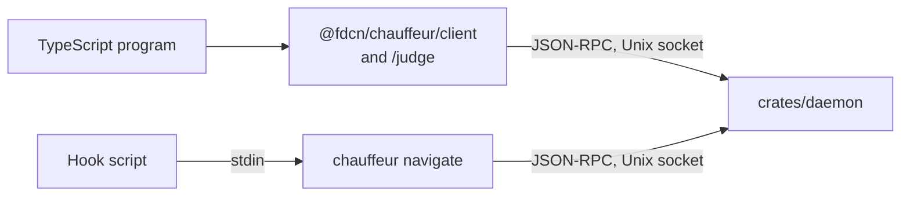

# Slice 2: sourcefed triage

**Status:** In progress: requests, intents and limits are built; admission,
the daemon's socket and rule sources, the bindings and sourcefed's side are
next.

**You can:** let sourcefed ask Chauffeur before it queues each event, so
OpenCode, Pi, MCP and the CLI receive the same filtered stream, as in
[sourcefed: one triage for every host](../pluggability.md#sourcefed-one-triage-for-every-host).
sourcefed's daemon navigates `sourcefed.event`, its installer adds
`sourcefed/triage` with the System One screen, and its OpenCode adapter's
`chauffeur.gate` call goes.

A caller sends an event or an inline strategy, with its evidence and a
deadline, and receives the events and the intents or verdict. It sends data,
never callbacks or code. This slice adds caller events, intents, the
integration and project rule sources, admission and cancellation, and the
bindings: the TypeScript client and `/judge`, and `chauffeur navigate`.



## Wire contract

A `chauffeur.navigate` request, `chauffeur.event` notifications, then the
result, as [JSON-RPC 2.0](../pluggability.md#json-rpc-2-0) lines. `chauffeur navigate` reads the request's
`params` on stdin and prints the messages it receives:

```sh
chauffeur navigate <<'EOF'
{ "protocol": 1, "deadline_ms": 3000, "on": "sourcefed.event",
  "evidence": { "event": "…", "thread": "…" } }
EOF
```

It prints one JSON-RPC message per line: `event` notifications as the run
goes, then the result. Their contents, in order:

```text
event   rule_matched  { "rule": "sourcefed/triage" }
event   round_ready   { "rule": "sourcefed/triage", "round": 1, "steps": ["screen"] }
event   step_settled  { "rule": "sourcefed/triage", "step": "screen",
                        "answer": { "outcome": "no", … } }
result  intents       [{ "rule": "sourcefed/triage", "withhold": "event" }]
```

A rejection is a JSON-RPC error whose `data.reason` names it: `invalid`,
`limit_exceeded`, `judge_unavailable`, `busy`, `deadline` or
`unsupported_protocol`.

A request with `strategy` in place of `on` ends with `{"verdict": {…}}`.
`$CHAUFFEUR_SOCKET` defaults to `chauffeur/daemon.sock` in the user's runtime
directory: `$XDG_RUNTIME_DIR`, or `$TMPDIR` on macOS.

- **Answers and failures** are distinct: a step settles to
  `{"answer": {"outcome", "p", "level", "model", "placeholder"}}` or
  `{"failed": "<reason>"}`. Probabilities and the level have at most three
  decimals, and `placeholder` marks a stand-in's answer.
- **Intents** carry the rule that produced them. A rule's intents are dropped
  if its strategy misses the deadline; other rules' intents still return.
- **Evidence** is named once per navigation and referenced by steps, so a
  batched provider call carries each block once.
- **Versioning:** `protocol` is required; the daemon answers
  `unsupported_protocol` with the versions it accepts, and each binding reports
  it as `unavailable`.
- **Limits**, checked before admission: 32 steps per strategy, counting each
  copy `for_each` makes; 16 `after` entries per step; 64 outcomes per
  question; 64 evidence blocks and candidates; 256 KiB of evidence; 30 s
  deadline. Each rejection names its limit. The `after` and `for_each`
  limits are checked with those fields, in slices 3 and 4.

## What it builds

### Requests, intents and limits

The `navigate` request and its intents, the limits above, and the one
`navigate` schema with the valid and invalid requests every binding's tests
replay.

Files: `crates/protocol/src/request.rs`, `intent.rs`, `limits.rs`,
`progress.rs`, `rule/strategy.rs`, `schema/navigate.json`,
`fixtures/navigate.json`

```json
{
  "jsonrpc": "2.0",
  "id": 1,
  "error": {
    "code": -32602,
    "message": "evidence is over 256 KiB",
    "data": { "reason": "limit_exceeded", "limit": "evidence_bytes", "max": 262144 }
  }
}
```

Structure:

`Navigate::parse` checks a request's `params` in order: the protocol first, so
a newer caller's fields read as `unsupported_protocol`, then the fields, the
limits, and an inline strategy. A request without `deadline_ms` gets
`DEFAULT_DEADLINE`, 3 seconds. An empty `on` is refused, and so is an inline
step naming evidence the request does not send. `event` is what rules match:
named by `on`, with each evidence block as a field, so a block named `event`
stays a field.

```rust
pub const PROTOCOLS: [u64; 1];
pub const DEFAULT_DEADLINE: Duration;

pub struct Navigate { … }

impl Navigate {
    pub fn parse(params: &Value) -> Result<Self, Rejection>;
    pub const fn deadline(&self) -> Duration;
    pub fn evidence(&self) -> &[(String, String)];
    pub fn candidates(&self) -> &[(String, String)];
    pub const fn target(&self) -> &Target;
    pub fn event(&self) -> Option<Event>;
}

impl Event {
    pub const fn new(name: String, fields: Map<String, Value>) -> Self;
}

pub enum Target {
    On(String),
    Strategy(Strategy),
}
```

A rejection is the JSON-RPC error a binding receives. `to_error` adds
`limit` and `max` for a limit, and `accepted` for a protocol. The code is
`-32602` for what the caller sent and `-32000` for what the daemon could
not serve.

```rust
pub enum Rejection {
    Invalid(String),
    LimitExceeded(Exceeded),
    UnsupportedProtocol,
    Busy,
    Deadline,
    JudgeUnavailable(String),
}

impl Rejection {
    pub const fn reason(&self) -> &'static str;
    pub fn to_error(&self) -> Value;
}

impl Display for Rejection {}
impl Error for Rejection {}
impl From<Exceeded> for Rejection {}
impl From<RuleError> for Rejection {}
```

Rule files are held to the same limits as requests: a strategy of 33 steps,
or an ask of 65 outcomes, used or not, is refused when it loads, as
`RuleError::Limit`; a blank step ID is `RuleError::BlankStep`.

```rust
pub enum Limit {
    Steps,
    Outcomes,
    EvidenceBlocks,
    Candidates,
    EvidenceBytes,
    Deadline,
}

impl Limit {
    pub const ALL: [Self; 6];
    pub const fn name(self) -> &'static str;
    pub const fn max(self) -> u64;
    pub const fn check(self, count: u64) -> Result<(), Exceeded>;
}

pub struct Exceeded {
    pub limit: Limit,
    pub count: u64,
}

impl Display for Exceeded {}
impl Error for Exceeded {}
```

A rule and an inline strategy share `Strategy`: the judges its steps name
and its steps as a core plan.

```rust
pub struct Strategy { … }

impl Strategy {
    pub const fn judges(&self) -> &BTreeMap<String, JudgeSpec>;
    pub const fn plan(&self) -> &Plan<Question>;
}

impl Rule {
    pub const fn strategy(&self) -> &Strategy;
}
```

An intent is one object on the wire, `rule` and the intent itself.
`from_json` refuses an object with no `rule` or more than one intent, and a
rule file may not name a `then` entry `rule`.

```rust
pub struct Intent { … }

impl Intent {
    pub fn new(rule: &str, then: &Then) -> Self;
    pub fn from_json(value: &Value) -> Option<Self>;
    pub fn to_json(&self) -> Value;
    pub fn rule(&self) -> &str;
    pub fn name(&self) -> &str;
    pub const fn payload(&self) -> &Value;
}
```

`progress` turns a run into what the caller sees: the `chauffeur.event`
params, without the request's `id`, and the verdict by step.

```rust
pub mod progress {
    pub fn rule_matched(rule: &str) -> Value;
    pub fn run_events(rule: Option<&str>, events: &[RunEvent<Answer>]) -> Vec<Value>;
    pub fn settled(outcome: &Outcome<Answer>) -> Value;
    pub fn verdict(verdict: &Verdict<Answer>) -> Value;
}
```

The fixtures are one file of cases, each with `params` and either
`"expect": "on"` or `"strategy"`, or a `reject` with its `reason` and
`limit`. A case with `fill` has `text` repeated `times` put in the named
block of its `evidence` or `candidates` before it is sent, so the file stays
small.

```json
{
  "name": "evidence over 256 KiB",
  "params": { "protocol": 1, "on": "sourcefed.event", "evidence": { "log": "" } },
  "fill": [{ "in": "evidence", "name": "log", "text": "€", "times": 87381 }],
  "reject": { "reason": "limit_exceeded", "limit": "evidence_bytes" }
}
```

Verified by:

- Round-trip and rejection cases for every limit and malformed field,
  including duplicate outcomes, reserved outcome names and a per-outcome
  confidence that misses an outcome: `crates/protocol/tests/navigate.rs`
  replays the 51 fixture cases and checks that every limit has one, at
  and over it, bytes counted as UTF-8 across evidence and candidates.

### Admission and running

One permit per navigation, held from admission through delivery, with
per-source and global capacity; a bounded worker pool; the deadline and
cancellation checked before each round; late results discarded.

Files: `crates/runtime/src/admission.rs`, `run.rs`

```rust
// Err(Busy) while the source's share is in use.
let permit = admission.admit(Source::Integration)?;

// The deadline and cancellation are checked before each round.
let ran = pool.run(navigation, deadline, &cancel);

deliver(ran); // a result after the deadline is discarded
drop(permit); // released once, after delivery
```

Verified by:

- Miri over deadline, cancellation, a late result, overflow and exhausted
  capacity, including audit A3's flood: 81 submissions with capacity 8 admit 8
  and reject 73 with `capacity`.
- Kani: a permit is released exactly once on every terminal path; the event
  log never exceeds its bound.

### The daemon's socket and rule sources

Several calls per connection, `$/cancelRequest`, and cancelling on close;
`--models FILE` for tests. The integration and project rule sources, refusing
System Two in a project rule the user has not allowed and any model or
placeholder entry from a project. Matching rules run concurrently.

Files: `crates/daemon/src/socket.rs`, `rules.rs`

```json
{ "jsonrpc": "2.0", "method": "$/cancelRequest", "params": { "id": 1 } }
```

```text
distribution/rules/                     shipped
~/.config/chauffeur/rules/sourcefed/    an integration's, installed by it
~/.config/chauffeur/rules/              the user's
.chauffeur/rules/                       a project's: no models, and
                                        System Two only where allowed
```

Verified by:

- Each of the four sources loads.
- A project rule naming System Two, and a model or placeholder entry in a
  project's `.chauffeur/`, are refused.
- Two matching rules both return their intents; a rule that misses the
  deadline drops only its own intents.

### The bindings

`chauffeur navigate` reads one request on stdin and prints the JSON-RPC
messages on stdout, exiting 0 with intents or a verdict, 1 when rejected and
2 when no daemon answers. `@fdcn/chauffeur/client` sends `navigate` over the
socket and closes on abort; `/judge` holds `ask`, `judge` and `noul`, with
results typed from their questions.

Files: `crates/cli/src/navigate.rs`, `packages/chauffeur/src/client/`,
`packages/chauffeur/src/judge/`

```ts
import { navigate } from "@fdcn/chauffeur/client"
import { ask, judge, noul } from "@fdcn/chauffeur/judge"

const { intents } = await navigate(
  { on: "sourcefed.event", evidence: { event, thread } },
  { signal: AbortSignal.timeout(3_000) }
)

const quick = judge({ tier: "system-one", confidence: 0.7 })
const done = await ask(noul("Is the migration finished?"), {
  judge: quick,
  evidence: { log }
})

if (done.ok && done.outcome === "yes") {
  /* "yes" | "no" | "unsure" */
}
```

Verified by:

- The client, `/judge` and `chauffeur navigate` accept and reject every
  fixture identically and return the same verdicts.
- Aborting any caller cancels the navigation; an unsupported protocol reports
  as `unavailable`.
- `ask`'s result types reject impossible outcomes at compile time.

### The navigate tab

The playground's _Navigate_ tab checks a request as the daemon does and runs
it against rule files, each step answered by a stand-in reply, so a rule's
triage can be tried in a browser with no daemon or model.

Files: `playground/wasm/src/navigate.rs`, `playground/src/features/navigate.ts`

```json
{
  "request": {
    "protocol": 1,
    "on": "sourcefed.event",
    "evidence": { "event": "thanks, looks good 👍" }
  },
  "rules": { "sourcefed/triage": { "on": "sourcefed.event", "…": "…" } },
  "answers": { "screen": { "yes": 0.06, "no": 0.94 } }
}
```

Structure:

`navigate` takes the request, rule files by ID and each step's reply by step
ID, and returns the events and the intents or verdict, the rejection a caller
gets, or an error for input it cannot read. A step with no reply fails as
`unavailable`, as with no model; a rule that does not load is listed in
`refused`. The protocol crate takes `chauffeur-judges` without its model
formats, so it builds for the browser.

```rust
#[wasm_bindgen]
pub fn navigate(input: &str) -> String;
```

Verified by:

- `playground/wasm/tests/navigate.rs`: noise withheld after the run's
  events; unsure, a failure and no reply give no intent; an inline verdict; a
  refused rule; a rejection over a limit.
- The tab in Chrome, from `vite preview` of the release build: each example
  shows its events, then withhold, no intent, a verdict, or the
  `unsupported_protocol` rejection.

### sourcefed

Its daemon navigates before queuing each event, its installer adds
`sourcefed/triage`, and its OpenCode adapter's `chauffeur.gate` call goes.

Files, in sourcefed: its daemon, its installer, `adapters/opencode/bridge.ts`

```ts
const chauffeur = connect() // kept for the daemon's lifetime

const { intents } = await chauffeur.navigate({
  on: "sourcefed.event",
  evidence: { event, thread, monitor }
})
if (!intents.some((intent) => intent.withhold === "event")) queue(target, event)
```

Verified by the end-to-end checks below.

## End to end

- sourcefed, for real: v1's 12 labelled events give the same deliveries;
  events reaching OpenCode, Pi and the CLI are filtered alike; with Chauffeur
  stopped, sourcefed delivers.
