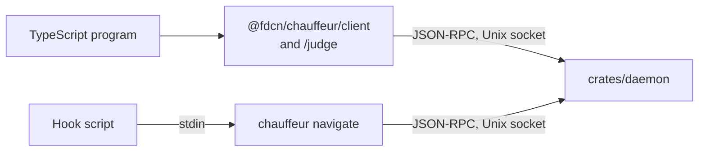

# Slice 2: sourcefed triage

**Status:** Planned.

**You can:** let sourcefed ask Chauffeur before it queues each event, so
OpenCode, Pi, MCP and the CLI receive the same filtered stream, as in
[sourcefed: one triage for every host](../pluggability.md#sourcefed-one-triage-for-every-host).
sourcefed's daemon navigates `sourcefed.event`, its installer adds
`sourcefed/triage` with the System One screen, and its OpenCode adapter's
`chauffeur.gate` call goes.

A caller sends an event or an inline strategy, with its evidence and a
deadline, and receives the events and the intents or verdict. It sends data,
never callbacks or code. This slice adds caller events, intents, the
integration and project rule sources, admission and cancellation, and the
bindings: the TypeScript client and `/judge`, and `chauffeur navigate`.



## Wire contract

A `navigate` request, `event` notifications, then the result, as
[JSON-RPC 2.0](../pluggability.md#json-rpc-2-0) lines. `chauffeur navigate` reads the request's
`params` on stdin and prints the messages it receives:

```sh
chauffeur navigate <<'EOF'
{"protocol": 1, "deadline_ms": 3000, "on": "sourcefed.event", "evidence": {"event": "…", "thread": "…"}}
EOF
# → {"jsonrpc": "2.0", "method": "event", "params": {"id": 1, "rule_matched": {"rule": "sourcefed/triage"}}}
# → {"jsonrpc": "2.0", "method": "event", "params": {"id": 1, "round_ready": {"rule": "sourcefed/triage", "round": 1, "steps": ["screen"]}}}
# → {"jsonrpc": "2.0", "method": "event", "params": {"id": 1, "step_settled": {"step": "screen", "answer": {"outcome": "no", "p": {"yes": 0.04, "no": 0.96}, "level": 0.96}}}}
# → {"jsonrpc": "2.0", "id": 1, "result": {"intents": [{"rule": "sourcefed/triage", "withhold": "event"}]}}
```

A rejection is a JSON-RPC error whose `data.reason` names it:
`limit_exceeded`, `judge_unavailable`, `busy`, `deadline` or
`unsupported_protocol`.

A request with `strategy` in place of `on` ends with `{"verdict": {…}}`.
`$CHAUFFEUR_SOCKET` defaults to `chauffeur/daemon.sock` in the user's runtime
directory: `$XDG_RUNTIME_DIR`, or `$TMPDIR` on macOS.

- **Answers and failures** are distinct: a step settles to
  `{"answer": {"outcome", "p", "level"}}` or `{"failed": "<reason>"}`.
  Probabilities have at most three decimals.
- **Intents** carry the rule that produced them. A rule's intents are dropped
  if its strategy misses the deadline; other rules' intents still return.
- **Evidence** is named once per navigation and referenced by steps, so a
  batched provider call carries each block once.
- **Versioning:** `protocol` is required; the daemon answers
  `unsupported_protocol` with the versions it accepts, and each binding reports
  it as `unavailable`.
- **Limits**, checked before admission: 32 steps per strategy, counting each
  copy `for_each` makes; 16 `after` entries per step; 64 outcomes per
  question; 64 evidence blocks and candidates; 256 KiB of evidence; 30 s
  deadline. Each rejection names its limit.

## Files

| Path                                                                                  | Contents                                                                                                                                                                                                                                                                                 |
| ------------------------------------------------------------------------------------- | ---------------------------------------------------------------------------------------------------------------------------------------------------------------------------------------------------------------------------------------------------------------------------------------- |
| `crates/protocol/src/{request,intent,limits}.rs`, `schema/navigate.json`, `fixtures/` | Requests, intents and limits; the one `navigate` schema, and the valid and invalid requests every binding's tests replay                                                                                                                                                                 |
| `crates/runtime/src/admission.rs`                                                     | One permit per navigation, held from admission through delivery; per-source and global capacity                                                                                                                                                                                          |
| `crates/runtime/src/run.rs`                                                           | A bounded worker pool; the deadline and cancellation checked before each round; late results discarded                                                                                                                                                                                   |
| `crates/daemon/src/{socket,rules}.rs`                                                 | Several calls per connection, `$/cancelRequest`, cancel on close, `--models FILE` for tests; the integration and project rule sources, refusing System Two in a project rule the user has not allowed and any model or placeholder entry from a project; matching rules run concurrently |
| `crates/cli/src/navigate.rs`                                                          | `chauffeur navigate`: one request on stdin, the JSON-RPC messages on stdout; exit 0 with intents or a verdict, 1 when rejected, 2 when the daemon is unavailable                                                                                                                         |
| `packages/chauffeur/src/{client,judge}/`                                              | `@fdcn/chauffeur/client` and `/judge`: `navigate` over the socket, closing on abort; `ask`, `judge`, `noul`, and results typed from their questions                                                                                                                                      |
| sourcefed: its daemon, installer and `adapters/opencode/bridge.ts`                    | `navigate` before queuing; installing `sourcefed/triage`; removing `chauffeur.gate`                                                                                                                                                                                                      |

## Verification

- Protocol: round-trip and rejection cases for every limit and malformed
  field, including duplicate outcomes, reserved outcome names and a
  per-outcome confidence that misses an outcome.
- Runtime under Miri: deadline, cancellation, late result, overflow, and
  exhausted capacity, including audit A3's flood: 81 submissions with capacity
  8 admit 8 and reject 73 with `capacity`.
- Kani: a permit is released exactly once on every terminal path; the event
  log never exceeds its bound.
- Rules: each of the four sources loads; a project rule naming System Two, and
  a model or placeholder entry in a project's `.chauffeur/`, are refused; two
  matching rules both return their intents; a rule that misses the deadline
  drops only its own intents.
- Bindings: the client, `/judge` and `chauffeur navigate` accept and reject
  every fixture identically and return the same verdicts; aborting any caller
  cancels the navigation; an unsupported protocol reports as `unavailable`;
  `ask`'s result types reject impossible outcomes at compile time.
- sourcefed, for real: v1's 12 labelled events give the same deliveries;
  events reaching OpenCode, Pi and the CLI are filtered alike; with Chauffeur
  stopped, sourcefed delivers.
