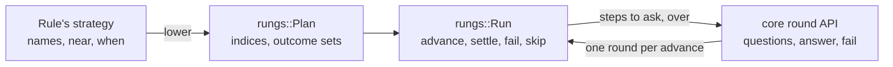

# Slice 3: Escalation from Jev to GLiDE

**Status:** Planned.

**You can:** have the commit nudge and `sourcefed/triage` ask GLiDE only when
Jev's answer is near the bar the rule acts on, or Jev fails, see each
strategy as a tree with `chauffeur strategy show`, and step through it in the
playground's Strategy tab. neo checks an iPhone screen through Chauffeur with its screenshot, and a
jev-distill student answers before Jev.

This slice adds strategies with more than one step: a step's `after` names
the earlier steps it waits for and the outcomes it needs. The step machine
underneath is [rungs](https://github.com/StevenJPx2/rungs/issues/1), shared
with atelier. It also adds image evidence, the `student` format, and a tier
that rests a failed model for 60 seconds before asking it again.

## What it builds

### `after` and rounds in core

A step's `after` names the earlier steps it waits for and the outcomes it
needs. Core validates a plan before any judge is asked, and drives it through
the round API: `questions`, `answer` and `fail`.



Core turns a plan's named steps into a `rungs::Plan` and keeps a `rungs::Run`
for each run. rungs decides which steps start, which are skipped and when the
run is over. Core keeps what rungs knows nothing about:

| Core keeps      | How                                                                                                                                                   |
| --------------- | ----------------------------------------------------------------------------------------------------------------------------------------------------- |
| Names           | Step IDs become indices; events and verdicts carry the names                                                                                          |
| `near`          | An answer settles as one outcome index: the answer times 2^k, plus which of the step's k `near` needs matched; each need lists the indices it accepts |
| `when`          | The listed outcomes, `failed` as `Outcome::FAILED`, join the need's outcome set                                                                       |
| The deadline    | With less than 500 ms left before the end, core skips every Pending step, so no escalation starts                                                     |
| Batches         | A reply is settled on a copy of the run, kept only when every step in it settles                                                                      |
| Failure reasons | `Failure::Timeout` and the rest stay in the events; rungs only records `FAILED`                                                                       |

A string need is `Need::settled`, an object need `Need::outcome`, and `all`
and `any` are a step's `after` and `after_any`. Every step has one attempt.

Files: `crates/core/src/plan/run.rs`, `crates/core/src/plan/near.rs`,
`crates/core/src/proofs.rs`, `crates/core/tests/scenarios.rs`, `deny.toml`

```toml
# crates/core/Cargo.toml
rungs = { git = "https://github.com/StevenJPx2/rungs", tag = "v0.1.0" }
```

```json
"strategy": [
  { "id": "fast", "judge": "jev", "ask": "nonconventional" },
  { "id": "sure", "judge": "glide", "ask": "nonconventional",
    "after": [{ "step": "fast", "near": 0.15, "when": ["failed"] }] }
]
```

A need with `near` matches when the step's P for an outcome the rule acts on,
in its `then` or a later need, lies within that margin of the outcome's bar.
The commit nudge acts on `yes` at 0.7, so Jev's `yes` at 0.8 goes to GLiDE,
and its `no` at 0.75, a P(yes) of 0.25, does not. `when` adds the outcomes
that also match, here a failure.

The steps share the caller's deadline and end 1 s before it, so the answers
in hand return in time; a step that escalates starts only with 500 ms left
before that.

```rust
let mut state = plan.start();

// Each round holds the steps whose needs are met.
while let Some(round) = state.questions() {
    // Or state.fail(step, Failure::Timeout).
    state = state.answer(ask_judges(&round))?;
}

let verdict = state.finish(); // "sure" is skipped when "fast" said yes or no
```

Verified by scenario tests:

- Escalation, with recorded answers at every tier: `near` asks GLiDE for
  Jev's P(yes) of 0.55 to 0.85 on a 0.7 bar and not for 0.25, and a failure
  listed in `when` asks it too.
- The deadline: the steps end 1 s before it, and an escalation with less
  than 500 ms left before that is not started.
- `after` alone: a string need waits for a skipped step and then runs; an
  object need never matches a skipped step; `Failed` matches only when listed;
  a step with both `all` and `any` runs only when both hold.
- Validation: an empty plan, more than 16 steps, a duplicate ID, `after`
  naming a later or unknown step, an empty `when` list, more `near` needs on
  one step than 126 outcomes hold, and a judge the panel lacks, each rejected
  before any judge is asked.
- The round API: a reply naming an unknown, unasked or repeated step, or
  missing one, returns the unchanged round; each judge answers its share of a
  round in one call; a batch of the wrong length settles as `Failed`.

rungs' own Kani proofs cover the `after` rule: a step waits until every step
it names has finished, starts exactly when its needs hold, is skipped only when
they cannot, and a run never stalls and starts every step within `depth()`
passes. Core's Kani harnesses cover what it adds, over at most three steps and
a small outcome enum:

- `a_near_need_matches_only_within_its_margin`: a `near` need matches exactly
  when a P the rule acts on lies within the margin of its bar, or the outcome
  is in `when`.
- `an_outcome_index_decodes_to_its_answer_and_near_matches`: encoding an
  answer and its `near` matches as one index, then decoding it, gives both
  back.
- `a_reply_settles_all_of_its_steps_or_none`: a rejected reply leaves the
  run unchanged.

### Lowering rules to plans

Named judges, asks and `after` in a rule file become a `chauffeur_core::Plan`.

Files: `crates/protocol/src/lower.rs`

```rust
// Named judges become core judges, such as "system-one:glide".
let plan = lower(&rule, &models)?;
```

Verified by:

- Kani: `strategy_show_bounds_every_lowered_plan`, a lowered plan has at most
  the rounds `strategy show` reports.

### SubQ, GLiDE and richer questions

`choice` with every outcome's probability, and GLiDE's level-valued `score`,
in the `systemone` format; SubQ and GLiDE shipped beside Jev.

Files: `crates/judges/src/tiers/system_one/`, `distribution/models/subq.json`,
`glide.json`

```json
{
  "outcomes": ["low", "medium", "high"],
  "evidence": ["prompt"],
  "instructions": "How hard is the user's request?"
}
```

```json
{
  "answer": {
    "outcome": "medium",
    "p": { "low": 0.12, "medium": 0.45, "high": 0.43 },
    "level": 1.31
  }
}
```

Verified by:

- `main`'s `judges/{subq,glide}/tests/wire.rs` replayed over loopback.
- Labelled scale questions through `choice` and `score` report which agrees
  with the labels more often.

### Image evidence

Evidence blocks are text or images. An image goes only to a format that
accepts images, and only when a step names it.

Files: `crates/judges/src/evidence/`

```json
{
  "on": "neo.screen-check",
  "evidence": {
    "screenshot": { "image": "iVBORw0KGgo…", "media_type": "image/png" },
    "ocr_text": "Pay ₹250 to Ravi",
    "question": "Is this the payment confirmation for ₹250 to Ravi?"
  }
}
```

Verified by:

- neo's screen check, with a recorded screenshot, reaches Jev with its opt-in
  and reaches no text-only format.

### The `student` format

jev-distill's students over its loopback server: the task's labels are the
outcomes, and evidence blocks fill its `state`.

Files: `crates/judges/src/tiers/system_one/student.rs`

```json
{
  "models": {
    "routing-student": {
      "format": "student",
      "endpoint": "http://127.0.0.1:8787",
      "task": "routing"
    }
  }
}
```

Verified by:

- A question whose outcomes differ from the task's labels fails as `invalid`
  with no call; a student's `unsure` hands the step to Jev.

### A rest for a failing model

A model that fails rests for 60 seconds, then is tried again.

Files: `crates/judges/src/tiers/fallback.rs`

```text
13:54:43  jev timed out        → subq answers; jev rests until 13:55:43
13:55:10  jev skipped          → subq answers
13:55:50  jev asked again      → jev answers
```

Verified by:

- A failing first model is skipped until its rest is over, then asked again.

### `chauffeur strategy`

`strategy list`: each loaded rule with its event, steps, and most rounds and
model calls. `strategy show <rule>` and `--file`: the tree, rounds, resolved
models, `after`, confidence, and the maximum rounds and model calls.

Files: `crates/cli/src/strategy.rs`

```text
$ chauffeur strategy show conventional-commits
conventional-commits  on tool.after
└─ fast    system-one:jev    confidence 0.7
   └─ sure system-one:glide  confidence 0.7   after fast is unsure or failed
at most 2 rounds · 2 model calls
```

Verified by:

- `"model": "glide"` without GLiDE configured shows the tier's fallback
  order.

### The playground

The Strategy tab steps through the same tree.

Files: `playground/src/features/strategy.ts`

Verified by:

- The tab steps through each shipped rule's tree in a real browser.

## End to end

- `"model": "glide"` without GLiDE configured runs on the tier's fallback
  order and reports it.
- The escalation runs live against Jev and GLiDE and agrees with `main`'s
  escalation near the bar, `CHAUFFEUR_JUDGE_ESCALATE=glide`, on the same
  cases, reporting answers, rounds, elapsed time and model calls.
