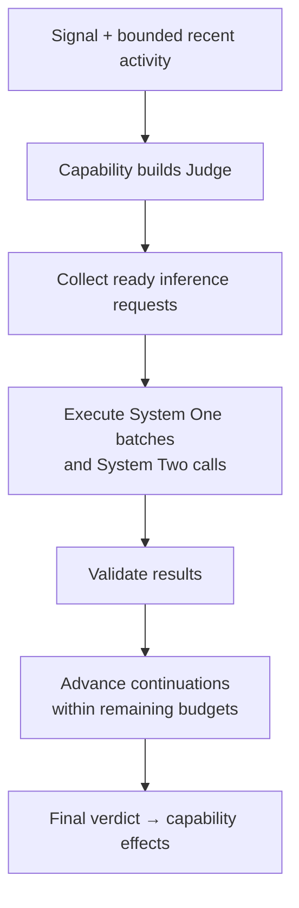
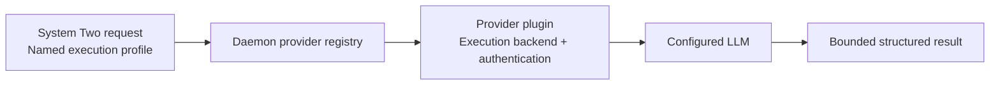

# System Two judgments

Status: implementation steps 1 to 5 are built. The daemon executes System Two
through profiles in `skills/config/judge.json`, records bounded attempt metadata,
and propagates host deadlines through its workers.
System Two ships off, and no capability asks it yet.

Chauffeur composes fast classification and LLM reasoning in the same `Judge<T>`
state machine. Capabilities define judgments, provider plugins execute inference,
and the daemon schedules work within the host's deadline.

## Judgment flow



Each continuation can finish, branch, or request another round. Independent
branches run side by side; dependent branches wait for their inputs.
Within a run, a round settles when every request has succeeded or failed.
Follow-up rounds contain only branches still asking.

### Provider execution



| Owner | Responsibility |
|---|---|
| `crates/core` | Inference contracts, judgment composition, validation and per-run state |
| `capabilities/*` | Questions, evidence selection, branching and interpretation of verdicts |
| `judges/jev`, `judges/subq`, `judges/http` | System One implementations and their shared transport |
| `plugins/anthropic`, `plugins/openai` | Provider metadata and optional LLM execution backends |
| `crates/daemon` | Provider registry, admission, execution workers, cancellation and persistence |
| `skills/config/` | Profiles, prompts, schemas, escalation conditions and budgets |
| `adapters/opencode` | Signals, host deadlines and effect application |

## Existing foundations

- `crates/core/src/judge/mod.rs` provides `done`, `ask`, `then`, `all` and `zip`.
- `crates/core/src/judge/strategy.rs` composes `single`, `fan_out` and `chain`.
- `Judging<C>` adapts a typed judgment to the capability interface.
- The engine batches ready System One questions across capabilities and permits
  two dependent rounds per signal.
- The provider plugins expose model tiers, exclusions and recommendations through
  the model-router's `Provider` trait. Routing metadata is independent of
  inference transport and credential management.
- The engine holds up to 64 runs in flight, keyed by `RunId`, through
  `start`, `resume` and `cancel`; `begin` and `finish` drive one run at a time.
- `crates/daemon/src/scheduler.rs` owns the engine on one thread and judges up
  to 8 signals at once, one per agent. Four System One workers, one reserved
  for permission requests, and two System Two workers make every judge call,
  so the engine thread never waits on one. Each signal settles through its
  failure posture within its host budget, capped at 14 seconds after arrival.

## Composition and inference contracts

The state machine waits on typed inference requests. Two request kinds express
the execution tier:

| Request | Input | Validated result |
|---|---|---|
| System One classification | State and existing typed questions | Probability, choice or score answers |
| System Two reasoning | Instructions, bounded evidence, output schema and profile | Structured verdict or an explicit failure |

`Judge::ask` classifies and `Judge::reason` adds reasoning steps. Both compose
through the same `then`, `all` and `zip` operations.

Illustrative usage; `screen`, `review_request` and the decoder belong to
the calling capability:

```rust
screen.then(move |candidate| match candidate {
    Some(candidate) => Judge::reason(review_request(candidate), decode_review),
    None => Judge::done(Review::NotNeeded),
})
```

Supported compositions:

- System One only.
- System Two directly.
- System One screening followed by System Two review.
- Fan-out containing either tier, followed by a typed aggregation step.

System One questions sharing execution settings remain batched within a signal.
Each System Two request is an independent call; the executor bounds their
concurrency. A reasoning call can review several candidates when its capability
explicitly constructs that request. Cross-signal batching is deferred.

Every request has a capability-local ID. The engine namespaces it and assigns a
run ID. Results identify the exact run, round and request.
Failures are delivered per request; one failed branch does not erase another
branch's successful result. Aggregation defines how those outcomes combine.

### Verdicts and evidence

- System One retains its probability and confidence semantics.
- System Two returns schema-constrained verdicts, such as `complete`, `continue`,
  `blocked` or `insufficient_evidence`, with bounded evidence references and an
  optional short explanation.
- The core supports a documented, validated JSON Schema subset: objects, arrays,
  strings, booleans, bounded numbers and enums. Unsupported schemas fail config
  validation. Provider-specific schema translation belongs to the plugin.
- Refusal, malformed output, truncation, unavailable execution and timeout are
  explicit outcomes. They are never converted into a confident verdict.
- Evidence references must resolve to supplied evidence IDs. Schema validation
  verifies structure and references; factual correctness requires evaluation.
- LLM-reported confidence does not enter System One threshold rules.

Evidence consists of the supplied signal, bounded Situation and explicitly
selected capability facts. Missing evidence yields an insufficient-evidence
verdict. System Two has no filesystem, network tools or agent session. Prompts
separate trusted instructions from untrusted evidence.

## Provider plugins

Each provider plugin can implement two independent interfaces:

- The existing model-router `Provider` interface for metadata.
- Core's `Backend` interface: one structured `Completion` (model, effort,
  instructions, input, JSON Schema, output limit, timeout) in, JSON or an
  explicit `ReasoningFailure` out, with reported model and token usage alongside
  either outcome. `Reasoned` remains the capability-facing verdict contract.

`plugins/openai` provides `codex::CodexBackend`, which calls the Codex
Responses endpoint with the ChatGPT login in `$CODEX_HOME/auth.json`, refreshing
the token and writing it back for the Codex CLI. The daemon's registry
(`crates/daemon/src/reasoning.rs`) keys backends as `provider/backend`, builds
each on a worker thread the first time a profile needs it, and renders the
profile's wording around the request. The model-router retains ownership of its tier policy;
execution contracts do not depend on the model-router crate. Metadata-only
plugins remain valid. No new provider-specific judge crate is required for each
LLM provider.

Execution profiles select an exact provider, model, backend and supported
reasoning settings. A model's router tier is a recommendation, not proof that
credentials or a compatible executor are available. Unsupported settings fail
profile validation.

The plugin's backend owns API or CLI authentication. Finding credentials never
enables inference automatically. OpenCode's authenticated provider catalog does
not itself supply a callable Chauffeur backend. Credentials remain outside JSON
profiles and inference/audit payloads.

## Scheduling and lifecycle

The daemon coordinator owns mutable engine state; bounded execution workers own
provider I/O. Waiting for inference releases the coordinator to process work
for other agents.

1. Admit a signal with an absolute monotonic deadline, including queue time.
2. Build an owned run containing its signal snapshot, continuations, trace
   and settled effects.
3. Dispatch ready requests while enforcing global, provider and per-run limits.
4. Resume the matching run when results arrive; finish or dispatch another round.
5. Commit the verdict and capability state, then reply with effects and persist.

Each run owns its signal, a snapshot of the agent's activity, its pending
requests, settled effects, learning probe and trace. Capabilities receive the
`RunId` in `start`, `resume` and `cancel` and keep anything they need between
rounds under it; `Judging<C>` holds one judge per run, and permission contracts
re-read the request. The engine accepts one run per agent and rejects results
for runs that settled or were cancelled.

A capability acts when its own judgment finishes, and the run returns its
effects once every capability has settled. A cancelled run returns no effects.
Learned safety patterns apply as soon as answers validate, since they judge the
command, not the run.

| Concern | Decision |
|---|---|
| Ordering | One active signal per agent; other agents progress independently |
| Priority | Permission work has reserved capacity; background reasoning cannot consume it |
| Supersession | Deferred: a new user request waits behind its agent's active run. Invalidating the older run's effects needs a host-visible cancellation signal |
| Cancellation | Caller disconnect, deadline and shutdown stop further provider calls for the run; active blocking calls finish on their workers and late results are discarded |
| Late completion | Run/attempt tokens reject late or duplicate results before state mutation |
| Effects | Accumulate until the signal settles; return once to the waiting host |
| Reload | Capability config activates between signals; worker profiles reload between calls |
| Restart | Persist committed session state; in-flight continuations are discarded and callers receive host failure behavior |

Effect delivery retains the current request/reply semantics. A host disconnect
can make delivery uncertain; no automatic replay of effects is added. Detached
background reviews and later host resumes are deferred.

### Budgets and host deadlines

Shipped defaults live in `skills/config/judge.json`, layered with
`~/.config/chauffeur/judge.json`. Each call snapshots its profile and rendered
wording. Invalid reloads retain the last valid configuration.

Execution limits:

| Limit | Default |
|---|---|
| Active signal runs | 8 |
| Concurrent System Two calls | 2, separate from reserved System One capacity |
| Dependent rounds | 2 |
| Provider attempts per signal | Planned: 8, counting both tiers and fallback attempts |
| System Two input / response size | 32 KiB / 64 KiB |
| System Two output tokens | 1,024 |
| System Two call timeout | 6 seconds per profile, capped by the run's remaining time |
| Minimum useful call time | 250 ms; shorter budgets yield `TimedOut` without a provider call |
| Reply reserve | 150 ms from a supplied host budget |

Input that exceeds its budget is rejected or reduced by explicit capability
evidence selection; the executor does not silently remove evidence.

The signal RPC accepts optional `deadline_ms`. The run receives the lesser of
the host budget minus the reply reserve and the daemon's 14-second limit; an
absent budget uses that limit. Queueing, schema setup, provider attempts and
dependent rounds share the deadline. Workers recheck it before provider I/O,
and expiry supplies failure outcomes through the capability's posture.

The OpenCode adapter sends its signal timeout: 2 seconds for permissions,
6 seconds for admission, 3 seconds for ordinary tool results and event gating,
8 seconds for tool recovery and explicit requests, and 20 seconds by default
for turn ends and rulebook commands. Additive signal fields are accepted by
the RPC parser. A client receiving an older daemon's explicit rejection of
`deadline_ms` retries the signal without that field.

## Escalation, failure and safety

- Capability compositions select direct reasoning or conditional escalation.
  Conditions and thresholds live in their owner's JSON configuration.
- Transport fallback is a separate, explicitly configured provider policy.
  Valid uncertainty triggers escalation only when the composition requests it.
- The first cut makes one attempt per System Two request. It has no automatic
  repair call, retry loop or cross-provider fallback.
- Failure follows the capability's conservative outcome. A failed completion
  review cannot declare a goal complete; a failed permission review asks the user.
- The safety backstop runs before inference and remains authoritative.
- State, evidence, instructions, schemas containing text and derived verdicts
  pass through local redaction before egress or audit storage. Chained requests
  are redacted again before dispatch.
- Audit records contain bounded verdicts and explanations, never private
  reasoning traces or credentials. Error bodies are sanitized and bounded.

## Configuration and observability

System Two ships disabled, with no active execution profile. Enabling it requires
an explicit provider/backend/model selection and an opt-in capability route.
Existing System One environment selection remains supported.

Each reasoning in the run's trace records its round, capability-namespaced
request ID, profile, clipped instructions, evidence IDs and validated verdict
or failure. Execution metadata adds provider, backend, requested model,
reported model, input/output token counts when supplied, and latency in
milliseconds. A started attempt's execution settings and elapsed latency remain
available when the scheduler settles it as timed out. Settings are absent when
no worker resolved a profile; unreported usage stays absent.

`audit.jsonl` serializes that trace through the existing redactor. Provider
metadata survives malformed verdicts and refusals. Explanations remain optional
and short; private reasoning and credentials are excluded. Queue-delay metrics,
configuration generations and standalone cancellation records are deferred.

## Implementation sequence

1. **Core requests and composition:** extend `crates/core/src/contracts/` and
   `crates/core/src/judge/`; preserve classification call sites and add typed
   reasoning outcomes. Test mixed-tier fan-out, branching and partial failure
   with fake executors.
2. **Owned execution state:** refactor `crates/core/src/engine.rs` and
   `judge/judged.rs` around run-owned continuations. Preserve permission
   contracts, learning probes, effect ordering and existing regression tests.
3. **Coordinator and workers:** update `crates/daemon/src/engine.rs`; add bounded
   dispatch, per-agent ordering, deadline propagation and cancellation. Use fake
   slow providers to prove isolation before connecting live models.
4. **Provider execution:** add the core executor interface and daemon registry;
   extend the selected plugin in `plugins/anthropic` or `plugins/openai` with one
   backend. Verify its official authentication, structured-output and cancellation
   contracts before implementation.
5. **Audit and deadlines — built:** core traces and daemon audit retain execution
   metadata on verdicts and failures. Core RPC/client and OpenCode propagate
   optional host budgets; workers cap call timeouts and skip unusable budgets.
6. **First integration:** add an opt-in rulebook completion review in
   `capabilities/rules`, with its wording and schema in owner config. Run direct
   System Two and System One → System Two variants against labeled cases before
   enabling either in a live rulebook. The screened variant uses one classification
   round and one reasoning round. Open todos keep their deterministic completion
   veto; uncertain or failed reviews cannot complete the rulebook, and existing
   pause/continuation priorities remain authoritative.
7. **Evaluation and documentation:** extend `bench/src/judges/` for mixed-tier
   trajectories and human-labeled verdicts. Update `docs/judges.md`,
   `docs/plans/judge.md` and `ARCHITECTURE.md` when the implementation lands.

## Verification and rollout

- Preserve existing System One effects and batching with System Two disabled.
- Validate schema failures, unresolved evidence references, refusals, truncated
  responses and unavailable profiles.
- Use deterministic clocks and fake providers to test deadlines, queue saturation,
  reserved capacity, hot reload, restart and cancellation during inference.
- Prove a slow reasoning call cannot block another agent's permission request.
- Reject late/duplicate results and prevent effects or capability-state updates
  from superseded runs. Test both arrival orders around cancellation.
- Exercise CLI process termination and clean temporary state if a CLI backend is
  selected; exercise HTTP cancellation and response bounds for an API backend.
- Measure false completion, missed completion, escalation rate, p50/p95 end-to-end
  latency, token usage and deadline misses against independently labeled cases.
- Use model agreement as a diagnostic. Jev output is not training data; evaluation
  labels come from human review.
- Start with offline replay, then isolated live rulebooks. Permission automation
  and default-enabled reasoning require separate outcome evidence and approval.

## Open decisions

| Decision | Recommended starting point |
|---|---|
| Cancelling an in-flight call | The blocking client cannot abort a call its run abandoned; the worker finishes it and the result is dropped. Move backends to an async or cancellable client if abandoned calls hold workers in practice |
| State of a cancelled run's finished branches | A settled capability keeps the state it acted on. The daemon restores a snapshot for abandoned model-error replies; defer every `act` to run settlement once concurrent dispatch shows stale state elsewhere |

Multi-provider ensembles, autonomous tool use, images, durable background reviews
and new effect types are deferred.
