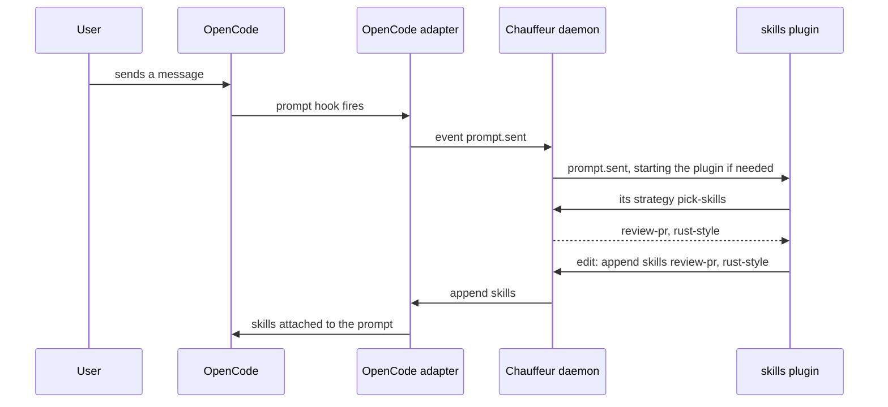

# Plugins

A plugin is a long-running TypeScript program that hooks events, asks
Chauffeur's judges questions, and acts on the harness. The daemon starts it,
passes it the events it hooks, and carries its actions to the adapter. A
plugin is harness-agnostic: it works in every harness whose adapter supports
the actions it uses. [Writing a plugin](writing.md) shows how to build one.

Rule files and plugins split the work:

| Use         | When the behaviour                                                                   | Example                                    |
| ----------- | ------------------------------------------------------------------------------------ | ------------------------------------------ |
| A rule file | Is a decision: an event, a filter, questions and what to return                      | `conventional-commits`, `sourcefed/triage` |
| A plugin    | Keeps state, acts over time, registers tools or commands, or computes its candidates | `skills`, `warming`, `model-router`        |

## How a message reaches a plugin



## First-party plugins

| Plugin                                  | Does                                                                            | Slice |
| --------------------------------------- | ------------------------------------------------------------------------------- | ----- |
| [`guard`](guard.md)                     | Blocks irreversible commands, asks before risky ones, learns what it blocked    | 5     |
| [`monitors`](monitors.md)               | Starts sourcefed monitors for the session's own PRs, issues and threads         | 5     |
| [`skills`](skills.md)                   | Attaches the skills a message needs, and a better one when the agent drifts     | 6     |
| [`tools`](tools.md)                     | Hides the tools a task will not use, and points at the Code Mode tools it needs | 6     |
| [`ask-chauffeur`](ask-chauffeur.md)     | The `ask_chauffeur` tool, for asking for a tool or skill in plain words         | 6     |
| [`context-renewal`](context-renewal.md) | Summarizes a long, cold session with a cheaper model before the next prompt     | 7     |
| [`warming`](warming.md)                 | Keeps an idle session's prompt cache warm while that is cheaper                 | 7     |
| [`model-router`](model-router.md)       | Moves the agent to another provider on a usage limit, and back                  | 7     |
| [`rulebooks`](rulebooks.md)             | `/goal` and other books of rules switched on for one session                    | 12    |

## Using a plugin

Plugins are listed in `~/.config/chauffeur/plugins.json`, keyed by ID. The
shipped list turns the first-party plugins on; the user's file adds plugins,
sets options, and turns any off:

```jsonc
// ~/.config/chauffeur/plugins.json
{
  "skills": { "options": { "attach": { "top": 3 } } },
  "warming": { "enabled": false },
  "notes": { "path": "~/code/chauffeur-notes" }
}
```

- A first-party plugin needs no `path`; a user's plugin names its folder.
- Options merge over the plugin's defaults, key by key.
- Edits apply without a restart.
- A project's `.chauffeur/` can never add a plugin: plugins run code.
