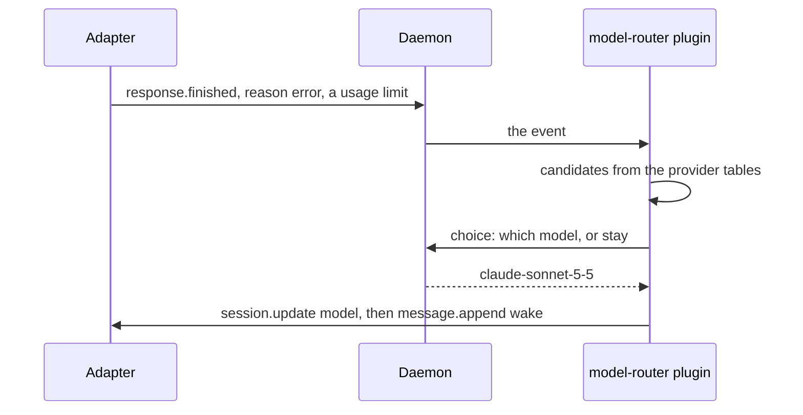

# `model-router`

Keeps the agent on a model that can serve it. On a usage limit it moves to
the same tier on another provider the user pays for directly, and moves back
once the limit has likely cleared. Slice 7.



| Hook                                             | Does                                                                                              |
| ------------------------------------------------ | ------------------------------------------------------------------------------------------------- |
| `ctx.on("response.finished")`, `reason: "error"` | On a usage limit, picks a model and switches                                                      |
| `ctx.before("prompt.sent")`                      | At least 5 minutes after a switch, asks whether the original limit has cleared, and switches back |

- **A limit** is HTTP 402, 429, 503 or 529, a limit error type, or limit
  wording such as "credit balance". A lasting one, such as an exhausted
  quota, never offers `stay`.
- **Candidates,** at most 8: pins, recommended models, the same tier on
  providers used directly, any tier there, then `last_resort`. Never a
  blacklisted model, nor any model of a provider that hit a limit. A model
  that cannot serve (401, 403, 404) rules out only itself.
- **No switch** when a tool already ran in the failed step.
- **The pick** is one `choice` naming the error, `stay` among the outcomes
  once per model. Below 0.2, or on a failure, the first candidate wins.
- **Switching back** is one yes/no at 0.7: "has the original limit most
  likely cleared?". A model the user picks clears the origin.

The tier tables are `distribution/providers/<provider>.json`; the user's file
of the same name replaces a table's `tiers`. There are four tiers: frontier
(Claude Fable, GPT-6 Astra), balanced (Claude Opus and GPT-6.1 Sol at high),
efficient (Opus at low, GPT-6.1 Terra) and fast. A table recommends at most
one model per tier, and one that recommends two fails to load, so a failover
with no confident pick goes to the other provider's model of the same tier. The models left behind and the
providers that hit limits are kept in the plugin's storage.

## Commands

```sh
# Sessions moved off a model, and providers at a limit.
chauffeur model-router status

# Treat a provider's limit as cleared.
chauffeur model-router forget anthropic
```

```text
$ chauffeur model-router status
SESSION   FROM                               NOW                    SINCE
ses_42    anthropic/claude-opus-5-5#high     openai/gpt-6.1-sol#high 13:58
LIMITED   anthropic (usage limit, lasting)
```

## Options

```jsonc
{
  "model-router": {
    "options": {
      "pins": [],
      "blacklist": ["opencode-go/*"],
      "last_resort": ["opencode/*-free"],
      "pick_confidence": 0.2,
      "max_candidates": 8,
      "switch_back": { "after_seconds": 300, "confidence": 0.7 },
      "limit": { "messages": ["credit balance", "…"], "types": ["rate_limit", "…"] },
      "lasting": {
        "messages": ["usage limit", "…"],
        "types": ["quota_exceeded", "…"]
      }
    }
  }
}
```

The plugin needs `response.finished` with the error's status, type and
message, and `session.update` for the model with its thinking variant:
OpenCode, Pi and Claude Code's mod have it; Claude Code's hook command and
Codex do not, so there it does nothing.
