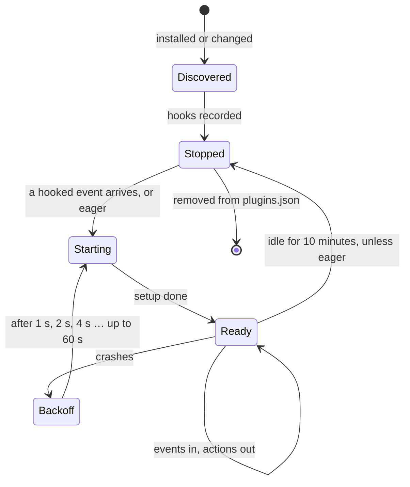

# Writing a plugin

A plugin is a folder with a `package.json` and one module whose default
export is `Plugin.define(...)`. It runs from source on Bun, so nothing is
built first.

```text
chauffeur-notes/
├── package.json
└── index.ts
```

```json
{
  "name": "chauffeur-notes",
  "type": "module",
  "main": "index.ts",
  "dependencies": { "@fdcn/chauffeur": "1.0.0" },
  "chauffeur": { "eager": false }
}
```

```ts
// index.ts
import { Plugin } from "@fdcn/chauffeur/plugin"
import { ask, judge, noul } from "@fdcn/chauffeur/judge"
import { message } from "@fdcn/chauffeur/harness"

const quick = judge({ tier: "system-one", confidence: 0.7 })

export default Plugin.define({
  id: "notes",
  setup(ctx) {
    ctx.on("response.finished", async (e) => {
      const decided = await ask(
        noul("Did the user and the agent settle a decision worth noting?"),
        {
          judge: quick,
          evidence: { summary: e.summary, request: e.request }
        }
      )
      if (decided.ok && decided.outcome === "yes")
        message.append(e.session, [{ text: "Add the decision to NOTES.md." }], {
          delivery: "next"
        })
    })
  }
})
```

Register it under the same ID in `~/.config/chauffeur/plugins.json`:

```json
{ "notes": { "path": "~/code/chauffeur-notes" } }
```

## Acting on an answer

An answer can drive the agent, or the plugin can act on it itself. A plugin
is an ordinary Bun program with the user's access, so it can write files,
call APIs, run commands or start longer work; harness actions are one kind
of effect among several. The same plugin, writing the note itself:

```ts
import { appendFile } from "node:fs/promises"
import { join } from "node:path"

ctx.on("response.finished", async (e) => {
  const decided = await ask(
    noul("Did the user and the agent settle a decision worth noting?"),
    {
      judge: quick,
      evidence: { summary: e.summary, request: e.request }
    }
  )
  if (decided.ok && decided.outcome === "yes")
    await appendFile(join(e.workspace, "NOTES.md"), "- " + e.summary + "\n")
})
```

| Effect              | Through                          | Example                                                                        |
| ------------------- | -------------------------------- | ------------------------------------------------------------------------------ |
| Steer the agent     | `message.append`                 | Ask the agent to update `NOTES.md`                                             |
| Change the harness  | `session.*`, the registries      | Compact a session, switch its model, register a tool                           |
| Act directly        | The plugin's own code            | Write `NOTES.md`, file an issue, post to Slack, run a build, index the session |
| Tell other programs | Its own events, `navigate`, HTTP | Send `notes.saved`, which rules and other plugins can hook                     |

- **Inside `ctx.before`,** return within the budget, and start longer work
  without awaiting it.
- **Work that outlives the event,** such as a timer or a watch, needs
  `"eager": true`: a lazy plugin stops after 10 idle minutes.
- **The plugin bounds its own work:** its queues, retries and timeouts. The
  daemon bounds only the events queued for it.

## The SDK

One package, `@fdcn/chauffeur`, with subpath exports so bundlers keep only
what is imported:

| Import                    | Holds                                                                                                         |
| ------------------------- | ------------------------------------------------------------------------------------------------------------- |
| `@fdcn/chauffeur/plugin`  | `Plugin.define({ id, defaults, setup(ctx) })`; `ctx` holds `on`, `before`, `command`, `options` and `storage` |
| `@fdcn/chauffeur/judge`   | `ask`, `judge`, `strategy`, and the question functions `question`, `noul`, `choice`, `score`                  |
| `@fdcn/chauffeur/harness` | Actions: `session`, `message`, `permission`, and the registries                                               |
| `@fdcn/chauffeur/client`  | `navigate(request)`, and `connect()` for a program that makes many calls                                      |

`ctx` holds what is tied to the plugin's lifetime. Everything else is a
function to import, and `/judge` works the same from any program.

## Hooks

| Hook                                                | Holds the harness                             | Can                          |
| --------------------------------------------------- | --------------------------------------------- | ---------------------------- |
| `ctx.on(event, handler)`                            | Never: the event goes ahead at once           | Call any action, any time    |
| `ctx.before(event, handler, { budget, onTimeout })` | Until the handler returns or `budget` ms pass | Edit what is about to happen |

`before` exists for the points where acting late is acting too late:

| Event              | A `before` handler can                    | `onTimeout`               |
| ------------------ | ----------------------------------------- | ------------------------- |
| `prompt.sent`      | Append parts, edit the text, block it     | `allow`                   |
| `tool.before`      | Block it, ask the user, rewrite its input | `ask`, `block` or `allow` |
| `permission.asked` | Reply, or ask the user                    | `ask`                     |

`ask` hands the decision to the user, so a slow or failed judge never lets an
action through silently. A harness denial always wins over a plugin.

Events are the harness package's, such as `tool.after` and `session.idle`,
and callers' own, such as `sourcefed.event`. A plugin's own events carry its
ID before a dot, `notes.saved` here; the daemon refuses any other name from
it. See [Events](../plans/pluggability.md#events).

## Actions

Actions are named by resource and verb, such as `message.append` with a
delivery of `now`, `next` or `wake`, or `session.compact`. A plugin can check
the harness package's fidelity table before relying on one; an action a
harness cannot carry out returns `unsupported`.

| Kind of action | Examples                                                | If it fails or arrives stale                                                                    |
| -------------- | ------------------------------------------------------- | ----------------------------------------------------------------------------------------------- |
| Sets state     | `session.update`, registry `add`, `update` and `remove` | Retried with backoff; the last write wins                                                       |
| One-shot       | `session.compact`, `session.interrupt`                  | Retried once if the adapter was unreachable; dropped if stale                                   |
| Append         | `message.append`                                        | Delivered `next` when the plugin set `late: "next"`; otherwise dropped once its turn has passed |
| Guard decision | Block, ask the user                                     | Never retried; on timeout, `onTimeout` applies                                                  |

Each action carries the session `revision` it applies to, and the adapter
checks it against the harness before carrying it out, so a stale action never
lands on a newer state.

## Asking questions

`ask` sends one question and returns a result typed from it:

```ts
type Result<O extends string> =
  | { ok: true; outcome: O | "unsure"; p: Record<O, number>; level: number }
  | {
      ok: false
      failed: "unavailable" | "rate_limited" | "timeout" | "invalid" | "deadline"
    }
```

```ts
import { ask, choice, judge, noul, score } from "@fdcn/chauffeur/judge"

const quick = judge({ tier: "system-one", model: "jev", confidence: 0.7 })

const commit = await ask(
  noul("Does this commit message break Conventional Commits?"),
  { judge: quick, evidence }
)
if (commit.ok && commit.outcome === "yes") {
  /* "yes" | "no" | "unsure" */
}

const next = await ask(
  choice(
    ["act", "ignore", "ask-user"],
    "What should the agent do with this message?"
  ),
  { judge: quick, evidence }
)
const effort = await ask(
  score(["low", "medium", "high"], "How hard is the user's request?"),
  { judge: quick, evidence }
)
if (effort.ok && effort.level >= 1) {
  /* medium or higher */
}
```

`strategy([...]).run` runs several steps, with `after`, `forEach` and facts,
and returns the last step's result; the [skills plugin](skills.md) uses one.
`ask` and `strategy` send inline strategies through `navigate`, so limits,
confidence, model fallback, redaction and keys stay in the engine. A plugin
never holds a model key.

A question function returns `{ wire, read }`: the generic question, and a
reader that types the reply. `question` is the primitive the others use, so
a plugin defines a new kind of question without any change to the engine. An
outcome outside the list fails as `invalid` at run time, and a comparison
with an impossible outcome fails to compile.

## Commands

`ctx.command` adds a command to the `chauffeur` binary, under the plugin's ID:

```ts
ctx.command(
  "list",
  { description: "List the decisions noted so far", options: { since: "string" } },
  async (args) => readNotes(ctx.storage, args.since) // printed as JSON
)
```

```sh
chauffeur notes list --since 2026-11-01
```

- **Recorded at discovery,** with the hooks, so `chauffeur --help` lists a
  plugin's commands while the daemon runs, even when the plugin is stopped.
- **Run in the plugin.** The binary sends the command to the daemon, which
  starts the plugin if needed; the handler's result is printed, and a thrown
  error exits 1 with its message.
- **Named by the plugin's ID.** A plugin whose ID is a built-in command, such
  as `daemon` or `audit`, is refused at discovery.

These are commands for the person at a terminal. A slash command inside the
harness, such as `/goal`, is the harness's `command` registry.

## Tools

`tool.add` gives the agent a tool, through the harness's tool registry:

```ts
import { tool } from "@fdcn/chauffeur/harness"

tool.add({
  name: "notes_find",
  description: "Find the decisions noted about a topic.",
  input: { topic: "string" },
  run: async (input, e) => findNotes(ctx.storage, input.topic)
})
```

The reply is what `run` returns, as text or JSON. [Tools](../tools/README.md)
shows how agents call them.

## Options and storage

- **`ctx.options`** is the plugin's `options` from `plugins.json`, merged over
  the defaults it declares in `Plugin.define({ defaults })`.
- **`ctx.storage`** is the plugin's own folder,
  `~/.local/state/chauffeur/plugins/<id>/`, for what it remembers across
  restarts, such as the guard's learned list. Nothing else writes there.

## Lifecycle



- **Discovery.** When a plugin is installed or its files change, the daemon
  runs its `setup` once in discovery mode: `ctx.on` and `ctx.before` only
  record the hooks, and the plugin stops. The hooks are cached against the
  plugin's file hash, so `setup` registers hooks before doing anything with
  side effects.
- **Lazy by default.** The first event the plugin hooks starts it, and events
  queue until it is ready. An idle plugin stops after 10 minutes.
- **Eager.** `"chauffeur": { "eager": true }` in `package.json` starts it with
  the daemon and keeps it running, for plugins with timers or their own
  connections.
- **Transport.** The daemon starts each plugin as a child process and speaks
  JSON-RPC 2.0 over its stdin and stdout, so a plugin never outlives the
  daemon.
- **Hot reload.** When its files change, the daemon reruns discovery and
  restarts it; its next event reaches the new code.
- **Isolation.** A crash affects only that plugin. A slow plugin's `on`
  events queue to a bound; overflow drops the oldest and says so in an event.

## Trying it

1. Point the System One tier at a placeholder in `~/.config/chauffeur/models.json`,
   so the plugin's questions get fixed answers without a key.
2. Send it an event: `chauffeur emit < turn-finished.json`.
3. Read what it asked, what the judge answered and what it did:
   `chauffeur audit`.
