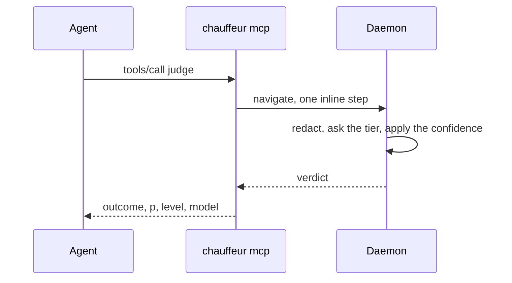

# The `chauffeur` MCP server

`chauffeur mcp` serves Chauffeur's tools over the MCP stdio transport, so an
agent in any MCP client can call them. It talks to the running daemon; with
none, each call replies `{ "failed": "unavailable" }`.

It serves:

- [`judge`](judge.md);
- every tool a plugin registers with `tool.add({ …, mcp: true })`, for tools
  that work outside a harness session. `ask_chauffeur` needs one, since it
  reveals the session's hidden tools, so it stays with the adapter.

## Adding it

OpenCode:

```sh
opencode mcp add chauffeur --global -- chauffeur mcp
```

Claude Code:

```sh
claude mcp add chauffeur -- chauffeur mcp
```

Codex, in `~/.codex/config.toml`:

```toml
[mcp_servers.chauffeur]
command = "chauffeur"
args = ["mcp"]
```

A release candidate is `chauffeur-next mcp`, which talks to its own daemon.

## What a call becomes



Each call is one navigation from the caller `mcp`, within `navigate`'s limits
and a 30-second deadline, and it is written to the audit log like any other
run.
