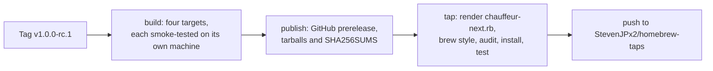

# Scripts

Packaging and the Homebrew formula, with no dependencies beyond Node.

| File               | Holds                                                                                                                                                              |
| ------------------ | ------------------------------------------------------------------------------------------------------------------------------------------------------------------ |
| `package.mjs`      | The workspace's version; one tarball per target with `bin/chauffeur` and `share/chauffeur/` (`distribution/` and the license); `SHA256SUMS`                        |
| `homebrew.mjs`     | Renders `Formula/chauffeur-next.rb` from a release candidate's `SHA256SUMS`                                                                                        |
| `smoke.mjs`        | Installs a tarball as `chauffeur` and as `chauffeur-next`, then runs each: `version`, the daemon, the shipped rule, a nudge through `emit`, and the run in `audit` |
| `release.test.mjs` | `node --test scripts/*.test.mjs`: tarball layout, checksums, the formula's URLs, checksums and names                                                               |

## Cutting a release candidate

1. Set `version` in the root `Cargo.toml` to the candidate, such as
   `1.0.0-rc.1`, and commit it on `v2`.
2. Tag and push: `git tag v1.0.0-rc.1 && git push origin v1.0.0-rc.1`.

`.github/workflows/release.yml` does the rest:



| Target         | Runner             | Rust target                  |
| -------------- | ------------------ | ---------------------------- |
| `darwin-arm64` | `macos-latest`     | `aarch64-apple-darwin`       |
| `darwin-x64`   | `macos-15-intel`   | `x86_64-apple-darwin`        |
| `linux-arm64`  | `ubuntu-24.04-arm` | `aarch64-unknown-linux-musl` |
| `linux-x64`    | `ubuntu-latest`    | `x86_64-unknown-linux-musl`  |

- The build stops if the tag is not `v` and the workspace's version.
- The tap job runs in the `release` environment, which only `v*-rc.*` tags
  may use and which waits for your approval. Its `TAP_DEPLOY_KEY` is an SSH
  deploy key that can write to `StevenJPx2/homebrew-taps` and nothing else.
  Without it, the prerelease is still published and the tap is unchanged.
- The formula and its binary are both `chauffeur-next`: Homebrew's `@`
  names take only version numbers, and the binary's name chooses its socket,
  configuration and `share/` folder.

## Trying the formula locally

`homebrew.mjs` takes a download location as a third argument, so a formula
can install from local tarballs:

```sh
node scripts/homebrew.mjs 1.0.0-rc.1 dist/SHA256SUMS file://$PWD/dist > Formula/chauffeur-next.rb
```

Put it in a local tap, then `brew trust`, `style`, `audit --strict`,
`install` and `test` it as the release job does.
